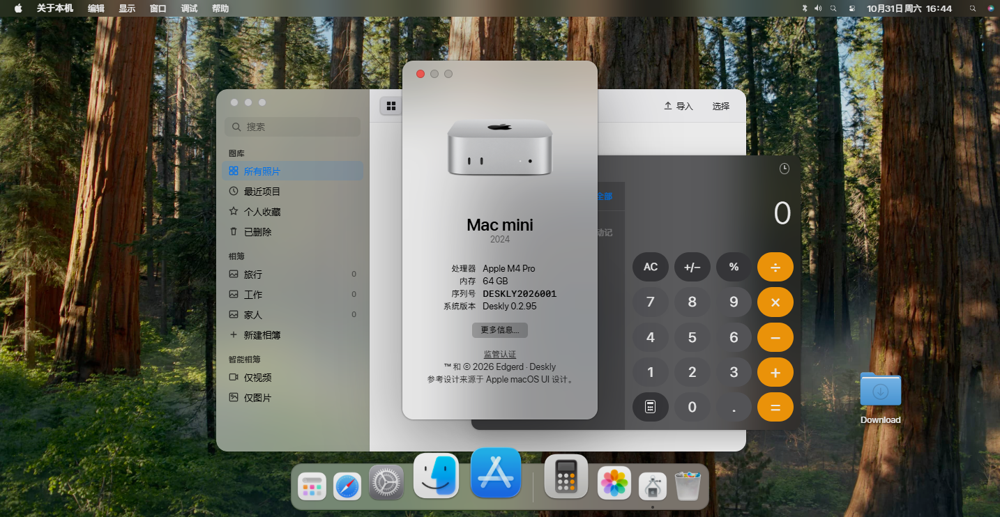

# Deskly

[](https://github.com/Edgerd/Deskly)
[](https://github.com/Edgerd/Deskly/issues)
[](https://space.bilibili.com/3537111380658360/dynamic)
[](https://ifdian.net/a/edgerd)

> 把浏览器新标签页变成 macOS Sequoia 风格桌面的 Chromium 扩展。
> 程序坞、顶部菜单栏、窗口管理器、访达、计算器、系统设置、应用商店、聚焦搜索……全部以「插件」形式运行在同一份宿主文档里。


---

## 关于

### 项目说明

- 本项目 **除底座外大量 Vibe**
- **有大量人工测试与人工审查**：每轮功能都由人工在真实浏览器里逐项点过并进行错误修复，并配合脚本做机器校验；代码也经过人工逐段审查。
- **主要使用这些模型编写**：DeepSeek-V4.1-Flash、DeepSeek-V4-Flash、Qwen-3.7-Flash。
- **插件仍处于早期开发阶段**：可能有较多奇奇怪怪的bug 欢迎进行测试和提 issue。

### 版本说明

本项目是我个人项目的 **Vibe 二次重构**产物。早期开发项目过于混乱、**仅做了本地版本控制**。重构之后才第一次把完整代码收进 Git，所以：

- `v0.3.0` 是本仓库的**第一个正式发行版**，也是版本历史的起点；
- 它之前的内部版本（0.2.93 及更早）只存在于文档与本地备份，没有提交记录；
- 之后每次发版都会在 [Releases](https://github.com/Edgerd/Deskly/releases) 里给出简介与更新日志。

## 效果展示



访达、关于本机与计算器窗口；顶部菜单栏、程序坞、桌面图标与壁纸均为插件化实现。

## 安装（开发者模式加载）

1. Chrome / Edge 打开 `chrome://extensions`（Edge 为 `edge://extensions`），开启「开发者模式」。
2. 点击「加载已解压的扩展程序」，选择**本仓库根目录**（含 `manifest.json` 的那一层）。
3. 新开一个标签页，即为 Deskly 桌面。

> 扩展需要 `bookmarks` 权限（用于访达的收藏夹）与 Bing / 图床域名的主机权限（壁纸与搜索）。

## 目录结构

```
index.html              新标签页入口
manifest.json           MV3 清单
sw.js                   后台 service worker
Logo.png                扩展图标
assets/                 样式、图标、字体、图片、声音、多语言、第三方库
src/javascripts/        插件内核
mods/                   内置插件
dev/                    开发文档与自检脚本
docs/                   设计对照、代码审查、产品更新信息与知识库
```


## 许可

本项目基于 [GNU General Public License v3.0](LICENSE)（GPL-3.0）开源：可自由使用、修改、分发，但衍生作品须同样以 GPL-3.0 开源并提供源码。Copyright (c) 2026 Edgerd。
