# 第 1 章 · iMac 概述与配件

> 来源：苹果《iMac 使用手册》2024 年款 · macOS Sequoia 15 · 欢迎使用 / 浏览 iMac / 包装清单 / 将配件连接到 iMac / 妙控键盘 / 妙控鼠标 / 妙控板 / 给配件充电 / 转换器 / 连接显示器

## 欢迎使用

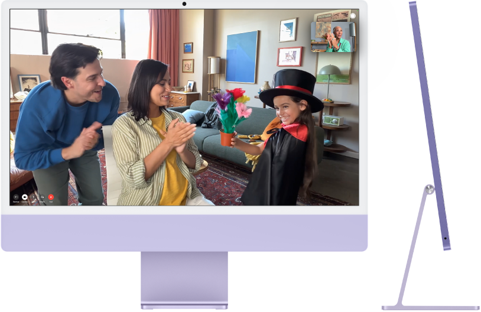

*图：24 英寸 iMac 的正面视图和侧视图。*

**开始使用**：按下 iMac 背面的电源按钮，打开键盘和鼠标，按「设置助理」的提示操作即可上手。

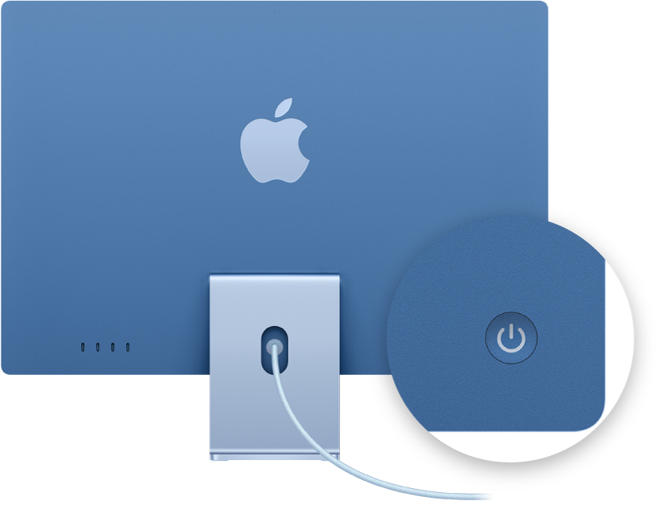

*图：24 英寸 iMac 的背面视图，标注了电源按钮。*

**保持同步**：借助 iCloud 在所有设备访问信息、照片、备忘录等；iOS 与 iPadOS 设备可同 iMac 配合拨打电话、接力任务、跨设备拷贝和粘贴。

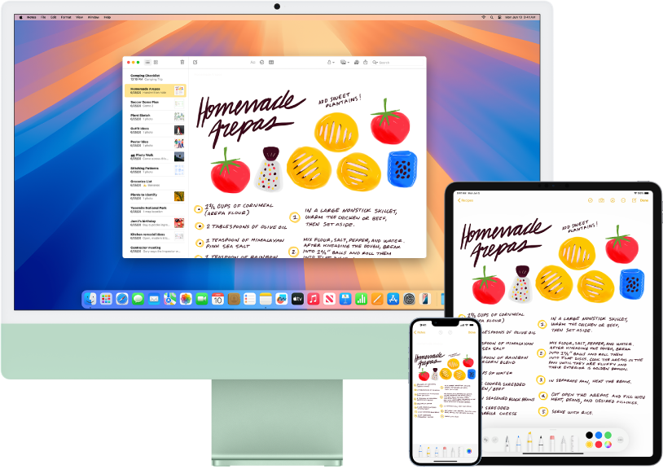

*图：“备忘录” App 中的购物清单显示在 iMac、iPhone 和 iPad 上。*

**做更多事情**：iMac 附带各种内建 App，帮助保持联络、为创作赋能、提供娱乐。

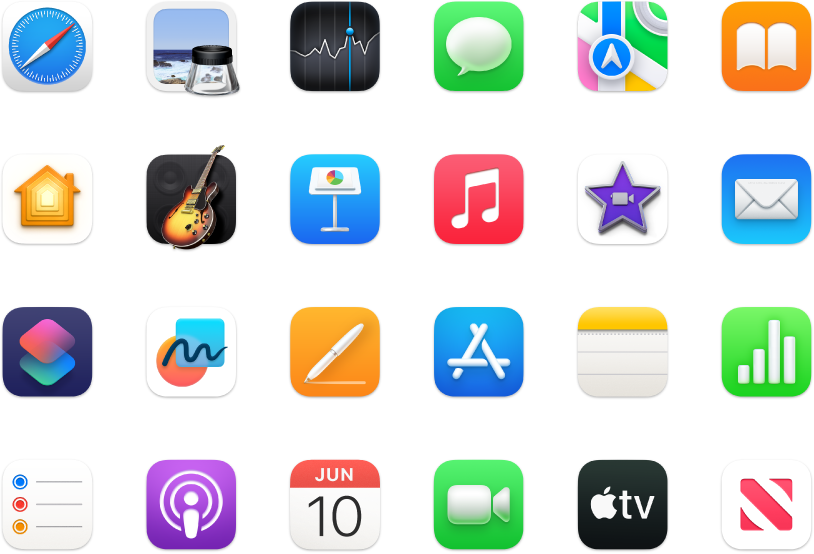

*图：Mac 随附的 App 图标。*

**探索新功能**：macOS Sequoia 及附带 App 的变化见 [macOS Sequoia 的新功能](https://support.apple.com/zh-cn/guide/mac-help/apd07d671600)。

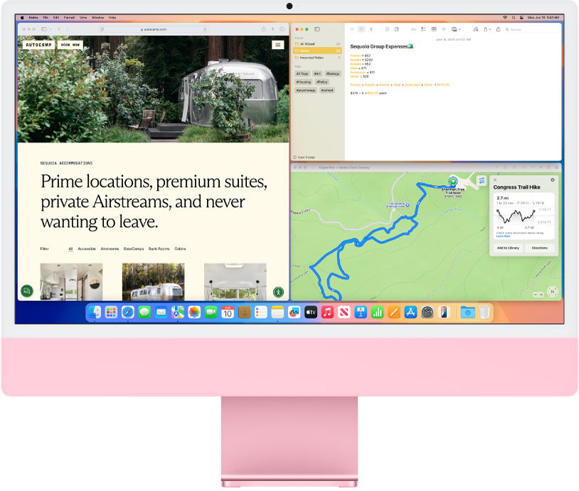

*图：“地图”、Safari 浏览器和“备忘录” App 的重叠屏幕。*

本指南适用于现款 24 英寸 iMac（实际屏幕对角线测量为 23.5 英寸）；某些功能和内容仅在部分国家或地区可用，Apple TV+ 需要订阅。更多帮助见 [iMac 支持网站](https://support.apple.com/zh-cn/mac/imac)。

## 浏览 iMac

**雷雳 (USB-C) 端口**：以雷雳速度（高达 40 Gbit/s）传输数据，并可给可充电鼠标、键盘或 iPhone 等设备充电；可连接雷雳设备和最多两台外接 6K 显示器（如 Apple Pro Display XDR）。端口还兼容雷雳 3、DisplayPort 1.4 与 USB 3.2 及更早型号，可接外接储存设备、网络摄像头、音频设备；其他接口的 USB 设备用转换器接入。

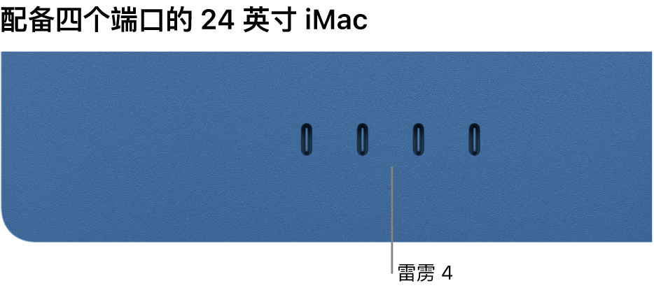

*图：显示四个雷雳 4 端口的 iMac。*

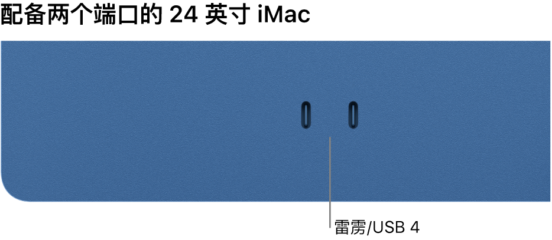

*图：显示两个雷雳/USB 4 端口的 iMac。*

*【注】*四端口机型配备雷雳 4，支持最多两台外接 6K 显示器；配备雷雳/USB 4 的双端口机型支持最多一台。

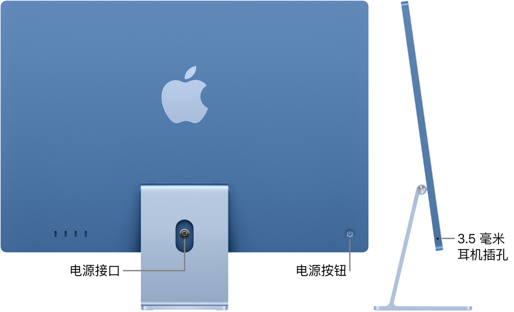

*图：iMac 的背面视图，显示电源接口和电源按钮。其旁边是侧视图，显示耳机插孔。*

- **电源接口**：电源适配器线缆穿过支架中的孔接到 iMac 背面；单独的电源线插入适配器后接电源插座。
- **电源按钮**：按下开机。关机选「苹果菜单 > 关机」，睡眠选「苹果菜单 > 睡眠」。
- **千兆位以太网 (RJ-45)**：在电源适配器上，路由器或调制解调器接入该端口。四端口机型随附内建以太网的适配器；双端口机型标配不含、可购买时选配，未选配时可能需 USB 至以太网转换器。
- **3.5 毫米耳机插孔**：接立体声耳机或外置扬声器。

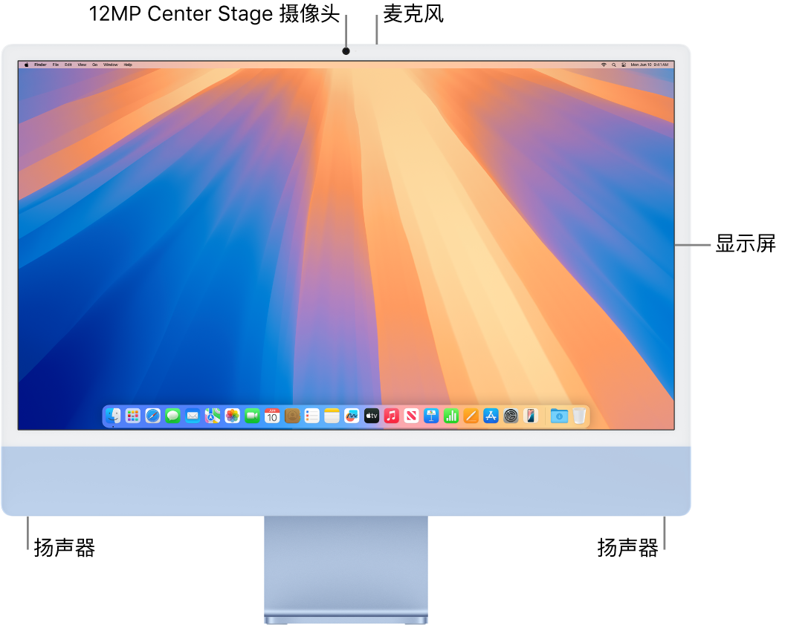

*图：iMac 的正面视图，显示显示屏、摄像头、麦克风和扬声器。*

- **显示器**：视网膜 4.5K，十亿色彩、500 尼特亮度；原彩显示按环境光调整颜色与强度。四端口 iMac 用 Nano-texture 纳米纹理玻璃散射复杂光照。
- **12MP Center Stage 摄像头**：FaceTime、拍照和录像；视频质量高、弱光表现更好，支持人物居中和桌上视角；旁边绿灯亮表示已打开。
- **麦克风**：录音室品质三麦克风，供会议、通话、播客和语音备忘录高质量录音。
- **扬声器**：六扬声器 = 两对双振动抵消低音单元 + 两个高性能高音单元；支持杜比全景声空间音频。

**要点**：外接显示器台数由端口数决定——四端口 2 台 6K，双端口 1 台。

## 包装清单

包装盒内随附键盘、鼠标和电源适配器。

**电源适配器**：24 英寸 iMac 附带 143W 电源适配器；四端口机型随附的适配器内建以太网，双端口机型可选配含或不含内建以太网的 143W 适配器。

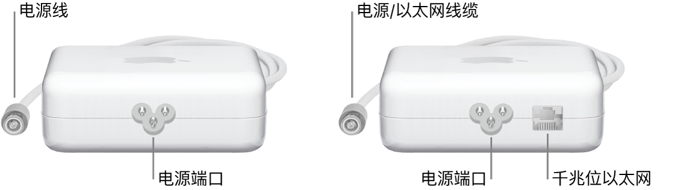

*图：一个不含以太网端口的电源适配器和一个含以太网端口的电源适配器。*

接法见上文「电源接口」。把路由器或调制解调器的网线插入适配器上的千兆位以太网即可——适配器线缆兼作以太网线缆，适配器与 iMac 之间无需单独网线。

**妙控键盘和妙控鼠标**：随机可能是带锁定键、带触控 ID、或带触控 ID 和数字键盘的妙控键盘（取决于机型与配置），下述说明通用。

**【重要事项】** 确保每台设备的打开/关闭开关

*图：打开/关闭开关*

已打开（绿色可见），设备会自动连接 iMac。

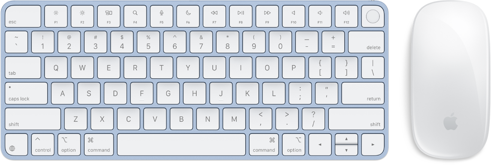

*图：配备触控 ID 的妙控键盘和妙控鼠标。*

- **妙控键盘**：可充电，出厂已与 iMac 配对；充电或重新配对用随附 USB-C 线接 iMac。自定义在「系统设置」>「键盘」，可设键盘、文本、快捷键和输入法。
- **妙控鼠标**：可充电，出厂已配对、开箱即用，通信范围内任意位置可用；充电与重新配对同上。自定义在「系统设置」>「鼠标」，含滚动、点按、轻扫和轻点选项。

单独购买的输入设备（如妙控板）先用随附线缆接 iMac 完成设置，再拔线放到最顺手的位置无线使用；同一根线缆也用于充电。

## 将配件连接到 iMac

可连接键盘、鼠标或触控板、AirPods 等可穿戴设备等。两种方式：蓝牙无线连接，或用连接线接入 iMac 的 USB-C 端口。

**开始之前**：① 参阅配件随附文稿；② 用连接线时确保线材正确，接头不合还需转换器（端口功能见「浏览 iMac」）；③ 确保 iMac 已更新到最新 macOS。

### 连接无线配件

**打开蓝牙**：点按菜单栏中的「控制中心」状态菜单

*图：“控制中心”状态菜单*

。蓝牙图标若

*图：GlobalArt/IL_Bluetooth*

呈灰色并带一条斜线即已关闭，点按打开。

**配对**：蓝牙配件首次使用必须配对。按配件文稿让其进入可配对状态（例如拨动开关），Mac 与配件都开机且彼此靠近；随后在「系统设置」>「蓝牙」的「附近的设备」中选中配件并点按「连接」。

**连接与查看**：配对后自动连接。点按菜单栏「控制中心」，把指针移到蓝牙上再点按箭头

*图：箭头*

，图标呈蓝色（或其他颜色）即已连接。未自动连接时，在「我的设备」中确认配件是否列出，未列出则重新配对。

**断开或忽略**：在「我的设备」中把指针移到配件上，点按出现的「断开连接」；要阻止自动连接，点按配件旁的信息图标

*图：“信息”图标*

，再点按「忽略此设备」。

**妙控键盘 / 妙控鼠标 / 妙控板**：随机配件已与 Mac 配对。单独购买或需重新配对时，用随附连接线接 iMac 并把开关拨至打开（绿色可见）即配对完成，之后可拔线无线使用；蓝牙开启时三者会自动连接 Mac。

*【注】*用随附连接线连接这三类配件时功能等同有线键盘或指针设备：不需要蓝牙，全部通信通过该连接线执行。

**AirPods**：见[将 AirPods 与 Apple 设备配对](https://support.apple.com/zh-cn/guide/airpods/dev7c85810f2)。

### 使用连接线连接配件

取决于配件和线材功能，连接时可能同时充电或传输数据；部分配件需另行接入电源。线材须同时适用于配件端口和 iMac 的 USB-C 端口，接头不适用时需使用[转换器](https://support.apple.com/102477)。

**【提示】** 部分配件首次连接需要批准，见[允许配件连接到 Mac](https://support.apple.com/zh-cn/guide/mac-help/mchlf779ae93)。

**进一步了解**：[Mac 上的蓝牙设置](https://support.apple.com/zh-cn/guide/mac-help/blth8111)、[关于 Mac 上的 USB](https://support.apple.com/zh-cn/guide/mac-help/mchlp1161/)；出现 USB 设备已停用的提示时见[相应排查文章](https://support.apple.com/102204)。

**注意**：「断开连接」后下次仍会自动重连，「忽略此设备」才会停止自动连接。

## 妙控键盘

随附的无线妙控键盘可输入表情符号、切换键盘语言、锁定 iMac，并按单键执行多种系统功能；配备触控 ID 的型号还可指纹登录并用 Apple Pay 购物。

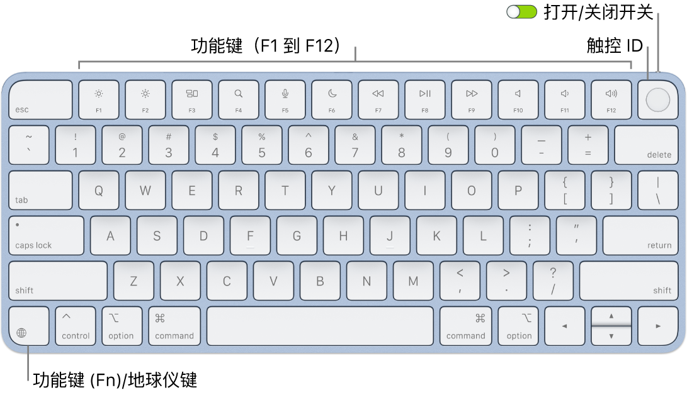

*图：配备触控 ID 的妙控键盘，顶部显示一排功能键和触控 ID，功能键 (Fn)/地球仪键位于左下角。*

**打开或关闭**：滑动键盘背面边缘的打开/关闭开关（绿色可见为开）。iMac 认不出键盘时，用随附 USB-C 线接 iMac 配对后再无线使用，该线也用于充电。

**锁定**：快按触控 ID 或锁定键

*图：GlobalArt/IL_Lock*

（无触控 ID 的型号为锁定键）。解锁：轻触触控 ID，或按任意键并键入密码。

**触控 ID**：用指纹解锁 iMac，并通过 Apple Pay 在 App Store、Apple 视频 App、Apple Books 和网站购物；设置时未配置可稍后在「系统设置」>「触控 ID 与密码」补设。手指轻放其上即可：首次启动或重启后仍需键入密码登录，之后解锁屏幕或购买都可改用触控 ID；启用快速用户切换后还能用指纹切回自己的账户。详见[在 Mac 上使用触控 ID](https://support.apple.com/zh-cn/guide/mac-help/mchl16fbf90a)。

**键盘设置**：若要指定键盘及功能键 (Fn)/地球仪键

*图：地球仪键*

的选项，打开「系统设置」>「键盘」，选取更改键盘或输入法、显示表情和符号、开始听写或定义功能。

**表情符号与切换语言**：按地球仪键切换键盘；重复按下循环「键盘」设置中指定的表情符号或其他语言；快按两下开始听写（需已设定该偏好设置）。

**功能键**：顶部一行为常用系统功能的快捷键。

| 功能键 | 按键 | 操作 |
| --- | --- | --- |
| 亮度 (F1、F2) |  *图：减少亮度键*  *图：增加亮度键* | 减少或增加屏幕亮度。 |
| 调度中心 (F3) |  *图：调度中心键* | 查看正在运行的程序，含所有空间与已打开的窗口。 |
| 聚焦搜索 (F4) |  *图：聚焦键* | 打开「聚焦」搜索 iMac 上的内容。 |
| 听写/Siri (F5) |  *图：麦克风键* | 按下启用听写（「信息」「邮件」、Pages 文稿等可键入文本处）；按住激活 Siri 并立即说出请求。 |
| 勿扰模式 (F6) |  *图：勿扰模式键* | 开/关「勿扰模式」：不显示也听不到通知，但可在「通知中心」查看。 |
| 媒体 (F7、F8、F9) |  *图：倒回键*  *图：播放/暂停键*  *图：快进键* | 倒回、播放或暂停、快进歌曲、影片或幻灯片放映。 |
| 静音 (F10) |  *图：静音键* | 内建扬声器或耳机插孔静音。 |
| 音量 (F11、F12) |  *图：减小音量键*  *图：增大音量键* | 减小或增大内建扬声器或耳机插孔音量。 |

**备选功能**：功能键可为特定 App 执行操作或执行备选功能（如 F11 隐藏所有窗口显示桌面）；按住 `Fn` 同时按功能键即触发。

**键盘快捷键**：同时按两个或多个键可完成通常需用触控板或鼠标执行的操作，例如 `Command-C` 拷贝所选文本、点按目标位置后 `Command-V` 粘贴。常用列表见「Mac 上的键盘快捷键」。

*【注】*搭载 Apple 芯片且运行 macOS 11.3 或更高版本的 Mac，触控 ID 与功能键功能如上所述。

**要点**：`Fn`/地球仪键身兼三职——切换键盘与循环表情符号、快按两下开始听写、配合功能键触发备选功能。

## 妙控鼠标

可在电脑通信范围内任意位置使用；充电或重新配对用 USB-C 充电线接 iMac。常用手势：

| 手势 | 操作 |
| --- | --- |
| 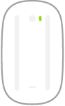 *图：鼠标底部，显示打开和关闭鼠标的开关。* | **打开/关闭**：滑动鼠标底部的打开/关闭开关，绿色可见即打开。 |
| 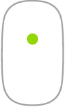 *图：显示点按操作的鼠标，可在鼠标表面的任意位置进行点按。* | **点按**：按下鼠标表面的上半部分以点按或连按。 |
| 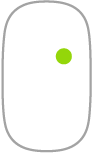 *图：显示辅助点按操作的鼠标，可为鼠标左侧或右侧启用辅助点按。* | **辅助点按（右键点按）**：按下鼠标左侧或右侧；要启用左/右键点按，在「系统设置」>「鼠标」选「辅助点按」；也可按住 `Control` 再点按。 |
| 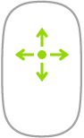 *图：显示如何在鼠标表面上将手指向任意方向扫过以向相应方向滚动的鼠标。* | **360º 滚动**：单指在表面扫过，向任意方向滚动或移动。 |
| 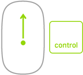 *图：显示如何在按住 Control 键时通过按下和缩放来在屏幕上放大项目的鼠标。* | **屏幕缩放**：按住 `Control` 并单指滚动以放大屏幕上的项目；需在「系统设置」>「辅助功能」>「缩放」选「配合修饰键使用滚动手势来缩放」。 |
| 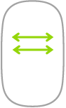 *图：显示如何使用双指轻扫以翻阅项目的鼠标。* | **双指轻扫**：左右轻扫，在页面、照片等项目间移动。 |

**自定义鼠标**：「系统设置」>「鼠标」可调整跟踪与滚动速度等设置、启用或自定义手势。

## 妙控板

手势可完成滚动网页、放大文稿、旋转照片等操作；力度触控板又加入压力感应与反馈——拖移或转动对象时，对象对齐会传来轻微振动，处理更精确（示例见[如何使用力度触控板](https://support.apple.com/102309)）。常用手势：

| 手势 | 操作 |
| --- | --- |
|  *图：点按手势符号。* | **点按**：按下触控板任意位置；或在「触控板」设置启用「轻点来点按」后轻点。 |
|  *图：用力点按手势符号。* | **用力点按**：点按后用力按下查看更多信息，如点按文字看定义、点按地址看在「地图」中打开的预览。 |
|  *图：辅助点按或右键点按手势符号。* | **辅助点按（右键点按）**：双指点按打开快捷键菜单；启用「轻点来点按」后用双指轻点或点按；也可按住 `Control` 再点按。 |
|  *图：双指滚动手势符号。* | **双指滚动**：双指上下滑动来滚动。 |
|  *图：张开或捏合来缩放手势符号。* | **张开或捏合来缩放**：大拇指与食指张开或捏合，放大或缩小照片和网页。 |
|  *图：轻扫以浏览手势符号。* | **轻扫以浏览**：双指左右轻扫，像翻书一样浏览网页、文稿等。 |
|  *图：打开启动台手势符号。* | **打开启动台**：四指或五指捏合快速打开「启动台」，再点按某个 App 打开。 |
|  *图：在 App 之间轻扫手势符号。* | **在 App 之间轻扫**：三指或四指左右轻扫，在全屏幕 App 之间切换。 |

**自定义手势**：「系统设置」>「触控板」可进一步了解每个手势、设定点按力度、决定是否使用压力感应、自定义其他手势。

**【提示】** 常误触发用力点按时，把点按力度调至更强；或点按「查询与数据检测器」旁的弹出式菜单选取「三指轻点」。

## 给无线配件的电池充电

妙控键盘、妙控鼠标和妙控板配备内建可充电电池。

- **检查电量**：点按菜单栏「控制中心」，把指针移到蓝牙项目上，再点按其旁边的箭头。
- **充电**：用 USB-C 充电线把妙控键盘、妙控鼠标或妙控板连到 Mac。
- **【提示】** 连接 iMac 时让输入设备处于开启状态可更快充电。
- **进一步了解**：见「处理和回收信息」或 [Apple 锂离子电池](https://www.apple.com/cn/batteries/)。

**注意**：开关关闭时接线充电会明显变慢。

## 配合 iMac 使用转换器

以下 Apple 转换器用于把外接设备、显示器等接到 iMac 的端口。

| 转换器 | 描述 |
| --- | --- |
| 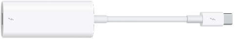 *图：雷雳 3 (USB-C) 转雷雳 2 转换器。* | **雷雳 3 (USB-C) 转雷雳 2 转换器**：连接雷雳 2 设备或雷雳显示器。 |
| 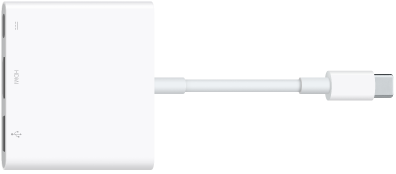 *图：USB-C 数字 AV 多端口转换器。* | **USB-C 数字 AV 多端口转换器**：连接 HDMI 显示器，同时接入标准 USB 设备。 |
| 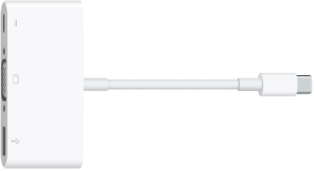 *图：USB-C VGA 多端口转换器。* | **USB-C VGA 多端口转换器**：连接 VGA 投影仪或显示器，同时接入标准 USB 设备。 |
|  *图：USB-C 转 USB 转换器* | **USB-C 转 USB 转换器**：接入闪存驱动器、相机或其他标准 USB 设备。 |
|  *图：USB-C 转 SD 读卡器转换器* | **USB-C 转 SD 读卡器转换器**：接 SD 卡以传输高分辨率照片和视频。 |

转换器和其他配件单独销售，见 [apple.com/cn](https://apple.com/cn/store)、当地 Apple Store 或其他经销商；更多外观与端口用法见[适用于 Mac 上雷雳或 USB-C 端口的转换器](https://support.apple.com/102477)。选购前请查阅文稿或与生产企业确认。

## 将外接显示器连接到 iMac

iMac 有两个或四个支持视频输出的 USB-C 端口：双端口机型可将最多一台外接 6K 显示器、投影仪或 HDTV 接到其中一个端口；四端口 iMac 支持最多两台。

*【注】*一个端口串接多台设备且其中含外接显示器时，显示器必须是最后一台设备；使用多端口转换器或集线器时不适用。

**【提示】** Apple TV 连接 HDTV 时，可用隔空播放以最高 1080p HD 镜像 iMac 屏幕（见「通过“隔空播放”在更大的屏幕上流播放内容」）。

显示器接口与端口不匹配时可结合转换器（单独销售）使用，请查阅显示器文稿或咨询制造商以选对产品。

| 若要连接此设备 | 使用此连接线或转换器 |
| --- | --- |
| Apple Pro Display XDR | 雷雳 3 (USB-C) 连接线 |
| 雷雳 3 (USB-C) 显示器 | 雷雳 3 (USB-C) 连接线 |
| USB-C 显示器 | USB-C (USB 3.1) 连接线 |
| 雷雳 2 显示器 | 雷雳 3 (USB-C) 转雷雳 2 转换器 |
| HDMI 显示器或 HDTV | USB-C 转 HDMI 转换器或 USB-C 数字 AV 多端口转换器 |
| VGA 显示器或投影仪 | USB-C VGA 多端口转换器 |
| DisplayPort 或 Mini DisplayPort 显示器 | USB-C 转 DisplayPort 或 Mini DisplayPort 转换器 |
| DVI 显示器或投影仪 | USB-C 转 DVI 转换器 |

**调整和排列显示器**：接好后在「系统设置」>「显示器」设定排列方式、开关屏幕镜像，并调整颜色、分辨率等。

**故障排除**：支持的显示器台数见「系统设置」>「帮助」>「iMac 技术规格」>「视频支持」（可能需要滚动）；黑屏或分辨率偏低见[相应排查文章](https://support.apple.com/102501)。

## 本章速查

| 项目 | 规格要点 |
| --- | --- |
| 雷雳 (USB-C) | 高达 40 Gbit/s；四端口 = 雷雳 4（最多 2 台外接 6K），双端口 = 雷雳/USB 4（最多 1 台）；兼容雷雳 3、DisplayPort 1.4、USB 3.2 及更早 |
| 千兆位以太网 | 在 143W 电源适配器上，线缆兼作网线；四端口机型内建、双端口机型可选配 |
| 其余接口 | 背面电源接口与电源按钮；侧边 3.5 毫米耳机插孔 |
| 屏幕与影音 | 视网膜 4.5K、十亿色彩、500 尼特、原彩显示（四端口机型 Nano-texture 玻璃，实际对角线 23.5 英寸）；12MP Center Stage 摄像头（绿灯亮 = 开启）；三麦克风；六扬声器支持杜比全景声 |

**功能键**：`F1`/`F2` 亮度 · `F3` 调度中心 · `F4` 聚焦 · `F5` 听写（按住 = Siri）· `F6` 勿扰 · `F7`/`F8`/`F9` 倒回/播放暂停/快进 · `F10` 静音 · `F11`/`F12` 音量 · `Fn` 换键盘或循环表情、快按两下听写、+ 功能键触发备选（F11 备选 = 显示桌面）· 快按触控 ID 锁定

**手势**：鼠标——上半部点按/连按、左或右侧辅助点按、单指扫 = 360º 滚动、`Control`+ 单指滚动 = 缩放、双指轻扫 = 翻阅 · 妙控板——按任意位置或轻点 = 点按、用力点按 = 查详情、双指点按 = 右键、双指上下 = 滚动、捏合张开 = 缩放、双指左右 = 浏览、三或四指左右 = 切换 App、四或五指捏合 = 启动台

**菜单路径**：「苹果菜单 > 关机」/「苹果菜单 > 睡眠」；「系统设置」>「键盘」/「鼠标」/「触控板」/「蓝牙」/「显示器」/「触控 ID 与密码」/「辅助功能 > 缩放」/「帮助 > iMac 技术规格 > 视频支持」；蓝牙电量与连接状态：菜单栏「控制中心」> 蓝牙 > 箭头

**快捷键**：`Command-C` 拷贝 · `Command-V` 粘贴 · `Control` + 点按 = 辅助点按
