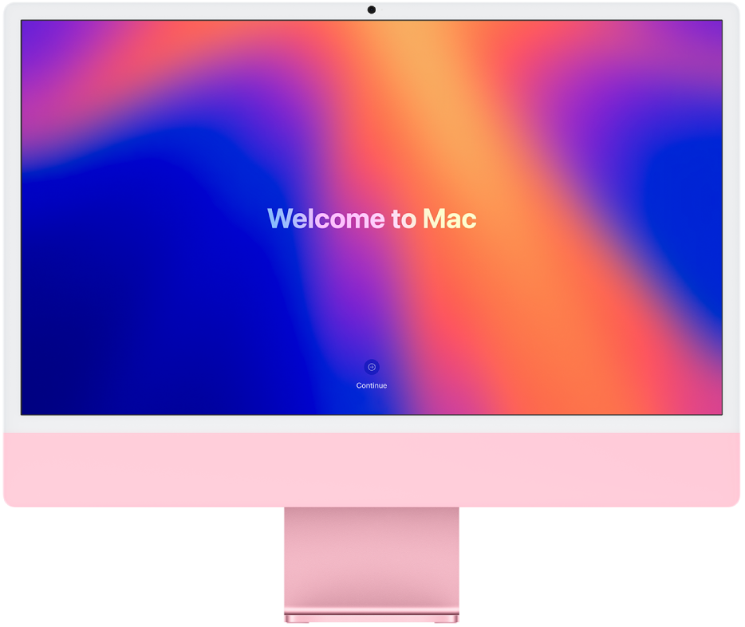
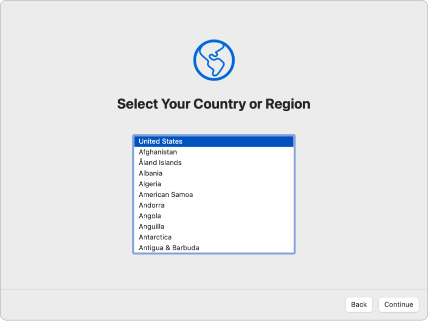
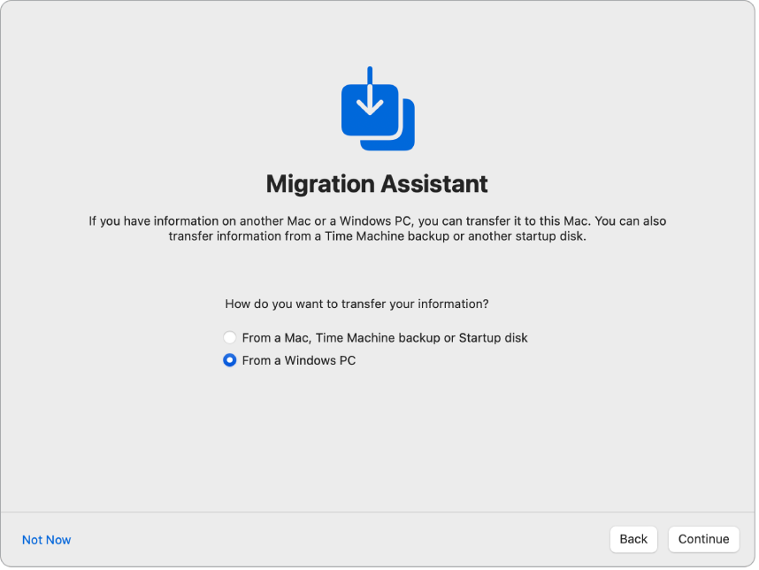
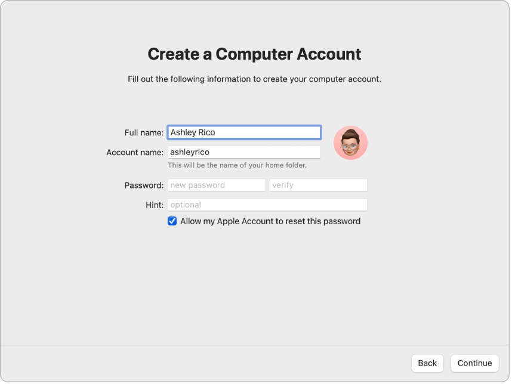
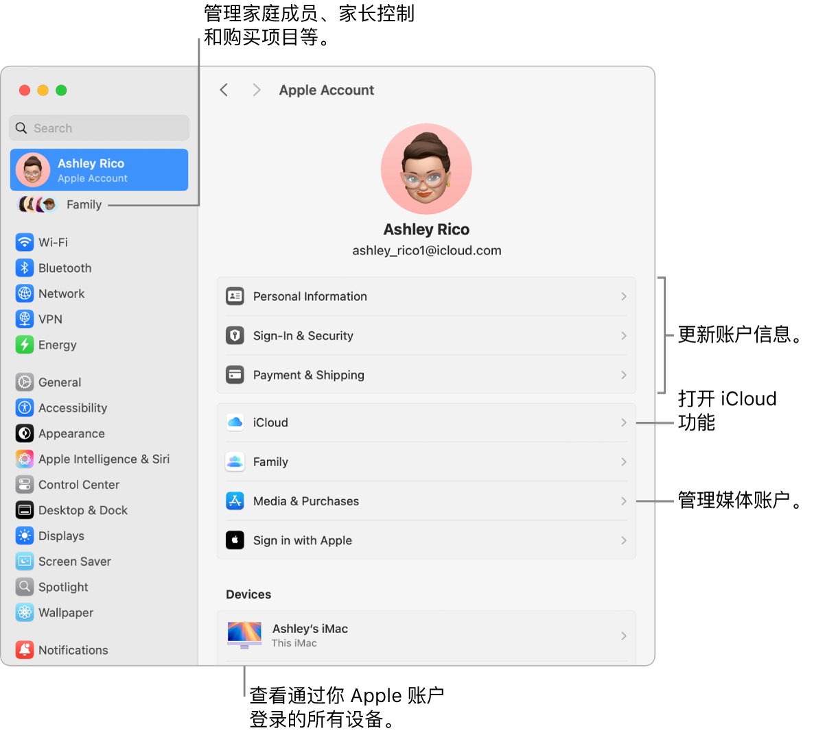
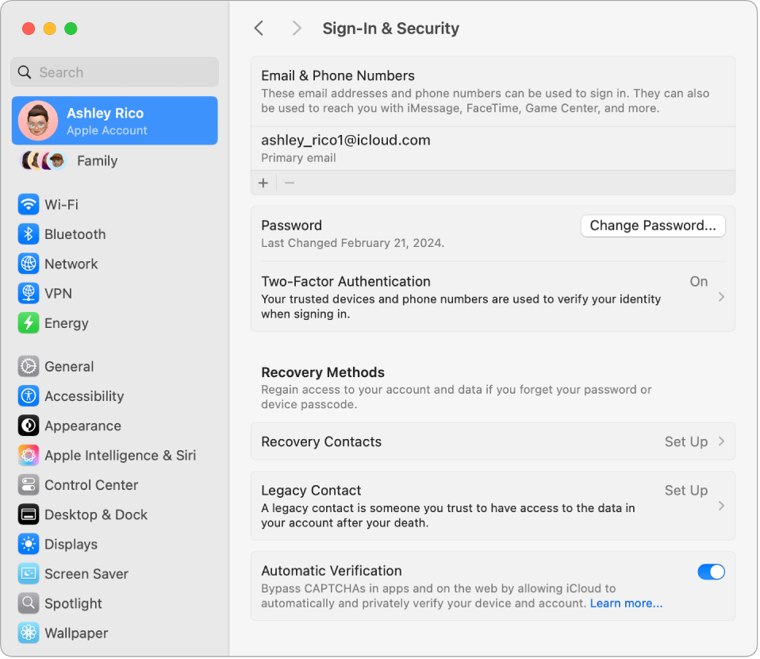
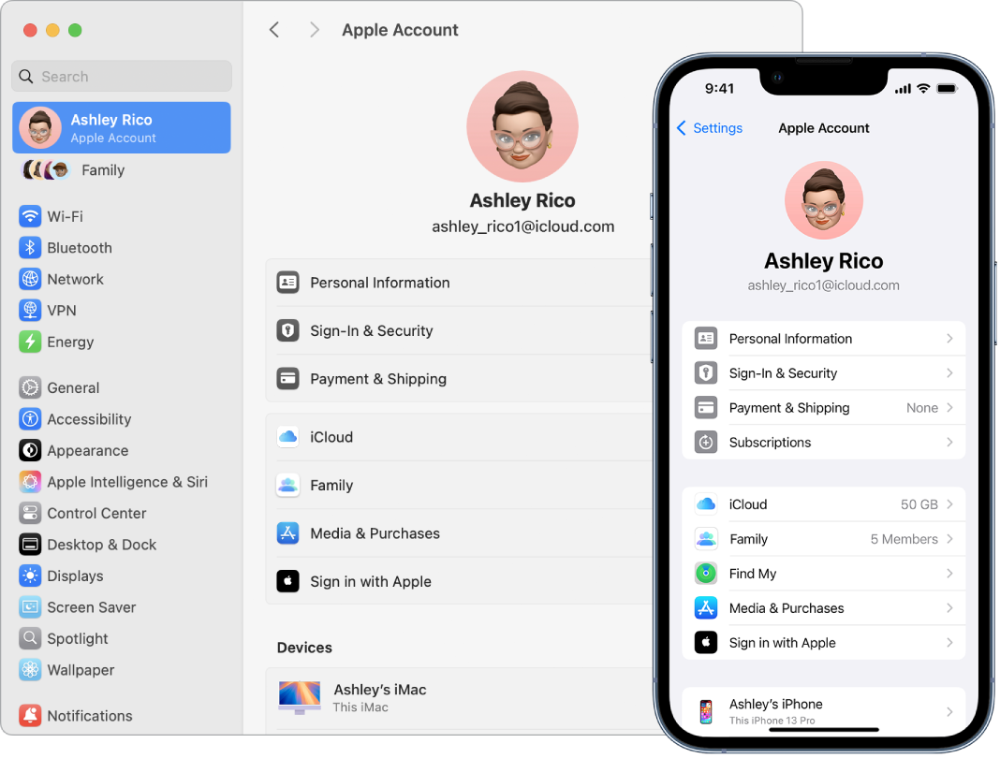

# 第 2 章 · 设置 Mac、Apple 账户与 iCloud

> 来源：苹果《iMac 使用手册》2024 年款 · macOS Sequoia 15 · 第 11–17 页（目录章节“设置 Mac”＋“Apple 账户和 iCloud”）

## 设置 iMac

设置新 iMac 时，你可以自定义 Mac 的部分设置、设置触控 ID 等功能，以及从另一台电脑传输数据。如果已有 Mac、iPad 或 iPhone，你还可以选择使用现有设置更快速设置新 Mac，从而跳过一些步骤。

*图：屏幕上显示“欢迎使用 Mac”的 iMac。*

“设置助理”会引导你完成必不可少的设置，之后即可开始使用 Mac。两条流程步骤顺序基本一致，只在“数据来源”和“能否复用现有设置”上有区别：**新 Mac 用户**从 Windows PC 迁移，可用运行 iOS 15／iPadOS 15 或更高版本的 iPhone 或 iPad 做快捷设置；**当前 Mac 用户**可从另一台 Mac、时间机器备份或 Mac 上的启动磁盘迁移，快捷设置要求 macOS 12／iOS 15／iPadOS 15 或更高版本的设备。

任一条流程走完都转到“iMac 设置完成后”。需要更多支持时，可通过在线交流、电子邮件或电话与 Apple 专家交流，或预约 Genius Bar 天才吧（[预约与支持选项](https://www.apple.com/cn/retail/geniusbar/)）。

## 针对新 Mac 用户设置 iMac

此演示涵盖设置过程的每个步骤，旨在搭配“设置助理”一起使用。

**【提示】** 部分步骤可能需要滚动以选择选项。如果配有妙控鼠标或妙控板且不确定如何滚动，只需在触控板上双指向上和向下滑动。想稍后调整手势，见“妙控鼠标”或“妙控板”的手势设置。

### 步骤 1 · 开始之前

- 如果有 iPhone 或 iPad，请在设置期间将其放在手边，因为部分步骤可能需要在另一台设备上验证。
- 设置期间有机会从另一台电脑（如 Windows PC）传输数据。若想这样做，请确保你有要传输数据的电脑，且已更新到最新的可用软件版本。
- “设置助理”可让你轻松设置 iMac，无需太长时间即可完成；但如果你选择传输数据，请预留额外的时间。

### 步骤 2 · 连接鼠标或触控板和键盘

设置初始，你可以将鼠标或触控板和键盘连接到 iMac。

- 新 Mac 随附的妙控鼠标、妙控板或妙控键盘应该已配对。若要打开它们，请滑动打开/关闭开关使**绿色可见**。
- 使用的鼠标、触控板或键盘并非随附自新 Mac 时，你需要将其配对，并可能要用连接线将配件以物理方式连接到 Mac。具体见配件随附文稿，或参阅“将配件连接到 Mac”。
- 设置期间键鼠无法连接：Apple 支持文章[如果你的键盘或鼠标在 Mac 设置期间无法连接](https://support.apple.com/108797)。

### 步骤 3 · 设定语言、国家或地区并接入 Wi-Fi

**选取语言。** 这会设定 Mac 的语言。稍后更改：「系统设置 > 通用 > 语言与地区」。

**设定国家或地区。** 这会设定 Mac 的日期、货币和温度等格式。稍后更改：「系统设置 > 通用 > 语言与地区」。

*图：“设置助理”屏幕显示用于选择用户国家或地区的选项。*

**打开辅助功能。** 查看“视觉”、“动作”、“听觉”和“认知”能力的辅助功能选项，或者点按“以后”。详见“Mac 上的辅助功能”。

**接入 Wi-Fi 网络。** 选取 Wi-Fi 网络并输入密码（如有必要）。如果使用以太网，点按“其他网络选项”，然后按照屏幕指示操作；你可能需要额外的以太网转换器将以太网线缆连接到 iMac，如 Belkin USB-C 至千兆以太网转换器。稍后更改 Wi-Fi：「系统设置 > Wi-Fi」，选取网络并输入密码（如有需要）。

### 步骤 4 · 从另一台电脑传输信息

你可以将数据（如**文件、联系人和账户**等）从 Windows PC 迁移到新 Mac。如果你有要迁移的另一台 Mac，改看下一节“针对当前 Mac 用户”。可以无线传输数据，或通过以太网线缆将 Windows PC 连接到 iMac。

*图：“设置助理”屏幕上显示“迁移助理”。从 Windows PC 传输信息的复选框已选中。*

- **开始之前。** 确保 Windows PC 已更新到最新的可用软件版本，然后在 Windows PC 上下载“迁移助理”。各操作系统的版本及流程说明见 Apple 支持文章[使用“迁移助理”从 PC 传输到 Mac](https://support.apple.com/102565)。
- **无线传输数据。** 你的 Windows PC 和新 Mac 必须接入**同一个 Wi-Fi 网络**。在设置屏幕上点按 Windows PC，然后按照指示操作。
- **使用以太网线缆传输数据。** 用以太网线缆直接将 Windows PC 连接到 Mac。iMac 一侧可能需要以太网转换器（如 Belkin USB-C 至千兆以太网转换器），Windows PC 一侧是否需要转换器取决于其端口。相互连接后，在设置屏幕上点按 Windows PC，然后按照指示操作。
- **稍后传输数据。** 此时也可以选择不传输；不传输请在“迁移助理”窗口中点按“以后”。设置完成后再传输见“将你的数据传输到新 iMac”。

### 步骤 5 · 登录 Apple 账户和设置电脑账户

**登录 Apple 账户。** 如果已有其他 Apple 设备（如 iPhone 或 iPad），你可能已有 Apple 账户；没有的话此时可以免费创建一个。Apple 账户包括电子邮件地址和密码，是你用来处理一切与 Apple 相关事务的账户（App Store、Apple 视频 App、iCloud 等）。**Apple 账户与你用于登录 Mac 电脑账户的用户名和密码不同**，详见本章“Apple 账户”。

**【提示】** 最好拥有自己的 Apple 账户并且不要与他人共享。

在此屏幕上执行以下任一项操作：

- *已有 Apple 账户：*输入其电子邮件地址和密码。如果已有 iPhone 或 iPad，此设备上会收到一个验证码；没有的话，与 Apple 账户关联的手机号码会收到包含验证码的短信。没收到验证码或短信时，按照屏幕提示操作。
- *没有 Apple 账户：*点按“创建新 Apple 账户”。
- *忘记 Apple 账户或密码：*点按“忘记 Apple 账户或密码”。
- *此时不想登录或创建：*点按“稍后设置”。设置完成后，打开“系统设置”并点按边栏中的“登录你的 Apple 账户”即可登录或新建。

*【注】*登录 Apple 账户后请阅读条款与条件。若要接受，勾选方框，然后点按“同意”并继续。

**创建电脑账户。** 添加你的名字，然后创建账户名和密码，它们稍后可用于解锁 iMac 或批准其他操作。你可以选择添加提示，可在你忘记电脑账户密码时助你寻回。若要更改账户的登录图片，点按它然后选取选项。

*图：“设置助理”屏幕上显示“创建电脑账户”。*

*【注】*电脑账户不同于 Apple 账户。但如果你忘记了 Mac 解锁密码，且在设置期间勾选了“允许使用 Apple 账户重设用户账户密码”，那么可以使用 Apple 账户来重设密码。

### 步骤 6 · 将此设为你的新 Mac

如果已经设置了运行 **iOS 15 或更高版本**或者 **iPadOS 15 或更高版本**的其他设备，屏幕会出现“将此设为你的新 Mac”以供快捷设置。如果没有与软件版本相符的 iPhone 或 iPad，你不会看到此步骤（不确定版本见[在 iPhone、iPad 或 iPod 上查找软件版本](https://support.apple.com/109065)）。

- 使用“将此设为你的新 Mac”时，你用**储存在 iCloud 账户中的设置**跳过一些设置步骤。若要使用当前设置，点按“继续”。
- 如果已配对的妙控键盘配备了触控 ID，设置过程会直接跳转到步骤 7（设置触控 ID 和 Apple Pay）。
- 如果使用当前设置并且没有配对配备触控 ID 的妙控键盘，设置过程即告完成，转到“iMac 设置完成后”。
- 如果想要自定义新 iMac 的设置，点按“自定义设置”并继续下一步。

### 步骤 7 · 自定义隐私和安全性设置、“屏幕使用时间”与 Siri

**启用定位服务。** 选取是否允许“地图”等 App 使用 Mac 的位置。若不启用“定位服务”，你将看到用于选取时区的屏幕。稍后更改：「系统设置 > 隐私与安全性 > 定位服务」。

**与 Apple 和开发者共享分析数据。** 选取是否将诊断和数据发送到 Apple，以及 Apple 是否可与开发者共享崩溃和使用数据。稍后更改：「系统设置 > 隐私与安全性 > 分析与改进」（可能需要滚动）。

**设置屏幕使用时间。** “屏幕使用时间”可让你查看 iMac 的每日和每周用量，设定可使用特定 App 的时间限额，以及管理子女的屏幕使用时间等。若要打开请点按“继续”，否则点按“稍后设置”。稍后设置：「系统设置 > 屏幕使用时间」。详见“Mac 上的屏幕使用时间”。

**通过文件保险箱保护数据。** 文件保险箱可帮你保护数据的安全。设置期间你可以选择打开文件保险箱以保护数据，还可以选择在忘记密码时允许 iCloud 账户解锁磁盘。原理与稍后如何开启见[使用文件保险箱加密 Mac 数据](https://support.apple.com/zh-cn/guide/mac-help/mh11785)。

**启用 Siri 和“嘿 Siri”。** 你可以在设置过程中打开 Siri 和“嘿 Siri”，便于说出 Siri 请求。若要设置 Siri，点按“启用‘询问 Siri’”；若要设置“嘿 Siri”，请在提示时说出几个 Siri 命令。若要稍后打开，请打开“系统设置”并点按边栏中的“Apple 智能与 Siri”（*图：Apple 智能与 Siri 边栏图标*）（较早版本中为“Siri”（*图：Siri 边栏图标*）），然后选取选项。详见“Mac 上的 Siri”。

你还可以在设置过程中选择与 Apple 共享音频来改进 Siri；以后始终可以更改是否共享音频：「系统设置 > 隐私与安全性 > 分析与改进」（可能需要滚动）。

### 步骤 8 · 设置触控 ID 和 Apple Pay

*【注】*以下步骤会在你配对了配备触控 ID 的妙控键盘时出现。

**设置触控 ID。** 你可以在设置期间将指纹添加到触控 ID（键盘右上方的按钮），用于解锁 iMac、授权 Apple Pay 购买以及登录部分第三方 App，按照屏幕指示操作即可。若要稍后设置触控 ID 或添加其他指纹：「系统设置 > 触控 ID 与密码」；若要添加指纹，点按（*图：“添加”按钮*）并按照屏幕说明操作。详见[在 Mac 上使用触控 ID](https://support.apple.com/zh-cn/guide/mac-help/mchl16fbf90a)。

**设置 Apple Pay。** 设置了触控 ID 后，你可以设置 Apple Pay 并添加借记卡、信用卡或商店卡，以通过触控 ID 进行购买。输入卡片详细信息，然后按照屏幕提示操作。如果已使用某张卡片购买媒体，可能会提示你先验证此卡片。若要稍后设置 Apple Pay 或添加其他卡片：「系统设置 > 钱包与 Apple Pay」，按照屏幕提示操作。

*【注】*发卡机构决定你的卡片是否可用于 Apple Pay，并可能要求你提供其他信息来完成验证。许多信用卡和借记卡可用于 Apple Pay；当前发卡机构名单见[参加 Apple Pay 计划的银行](https://support.apple.com/HT204916)。

### 步骤 9 · 设定桌面外观

**选取外观。** 为桌面外观选择“浅色”、“深色”或“自动”。稍后更改：「系统设置 > 外观」，选择一个选项；这里还可设定其他外观设置，例如高亮标记颜色或边栏图标大小。

*【注】*如果选择通过“将此设为你的新 Mac”进行快捷设置，则会跳过此步骤。

### 步骤 10 · 完成设置

新 iMac 已可供使用，转到下一节了解后续步骤。

**要点**
- 唯一能“跳过整段流程”的开关是“将此设为你的新 Mac”：它用 iCloud 中保存的设置跳过隐私自定义、Siri、外观等步骤，只保留触控 ID。
- 任何步骤当时没做，都能在“系统设置”对应边栏项里补齐——上文每步都给了路径。

## 针对当前 Mac 用户设置 iMac

此演示同样涵盖设置过程的每个步骤，旨在搭配“设置助理”一起使用。步骤顺序与上一节一致：连接配件 → 语言/地区/辅助功能/Wi-Fi → 从另一台 Mac 传输信息 → Apple 账户与电脑账户 → 将此设为你的新 Mac → 隐私与安全/屏幕使用时间/文件保险箱/Siri → 触控 ID 与 Apple Pay → 桌面外观 → 完成。下面只列**与新手流程不同或更详细**的部分，其余步骤的操作与“稍后更改”路径同上节。

**开始之前**

- 设置期间请将**其他 Mac 或者 iPhone 或 iPad** 放在手边，因为部分步骤可能需要在另一台设备上验证。
- 设置期间有机会从另一台 Mac 传输数据；若想这样做，请确保你有要传输数据的电脑，且已更新到最新的可用软件版本。
- “设置助理”本身很快即可完成；选择传输数据请预留额外时间。

**设定语言、国家或地区并接入 Wi-Fi**：与新手流程相同（「系统设置 > 通用 > 语言与地区」设定语言与国家或地区；“视觉”“动作”“听觉”“认知”辅助功能；Wi-Fi 或以太网“其他网络选项”）。

**【提示】** 设置后如果在菜单栏中没有看到 Wi-Fi 状态图标（*图：Wi-Fi 状态图标*），你可以添加它：打开“系统设置”，点按边栏中的“控制中心”，然后为 Wi-Fi 选择“在菜单栏显示”。

### 从另一台 Mac 传输信息

你可以将数据（如**文件、联系人和账户**等）从另一台 Mac 迁移到新 iMac。此外还可以选择从**时间机器备份**或位于 **Mac 上的启动磁盘**传输信息。从另一台 Mac 传输时，可以无线传输数据，或通过以太网线缆将 Mac 连接到 iMac。

*图：“设置助理”屏幕上显示“迁移助理”。从 Mac 传输信息的复选框已选中。*

| 传输来源 | 开始之前的准备 | 连接方式 |
| --- | --- | --- |
| 另一台 Mac | 更新到最新的可用软件版本，并在该 Mac 上打开“迁移助理”（位于「应用程序 > 实用工具」文件夹） | 无线（两台电脑彼此靠近），或用以太网线缆直连 |
| 时间机器备份 | 在“迁移助理”中选取该来源 | 按屏幕指示操作 |
| Mac 上的启动磁盘 | 在“迁移助理”中选取该来源 | 按屏幕指示操作 |

- **无线传输数据。** 两台电脑彼此靠近即可无线传输：在设置屏幕上点按另一台 Mac，然后按照指示操作。
- **使用以太网线缆传输数据。** 用以太网线缆直接将 iMac 连接到另一台 Mac；iMac 一侧可能需要以太网转换器（如 Belkin USB-C 至千兆以太网转换器），另一台 Mac 一侧是否需要转换器取决于其端口。连接后在设置屏幕上点按另一台 Mac。
- **稍后传输数据。** 不传输请在“迁移助理”窗口中点按“以后”，设置完成后再传（见“将你的数据传输到新 iMac”）。
- **目的是恢复而非迁移。** 如果要恢复 Mac，见 Apple 支持文章[从备份恢复 Mac](https://support.apple.com/102551)；迁移流程详见[使用“迁移助理”传输到新 Mac](https://support.apple.com/102613)。

### 登录 Apple 账户和设置电脑账户

**登录 Apple 账户。** 设置期间登录 Apple 账户时，你会在**其他 Apple 设备**上收到一个验证码，在新 iMac 上输入验证码以继续。如果没有收到验证码或没有相关设备，可以选择通过**短信或电话**接收验证码。如果无法使用与 Apple 账户关联的电话号码，请选取“无法使用此号码”，然后按照屏幕指示操作。

- 如果需要创建 Apple 账户，选取“创建新 Apple 账户”。
- 如果忘记了 Apple 账户或密码，选取“忘记 Apple 账户或密码”。
- 如果此时不想登录或创建，点按“稍后设置”；设置完成后打开“系统设置”，点按边栏中的“登录你的 Apple 账户”。

*【注】*登录 Apple 账户后请阅读条款与条件。若要接受，勾选方框，然后点按“同意”并继续。

**创建电脑账户。** 添加你的名字并创建账户名和密码，它们稍后可用于解锁 iMac 或批准其他操作；可选择添加提示以便忘记电脑账户密码时寻回；点按登录图片可更改它。

*【注】*电脑账户不同于 Apple 账户。但如果你忘记了 Mac 解锁密码，且在设置期间勾选了“允许使用 Apple 账户重设用户账户密码”，那么可以使用 Apple 账户重设密码。

### 将此设为你的新 Mac

如果已经设置了运行 **macOS 12 或更高版本、iOS 15 或更高版本或者 iPadOS 15 或更高版本**的其他设备，屏幕会出现“将此设为你的新 Mac”以供快捷设置。如果没有与软件版本相符的 Mac、iPad 或 iPhone，你不会看到此步骤（版本查询见[确定你的 Mac 使用的是哪个 macOS 版本](https://support.apple.com/109033)或[在 iPhone、iPad 或 iPod touch 上查找软件版本](https://support.apple.com/109065)）。

使用“将此设为你的新 Mac”时，你用储存在 iCloud 账户中的设置跳过一些设置步骤；若要使用当前设置请点按“继续”。如果已配对的妙控键盘配备了触控 ID，设置过程会跳转到“设置触控 ID 和 Apple Pay”；如果使用当前设置且没有配对配备触控 ID 的妙控键盘，设置过程即完成。想要自定义新 iMac 的设置，请点按“自定义设置”并继续下一步。

### 其余步骤

与新手流程逐项一致，仅列关键差异与入口：**定位服务**（不启用时会出现选取时区的屏幕）与**分析数据/共享音频改进 Siri** 同在「系统设置 > 隐私与安全性」；**屏幕使用时间**（查看 Mac 的每日和每周用量、设定 App 时间限额、管理子女的屏幕使用时间）、「系统设置 > 屏幕使用时间」；**文件保险箱**（可另选“忘记密码时允许 iCloud 账户解锁磁盘”，见[使用文件保险箱加密 Mac 数据](https://support.apple.com/zh-cn/guide/mac-help/mh11785)）；**Siri 与“嘿 Siri”**、「系统设置 > Apple 智能与 Siri」；**触控 ID**、「系统设置 > 触控 ID 与密码」；**Apple Pay**、「系统设置 > 钱包与 Apple Pay」；**桌面外观**（浅色/深色/自动，另可调高亮标记颜色与边栏图标大小）、「系统设置 > 外观」。

**注意**
- 从另一台 Mac 迁移时，“迁移助理”要**在旧 Mac 上手动打开**（「应用程序 > 实用工具」），新 iMac 端只是在设置屏幕上点按对方设备。
- 无线迁移的成败取决于两台设备是否彼此靠近、旧设备系统是否已更新到最新可用版本。

## iMac 设置完成后

完成设置后即可开始个性化 Mac，按目的分三条路线：

- **个性化与账户**：设置电子邮件与日历账户；[使屏幕上的文本和其他项目变大](https://support.apple.com/zh-cn/guide/mac-help/mchld786f2cd)以调整文本显示；[在 Mac 上自定义桌面图片](https://support.apple.com/zh-cn/guide/mac-help/mchlp3013)。
- **学习与上手**：Mac 新手参阅“Mac 新手？”了解有用技巧，另见[Mac 上常用的术语](https://support.apple.com/zh-cn/guide/mac-help/cpmh0038)与 Apple 支持文章[适用于从 Windows 转而使用 Mac 的用户的 Mac 提示](https://support.apple.com/102323)；想巩固 macOS 用法可探索桌面和菜单栏、访达、程序坞、控制中心。
- **硬件与 App**：了解 USB-C 端口、内建摄像头等硬件，探索妙控键盘的键盘功能，调整妙控板或妙控鼠标的手势，连接外接显示器或配件；多设备方面了解“多设备协同工作”与“在设备间共享内容”；在 App Store 了解如何使用 App 或安装新 App，包括之前已购买的 iPhone 和 iPad App（请注意，大部分 iPhone 和 iPad App 适用于 Mac）。

**要点**
- 忘记做某项个性化设置时，入口都在“系统设置”的对应边栏项，不必重跑“设置助理”。
- 以前在 iPhone 或 iPad 上购买的 App 可从 App Store 再次获取。

## Apple 账户

Apple 账户可让你访问所有 Apple 服务：从 App Store 下载 App；访问 Apple Music、Apple 播客、Apple TV 和 Apple Books 中的媒体；使用 iCloud 使内容在设备之间保持最新；设置“家人共享”群组等。你也可以使用 Apple 账户登录其他 App 和网站（见[在 Mac 上使用“通过 Apple 登录”](https://support.apple.com/zh-cn/guide/mac-help/mchl12f76694)）。

**【重要事项】** 如果忘记了 Apple 账户密码，**不需要**创建新的 Apple 账户。只需点按登录窗口中的“忘记密码”即可取回密码。

如果其他家庭成员也使用 Apple 设备，请确保每位家庭成员有其自己的 Apple 账户。你可以为子女创建 Apple 账户，并通过“家人共享”共享购买项目和订阅内容。可用服务清单见 Apple 支持文章[Apple 账户可用于哪些方面？](https://support.apple.com/102851)。

**汇于一处。** 在同一个位置管理 Apple 账户关联的所有内容：在 iMac 上打开“系统设置”，Apple 账户和“家人共享”设置位于**边栏顶部**。如果尚未登录，请点按边栏顶部的“登录你的 Apple 账户”。

*图：“系统设置”中的“Apple 账户”设置，包含更新账户信息、打开或关闭 iCloud 功能、管理媒体账户和“家人共享”（可在其中管理家庭成员、家长控制和购买项目等）的标注框。*

**更新账户、安全性和支付信息。** 在“系统设置”边栏中点按你的 Apple 账户，选择要检查的项目并更新关联信息：

| 项目 | 可做的事 |
| --- | --- |
| 个人信息 | 更新关联的姓名、出生日期以及拟我表情或照片；设定与 Apple 通信的偏好设置；查看数据的管理方式 |
| 登录与安全性 | 更改 Apple 账户密码；打开双重认证；添加或移除可用于登录的电话号码和电子邮件；设置“账户恢复”或“遗产联系人”；管理[“通过 Apple 登录”](https://support.apple.com/zh-cn/guide/mac-help/mchl12f76694) |
| 付款与配送 | 管理 Apple 账户关联的付款方式，以及在 Apple Store 商店购物的配送地址 |
| iCloud | 点按 iCloud 并选取要打开的 iCloud 功能；打开 iCloud+ 功能；管理 iCloud 储存空间。打开某项 iCloud 功能后，内容会储存在 iCloud 中，以便你在已打开 iCloud 且登录相同 Apple 账户的任何设备上访问 |
| 媒体与购买项目 | 管理与 Apple Music、Apple 播客、Apple TV 和 Apple Books 关联的账户；选择购买设置；管理订阅 |

*图：“系统设置”中 Apple 账户的“登录与安全性”部分。你可以在此处设置“账户恢复联系人”或“遗产联系人”。*

**使用“密码” App。** 集中一处查看你所有设备上的全部密码、通行密钥和验证码。方法是使用相同 Apple 账户登录 iCloud，并在 iCloud 设置中打开“密码”。详见[在 Mac 上使用密码](https://support.apple.com/zh-cn/guide/passwords/mchl901b1b95)。

**查看你的所有设备。** 查看关联至 Apple 账户的所有设备。你可以验证每台设备的“查找我的 [*设备*]”是否打开（见[查找](https://support.apple.com/zh-cn/guide/findmy-mac)），查看 iOS 或 iPadOS 设备的 iCloud 云备份状态，或者将不再拥有的设备从账户中移除。

**家人共享。** 通过“家人共享”可以设置由**多达六位成员**组成的家庭群组，然后：

- 在“查找”中共享设备位置或者将设备标记为丢失。
- 为子女创建 Apple 账户，并设定“屏幕使用时间”限额来管理其使用设备的方式。
- 共享订阅，包括 Apple TV+、Apple Music 和 iCloud+ 等；共享 App Store、Apple 视频 App、Apple Books 和 iTunes Store 中的购买项目。家庭成员仍可使用各自的 iCloud 账户。
- 使用一张信用卡为家庭购买项付款，并直接在 iMac 上批准子女的花销。

管理入口：点按“系统设置”中的“家人共享”。设置流程见 Apple 支持文章[设置“家人共享”](https://support.apple.com/108380)；另见[在 Mac 上管理“家人共享”群组](https://support.apple.com/zh-cn/guide/mac-help/mh5a9bb78c90)。

**注意**
- Apple 账户用于 Apple 服务，电脑账户用于解锁本机；两者密码不同，但勾选允许后 Apple 账户可用来重设电脑账户密码。
- “家人共享”共享的是订阅与购买项目，不共享各成员的 iCloud 内容与账户。

## 搭配 iMac 使用 iCloud

你可以通过 iCloud 使信息在所有设备上保持最新，以及同亲朋好友进行协作。使用 iCloud 并通过**相同 Apple 账户**登录所有设备时，iMac 可与 iPhone、iPad、iPod touch 或 Apple Watch 无缝协同工作。

如果首次设置 Mac 时没有打开 iCloud：打开“系统设置”，点按边栏中的“登录你的 Apple 账户”；登录后点按 iCloud，然后打开或关闭 iCloud 功能。详见[在 Mac 上设置 iCloud 功能](https://support.apple.com/zh-cn/guide/mac-help/mh36834)以及“在所有设备上登录 iCloud”。

**在设备间访问内容。** 通过 iCloud，你可以在设备间安全地储存、编辑和共享你的文稿、照片和视频以确保始终保持最新。具体项目见下一节“访问 iCloud 内容”。

**配合其他设备使用 iMac（连续互通）。** 通过“连续互通”功能，可在 iMac 和其他设备间无缝移动内容。只需**登录同一个 Apple 账户**，每当 iMac 和设备彼此接近时，它们就能方便地配合使用，例如：

- 在一台设备上开始一项任务，然后在另一台设备上完成该任务。
- 将 iPhone 用作 iMac 的网络摄像头。
- 通过“隔空播放”将屏幕内容流播放到另一台 Mac 或 Apple TV。
- 通过“随航”将 iPad 设置为与 iMac 并排工作。

支持“连续互通”的设备系统要求见 Apple 支持文章[Apple 设备上“连续互通”功能的系统要求](https://support.apple.com/108046)，另见[使用“连续互通”连接 Mac、iPhone、iPad 和 Apple Watch](https://support.apple.com/102418)。

*图：iPhone 和 Mac 上的 iCloud 设置。*

**充分使用 iCloud+。** iCloud+ 是一项订阅服务，可为你提供更多空间用以储存照片和文件等内容。你可以通过“家人共享”共享你的 iCloud+ 储存空间方案。iCloud+ 还包括“iCloud 专用代理”、“HomeKit 安防视频”以及针对 iCloud.com 上“邮件”地址的自定义电子邮件域。内容详见“什么是 iCloud+？”。

**要点**
- iCloud 与“连续互通”都要求同一个 Apple 账户，后者还要求设备彼此接近；未登录 Apple 账户时 iCloud 功能不可用，需在「系统设置 > 登录你的 Apple 账户」登录后到“iCloud”页逐项打开。

## 访问 iCloud 内容

你可以使用 iCloud 来保护照片、文件、备忘录、iCloud 钥匙串等最重要信息的安全，同时使这类信息在你的所有设备上保持最新且可用。iCloud 内建于每部 Apple 设备中，**每位用户初始均可获得 5 GB 的储存空间**（从 App Store、Apple 视频 App、Apple Books 或 iTunes Store 购买的项目不占用可用空间）。

如果你拥有 iPhone、iPad 或 iPod touch，只需通过 Apple 账户登录每台设备并打开 iCloud，便可获取所需的一切。如果需要使用更多储存空间和高级功能，可以升级至 **iCloud+**，其中包括“iCloud 专用代理”、“隐藏邮件地址”、“自定义电子邮件域”和“HomeKit 安防视频”支持。支持 iCloud 设备的系统要求见 Apple 支持文章[iCloud 的系统要求](https://support.apple.com/118308)。

*图：iMac、iPad、和 iPhone 上显示同样的内容。*

### iCloud 云盘：自动储存桌面和“文稿”文件夹

把文件存放在“文稿”文件夹或桌面，它们会自动存入 iCloud 云盘并随处可用；在 iMac 本机、iPhone 或 iPad 的“文件” App、iCloud.com 网站、Windows PC 的 Windows 版 iCloud App 中访问的都是同一批文件，在一处更改后浏览另一处即可看到编辑内容。

- 开启：“系统设置”→ 边栏点你的 Apple 账户 → iCloud → 打开“iCloud 云盘”。另见 Apple 支持文章[将“桌面”和“文稿”文件添加到 iCloud 云盘](https://support.apple.com/109344)。

### 照片：储存和共享

将照片图库储存在 iCloud 上，就可以在你的所有设备上查看照片和视频以及对它们所做的编辑。

- 开启：“系统设置”→ 边栏点你的 Apple 账户 → iCloud → 打开“照片”。
- **共享照片图库**：与**最多五位**其他用户共享照片和视频，每人都可添加内容、进行编辑或添加评论；智能建议可让你把包含特定人物或特定日期拍摄的精选照片轻松加入图库。开始使用：前往「照片 > 设置」，点按“共享图库”标签页并按屏幕指示操作。

### 购买项目：随处获取

通过相同 Apple 账户登录设备后，你的 App Store、Apple 视频 App、Apple Books 和 iTunes Store 购买项目即随时可用，不论你使用哪台电脑或设备进行购买，所有音乐、影片、图书等将随处可用。

### 查找：定位“查找我的 Mac”

如果你的 iMac 丢失且打开了“查找我的 Mac”，则可以使用[查找](https://support.apple.com/zh-cn/guide/findmy-mac)在地图中对其进行定位、锁定屏幕，甚至远程抹掉其数据。

- 开启：“系统设置”→ 边栏点你的 Apple 账户 → iCloud →“全部显示”→ 打开“查找我的 Mac”。
- *【注】*如果你的 iMac 上有**多个用户账户，只有一个账户**可以打开“查找我的 Mac”。
- Mac 丢失或失窃时见 Apple 支持文章[如果你的 Mac 丢失或失窃](https://support.apple.com/102481)。

### 其他受 iCloud 保护并同步的信息

照片、文件、备忘录与 **iCloud 钥匙串**等最重要信息同样由 iCloud 保护，并在登录相同 Apple 账户的设备间保持最新且可用；各项目的开关以「系统设置 > 你的 Apple 账户 > iCloud」页面中显示的内容为准。

**进一步了解**：《iCloud 使用手册》和[什么是 iCloud？](https://support.apple.com/zh-cn/guide/mac-help/mh36832)。

**注意**
- iCloud 的同步前提是“同一 Apple 账户 ＋ 该项功能已打开”；某台设备看不到内容时先检查这两点。
- 初始 5 GB 空间不含 App Store、Apple 视频 App、Apple Books、iTunes Store 的购买项目。

## 本章速查

**“设置助理”步骤顺序**

| # | 新 Mac 用户（含 Windows PC 迁移） | 当前 Mac 用户（含 Mac 迁移） |
| --- | --- | --- |
| 1 | 连接鼠标/触控板与键盘 | 同左 |
| 2 | 语言 → 国家或地区 → 辅助功能 → Wi-Fi/以太网 | 同左（另可在「系统设置 > 控制中心」把 Wi-Fi 图标加到菜单栏） |
| 3 | 从 Windows PC 传输信息（无线需同一 Wi-Fi；或以太网直连） | 从另一台 Mac／时间机器备份／Mac 上的启动磁盘传输（无线需两台电脑靠近；或以太网直连） |
| 4 | 登录或创建 Apple 账户 → 创建电脑账户 | 登录 Apple 账户（其他设备/短信/电话收验证码）→ 创建电脑账户 |
| 5 | 将此设为你的新 Mac（iOS 15／iPadOS 15 或更高） | 将此设为你的新 Mac（macOS 12／iOS 15／iPadOS 15 或更高） |
| 6 | 定位服务、分析数据、屏幕使用时间、文件保险箱、Siri | 同左 |
| 7 | 触控 ID 与 Apple Pay（仅配对了带触控 ID 的妙控键盘时出现） | 同左 |
| 8 | 桌面外观（浅色/深色/自动） | 同左 |
| 9 | 完成设置 → “iMac 设置完成后” | 同左 |

**迁移助理可迁移／可选的来源**

- 可迁移的数据类型：**文件、联系人和账户等**。
- 来源：Windows PC｜另一台 Mac｜时间机器备份｜Mac 上的启动磁盘。
- 旧 Mac 上的“迁移助理”位置：「应用程序 > 实用工具」文件夹。
- Windows 端需先下载对应操作系统的“Windows 迁移助理”。
- 传输中不想迁移：在“迁移助理”窗口点按“以后”，设置完成后再传。

**“当时没做、稍后补”菜单路径**

| 项目 | 路径 |
| --- | --- |
| 语言、国家或地区 | 「系统设置 > 通用 > 语言与地区」 |
| Wi-Fi 网络 | 「系统设置 > Wi-Fi」 |
| 菜单栏显示 Wi-Fi 图标 | 「系统设置 > 控制中心 > Wi-Fi > 在菜单栏显示」 |
| 定位服务 | 「系统设置 > 隐私与安全性 > 定位服务」 |
| 分析与改进（含共享音频改进 Siri） | 「系统设置 > 隐私与安全性 > 分析与改进」 |
| 屏幕使用时间 | 「系统设置 > 屏幕使用时间」 |
| Siri／“嘿 Siri” | 「系统设置 > Apple 智能与 Siri」（较早版本为「系统设置 > Siri」） |
| 触控 ID 与指纹 | 「系统设置 > 触控 ID 与密码」 |
| Apple Pay 卡片 | 「系统设置 > 钱包与 Apple Pay」 |
| 桌面外观、高亮颜色、边栏图标大小 | 「系统设置 > 外观」 |
| 登录 Apple 账户 | 「系统设置 > 登录你的 Apple 账户」 |
| Apple 账户各项 | 「系统设置 > 你的 Apple 账户 > 个人信息／登录与安全性／付款与配送／iCloud／媒体与购买项目」 |
| 家人共享 | 「系统设置 > 家人共享」 |
| iCloud 功能开关 | 「系统设置 > 你的 Apple 账户 > iCloud」（“全部显示”可见全部项目，含“查找我的 Mac”） |
| 共享照片图库 | 「照片 > 设置 > 共享图库」 |

**手势与操作要点**

- 触控板滚动：双指在妙控板/妙控鼠标上向上或向下滑动。
- 打开妙控鼠标/妙控板/妙控键盘：滑动开/关开关直到绿色可见。
- 接受 Apple 条款与条件：勾选方框 → 点按“同意”并继续。

**账户与 iCloud 速记**

- Apple 账户＝邮箱＋密码，用于 App Store、Apple 视频 App、iCloud、Apple 服务等；电脑账户＝本机用户名＋密码，用于解锁 iMac 与批准操作。勾选允许后，Apple 账户可重设电脑账户密码。
- 家人共享：最多 6 名成员；可共享订阅（Apple TV+、Apple Music、iCloud+）与购买项目；各成员仍使用自己的 iCloud 账户。
- iCloud 初始空间 5 GB；购买项目不占空间；iCloud+ 增加空间并含“iCloud 专用代理”、“隐藏邮件地址”、“自定义电子邮件域”、“HomeKit 安防视频”。
- iCloud 核心项目：iCloud 云盘（自动同步“桌面”与“文稿”，可在 Mac／“文件”App／iCloud.com／Windows 版 iCloud App 访问）、照片与共享照片图库（最多 5 位成员）、购买项目、查找我的 Mac（多用户账户时仅一个账户可开启）、iCloud 钥匙串。
