# 第 4 章 · 个性化、系统设置、窗口管理、截屏与数据备份

> 来源：苹果《iMac 使用手册》2024 年款 · macOS Sequoia 15 · 「增添个人风格」至「备份和恢复」（原页 25–33）

## 增添个人风格

通过更换墙纸、自定义桌面等方式让 iMac 专属于你。

**更换墙纸。**选取 Mac 的外观。打开「系统设置」，点按“墙纸”，然后选取你要的墙纸。你可以让同一图像同时作墙纸和屏幕保护程序，或为二者分别选择不同的图像。

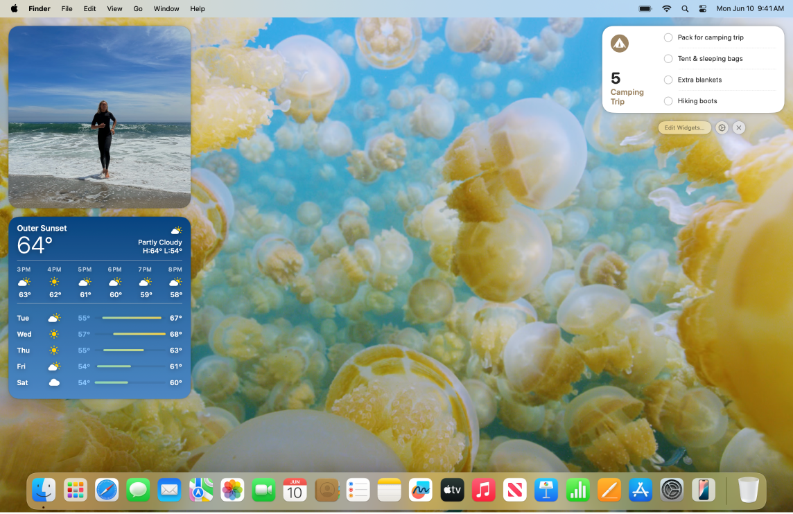

*图：Mac 桌面使用自定义墙纸。*

**将小组件添加到桌面。**把喜爱的 App 放在显要位置。点按屏幕右上方的日期或时间打开通知中心，再点按“添加小组件”打开小组件中心，以添加、移除或重新排列小组件；将新小组件拖到桌面任意位置或拖入通知中心。例如添加“照片”小组件查看相簿或回忆中的照片，或添加“播客”小组件陈列你喜爱的节目。

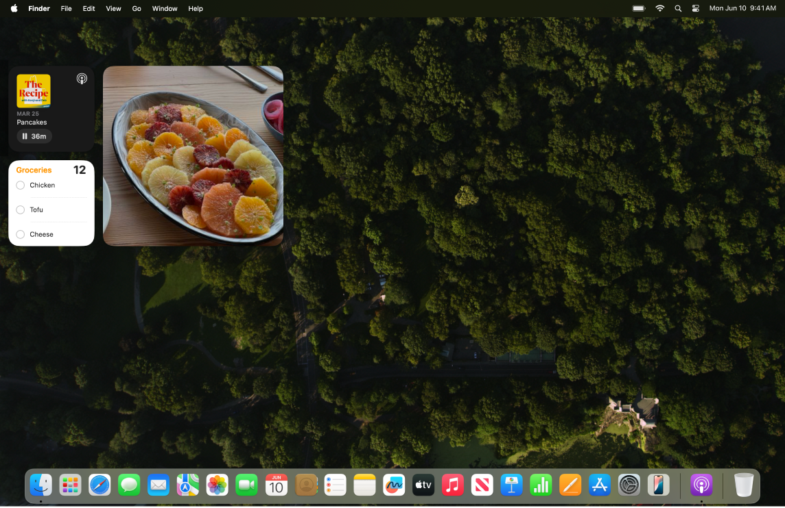

*图：Mac 桌面使用自定义墙纸。*

**制作拟我表情。**创建拟我表情以在 App 间代表自己，包括 Mac 上的登录窗口、你的 Apple 账户头像和“通讯录”中的“我的名片”。打开「系统设置」，点按“用户与群组”，点按登录名旁的头像，点按“拟我表情”，再点按下面的“添加”按钮以选择和创建面部图像。

*图：“添加”按钮*

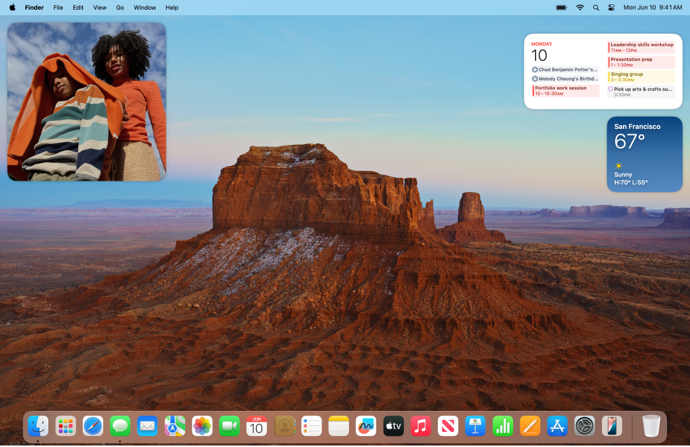

*图：Mac 桌面使用自定义墙纸。*

**设置多个桌面。**使用“调度中心”创建多个工作和娱乐空间。按键盘顶行的调度中心键进入调度中心，然后点按“添加桌面”按钮。你可以在工作时把窗口从一个空间拖移到另一个空间，以及添加或删除空间。

*图：调度中心键*

**要点**：墙纸、屏幕保护程序、拟我表情、空间都从「系统设置」或“调度中心”进入；同一图像可兼作墙纸与屏幕保护程序。

## 系统设置

在「系统设置」中，你可以自定义 iMac 并调整其设置：添加兼作墙纸的屏幕保护程序、管理通知、通过“显示器”设置更改亮度或分辨率、调整“辅助功能”设置、下载最新的软件更新等。

若要开始，点按程序坞中的“系统设置”图标，或选取「苹果菜单 > 系统设置」，然后点按边栏中你要调整的设置（若要查看全部设置，可能需要向下滚动）。**【提示】** 不确定某项设置的位置时，使用搜索栏——随着你键入，结果会出现在边栏中。

*图：“系统设置”图标*

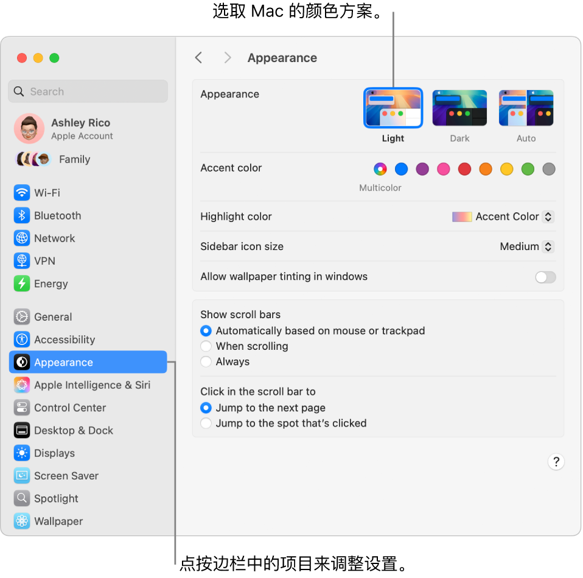

*图：“系统设置”中的“外观”窗口。*

本章各页涉及的设置面板（点边栏进入，需向下滚动可看到全部）：

- 外观
- 墙纸
- 屏幕保护程序
- 锁定屏幕
- 控制中心
- 显示器
- 用户与群组
- 屏幕使用时间
- 辅助功能（旁白 / 缩放 / 显示 / 助听设备 / 音频 / 语音控制 / 语音 / 键盘等）
- 通用（软件更新 / 时间机器）

**锁定屏幕。**可将 iMac 设定为在不活跃一段时间后关闭显示屏或开始屏幕保护程序，也可设定返回时需要输入密码解锁屏幕。若要设置，前往「系统设置」中的“锁定屏幕”。

**选取屏幕保护程序。**慢动作屏幕保护程序可在你离开 Mac 以及用作墙纸时，使 iMac 显示屏成为一件艺术品。若要设置，前往「系统设置」中的“屏幕保护程序”。如果选取“自然景观”“城市景观”“水下景观”“地球”或“随机播放航拍”屏幕保护程序，你还可以打开“显示为墙纸”将其用作墙纸。

**自定义控制中心和菜单栏。**选取要在控制中心或菜单栏中显示的设置。在「系统设置」中点按边栏的“控制中心”，然后选取选项。

*图：控制中心图标*

**更新 macOS。**在「系统设置」中点按“通用”，再点按“软件更新”以查看 Mac 是否运行最新版本的 macOS，并可指定软件自动更新的选项。

**iCloud 和“家人共享”设置。**在 iMac 上通过 Apple 账户登录 iCloud，管理 App 使用 iCloud 的方式，以及设置和管理“家人共享”。

**注意**：多数自定义功能的入口都是边栏中的同名面板；找不到时用搜索栏最快。

## 显示器设置

**匹配周围的光线（原彩显示）。**iMac 采用原彩显示技术，自动调整显示器颜色以匹配环境光，提供更自然的观看体验。在「系统设置」的“显示器”设置中打开或关闭原彩显示。

**使用动态桌面。**使用动态桌面图片时，桌面图片会随你所在位置的时间推移而自动变化。点按「系统设置」中的“墙纸”，选取“动态桌面”的图片。若要使屏幕基于你所在的时区而变化，请启用“定位服务”；如果关闭“定位服务”，图片将基于“日期与时间”设置中指定的时区而变化。

**更改项目在屏幕上的显示方式。**更改显示屏分辨率以使屏幕内容变大，或增加文本和图标的大小使其更易看清；你也可以使指针更易于看清，或摇动鼠标来快速找到它。

**通过深色模式保持专注。**可为桌面、菜单栏、程序坞和所有内建 macOS App 使用深色方案：内容凸显并居中，变暗的控件和窗口隐入背景。“邮件”“通讯录”“日历”“信息”等 App 以黑底白字显示，光线较暗时更护眼。“深色模式”专为编辑照片和图像的专业人士设计（颜色和细节在深色背景中更凸显），也适合想专注内容的用户。

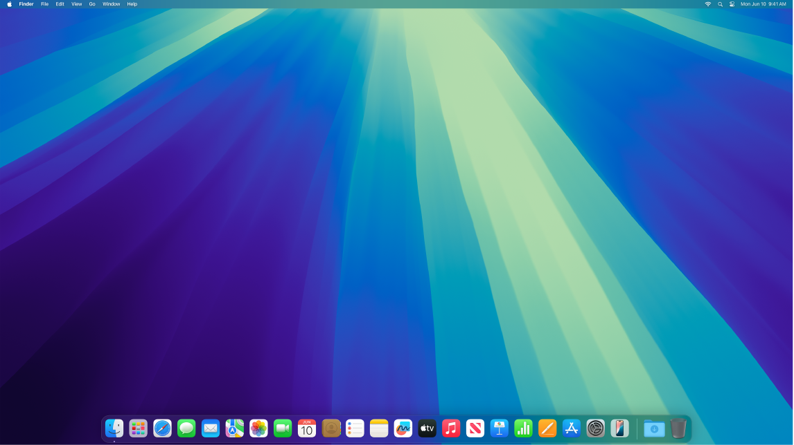

*图：处于“深色模式”的桌面。*

**夜览。**夜间或光线不足时将 Mac 切换到更暖的颜色，减少明亮的蓝光暴露（蓝光会导致失眠，较暖的屏幕颜色有助于睡眠）。可设定在特定时段自动开关，或设为日落到日出时段内启用。打开「系统设置」，点按“显示器”，点按底部的“夜览”按钮并设定选项，拖移滑块以调整色温。

**连接显示器。**可将外接显示器、投影仪或 HDTV 连接到 Mac。如不确定你的 Mac 支持连接几台外接显示器，请查看“技术规格”：打开「系统设置」，选取「帮助 > iMac 技术规格」，然后找到“视频支持”（可能需要滚动）。

**注意**：外接显示器数量上限以“iMac 技术规格”的“视频支持”为准，不要凭型号臆测。

## 屏幕使用时间

“屏幕使用时间”可让你了解在 iMac 上所花时间，提供各种工具帮你在停用期间远离电脑，并让你监控子女在其 Apple 设备上的活动。

**查看使用 iMac 的情况。**打开「系统设置」，选取边栏中的“屏幕使用时间”，然后点按“App 与网站活动”“通知次数”或“使用次数”（可能需要先打开“屏幕使用时间”，这些选项才会出现）。查看某天或整周使用 App 和网站的时间、通知次数最多的 App，以及每天使用设备的频率。

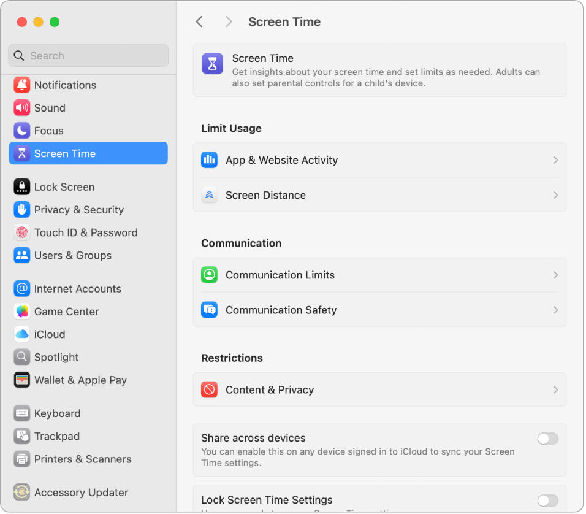

*图：“屏幕使用时间”设置窗口显示查看“App 使用时间”、“通知次数”和“使用次数”的选项，以及管理屏幕使用时间的选项，例如计划停用时间，设定 App 限额和限定通信等。*

**设定限额。**设定限额以控制你在特定 App、App 类别和网站上花费的时间。在“屏幕使用时间”中，选取“停用时间”，打开“停用时间”，然后点按“定时”弹出式菜单以创建每日定时，或为一周的每一天自定义时间。

**不错过重要的信息。**选取始终需要访问的 App 或网站。在“屏幕使用时间”中选取“始终允许”，然后打开想要在停用期间仍可使用的 App。

**管理子女的屏幕使用时间。**父母可在其 Mac、iPhone 或 iPad 上配置“屏幕使用时间”，子女设备上的一切内容都会相应设置；还可以为“音乐”和“图书”App 设定基于年龄的媒体分级。

**要点**：限额/停用/始终允许三项配合使用；家长设备上的配置会同步到子女设备。

## 辅助功能

Mac 包括辅助功能工具，使 Apple 功能可供所有人轻松使用。若要访问这些工具，打开「系统设置」，点按边栏中的“辅助功能”。“辅助功能”设置分为五个类别：

- *视觉：*放大屏幕内容、使指针变大以及应用色彩滤镜等。
- *听觉：*显示和自定义屏幕字幕、配对助听设备、进行实时文本 (RTT) 通话、获取音频的实时字幕、设定 AirPods 的辅助功能选项等。
- *肢体活动能力：*通过语音命令、键盘上的按键、屏幕键盘、面部表情或辅助设备来控制 Mac 和 App。
- *语音：*键入要说的话并让设备将其大声朗读出来；你也可以创建个人声音。
- *通用：*自定义键盘快捷键以快速打开或关闭辅助功能。

### 视觉

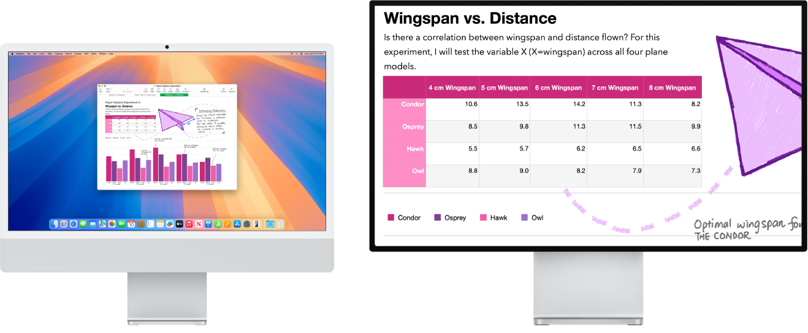

*图：右侧显示器上的“缩放显示”处于活跃状态，而左侧显示器的屏幕大小固定。*

**使用内建屏幕朗读器“旁白”。**“旁白”可大声描述屏幕上显示的内容，朗读文稿、网页和窗口中的文本；可用键盘或触控板手势控制 Mac；还可连接可刷新盲文显示器搭配使用。若要打开“旁白”，执行以下任一项：

- 按下 `Command-F5`（若“旁白”已打开，再按会关闭它）。
- 使用 Siri，例如说“打开旁白”或“关闭旁白”。
- 选取「苹果菜单 > 系统设置」，点按边栏中的“辅助功能”（可能需要向下滚动），点按“旁白”，然后打开或关闭“旁白”。

**通过“缩放”调整视图。**可放大部分或整个屏幕；如果有多个监视器，可在一个监视器上放大显示，而在其他监视器上使用标准分辨率。若要更改缩放设置，选取「苹果菜单 > 系统设置」，点边栏“辅助功能”，再点“缩放”。

**通过“悬停文本”放大字词。**在「系统设置」中点“辅助功能”>“缩放”，然后打开底部的“悬停文本”。按住 `Command` 键并将指针放在文本上，屏幕上会出现包含缩放文本的窗口。

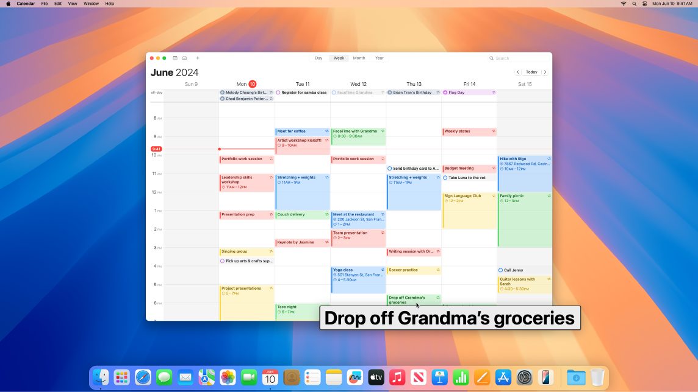

*图：“悬停文本”功能将放大的文本显示在新窗口中。*

**调整 Mac 显示器色彩。**可使用色彩滤镜调整显示器色彩：前往「系统设置」>“辅助功能”>“显示”，打开或关闭“色彩滤镜”。若要快速开关，按下 `Option-Command-F5`；如果 Mac 或妙控键盘配备触控 ID，快速按三下触控 ID。

### 听觉

**实时添加字幕。**使用“实时字幕”为对话、音频和视频添加实时字幕。**【重要事项】** 实时字幕并非在所有语言、国家或地区都可用；准确度可能有所不同，且在高风险或紧急情况下不应依赖。

**使用助听设备。**将 Made for iPhone (MFi) 助听器或声音处理器直接与 Mac 配对，以流播放音频并调整其设置。若要配对，选取「苹果菜单 > 系统设置」，点边栏“辅助功能”，再点“助听设备”。

**自定义 AirPods。**设定 AirPods 的辅助功能选项来放大柔音和调整某些频率，让音乐、电影、通话和播客听起来更清楚。

**消弭不必要的噪声。**消弭环境杂声并通过播放海洋或雨声等舒缓声音减少干扰。若要打开背景音，选取「苹果菜单 > 系统设置」，点边栏“辅助功能”，再点“音频”并打开“背景音”，从各种声音中选择并拖移滑块调整音量。

### 肢体活动能力

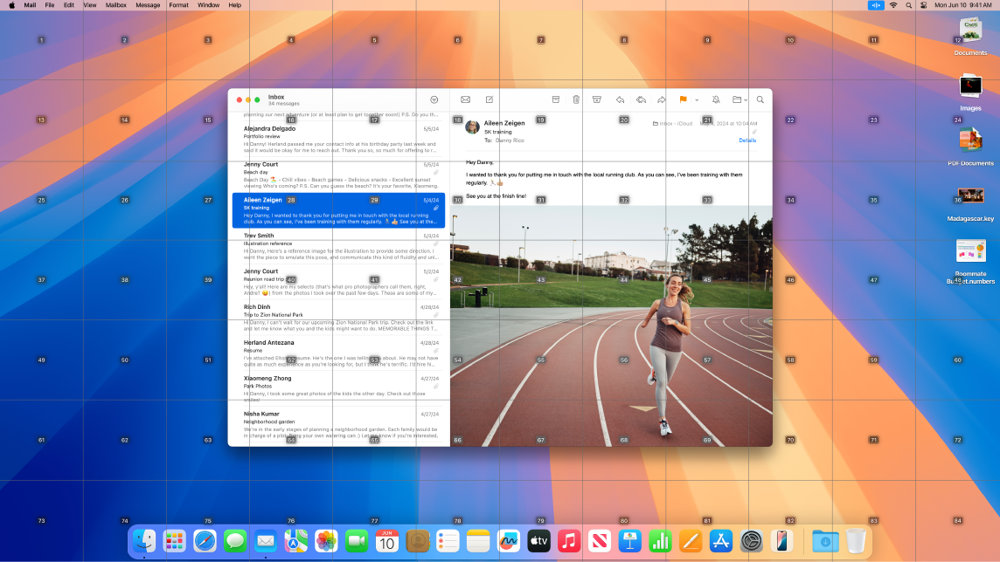

*图：“邮件”在桌面上打开，带有网格叠层。*

**通过语音控制 Mac。**使用“语音控制”以通过语音执行一系列操作；它在 Mac 本机处理所有音频，确保个人数据安全私密。若要打开，选取「苹果菜单 > 系统设置」，点边栏“辅助功能”，再点“语音控制”。

**自定义指针。**自定义鼠标指针的轮廓和填充颜色，以便指针在移动或改变形状时更易识别。

**改进的键盘访问。**一组扩展的键盘快捷键允许你通过键盘控制 Mac 上的所有操作，无需鼠标或触控板。

### 语音

**让 Mac 为你朗读。**通过实时语音，可在打电话、FaceTime 通话及面对面交谈时键入要说的话并让设备大声朗读；存储常用短语以便快速插话；可选取要使用的声音或录制个人声音。

**使用人声快捷指令。**设置 Mac 在你说出所选字词或其他声音时执行操作。若要使用，选取「苹果菜单 > 系统设置」>“辅助功能”，前往“语音”，再点“人声快捷指令”。

**让 Siri 听取非典型语音。**如果你有影响语言能力的后天或慢性疾病，可让 Siri 识别更广泛的非典型语音模式。

**要点**：`Command-F5` 开关旁白、`Option-Command-F5`（或按三下触控 ID）开关色彩滤镜是最常用的两个辅助功能快捷键。

## 管理窗口

桌面上常会打开多个 App、每个 App 一个或多个窗口。你可以使某个 App 铺满整个屏幕、选取两个 App 共享屏幕，或调整自定义工作空间布局；用“台前调度”自动整理 App 和窗口避免杂乱并在任务间快速移动；需要查找被遮挡的窗口时用调度中心在一层中显示所有打开的窗口；也可用多个桌面空间在不同桌面上展开工作并在其间轻松移动。

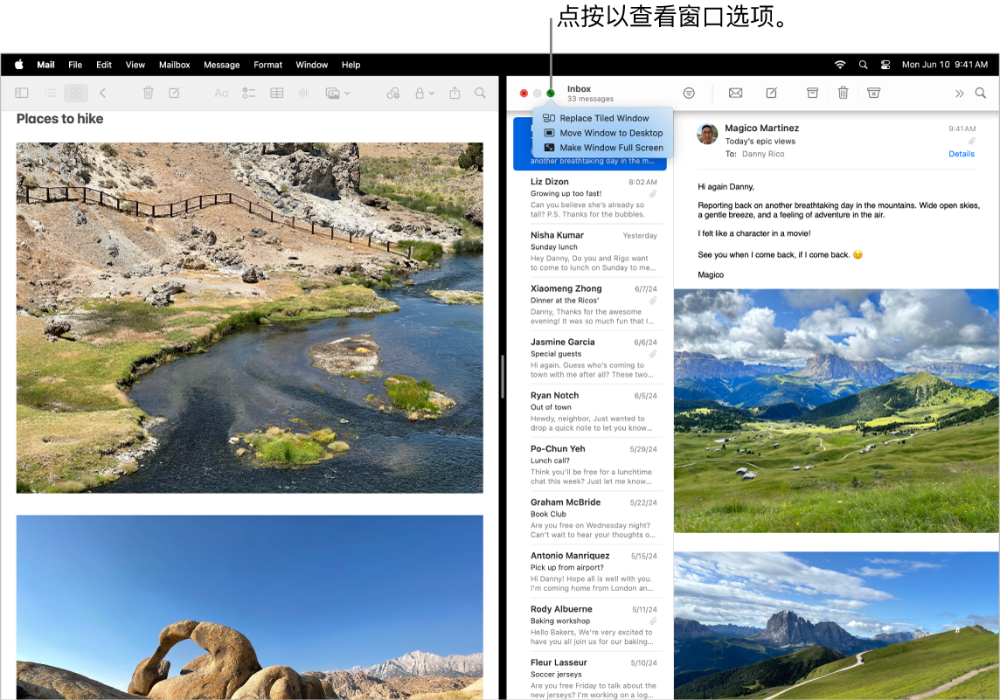

*图：Keynote 演示文稿填充了屏幕的左侧，Pages 文稿填充了右侧。绿色按钮下方打开了一个弹出式菜单，显示“替换拼贴窗口”、“将窗口移到桌面”和“全屏显示窗口”的选项。*

**使用整个屏幕（全屏幕视图）。**用全屏幕视图专注于某个 App；全屏幕视图中菜单栏会被隐藏，直到你将指针移到屏幕顶部（也可选择始终显示菜单栏）。若要进入或退出，将指针移到窗口左上角的绿色按钮上，然后从出现的菜单中选取“全屏幕”。

**拆分屏幕（分屏浏览）。**用分屏浏览在并排显示的两个 App 窗口中工作。将指针移到你要使用的窗口左上角的绿色按钮，点按“全屏幕”，然后选取“屏幕右侧”或“屏幕左侧”来放置窗口；点按另一个窗口，它会自动填充屏幕的另一半。将指针放在绿色按钮上可查看切换 App、使两个窗口全屏显示等选项。

**平铺窗口。**移动窗口并调整其大小，或排列窗口以填满屏幕。将指针移到你要使用的窗口左上角的绿色按钮上，然后选取你要如何排列屏幕。**【提示】** 想看清打开了多个窗口的桌面时，点按桌面墙纸的任意位置以快速将所有打开的窗口移到一边；准备好继续处理时，再次点按桌面墙纸以重新打开这些窗口。

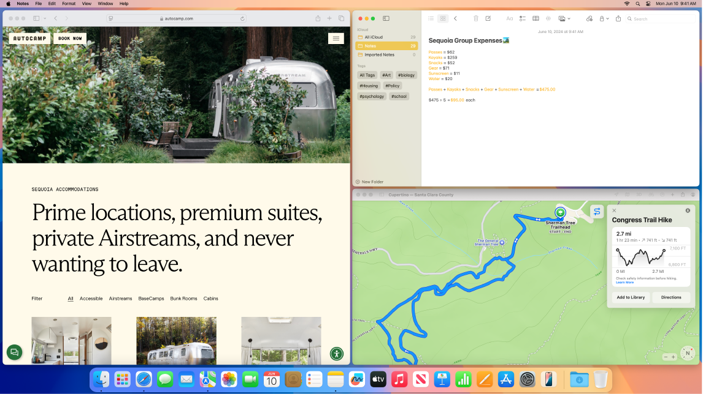

*图：屏幕显示平铺在左侧的 Safari 浏览器和平铺在右侧的“备忘录”和“信息”。*

**小组件。**将小组件中心的小组件放在桌面上，以便随时访问常用 App。点按菜单栏中的日期和时间，或按住 `Control` 键点按桌面，然后点按“编辑小组件”以添加、移除或重新排列小组件；可将新小组件拖到桌面任意位置或拖入通知中心。如果 iPhone 和 Mac 通过相同 Apple 账户登录，你还可以将 iPhone 小组件添加到桌面，无需在 Mac 上安装相应的 App。

**台前调度。**自动整理 App 和窗口，避免桌面杂乱：想要专注的内容位于正中间，其他窗口排列在一边，点按一下即可访问。打开控制中心，然后点按“台前调度”。

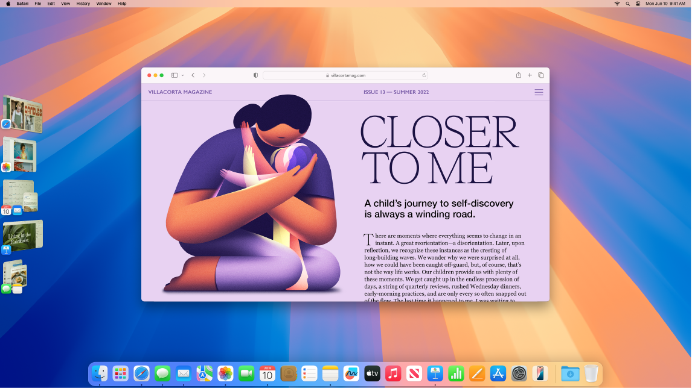

*图：屏幕显示“台前调度”，Safari 浏览器屏幕在主页面上，其他 App 在左侧。*

**调度中心。**快速将打开的窗口移到单个分层中，然后点按窗口以返回到常规视图（该窗口位于前面且处于活跃状态）。如果你有更多桌面（空间）或在分屏浏览中打开了 App，它们沿屏幕顶部成排显示。若要进入或退出调度中心，按下键盘顶行的调度中心键，或按下 `Control-上箭头`键；也可将调度中心图标添加到程序坞。

*图：调度中心键*

*图：调度中心 App 图标*

**一个桌面不够用时（多个空间）。**将 App 窗口整理到多个桌面空间中，工作时按需切换。若要创建空间，进入调度中心并点按“添加桌面”按钮。使用键盘快捷键和调度中心在空间之间移动；你可以在工作时将窗口从一个空间拖移到另一个空间，以及添加或删除空间。

*图：“添加”按钮*

**就像水平交通信号灯。**每个窗口左上角的红色、黄色和绿色按钮不仅是为了美观：

- 红色按钮关闭 App 窗口。对某些 App，这会退出 App 并关闭其所有已打开的窗口；对另一些 App，只关闭当前窗口但不退出 App。
- 黄色按钮暂时关闭窗口并将其放在程序坞的右侧；想重新打开时，在程序坞中点按它以展开。
- 绿色按钮是将窗口改为全屏幕和分屏浏览等模式的快速方式。

**注意**：全屏幕、分屏浏览、平铺三种排列都从窗口左上角绿色按钮的弹出菜单进入。

## 截屏

探索“截屏”菜单以查找截屏和录屏所需的所有控制；录屏时还可捕捉你的声音。优化的工作流程让你拍摄屏幕的照片和视频，然后轻松共享、编辑或存储。

**访问截屏控制。**按下 `Command-Shift-5`。你可以捕捉整个屏幕、所选窗口或窗口的一部分；也可以录制整个屏幕或屏幕的所选部分。使用屏幕底部的图标来捕捉屏幕所选内容、录制屏幕等。点按“选项”以修改存储位置、设定何时进行捕捉的计时器、设定麦克风和音频选项或显示指针；点按“捕捉”或“录制”以截屏或录制视频。

*图：捕捉屏幕所选内容图标*

*图：录制屏幕图标*

截屏或录制视频后，其缩略图会显示在屏幕的一角。将缩略图拖到文稿或文件夹中，轻扫到右侧以快速存储它，或点按以进行编辑或共享。*【注】* 你还可以通过以下方式打开“截屏”实用工具：从启动台中的“其他”文件夹打开，或在“访达”中前往「App > 实用工具」文件夹。

**标记截屏。**点按截屏的缩略图以使用“标记”工具添加注解；还可点按“共享”图标直接从截屏将标记的屏幕发送给同事或朋友。

*图：“共享”图标*

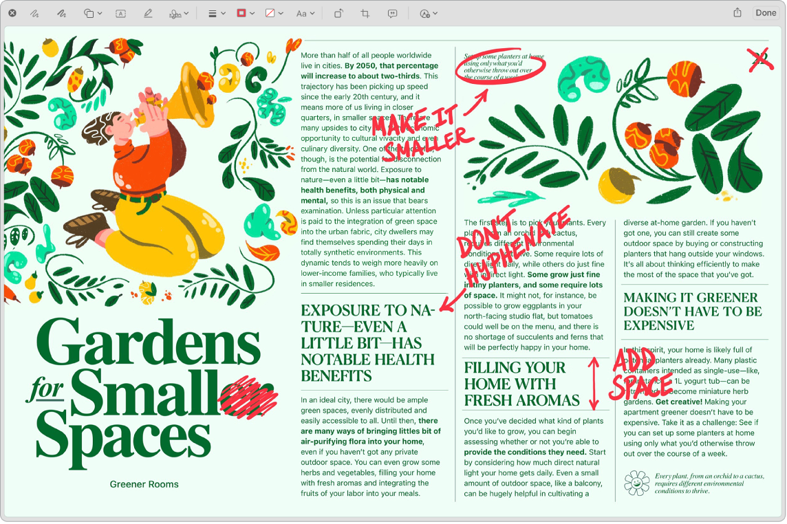

*图：标记的截屏以红色显示编辑和改正处。*

**要点**：`Command-Shift-5` 是截屏与录屏的统一入口；“选项”里可改存储位置、计时器、麦克风/音频与是否显示指针。

## 将你的数据传输到新 iMac

你可以向新 iMac 传输另一台 Mac 或 PC 上的文件和设置。首次启动新 iMac 时，系统会询问你是否要从另一台电脑传输数据。如需立即传输，可用以下选项之一。

开始之前：

- 将之前的电脑和新电脑同时升级至最新版本的操作系统（用页面顶部菜单选取当前操作系统以获得最准确说明）。
- 若要以无线方式传输数据，确保两台电脑都接入同一个网络。

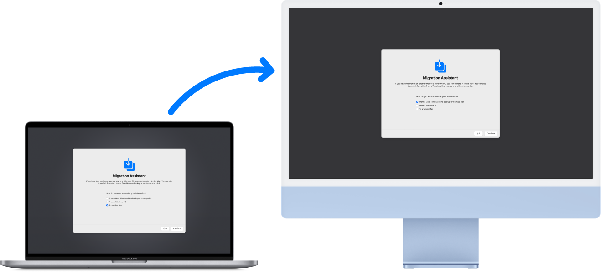

*图：同时显示“迁移助理”屏幕的 MacBook Pro 和 iMac。一个从 MacBook Pro 指向 iMac 的箭头表示数据从 MacBook Pro 传输到 iMac。*

**从另一台 Mac 传输数据。**使用“迁移助理”通过有线或无线网络传输数据，或使用以太网线缆连接旧电脑和新电脑传输。在两台 Mac 上，打开“访达”窗口，前往“应用程序”，打开“实用工具”文件夹，然后连按“迁移助理”并按屏幕指示操作。若以无线方式传输，请在迁移过程中保持电脑彼此靠近。

**从 PC 传输数据。**使用“Windows 迁移助理”通过有线或无线网络传输数据（在 Apple 支持文章里查找适用于 Windows PC 的正确版本“迁移助理”）。

**从储存设备传输数据。**使用合适的转换器（需要时）将储存设备连接到 iMac，再按“将信息从其他电脑或设备传输到 Mac”的说明操作。

**从时间机器备份传输数据。**如果之前电脑的硬盘内容已损坏、需要从时间机器备份恢复，可使用“迁移助理”完成（详见本章“备份和恢复 Mac”）。

**注意**：迁移前两台电脑都要升级到最新系统；无线迁移需在同一网络且彼此靠近。

## 备份和恢复 Mac

请务必定期备份 iMac 以避免文件丢失。你可以使用 Mac 内建的时间机器来备份 App、账户、设置、音乐、照片、电影和文稿；**时间机器不会备份 macOS 操作系统**。

**确定文件的备份位置。**时间机器可备份到已连接 iMac 的外置储存设备及其他支持的储存设备（可用磁盘列表见 Apple 支持文章“可与‘时间机器’搭配使用的备份磁盘”）。

**设置时间机器。**开始之前，参阅储存设备随附的文稿，确保 iMac 与外置储存设备接入同一个 Wi-Fi 网络，或使用连接线及合适的转换器（需要时）将外置储存设备连接到 iMac。打开「系统设置」，点按「通用 > 时间机器」，然后点按“添加备份磁盘”，选择用于备份的驱动器即可。

**恢复文件。**你可以使用时间机器恢复文件，并选择仅恢复部分文件或一次恢复所有文件。点按菜单栏中的时间机器图标，然后选取“浏览时间机器备份”；选择要恢复的一个或多个项目（单个文件夹或整个磁盘），然后点按“恢复”。*【注】* 如果时间机器图标不在菜单栏中，选取「苹果菜单 > 系统设置」，点边栏“控制中心”，点“时间机器”旁的弹出式菜单，然后选取“在菜单栏显示”。

*图：时间机器图标*

**重新安装 macOS。**操作系统文件与个人文件分开保存在密封的系统磁盘里，但部分操作（如抹掉磁盘或磁盘意外损坏）需要你恢复 iMac。你可以重新安装 macOS，然后使用时间机器从备份中恢复个人文件。在 macOS Big Sur 及更高版本中可通过多种方式恢复 Mac；你可能需要安装比电脑最初预装、或磁盘损坏前你所使用的 macOS 更新的版本。

**【重要事项】**高级用户不妨创建可引导的安装器以供将来重新安装 macOS；如果你想使用特定版本的 macOS，这将很有用。

**要点**：时间机器备份到外置/支持的储存设备，路径是「系统设置 > 通用 > 时间机器 > 添加备份磁盘」；恢复用菜单栏时间机器图标的“浏览时间机器备份”。

## 本章速查

**快捷键**

| 操作 | 按键 |
| --- | --- |
| 打开截屏控制（截屏/录屏） | `Command-Shift-5` |
| 打开/关闭“旁白” | `Command-F5` |
| 打开/关闭“色彩滤镜” | `Option-Command-F5`，或快速按三下触控 ID |
| 悬停文本放大字词 | 按住 `Command` 并将指针放在文本上 |
| 进入/退出调度中心 | 调度中心键，或 `Control-上箭头` |
| 点按桌面墙纸 | 快速移开/恢复所有打开的窗口 |

**常用菜单路径（均以「系统设置」为主入口）**

| 目的 | 路径 |
| --- | --- |
| 更换墙纸 | 「系统设置」>“墙纸” |
| 屏幕保护程序 / 兼作墙纸 | 「系统设置」>“屏幕保护程序”（打开“显示为墙纸”） |
| 不活跃后关屏/需密码解锁 | 「系统设置」>“锁定屏幕” |
| 控制中心与菜单栏项目 | 「系统设置」>“控制中心” |
| 软件更新 | 「系统设置」>「通用 > 软件更新」 |
| 原彩显示 / 夜览 / 外接显示器规格 | 「系统设置」>“显示器”；「帮助 > iMac 技术规格」看“视频支持” |
| 深色模式 | 「系统设置」>“外观” |
| 使用统计 / 停用 / 始终允许 / 子女限额 | 「系统设置」>“屏幕使用时间” |
| 旁白 / 缩放 / 悬停文本 / 色彩滤镜 / 助听设备 / 背景音 / 语音控制 / 人声快捷指令 | 「系统设置」>“辅助功能” |
| 设置时间机器备份 | 「系统设置」>「通用 > 时间机器 > 添加备份磁盘」 |
| 拟我表情/头像 | 「系统设置」>“用户与群组”>点登录名旁头像 |

**窗口管理**

- 全屏幕 / 分屏浏览 / 平铺：指针移到窗口左上角绿色按钮，从弹出菜单选取。
- 台前调度：打开控制中心，点“台前调度”。
- 调度中心：调度中心键或 `Control-上箭头`；多个空间/分屏 App 沿屏幕顶部成排显示。
- 多桌面：进入调度中心点“添加桌面”按钮，可跨空间拖移窗口、添加或删除空间。
- 红/黄/绿按钮：红=关窗（部分 App 会退出）、黄=缩到程序坞右侧、绿=全屏幕/分屏/平铺。

**传输与备份**

- 迁移：两台电脑先升级到最新系统；Mac 用“迁移助理”（「访达 > 应用程序 > 实用工具」），PC 用“Windows 迁移助理”；无线需同网络并彼此靠近。
- 时间机器备份 App/账户/设置/媒体/文稿，但不备份 macOS 本身；恢复从菜单栏时间机器图标 >“浏览时间机器备份”。
