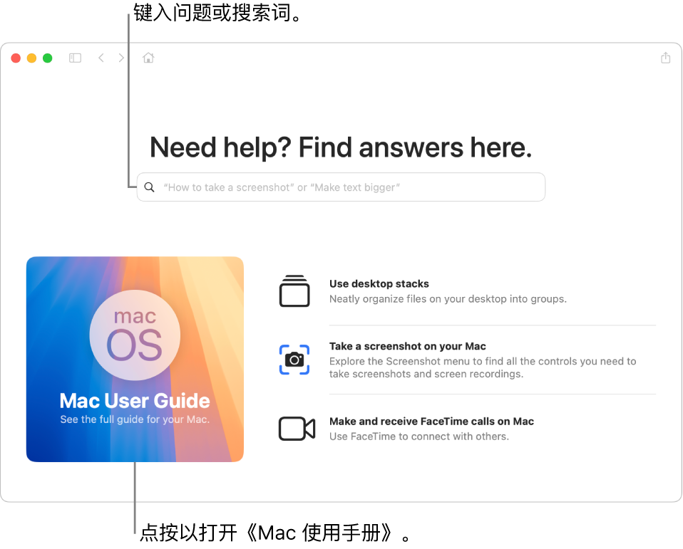
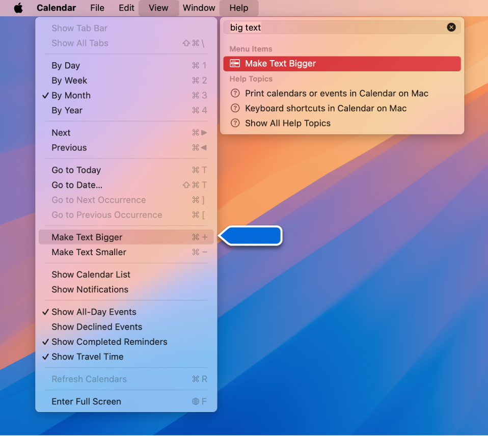
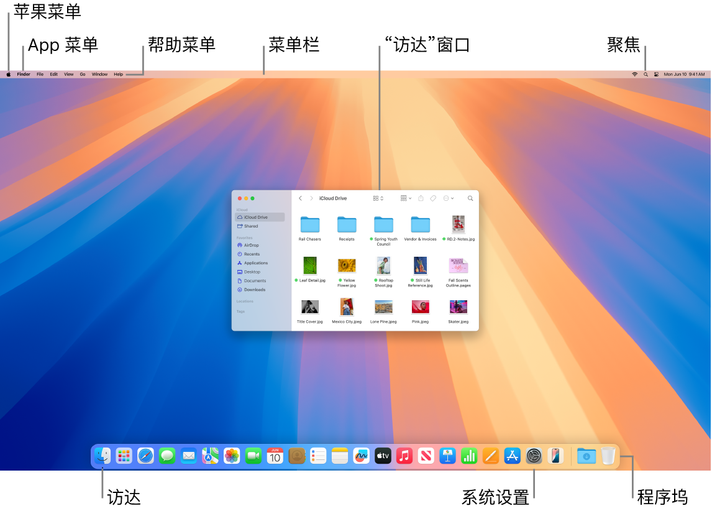
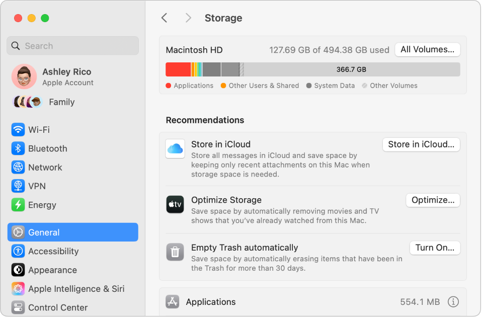

# 第 7 章 · 获得答案：内置手册、新手入门、FAQ、键盘快捷键与安全功能

> 来源：苹果《iMac 使用手册》2024 年款 · macOS Sequoia 15 · 「获得答案」部分（手册第 45–51 页）

## 使用《Mac 使用手册》

《Mac 使用手册》涵盖如何使用 iMac 的大量信息。

**获得帮助。** 打开「提示」App，或点按程序坞中的

*图：“访达”图标*

再点菜单栏「帮助」>「Mac 使用手册」，在搜索栏键入问题或搜索词并从结果选取主题。

*图：“提示”App 的手册首页与搜索栏*

**探索主题。** 点「目录」浏览后点选主题阅读，或在搜索栏键入内容直达答案。

**忘记菜单项位置时**：在「帮助」中搜索该命令，指针悬停在结果上，箭头即指出其菜单位置。

*图：搜索命令时，“格式”菜单中的对应项高亮*

进一步了解：[《Mac 使用手册》](https://support.apple.com/zh-cn/guide/mac-help)。

## Mac 新手？

第一台 Mac（尤其从 Windows 转来）的对照信息。

*图：Mac 桌面的主要区域*

**桌面**上有：

- **菜单栏**：始终在屏幕顶部（桌面或活跃 App），用于查找选项、执行任务。
- **程序坞**：在桌面底部（可在「系统设置」改位置），类似 Windows 任务栏加「开始」菜单；显示已打开的 App，点图标启动或用「启动台」。
- **访达**：点程序坞的访达图标打开，整理和查找文件（类似「文件资源管理器」）；窗口顶部按钮切换以下四种视图，任何视图中选中文件按 `空格键` 即用「快速查看」预览，无需打开文件。

  
  *图：“图标视图”图标*

  
  *图：“列表视图”图标*

  
  *图：“分栏视图”图标*

  
  *图：“画廊视图”图标*

- **聚焦**：搜索 Mac 上任何内容（文稿、联系人、电子邮件信息等），也能启动 App、搜索网页；点屏幕右上方图标或按 `Command-空格键`。

  
  *图：“聚焦”图标*

- **系统设置**：类似 Windows「控制面板」，用桌面、程序坞、显示器、蓝牙、网络等设置自定义。

  
  *图：“系统设置”图标*

**键盘**：Command 键

*图：Command 键图标*

类似 Windows 的 Control 键（`Command-C` 拷贝、`Command-V` 粘贴）；`Return` = Windows 的 `Enter`；`Delete` = 退格键，向前删除按 `Fn-Delete`。键位差异另见 [Windows 转 Mac 的提示](https://support.apple.com/102323)。

**安装 App**：来自 App Store 或互联网；互联网下载得到磁盘映像 `.dmg` 或软件包 `.pkg`，在「下载」文件夹连按并按屏幕指示操作，装完系统提示删除该文件。**卸载**：把「应用程序」文件夹中的 App 拖到「废纸篓」；部分 App 自带卸载器，可一并删除关联文件。

**窗口按钮**（窗口左上角；一个 App 可开多个窗口）：

- 
  *图：“关闭窗口”按钮*：点按或 `Command-W` 关窗口而非 App；`Option-Command-W` 关该 App 全部窗口；`Command-Q` 退出 App。
- 
  *图：“最小化窗口”按钮*：点按或 `Command-M`；App 保持打开，窗口缩为程序坞右侧图标，点图标恢复。
- 
  *图：“全屏幕窗口”按钮*：点按全屏；**按住 `Option` 点按则最大化**；悬停可看更多选项（如平铺窗口）；按 `Esc` 恢复。

**移动窗口**：拖标题栏（某些窗口无法移动）。**切换 App**：`Command-Tab` 切到上一个 App；按住 `Command` 按 `Tab` 显示全部已打开 App 的图标，用 `Tab`/箭头键选中后松开即进入。**截屏**：`Command-Shift-5` 打开「截屏」实用工具。

**Siri**：点按菜单栏的

*图：Siri 图标*

或

*图：“Apple 智能 Siri”图标*

；「嘿 Siri」选项打开后直接说「嘿 Siri」或「Siri」再讲请求，也可按住妙控键盘听写/Siri 键（`F5`）或用 Siri 设置中选定的快捷键，让它打开文件夹、启动 App、调亮屏幕等。

**配合 iPhone/iPad/Apple Watch**：各设备用同一 Apple 账户登录即可跨设备共享文件和照片、编辑文稿、回复电子邮件、接电话、发送文本信息。

## 关于 Mac 的常见问题

- **iMac 支持**：见 [iMac 支持](https://support.apple.com/zh-cn/mac/imac)。
- **截屏**：见「键盘快捷键」的 `Command-Shift-3`/`-4`/`-5`。
- **查看序列号**：选取

  
  *图：苹果菜单的苹果标志*

  「苹果菜单 > “关于本机”」即列出；序列号也印在 iMac 支架底部。
- **确认机型**：[识别 iMac 机型](https://support.apple.com/108054) 或「苹果菜单 > “关于本机”」。
- **查找文稿**：「系统设置」→「帮助」→「使用手册」得*《iMac 入门指南》*；同菜单点「macOS 帮助」打开系统手册；较早机型见[按产品浏览手册](https://support.apple.com/zh_CN/manuals)。
- **App 内帮助**：点按菜单栏的「帮助」菜单。
- **安全性信息**：见手册「Mac 的重要安全性信息」。
- **技术规格**：[iMac 技术规格](https://www.apple.com/cn/imac-24/specs/)，或「系统设置」→「帮助」→「iMac 技术规格」。
- **挂墙**：用 VESA 支架转换器，**应仅由 Apple 安装或拆卸**；服务找 Apple 零售店或授权服务提供商（[维修服务](https://support.apple.com/zh-cn/mac/repair/service)）。
- **磁盘问题**：用「磁盘工具」的[修复储存设备](https://support.apple.com/zh-cn/guide/disk-utility/dskutl1040)。
- **重装 macOS**：用 macOS 恢复功能（[重新安装 macOS](https://support.apple.com/102655)）。*注：自 macOS Big Sur 起时间机器备份不再包括系统文件。*
- **出售或折抵前**：备份数据后恢复出厂设置（[折抵前该怎么做](https://support.apple.com/102773)）。

## 键盘快捷键

组合键可完成通常用触控板、鼠标等执行的操作。常用快捷键如下。

*注*：App 内快捷键随语言和键盘布局而变；若某键未按预期工作，到菜单栏的 App 菜单查看实际快捷键，或用[「虚拟键盘」](https://support.apple.com/zh-cn/guide/mac-help/mchlp1015)查看当前布局（输入法）。

| 快捷键 | 描述 |
| --- | --- |
| `Command-X` | 剪切所选项目并将其拷贝到剪贴板。 |
| `Command-C` | 将所选项目拷贝到剪贴板。 |
| `Command-V` | 将剪贴板上的内容粘贴到当前文稿或 App 中。 |
| `Command-Z` | 撤销上一个命令。按下 `Command-Shift-Z` 以重做。 |
| `Command-A` | 选择所有项。 |
| `Command-F` | 打开“查找”窗口，或者在文稿中查找项目。 |
| `Command-G` | 查找当前搜索项目的下一个出现位置。按下 `Command-Shift-G` 以查找上一个出现位置。 |
| `Command-H` | 隐藏最前面 App 的窗口。按下 `Command-Option-H` 以查看最前面的 App，但是隐藏所有其他 App。 |
| `Command-M` | 将当前窗口最小化到程序坞。按下 `Command-Option-M` 以最小化最前面 App 的所有窗口。 |
| `Command-N` | 打开新的文稿或窗口。 |
| `Command-O` | 打开所选项目，或者打开对话框以选择要打开的文件。 |
| `Command-P` | 打印当前文稿。 |
| `Command-S` | 存储当前文稿。 |
| `Command-W` | 关闭当前窗口。按下 `Command-Option-W` 以关闭 App 的所有窗口。 |
| `Command-Q` | 退出当前 App。 |
| `Command-Option-Esc` | 选取一个 App 以“强制退出”。 |
| `Command-Tab` | 在打开的 App 中切换到下一个最常用的 App。 |
| `Command-Shift-5` | 打开截屏实用工具。你还可以使用以下快捷键截屏：`Command-Shift-3` 拍摄整个屏幕的截屏；`Command-Shift-4` 拍摄所选屏幕区域的截屏。 |
| `>>` | 编写备忘录时，创建另一个所选备忘录的链接。 |

更多快捷键（功能键、访达、文本编辑等）见 [Mac 键盘快捷键](https://support.apple.com/102650)。

## iMac 的安全性功能

搭载 Apple 芯片的 iMac 提供以下安全性功能，保护电脑上的内容并防止启动时载入未经授权的软件 App：

- **安全启动**：默认自动打开，验证启动时载入的操作系统软件是否经 Apple 授权；若因检测到不信任的组件而无法启动，会从安全的恢复分区启动并自动修复可能的问题（[设定安全性选项](https://support.apple.com/zh-cn/guide/mac-help/mchl768f7291)）。
- **安全储存**：储存驱动器由**硬件密钥**加密，安全性高；但灾难性故障后数据可能无法恢复，需把文件备份到外部来源，并用时间机器或其他方案定期备份（[时间机器备份你的 Mac](https://support.apple.com/104984)）。
- **系统完整性**：验证启动时载入的 macOS 版本是否经 Apple 授权，并在后台持续保护为 macOS 建立的授权，使恶意软件或恶意网站更难利用你的 Mac。
- **数据保护**：除默认储存驱动器加密外，第三方 App 开发者还可使用**文件级别加密**保护敏感数据，且不影响系统性能。

*注*：macOS 升级期间断电等少数情况下 iMac 可能无反应，固件或需修复（[修复或恢复 Mac 固件](https://support.apple.com/108900)）；完整文档见[《Apple 平台安全保护手册》](https://support.apple.com/zh-cn/guide/security/welcome/web)。

**注意**：硬件加密不等于备份；本页仅上述四项（「查找我的 Mac」见 iCloud 部分；FileVault/防火墙/Gatekeeper/锁定模式本手册未展开）。

## 节省 iMac 的空间

「优化储存空间」按需让文件可用以自动释放空间：最早的文件存入 iCloud 及电子邮件 IMAP/Exchange 服务器以便随时下载；另有标识和删除大文件的工具。

**查看建议**：「苹果菜单 > “系统设置” > 通用 > 储存空间」可见基于 Mac 配置的建议。

*图：“储存空间”的三项“推荐”：储存在 iCloud 中、优化储存空间、自动清倒废纸篓*

可设定的选项：

- **储存在 iCloud 中**：所有文件、照片和信息存入 iCloud 以腾出 Mac 空间。**桌面和文稿**：两个文件夹的全部内容存入 iCloud 云盘，空间不足时本机保留最近打开的文件、最早的按需取回；**信息**：信息和附件全部存入 iCloud，空间不足时本机只保留最近的附件、最早的按需取回。文件存在云端也能从 iMac 上停留的位置继续访问。
- **优化储存空间**：优化 Apple 视频 App 中电影和电视节目的储存，可选定自动移除看过的影片或电视节目，随时可再次下载。
- **自动清倒废纸篓**：自动抹掉在废纸篓中超过 30 天的项目。

macOS 还会：防止从 Safari 浏览器重复下载同一文件；新 App 安装完成时提醒你移除软件安装器；空间不足时清除可安全移除的日志和缓存。

**要点**：开启「自动清倒废纸篓」前确认废纸篓内无须再取回的文件——超过 30 天即自动抹掉。

进一步了解：[优化 Mac 储存空间](https://support.apple.com/zh-cn/guide/mac-help/sysp4ee93ca4)。

## Mac 资源、服务和支持

**系统报告**：显示硬件型号、序列号、操作系统版本、已安装内存总量等；打开「苹果菜单 > “关于本机”」→「更多信息」→「系统报告」。

**Apple 诊断**：判断部件（如内存、处理器）是否有问题，识别来源、给出基本解决步骤，需要时联系 AppleCare。

- 准备：断开所有外接设备，**键盘、鼠标、显示器、以太网连接（如可用）和交流电源除外**；确保电脑已接入互联网。
- 开始：关机 → 按住电源按钮至出现启动选项窗口 → 按住 `Command-D` 进入诊断模式 → 选择所在地区的语言。基本测试需几分钟；发现问题会显示描述与说明。**退出前记录参考代码**，便于联系 AppleCare（[Apple 诊断](https://support.apple.com/102550)）。

**网上资源**：[Apple 支持](https://support.apple.com/zh-cn)可了解产品、查看在线手册、检查软件更新、联系其他用户、获取服务与建议；iMac 专项见 [iMac 支持](https://support.apple.com/zh-cn/mac/imac)。

**AppleCare 支持**：可协助安装与打开 App、故障排除。致电最近的支持中心，**前 90 天免费**（自购机之日起生效）；来电前备好**购买日期**和 **iMac 序列号**。号码全列表见[联系 Apple](https://support.apple.com/106932)，号码可能更改，可能收本地或国内长途费。

## 本章速查

| 需求 | 路径 / 操作 |
| --- | --- |
| 内置手册 | 「提示」App 或「帮助」菜单 >「Mac 使用手册」；「目录」浏览、搜索栏检索 |
| 命令在哪个菜单 | 该 App 的「帮助」中搜索，指针悬停结果即显示位置 |
| 序列号 / 机型 / 系统信息 | 「苹果菜单 > “关于本机”」→「更多信息」→「系统报告」 |
| 手册与规格入口 | 「系统设置」→「帮助」→「使用手册」/「macOS 帮助」/「iMac 技术规格」 |
| 储存空间建议 | 「苹果菜单 > “系统设置”」→「通用」→「储存空间」 |
| 硬件自检 | 关机 → 按住电源按钮至启动选项窗口 → 按 `Command-D` |

**高频键**：`Command-空格键` 聚焦 · `空格键` 快速查看 · `Command-Tab` 切 App · `Command-Shift-3`/`-4`/`-5` 截屏 · `Command-Option-Esc` 强制退出 · `Fn-Delete` 向前删除 · `Option` 点绿色按钮 最大化

**Windows→Mac**：`Control`→`Command`、`Enter`→`Return`、退格→`Delete`、任务栏/开始菜单→程序坞、文件资源管理器→访达、控制面板→系统设置
