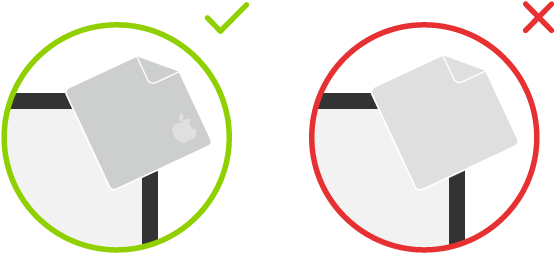
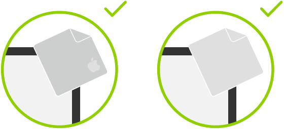
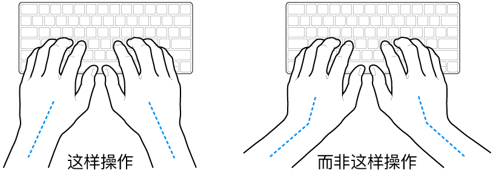
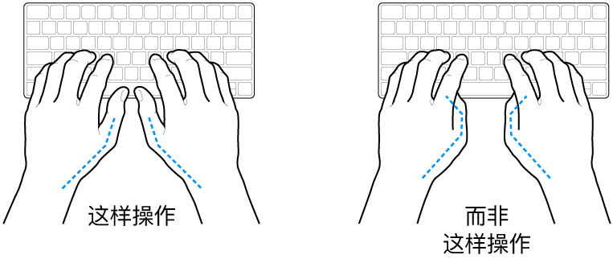
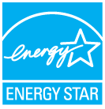
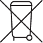

# 第 8 章 · 安全性、操作与监管信息

> 来源：苹果《iMac 使用手册》2024 年款 · macOS Sequoia 15 · 手册第 52–63 页（重要安全性信息 → 版权）

法规文本章，按法规类内容做了加大压缩：警告条目、硬性数值（温度/电压/间距/频段/时限）、型号核准代码、合规与环境结论一条不落；法务套话与同义的法语/西语/葡语段落只留结论；软件许可协议与版权给结论加原文链接。

## 重要安全性信息

**【警告】** 不遵循以下说明可能导致火灾、触电或其他伤害，并可能损坏 iMac、线缆或其他财物；使用 iMac 前须读完全部安全性信息。

| 主题 | 要求 |
| --- | --- |
| 操作 | 置于牢固、平稳的工作台，底部及四周通风顺畅；切勿把物体插入通风口；跌落、焚烧、刺穿、挤压或接触液体、油、乳液都会损坏 iMac；屏幕破裂等已损坏机器请勿使用 |
| 液体 | 远离饮料、油、乳液、洗脸池、浴缸、浴室；防雨、雪、雾 |
| 电源 | 从墙上插座拔下电源线是**完全切断 24 英寸 iMac 电源的唯一方法**（其他机型可从墙插或电脑端拔下）；电源线须保持在可触及范围 |
| **【警告】断电 6 种情形** | 拔插头而非拉线缆，并断开所有线缆：电源线/插头破损 · 异物泼洒入机壳 · 被雨淋或严重受潮 · 跌落或机壳损坏 · 需要服务或维修 · 清洁机壳 |
| **【警告】接地** | 交流电源线为三线接地插头，只适合接地插座；插座未接地时请合格电工更换，切勿忽视接地作用 |
| **【警告】听力** | 不要长时间高音量听音乐；仅用与 iMac 兼容的耳塞/耳机/耳罩，入耳前先打开音频并检查音量；背景噪声与持续高音量暴露会让声音听起来比实际音量小 · [声音和听力](https://www.apple.com/sound/) |
| 维修 | 仅限受过培训的技术人员；**自行拆开 iMac 造成的损坏不在有限保修范围内**；非专业人员维修或用非正品 Apple 部件会影响安全性与功能；故障、损坏或进液时联系 Apple 或授权服务提供商 · [Mac 维修和服务](https://support.apple.com/zh-cn/mac/repair/service) |
| 医疗设备 | 电磁场可能干扰起搏器、除颤器等；与医疗设备保持**大于 15 厘米（6 英寸）**，怀疑干扰即停用并咨询医师与制造商 |
| 导航 | 地图、路线与位置服务依赖可能不可用、不准确或不完整的数据服务；须比对环境并遵循路标，勿在需要全神贯注的活动中同时使用 |
| 身体状况·重复运动 | 痉挛、眩晕、眼睛疲劳、头痛等先咨询医师；重复同一动作（如玩游戏）致手、臂、腕、肩、颈不适时停用并咨询医师 |
| 后果严重的活动 | 不适用于因电脑故障可能导致死亡、人身伤害或严重环境破坏的任何用途 |
| 易爆环境 | 空气中易燃化学物、蒸汽或颗粒（粉尘、金属粉末）过高时使用有危险；高浓度工业化学品（含易蒸发的液化气体如氦气）会损坏或削弱 iMac；遵循所有标记和指示 |

**电源规格**：100–240 V（交流）· 最大 2 A · 50–60 Hz。澳大利亚顾客：[Online Safety](https://www.apple.com/au/legal/online-safety/)。

**要点** 墙插必须够得到（24 英寸机型唯一的完全断电手段）；自行拆机不保修。

## 重要操作信息

| 项目 | 数值 / 要求 |
| --- | --- |
| 操作温度 | 10–35°C（50–95°F），超出会影响性能 |
| 存放温度 | −40 至 47°C（−40 至 116°F） |
| 长期存放 | 阴凉环境，理想 22°C（71°F） |
| 空气 | 大量浮尘、烟灰缸/火炉/壁炉烟尘、或使用未过滤自来水的超声波加湿器处**切勿操作**：微粒会进入通风口，可能在显示器玻璃内表面形成轻霾 |
| 搬运 | 先关机并拔掉所有线缆，抬起时抓**两侧**。**【注意事项】** 手和手指远离活动部件以免夹伤 |
| 插头端口 | 勿强行插入；确认无碎屑、插头与端口匹配、方向对应。**【重要事项】** 仅用原装或 Apple 零售店/[apple.com/cn](https://www.apple.com) 销售的线缆 |
| 清洁机壳 | 关机拔线后用干净柔软不起绒布；开口勿受潮、勿直接喷液体；勿用酒精、喷雾剂、溶剂、研磨剂、含过氧化氢清洁剂 |
| 妙控键盘/鼠标 | 关闭设备并拔线，用微湿的柔软不起绒布擦外表面；勿弄湿开口，勿用气雾喷剂、溶剂、研磨剂 |

**Nano-texture 纳米纹理玻璃屏**：关机拔线后**只能用随附抛光布**；顽固污渍可用蘸 **70% 异丙醇（IPA）** 的抛光布（[清洁纳米纹理玻璃面板](https://support.apple.com/104948)）。

*图：两张图像，显示清洁 Nano-texture 纳米纹理玻璃显示器时使用的正确和不正确的布料。*

**标准玻璃屏**：随附抛光布或干净超细纤维布蘸水；切勿把液体直接喷到屏幕。

*图：两张图像，显示用于清洁标准玻璃显示器的两种布料。*

**注意** 纳米纹理只能用随附布（必要时 70% IPA），标准玻璃可蘸水；两者都禁止直接喷洒。

## 人体工程学

双肩放松，上臂与前臂成**稍大于直角**，手腕与手掌大致成直线；击键和使用触控板时手指轻触、双手放松，不要把拇指卷曲在手掌下；经常变换手的姿势，手、手腕或手臂慢性疼痛时咨询合格健康专家。

*图：手掌放在键盘上方，显示手腕和手掌的正确对齐位置和错误对齐位置。*

*图：手掌放在键盘上方，显示拇指的正确放置和错误放置。*

- **鼠标/触控板**：与键盘**等高**、位置舒适。
- **座椅**：可调高度、靠背坚固舒适；**大腿放平、双脚平放地板**，靠背支撑腰部并按厂商说明依体形调节。
- **显示器**：**顶部稍低于水平视线**，眼距 **45–70 厘米（18–28 英寸）**；避开眩光与头顶/户外光反射，用支架调整观看角度 · [人体工程学](https://support.apple.com/101928)。

**要点** 三项自检：腕掌成直线、双脚平放、屏幕顶部低于视线且 45–70 厘米。

## 监管信息

监管信息、认证和合规标记可在设备上获取：选取「苹果菜单 > 关于本机」，然后点按「监管认证」。

*图：GlobalArt/IL_AppleLogo*

| 型号 | CMIIT ID（型号核准代码，电子化显示） |
| --- | --- |
| A2873 | 2023AJ13009 |
| A2874 | 2023AJ12969 |
| A3137 | 24J99A013137 |
| A3247 | 24J99A013247 |

## FCC 合规声明

符合 **FCC 规则第 15 部分**，操作两个条件：(1) 不导致有害干扰；(2) 可承受任何外来干扰（包括可能导致非预期操作的干扰）。经测试符合**B 类**数码设备限制；设备会发射射频能量，未按指示安装使用可能造成有害干扰。

出现有害干扰（可用开关设备判定）时：调整天线方向或位置 · 加大设备与接收器距离 · 把设备接到与接收器不同电路的插座 · 咨询经销商或有经验的无线电/电视技术人员。

未经授权擅自更改或修改会使 **EMC 与无线规范失效**并丧失操作权限；本产品在使用合规外围设备、组件间用屏蔽电缆的条件下通过 EMC 认证，须如此配置。

**射频能量暴露**：符合 FCC/IC 限制，设备与人体**至少相隔 20 厘米（8 英寸）**。

| 硬性限制 | 内容 |
| --- | --- |
| 严禁操作 | 石油平台、航空器 |
| 航空器例外 | 高于 **10,000 英尺**的大型航空器上可用 **5.925–6.425 GHz** |
| 严禁安装 | 户外固定基础设施 |
| 无人机 | **5.925–7.125 GHz** 发射装置严禁用于无人机控制或通信 |

责任方（仅用于 FCC 问题）：Apple Inc., One Apple Park Way, MS 911-AHW, Cupertino, CA 95014, USA（[apple.com/contact](https://www.apple.com/contact)）

## 加拿大 ISED 合规声明

符合加拿大 ISED **免执照 RSS** 标准，两个操作条件同 FCC。**射频能量暴露**：符合加拿大 FCC/ISED 限制，人体间距同样**至少 20 厘米（8 英寸）**。

| 频段与场景 | 限制 |
| --- | --- |
| 5150–5250 MHz | **仅限室内**，减小对同信道移动卫星系统的有害干扰 |
| 5925–7125 MHz | 不用于无人航空器控制或通信；不在石油平台、航空器、汽车、列车、海上船舶上使用（超低功率设备除外） |
| 航空器例外 | 低功率室内接入点、室内附属设备、低功率客户端设备，以及在 **5.925–6.425 GHz** 操作的超低功率设备，可在高于 **3,048 米（10,000 英尺）**的《加拿大航空条例》定义大型航空器上使用 |

原页法语段与上述条款同义（数值一致：20 cm、5150–5250 MHz、5 925–7 125 MHz、3 048 米/10 000 英尺）。

## 微功率短距离设备声明

使用微功率短距离无线电发射设备应当符合国家无线电管理有关规定。

- **A2873、A2874、A3137、A3247** 符合《微功率短距离无线电发射设备目录和技术要求》中**通用微功率设备 F 类和 G 类**技术要求，用于**数据通信**，采用**内置天线**。
- 不得擅自改变使用场景/条件、扩大发射频率范围、加大发射功率（含**额外加装射频功率放大器**）或更改发射天线。
- 不得对其他合法无线电台（站）产生有害干扰，也不得要求免受干扰保护；应承受 ISM（工业、科学及医疗）设备及其他合法电台的干扰；一旦产生有害干扰**立即停用**，消除后方可继续使用。
- 在航空器内，以及射电天文台、气象雷达站、卫星地球站（含测控、测距、接收、导航站）等军民用电台（站）、机场的**电磁环境保护区域**内，遵守相关主管部门规定。
- **禁止**在以机场跑道中心为圆心、**半径 5000 米**的区域内使用各类模型遥控器。
- 微功率部分的温度与电压环境条件与 iMac 相同（操作 10–35°C；100–240 V 交流 / 最大 2 A / 50–60 Hz）。

## ENERGY STAR® 合规声明

*图：ENERGY STAR 标志。*

Apple 作为 ENERGY STAR 合作伙伴，已确认此产品**标准配置**符合 ENERGY STAR 指南的能源效率规范（[energystar.gov](https://www.energystar.gov)）。

- **出厂电源管理**：已启用，**闲置 10 分钟进入睡眠**；点按鼠标/触控板或按键盘任意键唤醒；更改：「系统设置 > 锁定屏幕」。
- **显示器联动**：主机关闭或睡眠即令显示器进入关闭/睡眠——以**空白屏幕**为特征的低功耗状态。

**要点** 10 分钟睡眠是合规默认配置，改动位置在「系统设置 > 锁定屏幕」。

## Apple 和环境

Apple 有责任尽量减小**运营和产品对环境造成的影响**，详见[环境责任](https://www.apple.com/cn/environment)网站。

## 处理和回收信息

*图：请勿丢弃于垃圾箱图标。*

符号含义：依当地法律法规，产品和/或其电池**必须与家庭垃圾分开处理**，寿命结束时送至管理部门指定的收集点；分开收集与回收可节约资源、保护人类健康和环境。

- 回收计划、收集点、受限物质：[apple.com/cn/environment](https://www.apple.com/cn/environment)。
- **Apple 回收计划**：旧设备免费回收、预付费发运标签见 [Apple Trade In](https://www.apple.com/cn/shop/trade-in)；*【注】* **并非所有国家和地区可用**。
- 土耳其：Türkiye Cumhuriyeti: AEEE Yönetmeliğine Uygundur（符合 AEEE 法规）。原页西语（apple.com/mx、apple.com/la）与巴西葡语（apple.com/br）段与上条同义。

**要点** 带叉垃圾箱＝产品与电池不进生活垃圾，送收集点或走 Trade In。

## 软件许可协议

**结论**：使用 iMac 即视为接受 Apple 及第三方软件许可协议条款；正文不载于手册，以官网法律文本为准。

**原文**：[软件许可协议](https://www.apple.com/cn/legal/sla/) · [手册原页](https://support.apple.com/zh-cn/guide/imac/apd6e208e1f7/2024/mac/15)

## 版权

**结论**：Copyright © 2025 Apple Inc. 保留一切权利。Apple 尽力保证手册准确，但**对印刷或文字错误概不负责**；某些 App 并非所有地区可用，可用性可能改变。地址：One Apple Park Way, Cupertino, CA 95014（[apple.com](https://www.apple.com)）。

- **Apple 标志（“键盘”）符号**（`Option-Shift-K`）：未经 Apple 事先书面同意用于商业用途，可能构成商标侵权与不正当竞争，违反美国联邦和各州法律。
- Apple **注册商标 62 项**（iMac、Mac、macOS、AirDrop、AirPlay、FaceTime、Finder、MagSafe、Safari、Siri、Time Machine、Touch ID 等）；Apple Intelligence、Force Touch、SharePlay 为其商标；**服务标记 12 项**（App Store、Apple Arcade、AppleCare、iCloud 系列、iTunes Store 等）。
- **第三方标记**：iOS 属 Cisco；Bluetooth® 属 Bluetooth SIG, Inc.；ENERGY STAR 属美国国家环境保护局；Dolby 与 Dolby Atmos 属 Dolby Laboratories Licensing Corporation。

**原文**：[手册原页](https://support.apple.com/zh-cn/guide/imac/apd7721c83d4/2024/mac/15)

## 本章速查

| 项目 | 值 / 结论 |
| --- | --- |
| 电源·断电 | 100–240 V 交流 · 最大 2 A · 50–60 Hz · 三线接地插头；24 英寸机型仅靠拔墙插完全断电，6 种情形须断电 |
| 温度 | 操作 10–35°C · 存放 −40 至 47°C · 长期存放理想 22°C |
| 间距 | 医疗设备 >15 厘米 · 射频暴露 ≥20 厘米（FCC/IC 与 ISED 同值） |
| 人体工学 | 腕掌成直线 · 手臂稍大于直角 · 屏幕顶部低于视线 · 眼距 45–70 厘米 · 指点设备与键盘等高 |
| 清洁 | 纳米纹理屏仅随附布（必要时 70% IPA）· 标准玻璃布蘸水 · 禁酒精/溶剂/研磨剂/过氧化氢/直接喷洒 |
| 线缆·维修 | 仅原装或 Apple 渠道线缆 · 仅受过培训技术人员维修，自行拆机不保修 |
| 节能·回收 | 闲置 10 分钟睡眠（「系统设置 > 锁定屏幕」）· ENERGY STAR 标准配置合规 · 产品与电池与家庭垃圾分开 · Trade In 免费回收（非所有地区）· 符合土耳其 AEEE |
| 无线电 | FCC 第 15 部分 B 类 · 加拿大免执照 RSS · 中国微功率 F 类/G 类 |
| 频段·场景 | 5150–5250 MHz 仅室内 · 航空器内仅 5.925–6.425 GHz 且高于 10,000 英尺/3,048 米 · 5.925–7.125 GHz 禁用于无人机 · 严禁户外固定基础设施与石油平台 · 模型遥控器禁区为跑道中心半径 5000 米 |
| 型号核准代码 | A2873→2023AJ13009 · A2874→2023AJ12969 · A3137→24J99A013137 · A3247→24J99A013247 |
| 菜单·键位 | 「苹果菜单 > 关于本机」→「监管认证」·「系统设置 > 锁定屏幕」· `Option-Shift-K` 输入 Apple 标志符号（商用需书面同意）· 唤醒按任意键或点按鼠标/触控板 |
