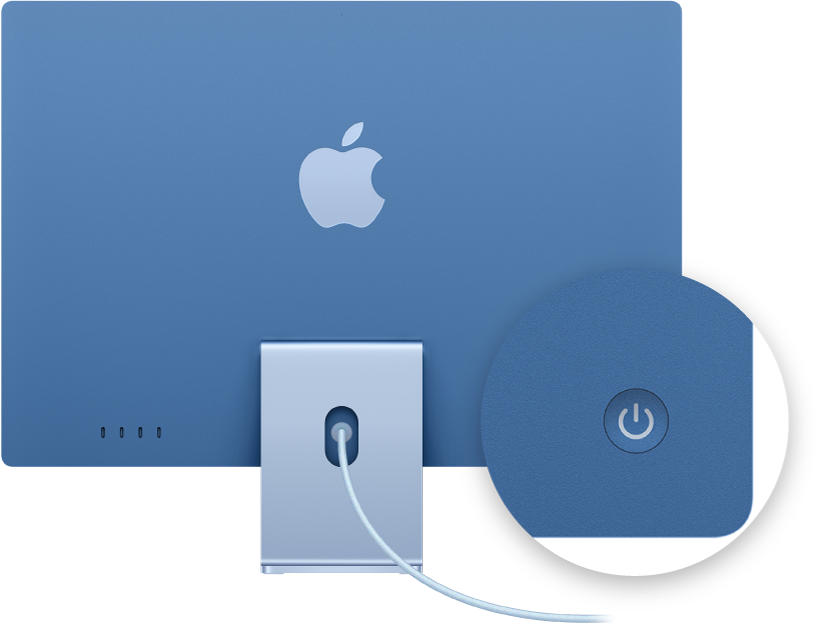
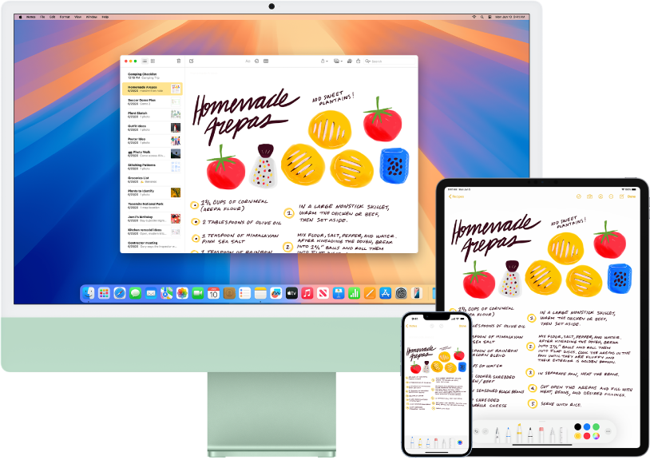
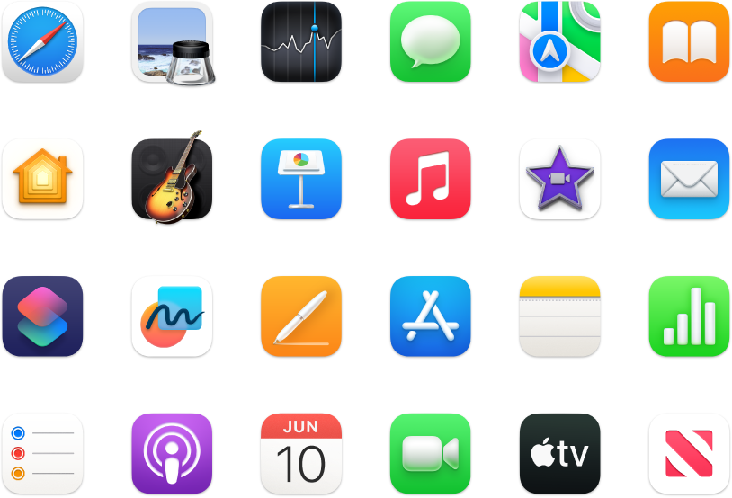
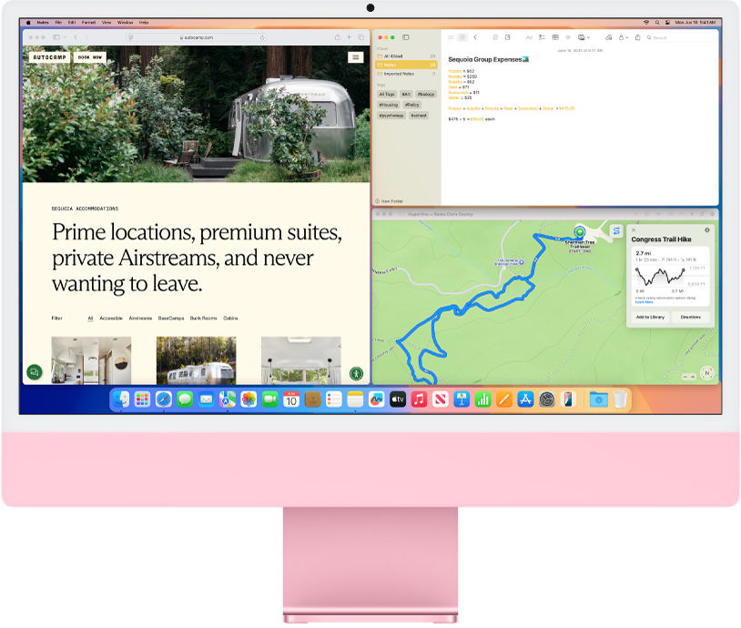

> 来源：https://support.apple.com/zh-cn/guide/imac/welcome/2024/mac/15
> 章节：欢迎使用

*图：24 英寸 iMac 的正面视图和侧视图。*

环顾你的新 Mac

获得 iMac 功能的快速简介。

[浏览 iMac](https://support.apple.com/zh-cn/guide/imac/apd2e7352054/2024/mac/15)

*图：24 英寸 iMac 的背面视图，标注了电源按钮。*

准备好开始了吗？

按下 iMac 背面的电源按钮，打开键盘和鼠标，按照“设置助理”的提示操作便能开始使用。

[设置 iMac](https://support.apple.com/zh-cn/guide/imac/apd831707cb3/2024/mac/15)

*图：“备忘录” App 中的购物清单显示在 iMac、iPhone 和 iPad 上。*

保持同步

借助 iCloud，在你的所有设备上访问信息、照片、备忘录等。并将 iOS 和 iPadOS 设备与 iMac 配合使用来拨打电话、接力任务以及跨设备拷贝和粘贴。

[搭配 iMac 使用 iCloud](https://support.apple.com/zh-cn/guide/imac/apdc44eb8957/2024/mac/15)

*图：Mac 随附的 App 图标。*

做更多事情

iMac 附带各种内建 App，可帮助你保持联络、为创作赋能以及提供娱乐时光等。

[了解 iMac 上 App 的功能](https://support.apple.com/zh-cn/guide/imac/apd83cde9f0c/2024/mac/15)

*图：“地图”、Safari 浏览器和“备忘录” App 的重叠屏幕。*

探索新功能

了解 macOS Sequoia 及附带 App 的新功能。

[macOS Sequoia 的新功能](https://support.apple.com/zh-cn/guide/mac-help/apd07d671600)

本*《iMac 入门指南》*适用于现款 24 英寸 iMac*。若要探索*《iMac 入门指南》*，请点按页面顶部的“目录”，或者在搜索栏中输入字词或短语。

如需更多帮助，请访问 [iMac 支持网站](https://support.apple.com/zh-cn/mac/imac)。

*实际屏幕对角线测量为 23.5 英寸。某些功能和内容仅在部分国家或地区可用。Apple TV+ 需要订阅。
