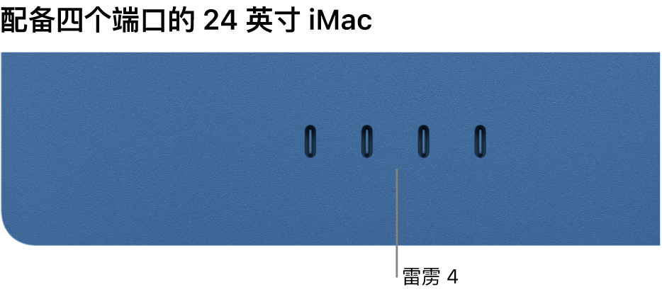
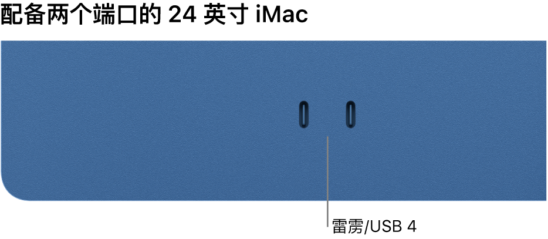
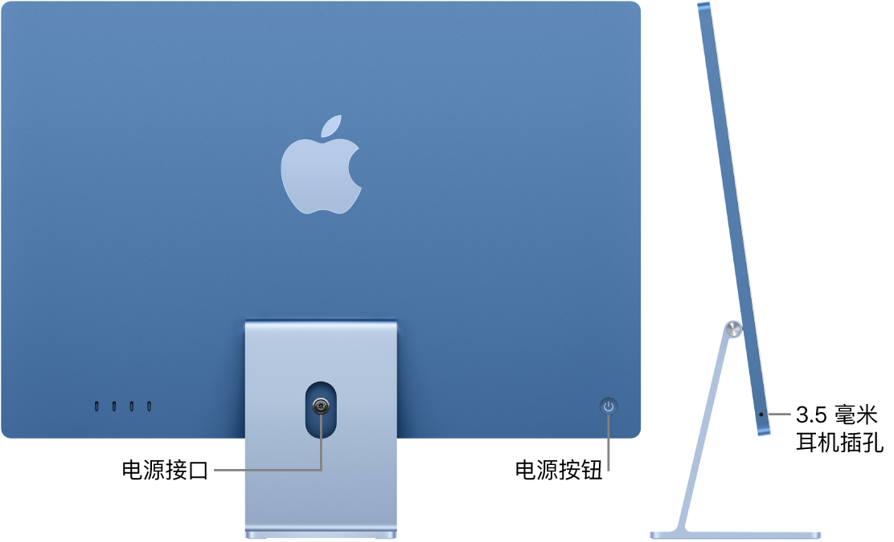
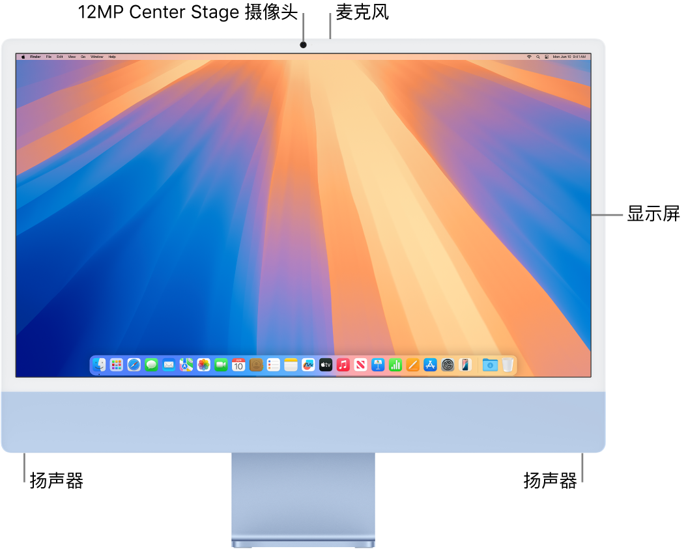

> 来源：https://support.apple.com/zh-cn/guide/imac/apd2e7352054/2024/mac/15
> 章节：浏览 iMac

# 浏览 iMac

24 英寸 iMac 比以往更个性化、更强大、更多功能。它内建以下功能：

*图：显示四个雷雳 4 端口的 iMac。*

*图：显示两个雷雳/USB 4 端口的 iMac。*

- *雷雳 (USB-C) 端口：*以雷雳速度（高达 40 Gbit/s）传输数据，以及给可充电鼠标、键盘或 iPhone 等设备充电。连接雷雳设备和最多两台外接 6K 显示器，如 Apple Pro Display XDR。

  *【注】*四端口机型配备雷雳 4，可支持最多两台外接 6K 显示器。配备雷雳/USB 4 的双端口机型可支持最多一台外接 6K 显示器。

  这些端口还支持雷雳 3、DisplayPort 1.4 和 USB 3.2 及更早型号，以便你可以连接外接储存设备、网络摄像头和音频设备等。你也可以为配备其他类型接口的 USB 设备使用转换器。

*图：iMac 的背面视图，显示电源接口和电源按钮。其旁边是侧视图，显示耳机插孔。*

- *电源接口：*将电源适配器线缆穿过支架中的孔，然后将其连接到 iMac 背面的电源接口。将单独的电源线插入电源适配器，然后将其插入电源插座。
- *电源按钮：*按下以将 iMac 开机。（若要将 iMac 关机，请选取苹果菜单

  

  *图：GlobalArt/IL_AppleLogo*

   >“关机”。选取苹果菜单

  

  *图：GlobalArt/IL_AppleLogo*

   >“睡眠”将其置于睡眠状态。）
- *千兆位以太网 (RJ-45)：* 配备四个端口的 24 英寸 iMac 随附内建以太网的电源适配器。配备两个端口的 24 英寸 iMac 标配的电源适配器没有内建以太网，但可以在购买时选配以太网。如果在购买时没有升级至以太网，则可能需要 USB 至以太网转换器。若要使用以太网，请将路由器或调制解调器连接到电源适配器上的千兆位以太网端口。
- *3.5 毫米耳机插孔：*插入立体声耳机或外置扬声器。

*图：iMac 的正面视图，显示显示屏、摄像头、麦克风和扬声器。*

- *显示器：*视网膜 4.5K 显示器支持十亿色彩并且可维持 500 尼特的亮度。原彩显示技术会调整显示屏的颜色和强度以匹配环境光，从而提供更自然的观看体验。

  四端口 iMac 使用 Nano-texture 纳米纹理玻璃，在复杂光照条件下的工作空间中可散射光线。

  进一步了解如何在 [Mac 的“显示器”设置](https://support.apple.com/zh-cn/guide/imac/apdab93667af/2024/mac/15)中充分利用你的显示器。
- *12MP Center Stage 摄像头：*进行 FaceTime 视频通话或拍照和录像。摄像头系统提供高质量视频、更好的弱光性能、人物居中和桌上视角。如果摄像头旁边的绿色指示灯亮起，表示摄像头已打开。请参阅 [FaceTime 通话](https://support.apple.com/zh-cn/guide/imac/apd828c43bd3/2024/mac/15)和[使用 Mac 上的内建摄像头](https://support.apple.com/zh-cn/guide/mac-help/mchlp2980)。
- *麦克风：*具备录音室品质的三个麦克风可在视频会议和通话时提供超清晰的音频，以及为播客和语音备忘录提供高质量的录音。
- *扬声器：*创新的六扬声器系统由两对双振动抵消低音单元和两个高性能高音单元组成。体验强劲且高质的音效，包括欣赏含杜比全景声的视频中的空间音频。
