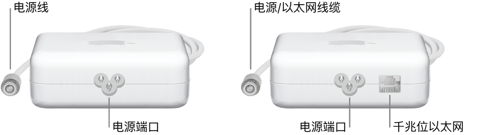
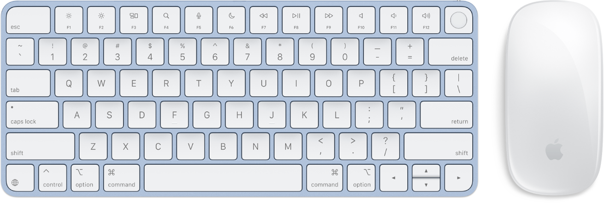

> 来源：https://support.apple.com/zh-cn/guide/imac/apd768124354/2024/mac/15
> 章节：包装清单

# 包装清单

若要使用 iMac，你需要用到包装盒内随附的配件：键盘、鼠标和电源适配器。

电源适配器

24 英寸 iMac 附带 143W 电源适配器。如果 iMac 有四个端口，随附的电源适配器内建以太网。配备两个端口的 24 英寸 iMac 可在购买时选配含有或不含内建以太网的 143W 电源适配器。

*图：一个不含以太网端口的电源适配器和一个含以太网端口的电源适配器。*

**连接电源适配器。**将电源线穿过支架中的孔，然后将其连接到 iMac 背面的电源接口。将单独的电源线插入电源适配器，然后将其插入电源插座。

**连接到以太网。**将路由器或调制解调器的以太网线缆插入电源适配器上的千兆位以太网。电源适配器线缆可同时用作以太网线缆，所以无需单独的以太网线缆来连接电源适配器和 iMac。

妙控键盘和妙控鼠标

你可能有带锁定键的妙控键盘、带触控 ID 的妙控键盘或带触控 ID 和数字键盘的妙控键盘，具体取决于你的 iMac 机型和所选配置。以下说明适用于所有这些键盘。

**【重要事项】**若要开始使用妙控键盘和妙控鼠标，请确保每台设备上的打开/关闭开关已打开

*图：打开/关闭开关*

（绿色可见）。设备将自动连接到你的 iMac。

*图：配备触控 ID 的妙控键盘和妙控鼠标。*

- *妙控键盘：*可充电妙控键盘已与你的 iMac 配对并可供使用。如果需要给键盘充电或再次配对，请使用随附的 USB-C 充电线将其连接到你的 iMac。

  若要自定义键盘的工作方式，请前往[系统设置](https://support.apple.com/zh-cn/guide/imac/aside/apd796e4d5da/2024/mac/15)，点按边栏中的“键盘”，然后在右侧选取键盘、文本、快捷键和输入法的设置。请参阅[妙控键盘](https://support.apple.com/zh-cn/guide/imac/apd0e7983e19/2024/mac/15)以了解键盘功能键的功能。
- *妙控鼠标：*可充电妙控鼠标已与你的 iMac 配对，开箱即可使用；你可以在电脑通信范围内的任意位置使用鼠标。如果需要给鼠标充电或再次配对，请使用随附的 USB-C 充电线将其连接到你的 iMac。

  若要自定义鼠标的工作方式，请前往“系统设置”，然后点按边栏中的“鼠标”来查看所有的滚动、点按、轻扫和轻点选项。请参阅[妙控鼠标](https://support.apple.com/zh-cn/guide/imac/apd292c14df0/2024/mac/15)以了解如何使用手势执行任务。

如果购买 iMac 时选配了输入设备（如妙控板），它已与你的 iMac 配对并可供使用。如果单独购买了输入设备，请使用随附的线缆将其连接到 iMac 以进行设置，然后断开线缆连接以在最适合你的位置通过无线方式使用。你可以使用同一根线缆给设备充电。
