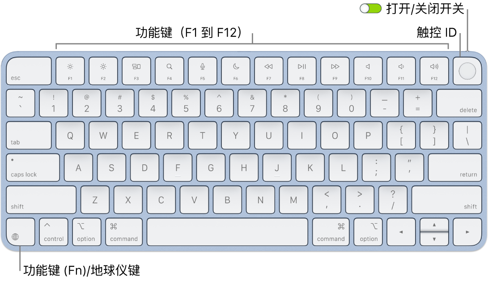

> 来源：https://support.apple.com/zh-cn/guide/imac/apd0e7983e19/2024/mac/15
> 章节：妙控键盘

# 妙控键盘

iMac 随附无线妙控键盘，其内建功能可让你轻松输入表情符号、切换键盘语言、锁定 iMac 以及通过按下某个按键执行许多系统功能。配备触控 ID 的妙控键盘还可让你使用指纹登录和通过 Apple Pay 购物。

若要将妙控键盘连接到 iMac，请参阅[将配件连接到 iMac](https://support.apple.com/zh-cn/guide/imac/apd376797067/2024/mac/15)。

*图：配备触控 ID 的妙控键盘，顶部显示一排功能键和触控 ID，功能键 (Fn)/地球仪键位于左下角。*

**打开或关闭键盘。**滑动键盘背面边缘的打开/关闭开关

*图：打开/关闭开关*

 以将键盘打开（绿色可见）或关闭。如果 iMac 无法识别键盘，请使用随附的 USB-C 充电线将其连接到 iMac 以进行配对，然后断开线缆连接以通过无线方式使用。你可以使用同一根线缆给键盘充电。

**锁定 iMac。**快速按下触控 ID 或锁定键

*图：GlobalArt/IL_Lock*

（未配备触控 ID 的妙控键盘会有锁定键）。若要解锁 iMac，请轻轻触碰触控 ID，或者按下任意键并键入密码。

**设置触控 ID。**如果键盘配备了触控 ID，你可以使用指纹解锁 iMac 和通过 Apple Pay 在 App Store、Apple 视频 App、Apple Books 和网站上购物。如果在设置 iMac 时未设置触控 ID，你可以稍后在[系统设置](https://support.apple.com/zh-cn/guide/imac/aside/apd796e4d5da/2024/mac/15)的“触控 ID 与密码”设置中进行设置。有关触控 ID 的更多信息，请参阅[设置 iMac](https://support.apple.com/zh-cn/guide/imac/apd831707cb3/2024/mac/15)。有关 Apple Pay 的信息，请参阅[使用钱包和 Apple Pay](https://support.apple.com/zh-cn/guide/mac-help/mchl4773988b)。

**使用触控 ID。**将手指轻轻放在触控 ID 上。首次启动或重新启动 iMac 时，你需要键入密码来登录 iMac。之后，无论何时要求输入密码以解锁屏幕或进行购买，你都可以使用触控 ID。如果为 iMac 设置了快速用户切换，你还可以使用指纹从另一个用户账户切换到你自己的账户。有关更多信息，请参阅[在 Mac 上使用触控 ID](https://support.apple.com/zh-cn/guide/mac-help/mchl16fbf90a)。

**设定键盘设置。**若要指定键盘和功能键 (Fn)/地球仪键

*图：GlobalArt/IL_Globe*

 的选项，请打开“系统设置”，点按边栏中的“键盘”，然后选取选项以更改键盘或输入法、显示表情和符号、开始听写或定义功能。

**使用表情符号或切换键盘语言。**按下

*图：地球仪键*

 以切换到其他键盘。重复按下

*图：地球仪键*

 以循环显示在“键盘”设置中指定的表情符号选项或其他语言，或者快速按两下来开始听写（如果已设定该偏好设置）。

**使用功能键。**顶部一行的功能键为以下常用系统功能提供了快捷键：

- *亮度（F1、F2）：*按下

  

  *图：减少亮度键*

   或

  

  *图：增加亮度键*

   来减少或增加屏幕亮度。
- *调度中心 (F3)：*按下

  

  *图：调度中心键*

   来查看 iMac 上正在运行的程序，包括所有空间和已打开的窗口。
- *聚焦搜索 (F4)：*按下

  

  *图：聚焦键*

   来打开“聚焦”并搜索 iMac 上的内容。
- *听写/Siri (F5)：*按下

  

  *图：麦克风键*

   来启用听写，此功能让你在可键入文本的地方（例如，在“信息”、“邮件”、Pages 文稿和其他 App 中）听写文本。按住

  

  *图：麦克风键*

   以激活 Siri，然后立即说出请求。
- *勿扰模式 (F6)：*按下

  

  *图：勿扰模式键*

   来打开或关闭“勿扰模式”。“勿扰模式”打开时，你在 iMac 上不会看到通知或听到通知提示音，但可以在“通知中心”中查看。
- *媒体（F7、F8、F9）：*按下

  

  *图：倒回键*

   来倒回，按下

  

  *图：播放/暂停键*

   来播放或暂停，或按下

  

  *图：快进键*

   来快进歌曲、影片或幻灯片放映。
- *静音 (F10)：*按下

  

  *图：静音键*

   使内建扬声器或耳机插孔的声音静音。
- *音量（F11、F12）：*按下

  

  *图：减小音量键*

   或

  

  *图：增大音量键*

   来减小或增大内建扬声器或耳机插孔的音量。

**使用备选功能。**功能键可以为特定 App 执行操作或者执行备选功能，例如，F11 键还可以隐藏所有打开的窗口并显示桌面。若要触发与按键关联的备选功能，请在按下功能键的同时按住 Fn 键。

**使用键盘快捷键。**你可以同时按下两个或多个按键在 iMac 上快速执行你通常使用触控板、鼠标或其他设备执行的操作。例如，按下 Command-C 以拷贝所选文本，然后点按要粘贴文本的位置并按下 Command-V。有关常用键盘快捷键的列表，请参阅 [Mac 上的键盘快捷键](https://support.apple.com/zh-cn/guide/imac/apd194062a6d/2024/mac/15)。如果你是 Mac 新手，可能还需要了解 [Mac 新手？](https://support.apple.com/zh-cn/guide/imac/apd1f14ec646/2024/mac/15)。

*【注】*对于搭载 Apple 芯片且运行 macOS 11.3 或更高版本的任何 Mac，触控 ID 和功能键的功能如上所述。
