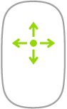
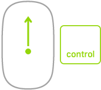
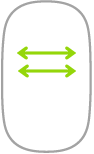

> 来源：https://support.apple.com/zh-cn/guide/imac/apd292c14df0/2024/mac/15
> 章节：妙控鼠标

# 妙控鼠标

你可以在电脑通信范围内的任意位置使用妙控鼠标。如果需要给鼠标充电或再次配对，请使用 USB-C 充电线将其连接到你的 iMac。

若要将妙控鼠标连接到 iMac，请参阅[将配件连接到 iMac](https://support.apple.com/zh-cn/guide/imac/apd376797067/2024/mac/15)。

以下是一些可在妙控鼠标上使用的常用手势。

| 手势 | 操作 |
| --- | --- |
|  *图：鼠标底部，显示打开和关闭鼠标的开关。* | **打开/关闭：**滑动鼠标底部的打开/关闭开关  *图：打开/关闭开关* 将鼠标打开（绿色可见）。 |
|  *图：显示点按操作的鼠标，可在鼠标表面的任意位置进行点按。* | **点按：**按下鼠标表面的上半部分以点按或连按。 |
|  *图：显示辅助点按操作的鼠标，可为鼠标左侧或右侧启用辅助点按。* | **辅助点按（即右键点按）：**按下鼠标的左侧或右侧来执行“辅助点按”。（若要启用右键点按和左键点按，请在[系统设置](https://support.apple.com/zh-cn/guide/imac/aside/apd796e4d5da/2024/mac/15)中点按“鼠标”，然后选择“辅助点按”。）或者在点按鼠标时按下键盘上的 Control 键。 |
|  *图：显示如何在鼠标表面上将手指向任意方向扫过以向相应方向滚动的鼠标。* | **360º 滚动：**单指在表面扫过，以向任意方向滚动或移动。 |
|  *图：显示如何在按住 Control 键时通过按下和缩放来在屏幕上放大项目的鼠标。* | **屏幕缩放：**按住 Control 键并使用单指滚动以在屏幕上放大项目。（若要启用屏幕缩放，请在“系统设置”中点按“辅助功能”，点按“缩放”，然后选择“配合修饰键使用滚动手势来缩放”。） |
|  *图：显示如何使用双指轻扫以翻阅项目的鼠标。* | **双指轻扫：**向左或向右轻扫以在页面、照片等项目中移动。 |

**自定义鼠标。**若要调整跟踪和滚动速度等设置，以及启用或自定义手势，请点按“系统设置”中的“鼠标”。
