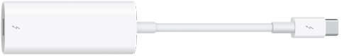
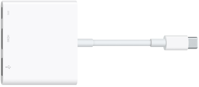
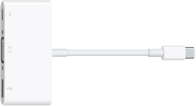
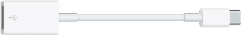

> 来源：https://support.apple.com/zh-cn/guide/imac/apdaf6085524/2024/mac/15
> 章节：转换器

# 配合 iMac 使用转换器

以下 Apple 转换器可用于将外接设备、显示器等连接到 iMac 上的端口。

| 转换器 | 描述 |
| --- | --- |
|  *图：雷雳 3 (USB-C) 转雷雳 2 转换器。* | **雷雳 3 (USB-C) 转雷雳 2 转换器：**将 iMac 连接到雷雳 2 设备或雷雳显示器。 |
|  *图：USB-C 数字 AV 多端口转换器。* | **USB-C 数字 AV 多端口转换器：**将 iMac 连接到 HDMI 显示器，同时将标准 USB 设备连接到 iMac。 |
|  *图：USB-C VGA 多端口转换器。* | **USB-C VGA 多端口转换器：**将 iMac 连接到 VGA 投影仪或显示器，同时将标准 USB 设备连接到 iMac。 |
|  *图：USB-C 转 USB 转换器* | **USB-C 转 USB 转换器：**将闪存驱动器、相机或其他标准 USB 设备连接到 iMac。 |
|  *图：USB-C 转 SD 读卡器转换器* | **USB-C 转 SD 读卡器转换器：**将 SD 卡连接到 iMac 以传输高分辨率照片和视频。 |

**进一步了解。**请参阅 Apple 支持文章：[适用于 Mac 上雷雳或 USB-C 端口的转换器](https://support.apple.com/102477)。

转换器和其他配件单独销售。请访问 [apple.com/cn](https://apple.com/cn/store)、当地 Apple Store 商店或其他经销商以了解更多信息和可用性。请检查文稿或与生产企业确认以确保选取正确的产品。
