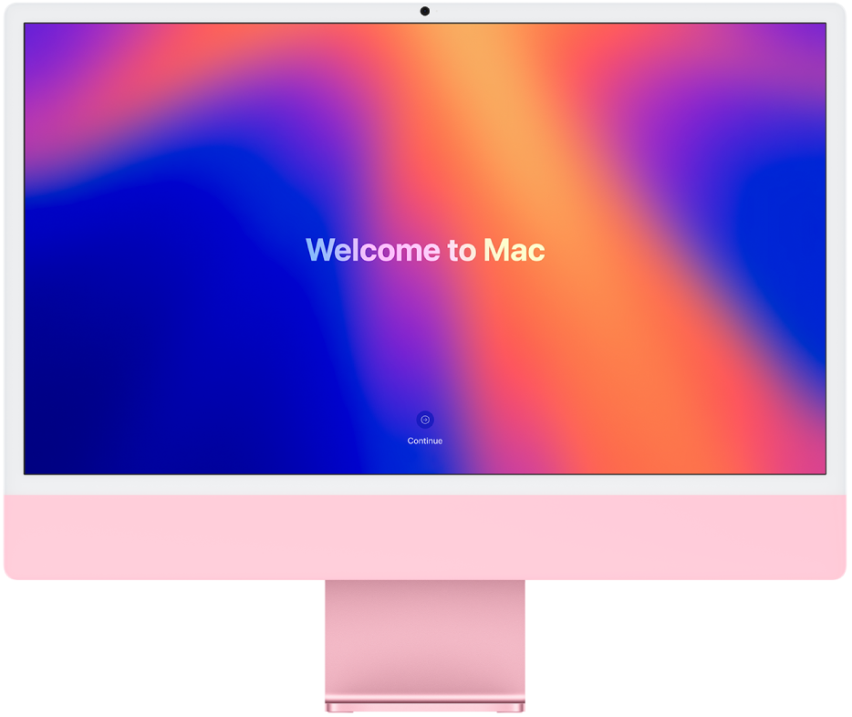

> 来源：https://support.apple.com/zh-cn/guide/imac/apd831707cb3/2024/mac/15
> 章节：设置 Mac

# 设置 iMac

设置新 iMac 时，你可以自定义 Mac 的部分设置、设置触控 ID 等功能，以及从另一台电脑传输数据。如果已有 Mac、iPad 或 iPhone，你可能还可以选择使用现有设置更快速设置新 Mac 来跳过一些步骤。

*图：屏幕上显示“欢迎使用 Mac”的 iMac。*

如果在设置 Mac 时需要更多支持，你可以通过在线交流、电子邮件或电话与 Apple 专家交流，或预约 Genius Bar 天才吧。若要进一步了解，请访问 [Genius Bar 天才吧预约与 Apple 支持选项](https://www.apple.com/cn/retail/geniusbar/)。

“设置助理”会引导你进行必不可少的设置以开始使用 Mac。设置完成后，请参阅 [iMac 设置完成后](https://support.apple.com/zh-cn/guide/imac/apdc23d572ce/2024/mac/15)以了解后续步骤。

如果你想完成流程中的每一步，请选取以下链接。

- *如果你是 Mac 新手：*请参阅[针对新 Mac 用户设置 iMac](https://support.apple.com/zh-cn/guide/imac/apd3a3bbed27/2024/mac/15)。
- *如果已是 Mac 用户：*请参阅[针对当前 Mac 用户设置 iMac](https://support.apple.com/zh-cn/guide/imac/apdead65a6b3/2024/mac/15)。
