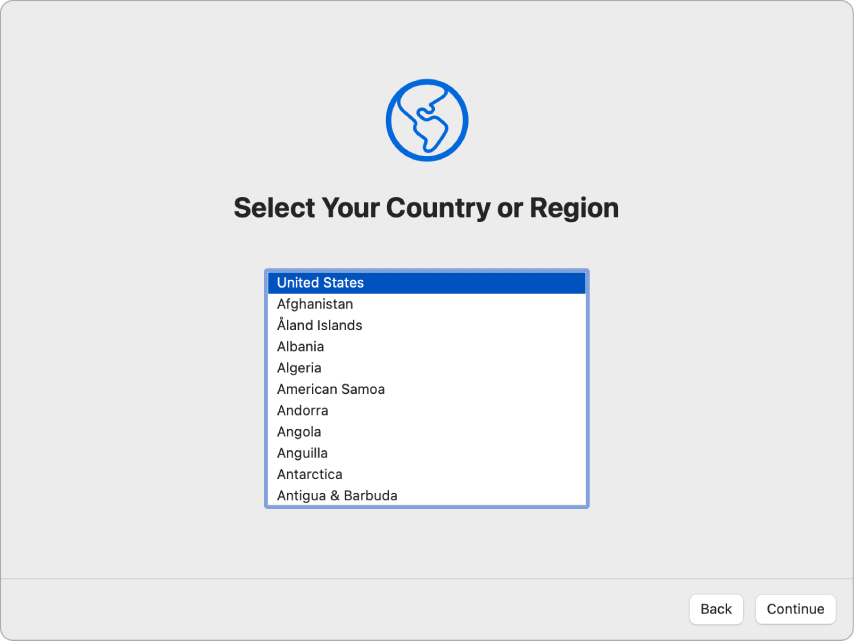
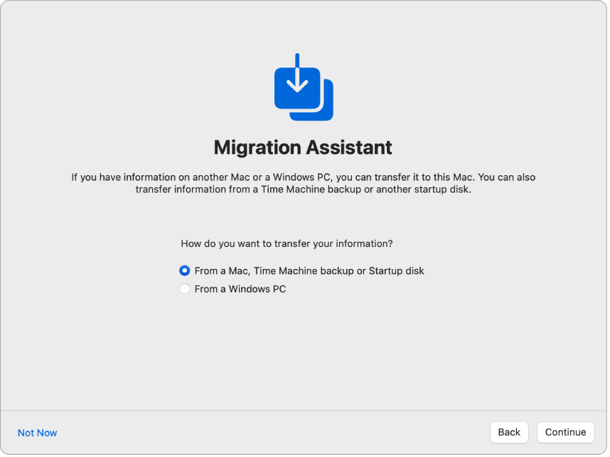
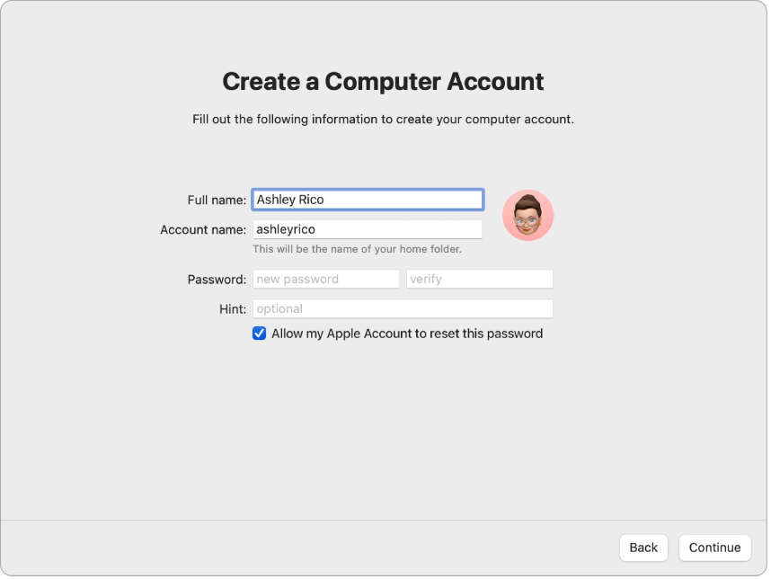

> 来源：https://support.apple.com/zh-cn/guide/imac/apdead65a6b3/2024/mac/15
> 章节：针对当前 Mac 用户设置 Mac

# 针对当前 Mac 用户设置 iMac

此演示涵盖设置过程的每个步骤，旨在搭配“设置助理”一起使用。

开始之前

- 设置期间，请将其他 Mac 或者 iPhone 或 iPad 放在手边，因为部分步骤可能需要在另一台设备上验证。
- 设置期间，你有机会从另一台 Mac 传输数据。若想这样做，请确保你有要传输数据的电脑，且已更新到最新的可用软件版本。
- “设置助理”可让你轻松设置 iMac，无需太长时间即可完成。但如果你选择传输数据，请预留额外的时间。

连接鼠标或触控板和键盘

设置初始，你可以将鼠标或触控板和键盘连接到 iMac。

如果你的新 Mac 随附妙控鼠标、妙控板或妙控键盘，它们应该已配对。若要打开妙控鼠标、妙控板或妙控键盘，请滑动打开/关闭开关使绿色可见。

如果你使用的鼠标、触控板或键盘并非随附自新 Mac，你需要将其配对。你可能还需要使用连接线将配件以物理方式连接到 Mac。请参阅配件随附的文稿以了解如何配对或连接，或参阅[将配件连接到 Mac](https://support.apple.com/zh-cn/guide/imac/apd376797067/2024/mac/15)。

如在设置期间有其他关于连接鼠标、触控板或键盘的问题，请参阅 Apple 支持文章：[如果你的键盘或鼠标在 Mac 设置期间无法连接](https://support.apple.com/108797)。

设定语言、国家或地区并接入 Wi-Fi

**选取语言。**这会设定 Mac 的语言。若要稍后更改语言，请打开[系统设置](https://support.apple.com/zh-cn/guide/imac/aside/apd796e4d5da/2024/mac/15)，点按边栏中的“通用”，点按“语言与地区”，然后选取选项。

**设定国家或地区。**这会设定 Mac 的日期、货币和温度等格式。若要稍后更改国家或地区，请打开“系统设置”，点按边栏中的“通用”，点按“语言与地区”，然后选取选项。

*图：“设置助理”屏幕显示用于选择用户国家或地区的选项。*

**打开辅助功能。**查看“视觉”、“动作”、“听觉”和“认知”能力的辅助功能选项，或者点按“以后”。若要进一步了解，请参阅 [Mac 上的辅助功能](https://support.apple.com/zh-cn/guide/imac/apd4c143b3c5/2024/mac/15)。

**接入 Wi-Fi 网络。**选取 Wi-Fi 网络并输入密码（如有必要）。如果使用的是以太网，你还可以点按“其他网络选项”，然后按照屏幕指示操作。你可能需要额外的以太网转换器将以太网线缆连接到 iMac，如 [Belkin USB-C 至千兆以太网转换器](https://www.apple.com/cn/shop/product/HJKF2ZM/A/belkin-usb-c-to-gigabit-ethernet-adapter?fnode=06728dd127e5972866628419f8d5b1f1da2b12b6a65fd283c0c20769d14e2201d8b9c18000c519476caa6bc2a9db98a9e9696e71ba81e3a753ad87c46b67119b5a9e02feddc7bd98b3fe7722552791c625c827194d25d045c535149f754a72ee)。

若要稍后更改 Wi-Fi 网络，请打开“系统设置”，点按边栏中的 Wi-Fi，然后选取网络并输入密码（如有需要）。

**【提示】**设置后，如果在菜单栏中没有看到 Wi-Fi 状态图标

*图：GlobalArt/IL_WiFi*

，你可以添加它。打开“系统设置”，点按边栏中的“控制中心”，然后为 Wi-Fi 选择“在菜单栏显示”。

从另一台 Mac 传输信息

你可以将数据（如文件、联系人和账户等）从另一台 Mac 迁移到新 iMac。你还可以选择从时间机器备份或位于 Mac 上的启动磁盘传输信息。从另一台 Mac 传输时，你可以无线传输数据，或通过以太网线缆将 Mac 连接到 iMac。

如果要恢复 Mac，请参阅[从备份恢复 Mac](https://support.apple.com/102551)。

*图：“设置助理”屏幕上显示“迁移助理”。从 Mac 传输信息的复选框已选中。*

**开始之前。**确保另一台 Mac 已更新到最新的可用软件版本。然后在要传输的 Mac 上打开“迁移助理”。“迁移助理”位于“应用程序”文件夹的“实用工具”文件夹中。

**无线传输数据。**如果两台电脑彼此靠近，以无线方式将信息从另一台 Mac 传输到新 Mac。在设置屏幕上点按另一台 Mac，然后按照指示操作。

**使用以太网线缆传输数据。**使用以太网线缆直接将 iMac 连接到另一台 Mac。你可能需要以太网转换器将线缆连接到 iMac，如 [Belkin USB-C 至千兆以太网转换器](https://www.apple.com/cn/shop/product/HJKF2ZM/A/belkin-usb-c-to-gigabit-ethernet-adapter?fnode=06728dd127e5972866628419f8d5b1f1da2b12b6a65fd283c0c20769d14e2201d8b9c18000c519476caa6bc2a9db98a9e9696e71ba81e3a753ad87c46b67119b5a9e02feddc7bd98b3fe7722552791c625c827194d25d045c535149f754a72ee)。你可能需要转换器将以太网线缆连接到另一台 Mac，具体取决于其端口。相互连接后，在设置屏幕上点按另一台 Mac，然后按照指示操作。

**稍后传输数据。**你也可以在此时选择不传输数据。如果不传输，请在“迁移助理”窗口中点按“以后”。若要在设置后传输数据，请参阅[将你的数据传输到新 iMac](https://support.apple.com/zh-cn/guide/imac/apda75cd668e/2024/mac/15)。

**进一步了解。**若要进一步了解此过程，请参阅[使用“迁移助理”传输到新 Mac](https://support.apple.com/102613)。

登录 Apple 账户和设置电脑账户

**登录 Apple 账户。**设置期间登录 Apple 账户时，你会在其他 Apple 设备上收到一个验证码。在新 iMac 上输入验证码以继续。如果没有收到验证码或没有设备，你可以选择通过短信或电话接收验证码。如果无法使用与 Apple 账户关联的电话号码，请选取“无法使用此号码”，然后按照屏幕指示操作。

如果需要创建 Apple 账户，请选取“创建新 Apple 账户”。如果忘记了 Apple 账户或密码，请选取“忘记 Apple 账户或密码”。

如果此时不想登录 Apple 账户或创建新 Apple 账户，请点按“稍后设置”。设置完成后，你可以登录 Apple 账户或创建新 Apple 账户。打开[系统设置](https://support.apple.com/zh-cn/guide/imac/aside/apd796e4d5da/2024/mac/15)，然后点按边栏中的“登录你的 Apple 账户”。

*【注】*登录 Apple 账户后，请阅读条款与条件。若要接受，请勾选方框，然后点按“同意”并继续。

**创建电脑账户。**添加你的名字并创建账户名和密码，它们稍后可用于解锁 iMac 或批准其他操作。你可以选择添加提示，可在你忘记电脑账户的密码时助你寻回。若要更改账户的登录图片，请点按它，然后选取选项。

*图：“设置助理”屏幕上显示“创建电脑账户”。*

*【注】*电脑账户不同于 Apple 账户。但是，如果你忘记了 Mac 解锁密码且在设置期间勾选了允许使用 Apple 账户重设用户账户密码这一选项，那么你可以使用 Apple 账户来重设密码。

将此设为你的新 Mac

如果已经设置了运行 macOS 12 或更高版本、iOS 15 或更高版本或者 iPadOS 15 或更高版本的其他设备，屏幕会出现“将此设为你的新 Mac”以供快捷设置。如果没有与软件版本相符的 Mac、iPad 或 iPhone，你不会看到此步骤。（不确定 Mac、iPhone 或 iPad 的软件版本？请参阅[确定你的 Mac 使用的是哪个 macOS 版本](https://support.apple.com/109033)或[在 iPhone、iPad 或 iPod touch 上查找软件版本](https://support.apple.com/109065)。）

使用“将此设为你的新 Mac”时，你使用储存在 iCloud 账户中的设置跳过一些设置步骤。若要使用当前设置，请点按“继续”。如果已配对的妙控键盘配备了触控 ID，设置过程会跳转到[设置触控 ID 和 Apple Pay](https://support.apple.com/zh-cn/guide/imac/apdead65a6b3/2024/mac/15#apd608c89d05)。如果使用当前设置并且没有配对配备了触控 ID 的妙控键盘，设置过程会完成；请参阅 [iMac 设置完成后](https://support.apple.com/zh-cn/guide/imac/apdc23d572ce/2024/mac/15)。

如果想要自定义新 iMac 的设置，请点按“自定义设置”并继续下一步。

自定义 Mac 的隐私和安全性设置、打开“屏幕使用时间”以及启用 Siri

**启用定位服务。**选取是否允许“地图”等 App 使用 Mac 的位置。若要稍后更改“定位服务”设置，请打开[系统设置](https://support.apple.com/zh-cn/guide/imac/aside/apd796e4d5da/2024/mac/15)，点按边栏中的“隐私与安全性”，然后点按“定位服务”并选取选项。

如果不选择启用定位服务，你将看到用于选取时区的屏幕。

**与 Apple 和开发者共享分析数据。**选取是否将诊断和数据发送到 Apple，以及 Apple 是否可与开发者共享崩溃和使用数据。若要稍后更改这些设置，请打开“系统设置”，点按边栏中的“隐私与安全性”，点按“分析与改进”（可能需要滚动），然后选取选项。

**设置屏幕使用时间。**“屏幕使用时间”可让你查看 Mac 的每日和每周用量，设定可使用特定 App 的时间限额，以及管理子女的屏幕使用时间等。若要打开“屏幕使用时间”，请点按“继续”，否则请点按“稍后设置”。如果选择稍后设置，请打开“系统设置”，然后点按边栏中的“屏幕使用时间”以选取选项。有关更多选项和详细信息，请参阅 [Mac 上的屏幕使用时间](https://support.apple.com/zh-cn/guide/imac/apd35460a9f3/2024/mac/15)。

**通过文件保险箱保护数据。**文件保险箱可帮你保护数据的安全。设置期间，你可以选择打开文件保险箱以保护数据，还可以选择在忘记密码时允许 iCloud 账户解锁磁盘。若要进一步了解文件保险箱，以及如不立即设置该如何稍后进行设置，请参阅[使用文件保险箱加密 Mac 数据](https://support.apple.com/zh-cn/guide/mac-help/mh11785)。

**启用 Siri 和“嘿 Siri”。**你可以在设置过程中打开 Siri 和“嘿 Siri”，便于你说出 Siri 请求。若要设置 Siri，请点按“启用‘询问 Siri’”。若要设置“嘿 Siri”，请在提示时说出几个 Siri 命令。若要稍后打开 Siri 和“嘿 Siri”，请打开“系统设置”，点按边栏中的“Apple 智能与 Siri”

*图：GlobalArt/IL_AppleIntelligenceAppIcon*

（或 Siri

*图：GlobalArt/AppIconTopic_Siri*

），然后选取选项。若要进一步了解 Siri，请参阅 [Mac 上的 Siri](https://support.apple.com/zh-cn/guide/imac/apdf7bb2fad4/2024/mac/15)。

你还可以在设置过程中选择与 Apple 共享音频来改进 Siri。以后始终可以更改是否要共享音频。打开“系统设置”，点按边栏中的“隐私与安全性”，点按“分析与改进”（可能需要滚动），然后选取选项。

设置触控 ID 和 Apple Pay

*【注】*以下步骤会在你配对了配备触控 ID 的妙控键盘时出现。

**设置触控 ID。**你可以将指纹添加到触控 ID，供你用于解锁 iMac、授权 Apple Pay 购买以及登录部分第三方 App。按照屏幕指示设置触控 ID。若要稍后设置触控 ID 或者添加其他指纹，请打开[系统设置](https://support.apple.com/zh-cn/guide/imac/aside/apd796e4d5da/2024/mac/15)，然后点按边栏中的“触控 ID 与密码”。若要添加指纹，请点按

*图：“添加”按钮*

 并按照屏幕说明进行操作。

若要进一步了解，请参阅[在 Mac 上使用触控 ID](https://support.apple.com/zh-cn/guide/mac-help/mchl16fbf90a)。

**设置 Apple Pay。**如果设置了触控 ID，你可以设置 Apple Pay 并添加借记卡、信用卡或商店卡以通过触控 ID 进行购买。输入卡片详细信息，然后按照屏幕提示操作。如果已使用卡片购买媒体，可能会提示你先验证此卡片。

若要稍后设置 Apple Pay 或添加其他卡片，请打开“系统设置”，然后点按“钱包与 Apple Pay”。按照屏幕提示来设置 Apple Pay。

*【注】*发卡机构决定你的卡片是否可用于 Apple Pay，并且可能会要求你提供其他信息来完成验证过程。许多信用卡和借记卡可用于 Apple Pay。有关 Apple Pay 可用性和当前信用卡发卡机构的信息，请参阅 Apple 支持文章：[参加 Apple Pay 计划的银行](https://support.apple.com/HT204916)。

设定桌面外观

**选取外观。**为桌面外观选择“浅色”、“深色”或“自动”。如果稍后想要更改在设置过程中所做的选择，请打开[系统设置](https://support.apple.com/zh-cn/guide/imac/aside/apd796e4d5da/2024/mac/15)，点按“外观”，然后选择一个选项。你还可以设定其他外观设置，例如高亮标记颜色或边栏图标大小。

*【注】*如果选择通过“将此设为你的新 Mac”以进行快捷设置，则会跳过此步骤。

完成设置

新 iMac 已可供使用。请参阅 [iMac 设置完成后](https://support.apple.com/zh-cn/guide/imac/apdc23d572ce/2024/mac/15)以了解后续步骤。
