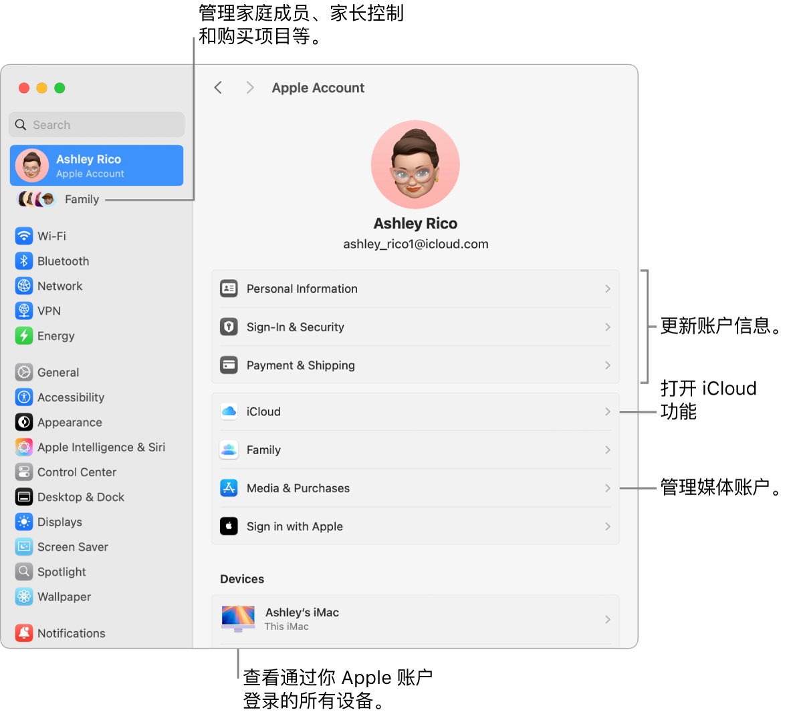
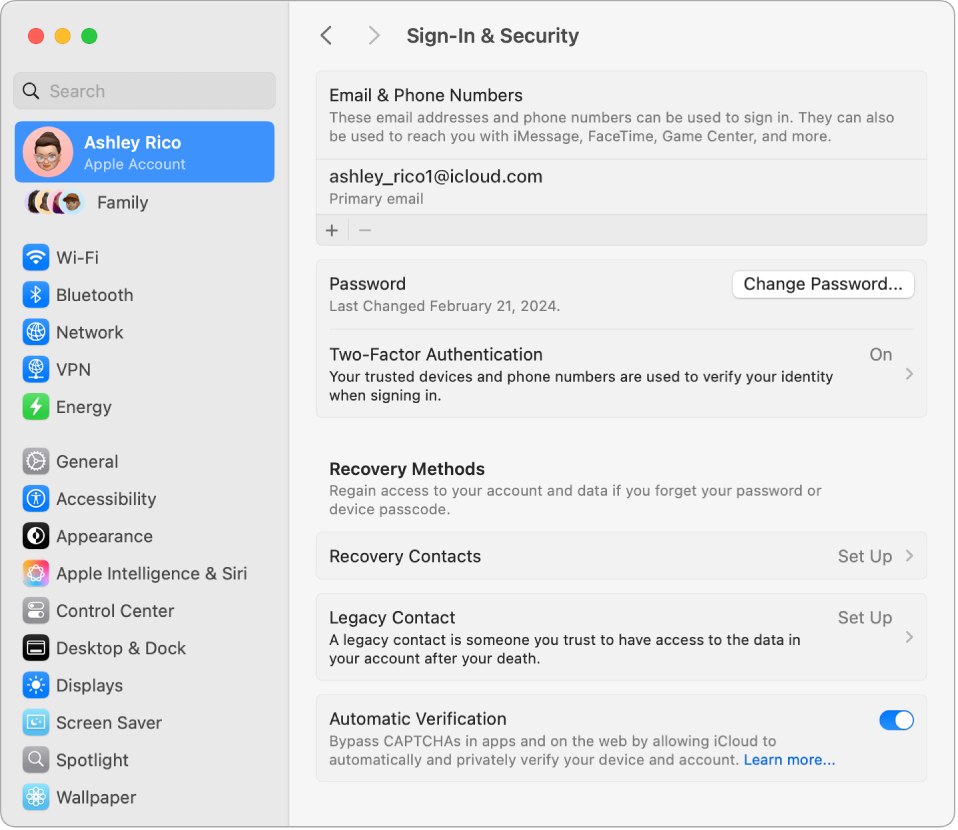

> 来源：https://support.apple.com/zh-cn/guide/imac/apd1c52f9d30/2024/mac/15
> 章节：Apple 账户

# Mac 上的 Apple 账户

Apple 账户可让你访问所有 Apple 服务。使用 Apple 账户从 App Store 下载 App；访问 Apple Music、Apple 播客、Apple TV 和 Apple Books 中的媒体；使用 iCloud 使内容在设备之间保持最新；设置“家人共享”群组等。

你也可以使用 Apple 账户访问其他 App 和网站（请参阅[在 Mac 上使用“通过 Apple 登录”](https://support.apple.com/zh-cn/guide/mac-help/mchl12f76694)）。

**【重要事项】**如果忘记了 Apple 账户密码，你不需要创建新的 Apple 账户。只需点按登录窗口中的“忘记密码”即可取回你的密码。

如果其他家庭成员也使用 Apple 设备，请确保每位家庭成员有其自己的 Apple 账户。你可以为子女创建 Apple 账户并通过“家人共享”来共享购买项目和订阅内容，这将在本节后面介绍。

若要查看可配合 Apple 账户使用的服务，请参阅 Apple 支持文章：[Apple 账户可用于哪些方面？](https://support.apple.com/102851)

**汇于一处。**在同一个位置管理你 Apple 账户关联的所有内容。在 iMac 上打开[系统设置](https://support.apple.com/zh-cn/guide/imac/aside/apd796e4d5da/2024/mac/15)，Apple 账户和“家人共享”设置位于边栏顶部。如果尚未登录 Apple 账户，请点按边栏顶部的“登录你的 Apple 账户”。

*图：“系统设置”中的“Apple 账户”设置，包含更新账户信息、打开或关闭 iCloud 功能、管理媒体账户和“家人共享”（可在其中管理家庭成员、家长控制和购买项目等）的标注框。*

**更新账户、安全性和支付信息。**在“系统设置”的边栏中点按你的 Apple 账户，然后选择要检查的项目并更新与账户关联的信息。

- *个人信息：*更新与你 Apple 账户关联的姓名、出生日期以及拟我表情或照片。你也可以设定与 Apple 通信的偏好设置，以及查看数据的管理方式。
- *登录与安全性：*更改 Apple 账户密码，打开[双重认证](https://support.apple.com/zh-cn/guide/imac/aside/apde0086f97b/2024/mac/15)，添加或移除可用于登录的电话号码和电子邮件，以及设置“账户恢复”或“遗产联系人”。请参阅[使用“通过 Apple 登录”](https://support.apple.com/zh-cn/guide/mac-help/mchl12f76694)。
- *付款与配送：*管理 Apple 账户关联的付款方式，以及在 Apple Store 商店中购物的配送地址。
- *iCloud：*点按 iCloud，然后选取要打开的 iCloud 功能。你也可以打开 iCloud+ 功能以及管理 iCloud 储存空间。打开某项 iCloud 功能后，你的内容会储存在 iCloud 中，以便你在已打开 iCloud 且登录相同 Apple 账户的任何设备上访问所有内容。若要进一步了解 iCloud，请参阅[搭配 iMac 使用 iCloud](https://support.apple.com/zh-cn/guide/imac/apdc44eb8957/2024/mac/15)，以及[使用 iCloud 的 App 和功能](https://support.apple.com/zh-cn/guide/icloud/mm203ae070a2/)和[什么是 iCloud+？](https://support.apple.com/zh-cn/guide/icloud/mmfc854d9604/icloud)。
- *媒体与购买项目：*管理与 Apple Music、Apple 播客、Apple TV 和 Apple Books 关联的账户；选择购买设置；以及管理你的订阅。

*图：“系统设置”中 Apple 账户的“登录与安全性”部分。你可以在此处设置“账户恢复联系人”或“遗产联系人”。*

**使用“密码” App。**集中一处查看你所有设备上的全部密码、通行密钥和验证码。通过相同 Apple 账户登录 iCloud 并在 iCloud 设置中打开“密码”。请参阅[在 Mac 上使用密码](https://support.apple.com/zh-cn/guide/passwords/mchl901b1b95)。

**查看你的所有设备。**查看关联至你 Apple 账户的所有设备。你可以验证每台设备的“查找我的 [*设备*]”是否打开（请参阅[查找](https://support.apple.com/zh-cn/guide/findmy-mac)），查看 iOS 或 iPadOS 设备的 iCloud 云备份状态，或者将不再拥有的设备从你的账户中移除。

**家人共享。**通过“家人共享”，你可以设置由多达六位成员组成的家庭群组。之后你可以在“查找”中共享设备位置或者将设备标记为丢失。你还可以为子女创建 Apple 账户并设定“屏幕使用时间”限额来管理其使用设备的方式（请参阅 [Mac 上的屏幕使用时间](https://support.apple.com/zh-cn/guide/imac/apd35460a9f3/2024/mac/15)）。

通过“家人共享”，你可以共享订阅，包括 Apple TV+、Apple Music 和 iCloud+ 等。你还可以共享 App Store、Apple 视频 App、Apple Books 和 iTunes Store 中的购买项目。家庭成员仍可使用各自的 iCloud 账户。你可以使用一张信用卡为家庭购买项付款，并直接在 iMac 上批准子女的花销。若要管理“家人共享”设置，请点按“系统设置”中的“家人共享”。若要进一步了解，请参阅 Apple 支持文章：[设置“家人共享”](https://support.apple.com/108380)。

**进一步了解。**若要进一步了解 iCloud 和“家人共享”，请参阅[搭配 iMac 使用 iCloud](https://support.apple.com/zh-cn/guide/imac/apdc44eb8957/2024/mac/15) 和[在 Mac 上管理“家人共享”群组](https://support.apple.com/zh-cn/guide/mac-help/mh5a9bb78c90)。
