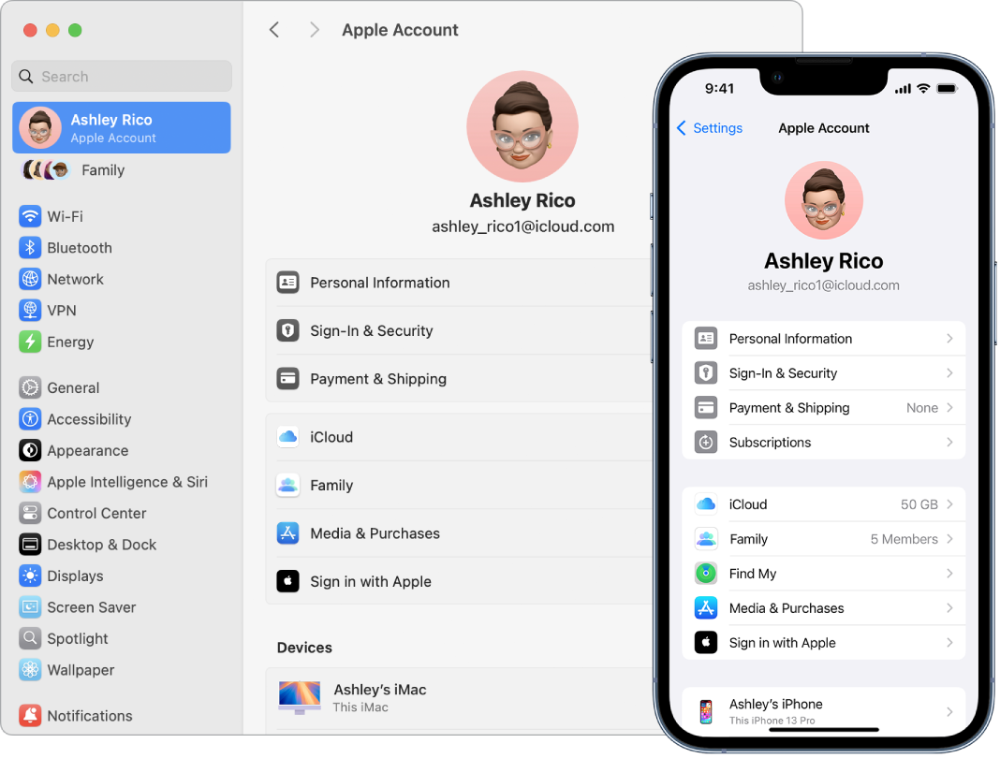

> 来源：https://support.apple.com/zh-cn/guide/imac/apdc44eb8957/2024/mac/15
> 章节：搭配 Mac 使用 iCloud

# 搭配 iMac 使用 iCloud

你可以通过 iCloud 使信息在所有设备上保持最新以及与亲朋好友进行协作。当使用 iCloud 并通过相同 [Apple 账户](https://support.apple.com/zh-cn/guide/imac/aside/apd74003fe84/2024/mac/15)登录所有设备时，你的 iMac 可与 iPhone、iPad、iPod touch 或 Apple Watch 无缝协同工作。

如果首次设置 Mac 时没有打开 iCloud，请打开[系统设置](https://support.apple.com/zh-cn/guide/imac/aside/apd796e4d5da/2024/mac/15)，然后点按边栏中的“登录你的 Apple 账户”。登录后，点按 iCloud，然后打开或关闭 iCloud 功能。若要进一步了解，请参阅[在 Mac 上设置 iCloud 功能](https://support.apple.com/zh-cn/guide/mac-help/mh36834)和[在所有设备上登录 iCloud](https://support.apple.com/zh-cn/guide/icloud/mmfc0f1e2a/)。

**在设备间访问内容。**通过 iCloud，你可以在设备间安全地储存、编辑和共享你的文稿、照片和视频以确保始终保持最新。若要开始，请参阅[在 Mac 上访问 iCloud 内容](https://support.apple.com/zh-cn/guide/imac/apd785390d2e/2024/mac/15)。

**配合其他设备使用 iMac。**通过“连续互通”功能，在 iMac 和其他设备间无缝移动内容。只需[登录 Apple 账户](https://support.apple.com/zh-cn/guide/imac/aside/apd20ea53580/2024/mac/15)，每当 iMac 和设备彼此接近时，它们就能方便地配合使用。例如，你可以在一台设备上开始一项任务，然后在另一台设备上完成该任务；将 iPhone 用作 iMac 的网络摄像头；通过“隔空播放”将屏幕内容流播放到另一台 Mac 或 Apple TV；通过“随航”将 iPad 设置为与 iMac 并排工作等。请参阅[在设备间共享内容](https://support.apple.com/zh-cn/guide/imac/apdb6816a22d/2024/mac/15)、[多设备协同工作](https://support.apple.com/zh-cn/guide/imac/apd9f9bfbdad/2024/mac/15)和[通过“隔空播放”在更大的屏幕上流播放内容](https://support.apple.com/zh-cn/guide/imac/apdf1417128d/2024/mac/15)。

有关支持“连续互通”的设备系统要求列表，请参阅 Apple 支持文章：[Apple 设备上“连续互通”功能的系统要求](https://support.apple.com/108046)。若要进一步了解配合 iMac 使用“连续互通”功能，请参阅 Apple 支持文章：[使用“连续互通”连接 Mac、iPhone、iPad 和 Apple Watch](https://support.apple.com/102418)，或者访问[在你不同设备之间，体验无间](https://www.apple.com/cn/macos/continuity/)。

*图：iPhone 和 Mac 上的 iCloud 设置。*

**充分使用 iCloud+。**iCloud+ 是一项订阅服务，可为你提供更多空间用以储存照片和文件等内容。你可以通过“家人共享”共享你的 iCloud+ 储存空间方案。iCloud+ 还包括“iCloud 专用代理”、“HomeKit 安防视频”以及针对 iCloud.com 上“邮件”地址的自定义电子邮件域。若要进一步了解 iCloud+ 所提供的内容，请参阅[什么是 iCloud+？](https://support.apple.com/zh-cn/guide/icloud/mmfc854d9604/icloud)。
