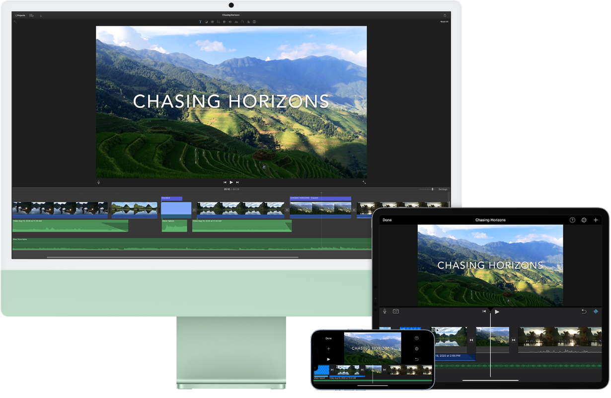

> 来源：https://support.apple.com/zh-cn/guide/imac/apd785390d2e/2024/mac/15
> 章节：访问 iCloud 内容

# 在 Mac 上访问 iCloud 内容

你可以使用 iCloud 来保护照片、文件、备忘录、iCloud 钥匙串等最重要信息的安全，同时使这类信息在你的所有设备上保持最新且可用。iCloud 内建于每部 Apple 设备中，每位用户初始均可获得 5 GB 的储存空间。（从 App Store、Apple 视频 App、Apple Books 或 iTunes Store 购买的项目不占用可用空间。）

所以如果你拥有 iPhone、iPad 或 iPod touch，只需通过 [Apple 账户](https://support.apple.com/zh-cn/guide/imac/aside/apd74003fe84/2024/mac/15)登录每台设备，打开 iCloud，这样便可获取所需的一切。如果需要使用更多储存空间和高级功能，你可以升级至 iCloud+，其中包括“iCloud 专用代理”、“隐藏邮件地址”、“自定义电子邮件域”和“HomeKit 安防视频”支持。

对于支持 iCloud 设备的系统要求，请参阅 Apple 支持文章：[iCloud 的系统要求](https://support.apple.com/118308)。

*图：iMac、iPad、和 iPhone 上显示同样的内容。*

**自动在 iCloud 云盘中储存你的桌面和“文稿”文件夹。**你可以将文件存储到“文稿”文件夹或桌面，它们会自动在 iCloud 云盘中可用并可供你随处访问。使用 iCloud 云盘时，即可在 iMac 上、iPhone 或 iPad 上的“文件” App 中、[iCloud.com](https://www.iCloud.com) 网站上或 Windows PC 上的 Windows 版 iCloud App 中访问文件。在设备上或 iCloud 云盘中更改文件后，你可以在浏览该文件时看到编辑的内容。

若要开始使用，请打开[系统设置](https://support.apple.com/zh-cn/guide/imac/aside/apd796e4d5da/2024/mac/15)，在边栏中点按你的 Apple 账户，点按 iCloud，然后打开“iCloud 云盘”。若要进一步了解，请参阅[在所有设备上设置并使用 iCloud 云盘](https://support.apple.com/zh-cn/guide/icloud/set-up-icloud-drive-mm203b05aec8/icloud)。另请参阅 Apple 支持文章：[将“桌面”和“文稿”文件添加到 iCloud 云盘](https://support.apple.com/109344)。

**储存和共享照片。**将照片图库储存在 iCloud 上，就可以在你的所有设备上查看照片和视频以及对它们所做的编辑。若要开始使用 iCloud 照片，请前往“系统设置”，在边栏中点按你的 Apple 账户，点按 iCloud，然后打开“照片”。

使用 iCloud 共享照片图库与最多五位其他用户共享照片和视频。每个人都可以更改共享图库，例如添加新内容、进行编辑或添加评论。智能建议可让你轻松添加精选集中的特定照片，例如包含特定人物或在某个特定日期拍摄的照片。若要开始使用，请前往“照片”>“设置”，点按“共享图库”标签页，然后按照屏幕指示操作。若要进一步了解 iCloud 照片，请参阅[在 iCloud.com 上使用 iCloud 照片](https://support.apple.com/zh-cn/guide/icloud/photos-on-icloudcom-overview-mmbc402b84/1.0/icloud/1.0)。

**随处获取你的购买项目。**通过相同 Apple 账户登录设备后，你的 App Store、Apple 视频 App、Apple Books 和 iTunes Store 购买项目即随时可用，不论你使用哪台电脑或设备进行购买。这样，你的所有音乐、影片、图书等将随处可用。

**通过“查找我的 Mac”来定位 iMac。**如果你的 iMac 丢失且打开了“查找我的 Mac”，则可以使用[查找](https://support.apple.com/zh-cn/guide/findmy-mac)在地图中对其进行定位、锁定屏幕，甚至远程抹掉其数据。若要打开“查找我的 Mac”，请打开“系统设置”，依次点按边栏中你的 Apple 账户、iCloud、“全部显示”，然后打开“查找我的 Mac”。请参阅 Apple 支持文章：[如果你的 Mac 丢失或失窃](https://support.apple.com/102481)。

*【注】*如果你的 iMac 上有多个用户账户，只有一个账户可以打开“查找我的 Mac”。

**进一步了解。**请参阅[《iCloud 使用手册》](https://support.apple.com/zh-cn/guide/icloud)和[什么是 iCloud？](https://support.apple.com/zh-cn/guide/mac-help/mh36832)。
