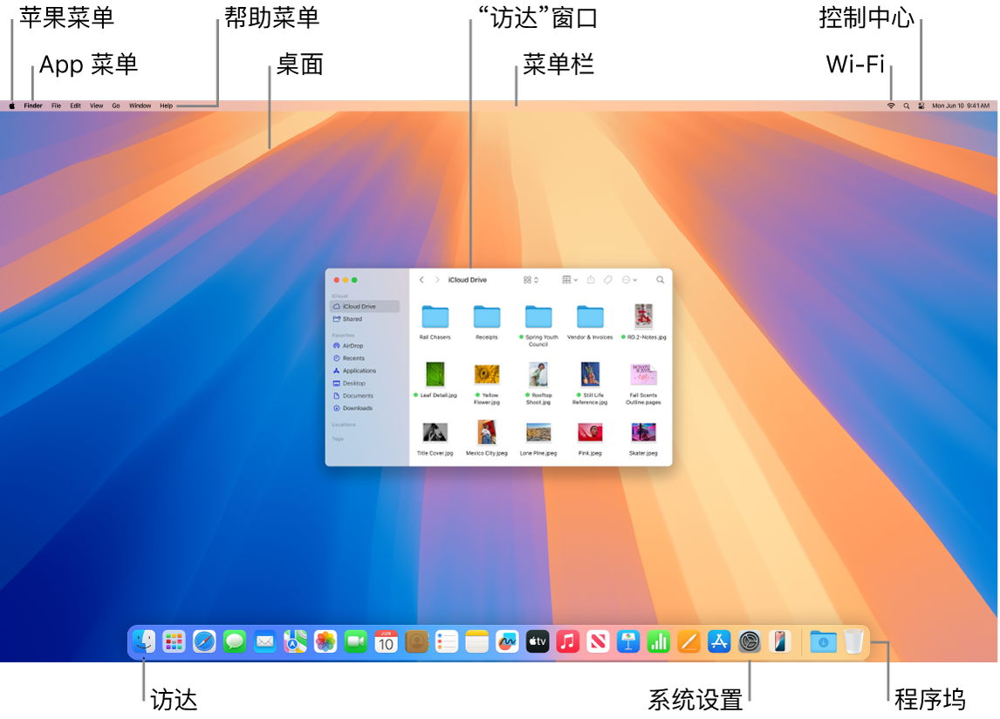

> 来源：https://support.apple.com/zh-cn/guide/imac/apd65991c417/2024/mac/15
> 章节：桌面和菜单栏

# Mac 上的桌面和菜单栏

在 iMac 上首先映入眼帘的便是*桌面*。*菜单栏*位于屏幕顶部，而*程序坞*显示在底部。

*图：显示苹果菜单、App 菜单、“帮助”菜单、桌面、菜单栏、“访达”窗口、Wi-Fi 图标、“控制中心”图标、“访达”图标、“系统设置”图标以及程序坞的 Mac 屏幕。*

**【提示】**在屏幕上找不到指针？若要暂时放大鼠标指针，请在触控板上快速来回移动你的手指。或者如果你使用的是鼠标，请将它快速来回滑动。

**桌面。**桌面是你工作的地方，不管是打开和使用 App、处理文件，还是通过“聚焦”搜索 iMac 或网站等。若要更改桌面图片，请打开[系统设置](https://support.apple.com/zh-cn/guide/imac/aside/apd796e4d5da/2024/mac/15)，点按边栏中的“墙纸”，然后选取一个选项。你还可以在桌面上储存文件，并通过叠放保持井井有条。 若要进一步了解桌面（包括如何使用叠放），请参阅[了解 Mac 桌面](https://support.apple.com/zh-cn/guide/mac-help/mh40612)。

**菜单栏。**菜单栏贯穿屏幕顶部。使用左侧的菜单在 App 中选取命令和执行任务。菜单项因你使用的 App 而变化。使用右侧的图标接入 Wi-Fi 网络、检查 Wi-Fi 状态

*图：Wi-Fi 状态图标*

、打开控制中心

*图：“控制中心”状态菜单*

、检查电池的充电状态

*图：电池充满图标*

、使用“聚焦”

*图：“聚焦”图标*

 搜索等。

**【提示】**你可以更改显示在菜单栏中的图标。请参阅 [Mac 上的“控制中心”](https://support.apple.com/zh-cn/guide/imac/apdc362a41b2/2024/mac/15)。

*图：FaceTime 通话窗口显示通话参与者通过同播共享一起聆听专辑。*

**苹果菜单

*图：GlobalArt/IL_AppleLogo*

。**苹果菜单包含经常使用的项目，始终显示在屏幕的左上角。若要打开苹果菜单，请点按苹果图标

*图：GlobalArt/IL_AppleLogo*

。

**App 菜单。**你可以同时打开多个 App 和窗口。活跃 App 的名称以粗体显示在苹果菜单

*图：GlobalArt/IL_AppleLogo*

 的右侧，之后是 App 的独特菜单。如果你打开了不同的 App 或点按了不同 App 中打开的窗口，App 菜单的名称将变为该 App，菜单栏中的菜单也随之更改。如果在菜单中查找命令但未找到，请检查 App 菜单以查看要使用的 App 是否处于活跃状态。

**“帮助”菜单。**你始终可以从菜单栏中获取关于 iMac 的帮助。若要获取帮助，请在程序坞中打开“访达”，点按“帮助”菜单并选取“macOS 帮助”以打开《macOS 使用手册》。或者在搜索栏中键入并选取一条建议。若要获取特定 App 的帮助，请打开 App 并点按菜单栏中的“帮助”。请参阅[使用《Mac 使用手册》](https://support.apple.com/zh-cn/guide/imac/apdfdad69354/2024/mac/15)。

**【提示】**你可以将小组件中心的小组件添加到桌面，甚至可以添加 iPhone 上的小组件而无需安装相应的 App。若要进一步了解，请参阅[在 Mac 上管理窗口](https://support.apple.com/zh-cn/guide/imac/apd2345fc25d/2024/mac/15)。

*图：部分桌面，其中“帮助”菜单已打开，显示“搜索”和“macOS 帮助”菜单选项。*

**进一步了解。**请参阅 [Mac 上的访达](https://support.apple.com/zh-cn/guide/imac/apddf030866a/2024/mac/15)和 [Mac 上的程序坞](https://support.apple.com/zh-cn/guide/imac/apd4b7fb731f/2024/mac/15)。
