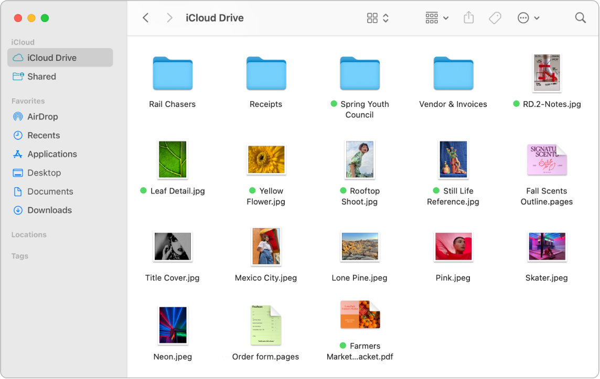
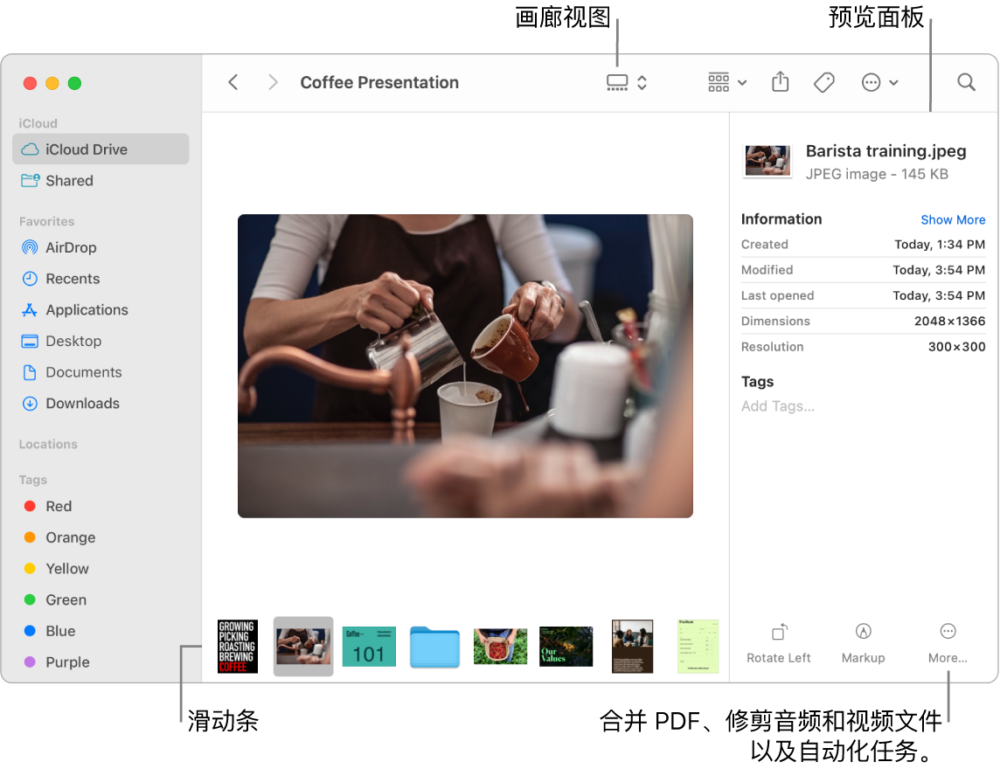

> 来源：https://support.apple.com/zh-cn/guide/imac/apddf030866a/2024/mac/15
> 章节：访达

# Mac 上的访达

“访达”用一个带笑脸的蓝色图标来表示，是 Mac 的大本营。你可以使用它来整理和访问 Mac 上的几乎所有内容，包括文稿、图像、影片及你拥有的任何其他文件。若要打开“访达”窗口，请点按屏幕底部程序坞中的

*图：“访达”图标*

。用力点按文件图标来快速查看其内容，或用力点按文件名进行编辑。若要了解用力点按和其他手势，请参阅[妙控板](https://support.apple.com/zh-cn/guide/imac/apdea23385dd/2024/mac/15)。

*图：打开的“访达”窗口，以图标形式显示文件和文件夹。*

**井井有条。**你的 Mac 已为常见类型的内容创建了文件夹，如“文稿”、“图片”、“应用程序”和“音乐”等。当你创建文稿、安装 App 以及执行其他工作时，你可以创建新文件夹来保持条理性。若要创建新文件夹，请选取“文件”>“新建文件夹”。请参阅[在 Mac 上以文件夹形式整理文件](https://support.apple.com/zh-cn/guide/mac-help/mh26885)。

**同步设备。**连接 iPhone 或 iPad 等设备时，设备会显示在“访达”边栏中。点按设备的名称以查看用于备份、更新、同步和恢复设备的选项。

**“访达”边栏。**左侧的边栏显示你经常使用或想要快速打开的项目。若要查看储存在 iCloud 云盘中的所有文稿，请点按边栏中的 iCloud 云盘文件夹。若要仅查看你正共享和与你共享的文稿，请点按“共享”文件夹。若要更改边栏中显示的内容，请选取“访达”>“设置”。

**更改查看文件和文件夹的方式。**点按“访达”窗口顶部的弹出式菜单按钮以更改查看文稿和文件夹的方式。以图标

*图：GlobalArt/IL_IconView*

、列表

*图：GlobalArt/IL_ListView*

、层级分栏

*图：GlobalArt/IL_ColumnView*

 或画廊

*图：GlobalArt/IL_GalleryView*

 方式进行查看。“画廊视图”和“分栏视图”会显示所选文件的大预览图，这可让你直观地辨别出文件是图像、视频片段还是其他文稿。你也可以进行快速调整，如旋转或标记图像。若要在“访达”中显示“预览”面板选项，请选取“显示”>“显示预览”。若要自定义显示的内容，请选取“显示”>“显示预览选项”，然后为你的文件类型选择选项。

**【提示】**若要以“画廊视图”的方式显示文件名，请按下 Command-J 并选择“显示文件名”。

若要进一步了解各种显示选项，请参阅[在“访达”中更改文件夹的显示方式](https://support.apple.com/zh-cn/guide/mac-help/mchldaafb302)。

*图：打开的“访达”窗口，处于“画廊视图”，显示了一张较大的照片，其下方是一排较小的照片，即滑动条。滑动条右侧是旋转、标记等控制。*

**快速操作。**在“画廊视图”或“分栏视图”中，点按“访达”窗口右下方的

*图：“更多”按钮*

 以了解直接在“访达”中管理和编辑文件的快捷键。你可以使用“标记”旋转图像、注释或裁剪图像，将多个图像和 PDF 合并为单个文件，修剪音频和视频文件，运行使用“快捷指令” App 创建的快捷指令以及通过“自动操作”工作流程创建自定义操作（如给文件添加水印）。请参阅[在 Mac 上的“访达”中执行快速操作](https://support.apple.com/zh-cn/guide/mac-help/mchl97ff9142)。

**快速查看。**选择文件，然后按下空格键以打开“快速查看”。使用“快速查看”窗口顶部的按钮给 PDF 签名、修剪音频和视频文件以及标记、旋转和裁剪图像，而无需一一打开相应的 App。若要进一步了解“快速查看”和标记功能，请参阅[在 Mac 上通过“快速查看”查看和编辑文件](https://support.apple.com/zh-cn/guide/mac-help/mh14119)和[在 Mac 上标记文件](https://support.apple.com/zh-cn/guide/mac-help/mchl1fd88863)。

**【提示】**你可以在“预览”或“快速查看”中使用“标记”添加可供“旁白”朗读的备选图像描述。

**更快访问。**“访达”菜单栏中的“前往”菜单可让你快速前往文件夹和位置。无需多次点按即可导航到“实用工具”文件夹：选取“前往”>“实用工具”。你还可以选取“前往”>“上层文件夹”以返回嵌套文件夹的顶层。如果知道特定文件夹的路径，请选取“前往”>“前往文件夹”，然后键入路径。请参阅[直接前往特定文件夹](https://support.apple.com/zh-cn/guide/mac-help/mchlp1236)。
