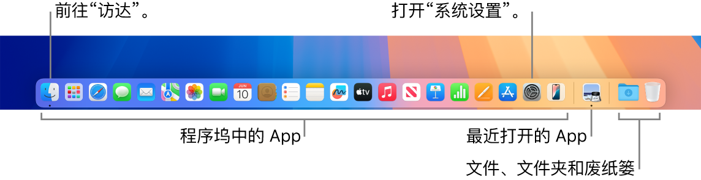
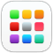
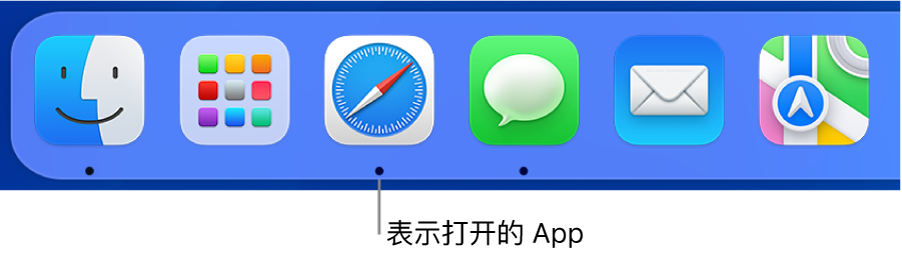

> 来源：https://support.apple.com/zh-cn/guide/imac/apd4b7fb731f/2024/mac/15
> 章节：程序坞

# Mac 上的程序坞

屏幕底部的程序坞非常方便，用于保留你最常使用的 App 和文稿。

*图：程序坞，显示“访达”、“系统设置”以及程序坞中将 App 和文件及文件夹分隔的分隔条。*

**打开 App 或文件。**点按程序坞中的 App 图标，或者点按程序坞中的[启动台](https://support.apple.com/zh-cn/guide/imac/aside/apd2d2a58738/2024/mac/15)图标

*图：GlobalArt/IL_LaunchpadAppIcon*

 以查看 Mac 上的所有 App，然后点按想要使用的 App。你还可以使用“聚焦”

*图：GlobalArt/IL_Spotlight*

（位于菜单栏右上角）搜索 App，然后直接从“聚焦”搜索结果中打开该 App。最近打开的 App 显示在程序坞的中间部分。

*图：程序坞的一部分，显示打开的 App 下面的黑色圆点。*

**关闭 App。**点按打开的窗口左上角的红色圆点时，该窗口会关闭，但 App 仍保持打开。程序坞中打开的 App 图标下面有一个黑色圆点。若要关闭 App，请按住 Control 键点按程序坞中的 App 图标并点按“退出”。

**将项目添加到程序坞。**拖移项目，并放置在想要的位置。将 App 放在程序坞的左侧部分，将文件或文件夹放在右侧部分。

**从程序坞移除项目。**将它拖出程序坞。该项目只是从程序坞移除，而不会从 Mac 移除。

**查看 Mac 上所有打开的内容。**按下键盘上的调度中心键

*图：GlobalArt/IL_MissionControl*

 或在触控板上用三指轻扫以打开调度中心。查看打开的窗口、桌面空间、全屏幕显示的 App 等，以及在它们之间轻松切换。你还可以将“调度中心”图标

*图：GlobalArt/IL_MissionControlAppIcon*

 添加到程序坞。请参阅[在 Mac 上的调度中心中查看打开的窗口和空间](https://support.apple.com/zh-cn/guide/mac-help/mh35798)。

**查看一个 App 中所有打开的窗口。**在程序坞中用力点按一个 App 以查看该 App 所有打开的窗口。若要用力点按，请点按然后更用力按下。

**【提示】**点按[系统设置](https://support.apple.com/zh-cn/guide/imac/aside/apd796e4d5da/2024/mac/15)中的“桌面与程序坞”以更改程序坞的外观和行为。调整程序坞的大小、将它移到屏幕左侧或右侧、将它设为不使用时隐藏等。

**进一步了解。**请参阅[在 Mac 上使用程序坞](https://support.apple.com/zh-cn/guide/mac-help/mh35859)。
