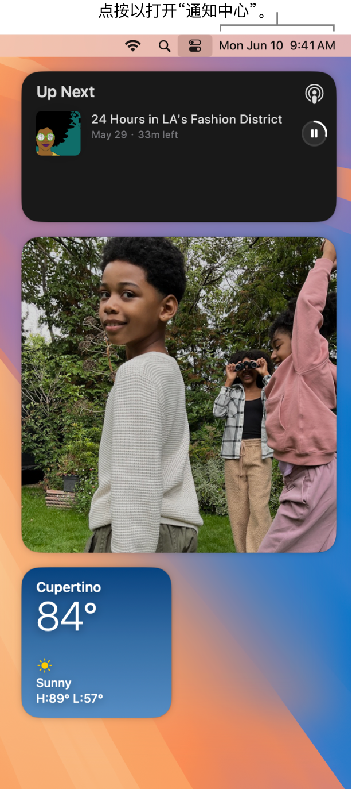

> 来源：https://support.apple.com/zh-cn/guide/imac/apd6d7eb47b9/2024/mac/15
> 章节：通知中心

# Mac 上的“通知中心”

“通知中心”可让你于一处轻松查看所有重要信息、提醒事项和小组件。详细了解日历日程、股市、天气等，并稍后查看未读通知（电子邮件、信息、提醒事项等）。

**打开“通知中心”。**点按屏幕右上方的日期或时间，或者用双指从触控板右边缘向左轻扫。向下滚动以查看更多。

*图：“通知中心”显示了通知以及“日历”、“天气”、“时钟”和“屏幕使用时间”的小组件。*

**与通知交互。**回复电子邮件、收听最新播客或者查看日历日程详细信息。点按通知右上角的箭头以查看选项、执行操作或获取更多信息。

**设定通知设置。**打开[系统设置](https://support.apple.com/zh-cn/guide/imac/aside/apd796e4d5da/2024/mac/15)，然后点按“通知”以选择你要查看的通知，包括是否要在 Mac 上查看 iPhone 通知。通知会按时间先后的顺序排列。

**暂停通知以专注于工作。**当你在工作、用餐或只是不想被打扰时，专注模式会自动过滤通知以便你仅看到所指定的通知。 专注模式会暂停所有通知或仅允许特定通知显示，并通过“信息”中的状态告诉联系人你的通知已静音。若要设置专注模式，请打开“系统设置”，然后点按边栏中的“专注模式”。若要打开或关闭专注模式，请点按菜单栏中的

*图：“控制中心”状态菜单*

，然后点按“专注模式”部分并选取一种专注模式。

你可以自定义专注模式以符合当前的需要，允许来自特定联系人或 App、电话或临近日程等的通知。你还可以在设备间共享专注模式，并使用专注模式过滤条件隐藏“日历”和“信息”等 App 中的干扰内容。

**自定义小组件。**点按“编辑小组件”（位于通知中心底部）以查看小组件中心以及添加、移除或重新排列小组件。如果在 iPhone 和 Mac 上登录相同 [Apple 账户](https://support.apple.com/zh-cn/guide/imac/aside/apd74003fe84/2024/mac/15)，你还可以将 iPhone 小组件添加到桌面，无需在 Mac 上安装相应的 App。你可以将新的小组件拖到桌面上的任意位置或拖入通知中心。你还可以添加来自 App Store 的第三方小组件。

**进一步了解。**请参阅[在 Mac 上使用“通知中心”](https://support.apple.com/zh-cn/guide/mac-help/mchl2fb1258f)。
