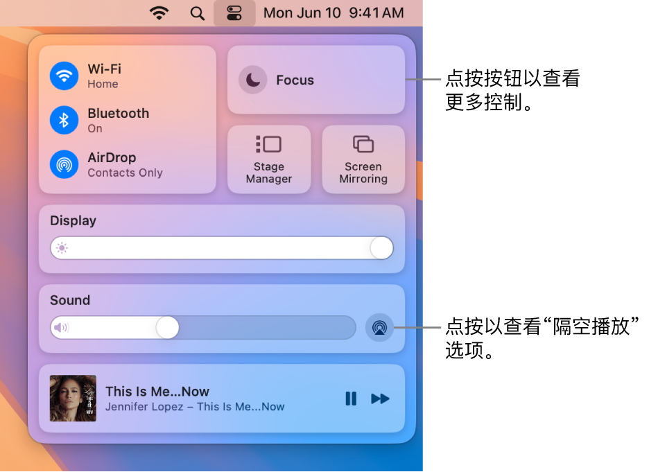
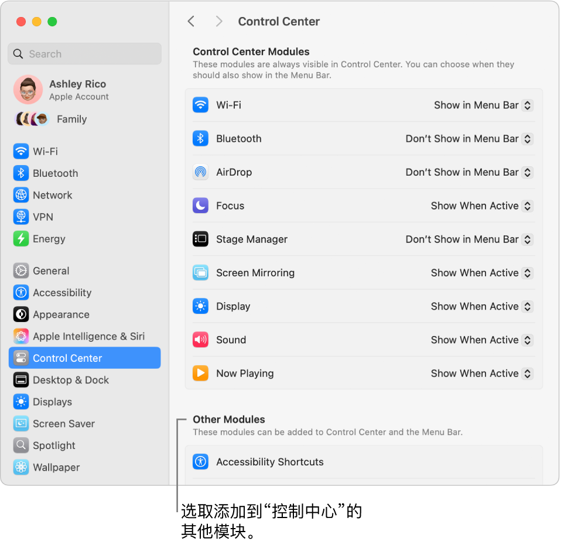

> 来源：https://support.apple.com/zh-cn/guide/imac/apdc362a41b2/2024/mac/15
> 章节：控制中心

# Mac 上的“控制中心”

控制中心集中一处显示 Mac 上的重要设置，可让你直接从菜单栏立即访问最常用的控制，如蓝牙、隔空投送、屏幕镜像、专注模式以及亮度和音量控制。点按屏幕右上角的

*图：“控制中心”状态菜单*

 以打开控制中心。

**点按可查看更多选项。**点按一个按钮以查看更多选项。例如，点按 Wi-Fi 按钮

*图：GlobalArt/IL_WiFi*

 以查看首选网络、其他网络，或者打开 Wi-Fi 设置。若要返回“控制中心”主视图，请再次点按

*图：“控制中心”状态菜单*

。

*图：Mac 上“控制中心”的放大视图。*

**管理桌面。**使用“台前调度”自动整理 App 和窗口并快速切换。你还可以将 App 归为一组以创建适合你工作流程的理想工作空间。请参阅[在 Mac 上管理窗口](https://support.apple.com/zh-cn/guide/imac/apd2345fc25d/2024/mac/15)。

**监视麦克风。**电脑的麦克风正在使用时，控制中心顶部会出现一个录音指示器。此指示器可让你知晓 App 是否可以访问麦克风，从而提高了 Mac 的安全性和隐私。

**置顶“控制中心”常用项目。**将常用项目从“控制中心”拖到菜单栏以在此处置顶显示，便于你只需点按一下即可轻松访问。若要更改菜单栏的显示内容，请打开[系统设置](https://support.apple.com/zh-cn/guide/imac/aside/apd796e4d5da/2024/mac/15)，点按“控制中心”，然后点按各项旁边的弹出式菜单并选取“在菜单栏显示”。你可以预览控制将显示在菜单栏中的哪个位置。某些项目无法添加到“控制中心”或菜单栏或者从中移除。

**【提示】**若要快速从菜单栏中移除项目，请按住 Command 键并将项目拖出菜单栏。

*图：“控制中心”设置窗口。*

**进一步了解。**请参阅[在 Mac 上使用“控制中心”](https://support.apple.com/zh-cn/guide/mac-help/mchl50f94f8f)。另请参阅[在设备间共享内容](https://support.apple.com/zh-cn/guide/imac/apdb6816a22d/2024/mac/15)和[通过“隔空播放”在更大的屏幕上流播放内容](https://support.apple.com/zh-cn/guide/imac/apdf1417128d/2024/mac/15)。
