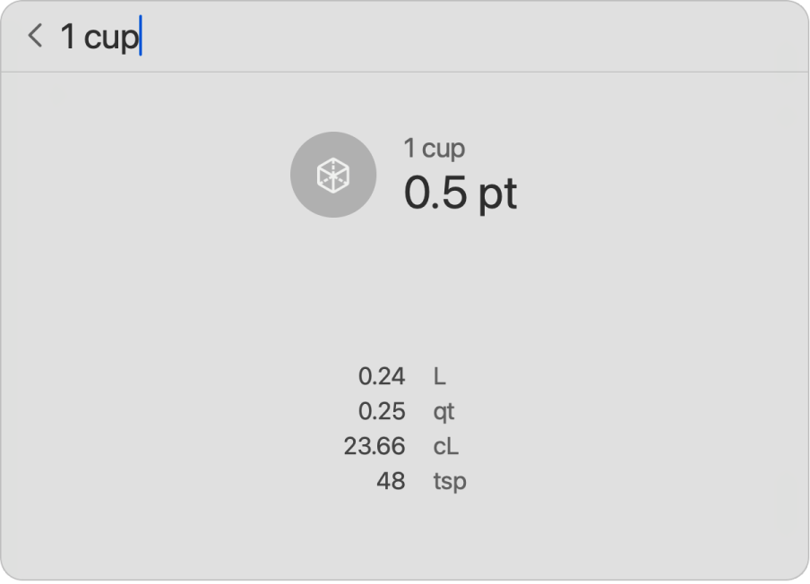

> 来源：https://support.apple.com/zh-cn/guide/imac/apd10f8d1038/2024/mac/15
> 章节：聚焦

# Mac 上的“聚焦”

使用“聚焦”

*图：GlobalArt/IL_Spotlight*

 可以轻松查找 iMac 上的所有内容，例如图像、文稿、联系人、日历日程以及电子邮件。你也可以使用“聚焦”来打开 App 或执行快速操作，例如开始专注模式。

**搜索任何内容。**点按屏幕右上方的

*图：“聚焦”图标*

，然后开始键入。你也可以按下键盘上的“聚焦”键 (F4)。“聚焦”可借助“实况文本”搜索图像中的文本（在指定语言中可用）。

**【提示】**按下 Command–空格键来显示或隐藏“聚焦”搜索栏。

*图：显示“马匹照片”搜索结果的“聚焦”窗口。*

**打开 App。**在“聚焦”中输入 App 名称，然后按下 Return 键。

**执行快速操作。**你可以通过“聚焦”快速执行某些任务，例如运行快捷指令、打开勿扰模式或设置闹钟。打开“聚焦”，然后搜索想要执行的操作。

*图：“聚焦”搜索显示 25 磅转换成千克、短吨、盎司、克和毫克。*

**转换货币、温度和度量单位。**输入货币（如 $、€ 或 ¥）和金额，然后按下 Return 键以获取转换后的值列表。或者指定单位转换的度量单位。

**缩小搜索范围。**你可以在“聚焦”搜索中包括或排除特定文件夹、磁盘或信息类型（如电子邮件或信息）。点按[系统设置](https://support.apple.com/zh-cn/guide/imac/aside/apd796e4d5da/2024/mac/15)中的“聚焦”并前往“搜索结果”，然后选择或取消选择要在“聚焦”结果中包括或排除的类别。

**使用 Siri 建议。**通过“聚焦”搜索时，“Siri 建议”提供来自维基百科文章、网页搜索结果、新闻、体育、天气、股票、影片及其他来源的信息。

如果想让“聚焦”只搜索 iMac 上的项目，请打开“系统设置”，点按“聚焦”，然后取消选择“搜索结果”下方的“Siri 建议”。

**进一步了解。**请参阅[在 Mac 上使用“聚焦”搜索](https://support.apple.com/zh-cn/guide/mac-help/mchlp1008)。
