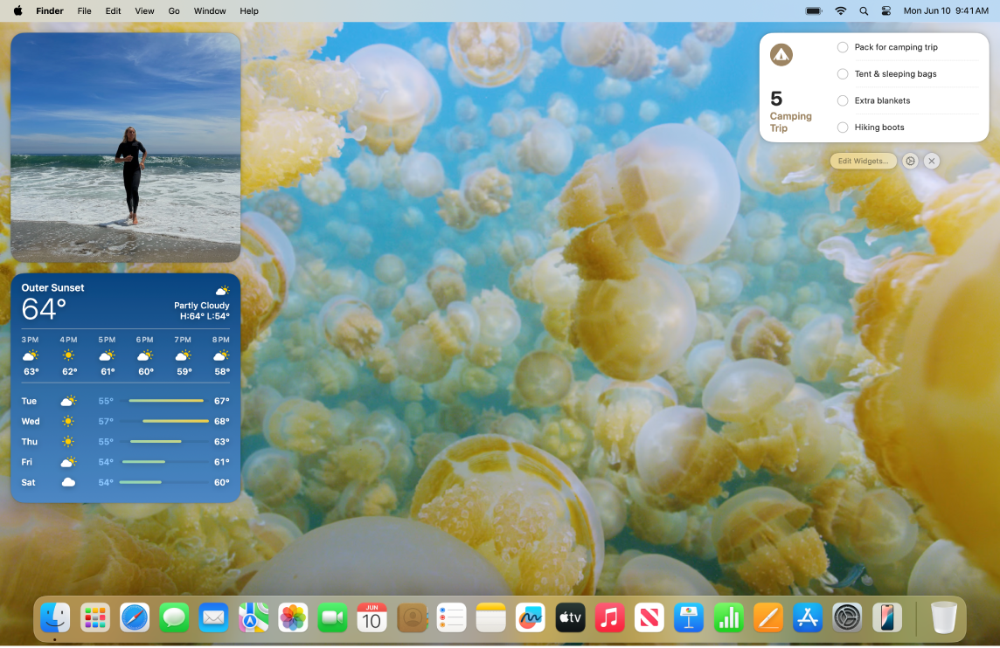
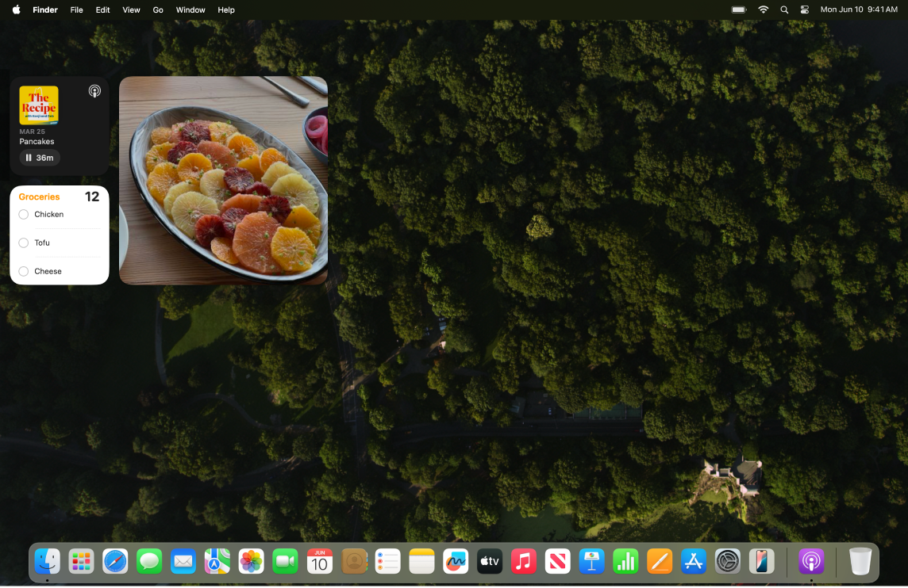
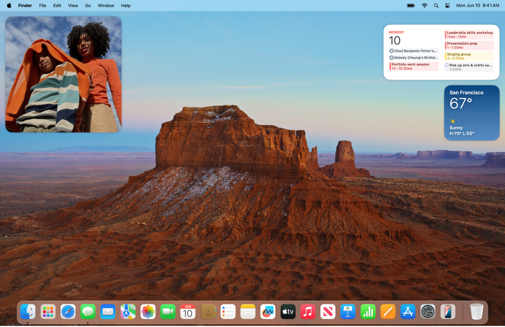

> 来源：https://support.apple.com/zh-cn/guide/imac/apd2add7474b/2024/mac/15
> 章节：增添个人风格

# 增添个人风格

通过更换墙纸和自定义桌面等方式使 iMac 专属于你。

**更换墙纸。**选取 Mac 的外观。打开[系统设置](https://support.apple.com/zh-cn/guide/imac/aside/apd796e4d5da/2024/mac/15)，点按“墙纸”，然后选取你要的墙纸。你可以选择相同的图像同时作为墙纸和屏幕保护程序，或者选择为二者选择不同的图像。

*图：Mac 桌面使用自定义墙纸。*

**将小组件添加到桌面。**将喜爱的 App 放在显要位置。将“照片”小组件添加到桌面以查看相簿或回忆中的照片，或者添加“播客”小组件以陈列你喜爱的节目。点按屏幕右上方的日期或时间以打开通知中心，然后点按“添加小组件”打开小组件中心以添加、移除或重新排列小组件。将新的小组件拖到桌面上的任意位置或拖入通知中心。

*图：Mac 桌面使用自定义墙纸。*

**制作拟我表情。**创建拟我表情以在 App 间代表自己，这包括在 Mac 上的登录窗口中、作为你的 Apple 账户头像和“通讯录”中的“我的名片”。打开“系统设置”，点按“用户与群组”，点按登录名旁边的头像。点按“拟我表情”，然后点按

*图：“添加”按钮*

 以选择和创建面部图像。请参阅[更改登录头像](https://support.apple.com/zh-cn/guide/mac-help/mtusr002)和[在“信息”中创建拟我表情](https://support.apple.com/zh-cn/guide/messages/ichta6e06677)。

*图：Mac 桌面使用自定义墙纸。*

**设置多个桌面。**使用“调度中心”设置多个工作和娱乐空间。 若要创建空间，请按下键盘顶行的

*图：调度中心键*

 进入调度中心，然后点按“添加桌面”按钮

*图：GlobalArt/IL_AddButton*

。你可以在工作时将窗口从一个空间拖移到另一个空间，以及添加或删除空间。请参阅[在多个空间中工作](https://support.apple.com/zh-cn/guide/mac-help/mh14112)。
