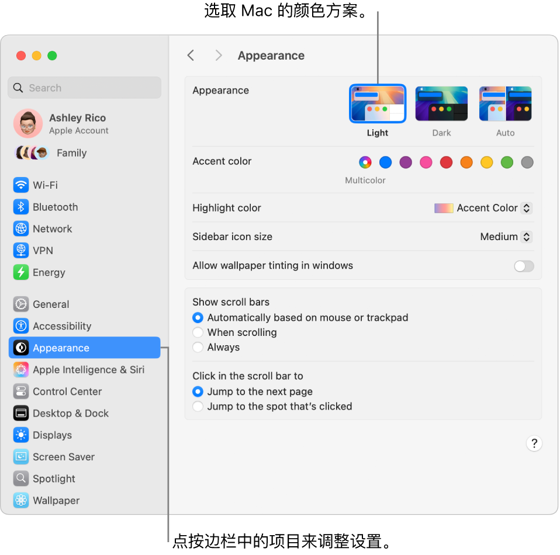

> 来源：https://support.apple.com/zh-cn/guide/imac/apda966cb8af/2024/mac/15
> 章节：系统设置

# Mac 上的“系统设置”

在“系统设置”中，你可以自定义 iMac 以及调整其设置来满足你的需求。例如，你可以添加同时用作墙纸的屏幕保护程序，管理通知，通过“显示器”设置更改亮度或分辨率，调整“辅助功能”设置等。你还可以下载最新的软件更新。

若要开始，请点按程序坞中的

*图：“系统设置”图标*

，或者选取苹果菜单

*图：GlobalArt/IL_AppleLogo*

 >“系统设置”，然后点按边栏中你要调整的设置。若要查看边栏中的所有设置，你可能需要向下滚动。

**【提示】**如果要调整特定的设置但不确定其位置，请使用搜索栏。随着你键入，结果会出现在边栏中。

*图：“系统设置”中的“外观”窗口。*

**锁定屏幕。**你可以将 iMac 设定为在不活跃一段时间后关闭显示屏或开始屏幕保护程序。你还可以设定在返回到 Mac 时需要密码才能解锁屏幕。若要设置，请前往“系统设置”中的“锁定屏幕”。

**选取屏幕保护程序。**慢动作屏幕保护程序可在你离开 Mac 以及用作墙纸时，使 iMac 显示屏成为一件艺术品。若要设置，请前往“系统设置”中的“屏幕保护程序”。如果选取“自然景观”、“城市景观”、“水下景观”、“地球”或“随机播放航拍”屏幕保护程序，你还可以打开“显示为墙纸”将其用作墙纸。

**自定义控制中心和菜单栏。**选取要在控制中心

*图：GlobalArt/IL_ControlCenter*

 或菜单栏中显示的设置。在“系统设置”中，点按边栏中的“控制中心”，然后选取选项。

**更新 macOS。**在“系统设置”中，点按“通用”，然后点按“软件更新”以查看 Mac 是否运行的是最新版本的 macOS 软件。你可以指定软件自动更新的选项。

**iCloud 和“家人共享”设置。**在 iMac 上通过 Apple 账户登录 iCloud，管理 App 使用 iCloud 的方式，以及设置和管理“家人共享”。有关更多信息，请参阅 [Mac 上的 Apple 账户](https://support.apple.com/zh-cn/guide/imac/apd1c52f9d30/2024/mac/15)和[搭配 iMac 使用 iCloud](https://support.apple.com/zh-cn/guide/imac/apdc44eb8957/2024/mac/15)。

**进一步了解。**若要进一步了解“系统设置”，请参阅[通过“系统设置”自定义 Mac](https://support.apple.com/zh-cn/guide/mac-help/mh15217)。
