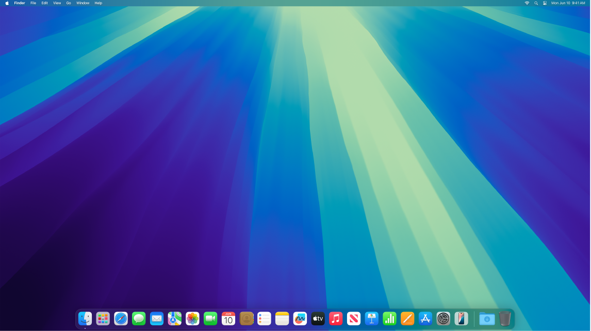

> 来源：https://support.apple.com/zh-cn/guide/imac/apdab93667af/2024/mac/15
> 章节：显示屏设置

# Mac 的显示器设置

**匹配周围的光线。**iMac 采用了原彩显示技术。原彩显示自动调整显示器的颜色以匹配环境光，从而提供更自然的观看体验。在[系统设置](https://support.apple.com/zh-cn/guide/imac/aside/apd796e4d5da/2024/mac/15)的“显示器”设置中打开或关闭原彩显示。

**使用动态桌面。**使用动态桌面图片时，桌面图片会随着你所在位置的时间推移而自动变化。点按“系统设置”中的“墙纸”，然后选取“动态桌面”的图片。若要使屏幕基于你所在的时区而变化，请启用“定位服务”。如果关闭了“定位服务”，图片将基于“日期与时间”设置中指定的时区而变化。

**更改项目在屏幕上的显示方式。**更改显示屏分辨率以使屏幕内容变大，或者增加文本和图标的大小使其更易看清。你也可以使指针更易于看清或者摇动鼠标来快速找到它。请参阅[使屏幕上的文本和其他项目变大](https://support.apple.com/zh-cn/guide/mac-help/mchld786f2cd)。

**通过深色模式保持专注。**你可以为桌面、菜单栏、程序坞和所有内建 macOS App 使用深色方案。你的内容会凸显出来并位于中间，而变暗的控制和窗口会隐入背景中。在“邮件”、“通讯录”、“日历”和“信息”等 App 中以黑底白字显示，这样在光线较暗的环境中工作时更护眼。

*图：处于“深色模式”的桌面。*

“深色模式”专为编辑照片和图像的专业人士而设计，因为颜色和细微的细节在 App 的深色背景中更加凸显。但也同样适合于想要专注内容的用户。

**夜览。**在夜间或光线不足的情况下将 Mac 切换到更暖的颜色，以减少暴露在明亮的蓝光下。蓝光会导致失眠，所以较暖的屏幕颜色有助于获得更佳睡眠。你可以设定在特定时段自动打开和关闭“夜览”，或设为在日落到日出时段内启用。打开“系统设置”，点按“显示器”，点按底部的“夜览”按钮，然后设定你的选项。拖移滑块以调整色温。

**连接显示器。**你可以将外接显示器、投影仪或 HDTV 连接到 Mac。如果不确定你的 Mac 支持连接几台外接显示器，请查看“技术规格”。打开“系统设置”，选取“帮助”>“iMac 技术规格”，然后找到“视频支持”（可能需要滚动）。请参阅[将外接显示器连接到 iMac](https://support.apple.com/zh-cn/guide/imac/apd271f29cb9/2024/mac/15)。

**进一步了解。**请参阅 [Mac 上的“显示器”设置](https://support.apple.com/zh-cn/guide/mac-help/mh40768)和[更改辅助功能中的“显示”设置](https://support.apple.com/zh-cn/guide/mac-help/unac089)。
