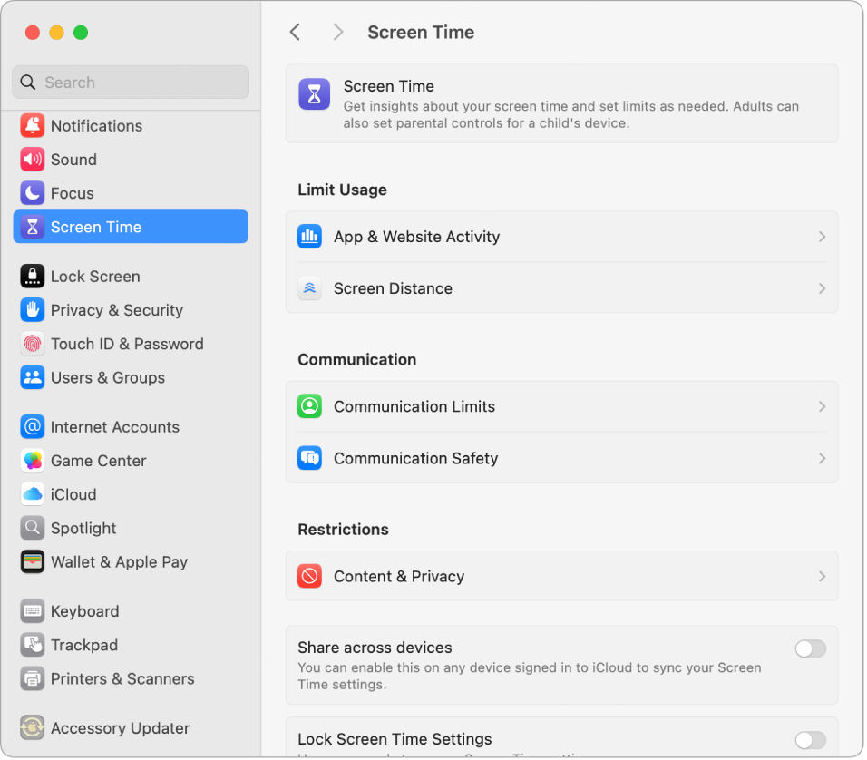

> 来源：https://support.apple.com/zh-cn/guide/imac/apd35460a9f3/2024/mac/15
> 章节：屏幕使用时间

# Mac 上的屏幕使用时间

“屏幕使用时间”可让你了解在 iMac 上所花时间的情况，提供各种工具以在停用期间轻松远离电脑，并让你监控子女在其 Apple 设备上的活动。

**查看使用 iMac 的情况。**查看报告来了解你在某天或整周使用 App 和网站的时间，查看通知次数最多的 App，以及每天使用设备的频率。打开[系统设置](https://support.apple.com/zh-cn/guide/imac/aside/apd796e4d5da/2024/mac/15)，选取边栏中的“屏幕使用时间”，然后点按“App 与网站活动”、“通知次数”或“使用次数”。可能需要打开“屏幕使用时间”后，这些选项才会出现。

*图：“屏幕使用时间”设置窗口显示查看“App 使用时间”、“通知次数”和“使用次数”的选项，以及管理屏幕使用时间的选项，例如计划停用时间，设定 App 限额和限定通信等。*

**设定限额。**设定限额以控制你在特定 App、App 类别和网站上花费的时间。在“屏幕使用时间”中，选取“停用时间”，打开“停用时间”，然后点按“定时”弹出式菜单以创建每日定时或为一周的每一天自定义时间。

**管理子女的屏幕使用时间。**父母可在其 Mac、iPhone 或 iPad上配置“屏幕使用时间”，子女设备上的一切内容都会相应设置。你还可以为“音乐”和“图书” App 设定基于年龄的媒体分级。请参阅[在 Mac 上为子女设置“屏幕使用时间”](https://support.apple.com/zh-cn/guide/mac-help/mchlc5595037)来进一步了解。

**不错过重要的信息。**选取始终需要访问的 App 或网站。在“屏幕使用时间”中，选取“始终允许”，然后打开想要在停用期间仍可使用的 App。

**进一步了解。**请参阅[在“屏幕使用时间”中管理停用时间](https://support.apple.com/zh-cn/guide/mac-help/mchl69510069)和[在“屏幕使用时间”中设置内容与隐私访问限制](https://support.apple.com/zh-cn/guide/mac-help/mchl8490d51e)。
