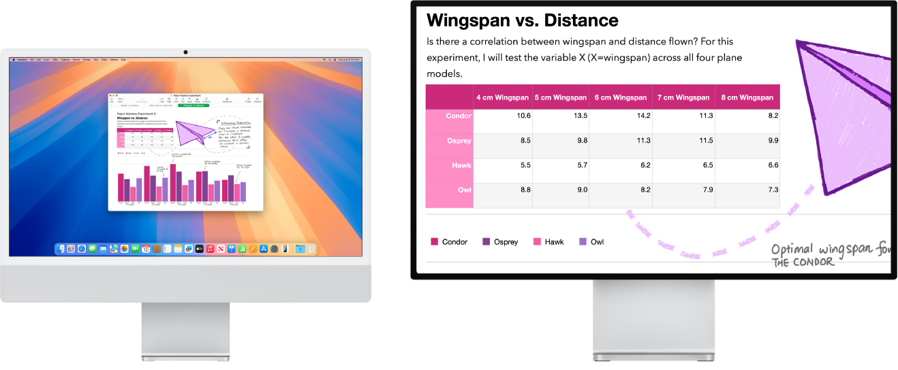

> 来源：https://support.apple.com/zh-cn/guide/imac/apd4c143b3c5/2024/mac/15
> 章节：辅助功能

# Mac 上的辅助功能

Mac 包括辅助功能工具，它们使 Apple 功能可供所有人轻松使用。若要访问这些工具，请打开[系统设置](https://support.apple.com/zh-cn/guide/imac/aside/apd796e4d5da/2024/mac/15)，然后点按边栏中的“辅助功能”。“辅助功能”设置分为五个类别：

- *视觉：*放大屏幕内容、使指针变大以及应用色彩滤镜等。
- *听觉：*显示和自定义屏幕字幕、配对助听设备、进行实时文本 (RTT) 通话、获取音频的实时字幕、设定 AirPods 的辅助功能选项等。
- *肢体活动能力：*通过语音命令、键盘上的按键、屏幕键盘、面部表情或辅助设备来控制 Mac 和 App。
- *语音：*键入要说的话并让设备将其大声朗读出来。你也可以创建个人声音。
- *通用：*自定义键盘快捷键以快速打开或关闭辅助功能。

视觉辅助功能

*图：右侧显示器上的“缩放显示”处于活跃状态，而左侧显示器的屏幕大小固定。*

**使用内建屏幕朗读器“旁白”。**“旁白”可以大声描述屏幕上显示的内容，朗读文稿、网页和窗口中的文本。你可以使用“旁白”通过键盘或触控板手势控制 Mac。你还可以连接可刷新盲文显示器以搭配“旁白”使用。

若要打开“旁白”，请执行以下任一项操作：

- 按下 Command-F5。如果“旁白”已打开，按下按键会关闭它。
- 使用 Siri。像这样说：“打开旁白”或“关闭旁白”。
- 选取苹果菜单

  

  *图：GlobalArt/IL_AppleLogo*

   >“系统设置”，然后点按边栏中的“辅助功能”（你可能需要向下滚动）。点按“旁白”，然后打开或关闭“旁白”。

[进一步了解旁白](https://support.apple.com/zh-cn/guide/voiceover)，包括如何根据需求进行自定义。

**通过“缩放”调整视图。**你可以放大部分或整个屏幕。如果有多个监视器，你可以在一个监视器上放大显示，而在其他监视器上使用标准分辨率。若要更改缩放设置，请选取苹果菜单

*图：GlobalArt/IL_AppleLogo*

 >“系统设置”，点按边栏中的“辅助功能”，然后点按“缩放”。

**通过“悬停文本”放大字词。**在“系统设置”中，点按“辅助功能”，点按“缩放”，然后打开底部的“悬停文本”。按下 Command 键并将指针放在文本上，屏幕上会出现包含缩放文本的窗口。

*图：“悬停文本”功能将放大的文本显示在新窗口中。*

**调整 Mac 显示器色彩。**你可以使用色彩滤镜调整 Mac 显示器色彩。若要更改这些设置，请前往“系统设置”，点按边栏中的“辅助功能”，点按“显示”，然后打开或关闭“色彩滤镜”。若要快速打开或关闭色彩滤镜，请按下 Option-Command-F5；如果 Mac 或妙控键盘配备了触控 ID，请快速按三下触控 ID。

[进一步了解视觉辅助功能](https://support.apple.com/zh-cn/guide/mac-help/mchl67c83f41)。

听觉辅助功能

**实时添加字幕。**你可以使用“实时字幕”为对话、音频和视频添加实时字幕。请参阅[使用实时字幕](https://support.apple.com/zh-cn/guide/mac-help/mchldd11f4fd)。

**【重要事项】**实时字幕并非在所有语言、国家或地区都可用。实时字幕的准确度可能会有所不同，且在高风险或紧急情况下不应依赖实时字幕。

**使用助听设备。**将 Made for iPhone (MFi) 助听器或声音处理器直接与 Mac 配对，以流播放音频和调整其设置。若要配对设备，请选取苹果菜单

*图：GlobalArt/IL_AppleLogo*

 >“系统设置”，点按边栏中的“辅助功能”，然后点按“助听设备”。请参阅[配合 Mac 使用助听设备](https://support.apple.com/zh-cn/guide/mac-help/mchle83953a5)。

**自定义 AirPods。**设定 AirPods 的辅助功能选项来放大柔音和调整某些频率，从而让音乐、电影、通话和播客听起来一清二楚。请参阅[为 AirPods 设定耳机调节](https://support.apple.com/zh-cn/guide/airpods/devcd05671ab)。

**消弭不必要的噪声。**消弭不必要的环境杂声并通过播放海洋或雨声等舒缓的声音尽量减少干扰。若要打开背景音，请选取苹果菜单

*图：GlobalArt/IL_AppleLogo*

 >“系统设置”，点按边栏中的“辅助功能”，然后点按“音频”并打开“背景音”。从各种声音中进行选择，然后拖移滑块来增大或减小背景音的音量。

[进一步了解听觉辅助功能](https://support.apple.com/zh-cn/guide/mac-help/mchlb4f015b1)。

肢体活动能力辅助功能

*图：“邮件”在桌面上打开，带有网格叠层。*

**通过语音控制 Mac。**你可以使用“语音控制”以通过语音执行一系列操作。“语音控制”在 Mac 上处理所有音频，确保你的个人数据安全私密。若要打开“语音控制”，请选取苹果菜单

*图：GlobalArt/IL_AppleLogo*

 >“系统设置”，点按边栏中的“辅助功能”，然后点按“语音控制”。

**自定义指针。**自定义鼠标指针的轮廓和填充颜色，以便指针在移动或改变形状时更易识别。

**改进的键盘访问。**一组扩展的键盘快捷键允许你通过键盘控制 Mac 上的所有操作，无需鼠标或触控板。

[进一步了解肢体活动能力辅助功能](https://support.apple.com/zh-cn/guide/mac-help/mchl654a7cc7)。

语音辅助功能

**让 Mac 为你朗读。**通过实时语音，你可以在打电话和 FaceTime 通话期间以及面对面交谈时，键入要说的话并让设备将其大声朗读出来。存储常用短语以在对话时快速插话。你可以选取要使用的声音或者录制个人声音。请参阅[创建个人声音](https://support.apple.com/zh-cn/guide/mac-help/mchldfd72333)。

**使用人声快捷指令。**设置 Mac 使其在你说出所选字词或其他声音时执行操作。若要使用人声快捷指令，请选取苹果菜单

*图：GlobalArt/IL_AppleLogo*

 >“系统设置”，点按“辅助功能”，前往“语音”，然后点按“人声快捷指令”。请参阅[使用人声快捷指令](https://support.apple.com/zh-cn/guide/mac-help/mchlf4548bb6)。

**让 Siri 听取非典型语音。**如果你有影响语言能力的后天或慢性疾病，则可以让 Siri 识别更广泛的非典型语音模式。请参阅[更改辅助功能中的 Siri 设置](https://support.apple.com/zh-cn/guide/mac-help/mchl5715a9f2)。

[进一步了解语音辅助功能](https://support.apple.com/zh-cn/guide/mac-help/mchl429b64a1)。

**进一步了解。**请参阅[在 Mac 上开始使用辅助功能](https://support.apple.com/zh-cn/guide/mac-help/mh35884)和 [Apple 辅助功能网站](https://www.apple.com/cn/accessibility)。
