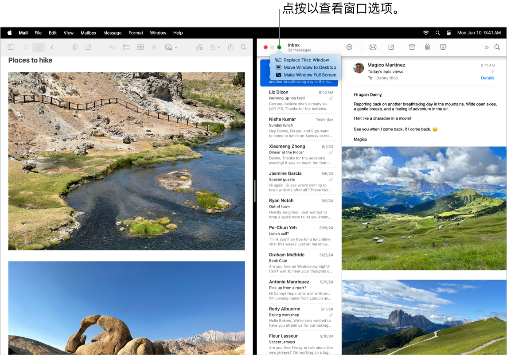
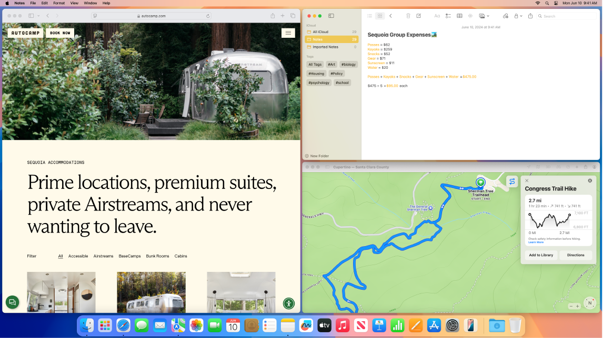
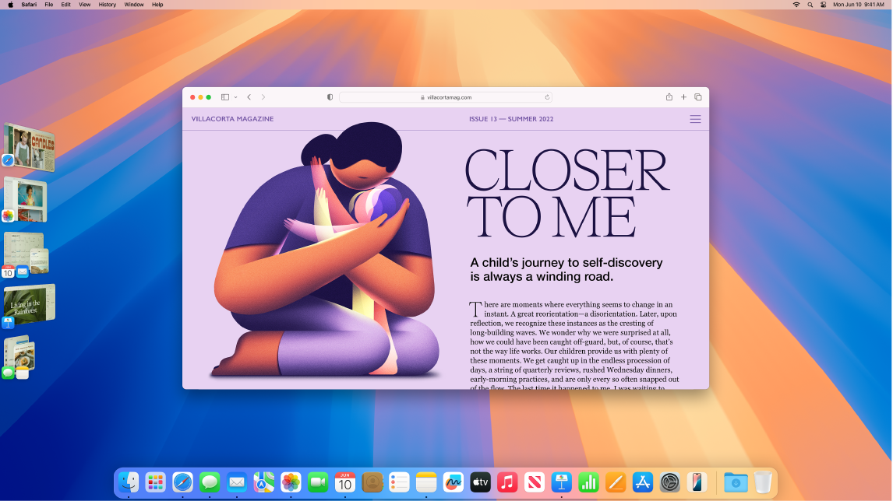

> 来源：https://support.apple.com/zh-cn/guide/imac/apd2345fc25d/2024/mac/15
> 章节：在 Mac 上管理窗口

# 在 Mac 上管理窗口

你经常会遇到桌面上打开了多个 App 且每个 App 打开了一个或多个窗口。幸好有一些高效方式来查看和导航你已打开的窗口。需要集中注意力时，你可以使某个 App 铺满整个屏幕，选取两个 App 来共享屏幕，或者调整自定义工作空间的布局。通过“台前调度”自动整理 App 和窗口以避免桌面杂乱无章并在任务间快速移动。如果需要查找被遮挡的窗口，请使用调度中心来在一层中显示所有打开的窗口。你可以使用多个桌面空间以在不同的桌面上展开你的工作并在桌面间轻松移动。

*图：Keynote 演示文稿填充了屏幕的左侧，Pages 文稿填充了右侧。绿色按钮下方打开了一个弹出式菜单，显示“替换拼贴窗口”、“将窗口移到桌面”和“全屏显示窗口”的选项。*

**使用整个屏幕。**使用全屏幕视图来专注于某个 App。在全屏幕视图中，菜单栏会被隐藏直至你将指针移到屏幕顶部，或者你可以选择始终显示菜单栏。若要进入或退出全屏幕视图，请将指针移到窗口左上角的绿色按钮上，然后从出现的菜单中选取“全屏幕”。请参阅[在全屏幕视图中使用 App](https://support.apple.com/zh-cn/guide/mac-help/mchl9c21d2be)。

**拆分屏幕。**使用分屏浏览以在并排显示的两个 App 窗口中工作。将指针移到你要使用的窗口左上角的绿色按钮，点按“全屏幕”，然后选取“屏幕右侧”或“屏幕左侧”来放置窗口。点按另一个窗口，它会自动填充屏幕的另一半。将指针放在绿色按钮上以查看切换 App、使两个窗口全屏显示等选项。请参阅[在分屏浏览中使用 App](https://support.apple.com/zh-cn/guide/mac-help/mchl4fbe2921)。

**平铺窗口。**移动窗口和调整其大小，或者排列窗口以填满屏幕。将指针移到你要使用的窗口左上角的绿色按钮上，然后选取你要如何排列屏幕。请参阅[平铺窗口](https://support.apple.com/zh-cn/guide/mac-help/mchlef287e5d)。

**【提示】**如果想要看清打开了多个窗口的桌面，请点按桌面墙纸的任意位置以快速将所有打开的窗口移到一边。准备好继续处理手头任务时，再次点按桌面墙纸以重新打开这些窗口。

*图：屏幕显示平铺在左侧的 Safari 浏览器和平铺在右侧的“备忘录”和“信息”。*

**小组件。**将小组件中心的小组件放在桌面上，以供你在需要时可以访问常用的 App。点按菜单栏中的日期和时间或者按住 Control 键点按桌面，然后点按“编辑小组件”以添加、移除或重新排列小组件。你可以将新的小组件拖到桌面上的任意位置或拖入通知中心。如果通过相同 [Apple 账户](https://support.apple.com/zh-cn/guide/imac/aside/apd74003fe84/2024/mac/15)登录 iPhone 和 Mac，你还可以将 iPhone 小组件添加到桌面，无需在 Mac 上安装相应的 App。

*图：屏幕显示“台前调度”，Safari 浏览器屏幕在主页面上，其他 App 在左侧。*

**台前调度。**自动整理 App 和窗口，避免桌面杂乱。想要专注的内容位于正中间，其他窗口排列在一边，点按一下即可访问。打开控制中心，然后点按“台前调度”。请参阅[使用台前调度整理 Mac 桌面](https://support.apple.com/zh-cn/guide/mac-help/mchl534ba392)。

**调度中心。**快速将打开的窗口移到单个分层中，然后点按窗口以返回到常规视图，其中该窗口位于前面且处于活跃状态。如果你有更多桌面（空间）或在分屏浏览中打开了 App，它们沿屏幕顶部成排显示。若要进入或退出调度中心，请按下键盘顶部行中的

*图：调度中心键*

，或者按下 Control-上箭头键。你还可以将“调度中心”图标

*图：GlobalArt/IL_MissionControlAppIcon*

 添加到程序坞。请参阅[在调度中心中查看打开的窗口和空间](https://support.apple.com/zh-cn/guide/mac-help/mh35798)。

**一个桌面不够用时。**将 App 窗口整理到多个桌面空间中，然后在工作时按需切换。若要创建空间，请进入调度中心并点按

*图：“添加桌面”按钮*

。使用键盘快捷键和调度中心在空间之间移动。你可以在工作时将窗口从一个空间拖移到另一个空间，以及添加或删除空间。请参阅[在多个空间中工作](https://support.apple.com/zh-cn/guide/mac-help/mh14112)。

**就像水平交通信号灯。**每个窗口左上角的红色、黄色和绿色按钮不仅仅是为了外观精美。点按红色按钮会关闭 App 窗口。对于某些 App，此操作会退出 App 并关闭该 App 所有已打开的窗口。对于其他 App，此操作会关闭当前窗口但不退出打开的 App。黄色按钮会暂时关闭窗口并将其放在程序坞的右侧。如果想要重新打开窗口，请在程序坞中点按它以展开。而绿色按钮则是将窗口改为全屏幕和分屏浏览等模式的快速方式。
