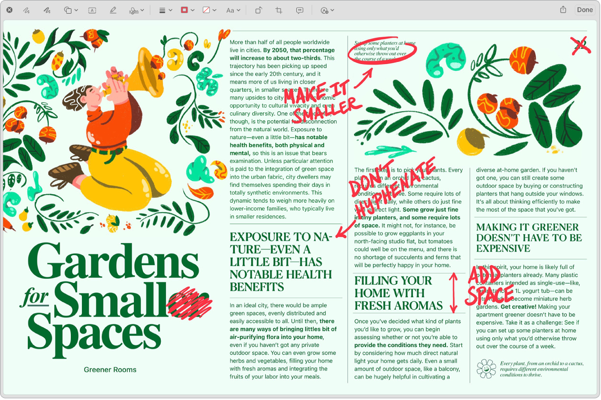

> 来源：https://support.apple.com/zh-cn/guide/imac/apdbc4019fdf/2024/mac/15
> 章节：截屏

# 在 Mac 上截屏

探索“截屏”菜单以查找你需要用于截屏和录屏的所有控制。录屏过程中还可以捕捉你的声音。优化的工作流程可让你拍摄屏幕的照片和视频，然后轻松进行共享、编辑或存储。

**访问截屏控制。**按下 Command-Shift-5。你可以捕捉整个屏幕、所选窗口或窗口的一部分。你也可以录制整个屏幕或屏幕的所选部分。

使用屏幕底部的图标捕捉所选内容

*图：捕捉屏幕所选内容图标*

、录制屏幕

*图：录制屏幕图标*

 等。点按“选项”以修改存储位置，设定何时进行捕捉的计时器，设定麦克风和音频选项，或者显示指针。点按“捕捉”或“录制”以截屏或录制视频。

截屏或录制视频后，其缩略图会显示在屏幕的一角。将缩略图拖到文稿或文件夹中，轻扫到右侧以快速存储它，或者点按以进行编辑或共享。

*【注】*你还可以通过以下方式打开“截屏”实用工具：从[启动台](https://support.apple.com/zh-cn/guide/imac/aside/apd2d2a58738/2024/mac/15)中的“其他”文件夹中打开，或在“访达”中前往“App”>“实用工具”文件夹。

**标记截屏。**点按截屏的缩略图以使用“标记”工具并添加注解。你还可以点按

*图：“共享”图标*

 以直接从截屏将标记的屏幕发送给同事或朋友。请参阅[在 Mac 上标记文件](https://support.apple.com/zh-cn/guide/mac-help/mchl1fd88863)。

*图：标记的截屏以红色显示编辑和改正处。*

**进一步了解。**请参阅[在 Mac 上截屏或录屏](https://support.apple.com/zh-cn/guide/mac-help/mh26782)。
