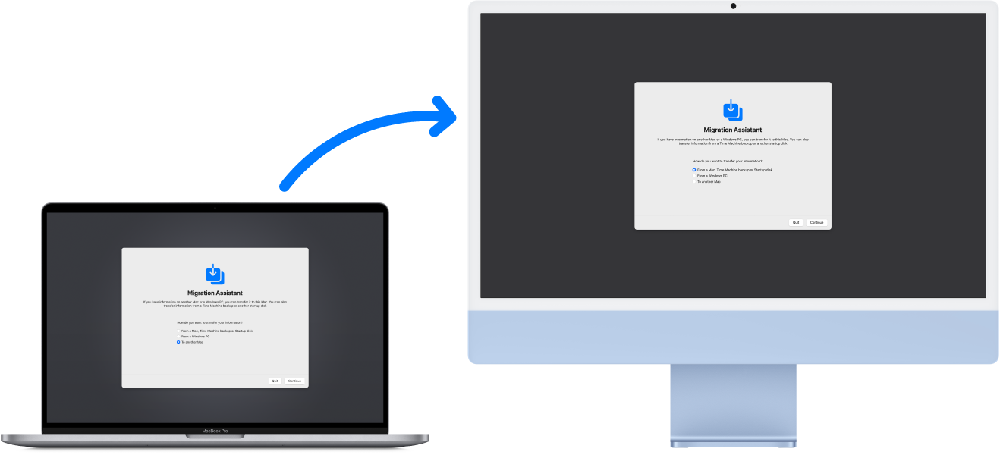

> 来源：https://support.apple.com/zh-cn/guide/imac/apda75cd668e/2024/mac/15
> 章节：传输数据

# 将你的数据传输到新 iMac

你可以向新 iMac 传输另一台 Mac 或 PC 上的文件和设置。首次启动新 iMac 时，系统会询问你是否要从另一台电脑传输数据。有关在设置期间传输数据的更多信息，请参阅[设置 iMac](https://support.apple.com/zh-cn/guide/imac/apd831707cb3/2024/mac/15)。如果想要立即从新电脑传输数据，你可以使用以下的选项之一。

开始之前

- 将之前的电脑和新电脑同时升级至最新版本的操作系统。有关如何基于当前操作系统更新 Mac 的更多信息，请参阅[保持 Mac 为最新](https://support.apple.com/zh-cn/guide/mac-help/mchlpx1065)。请确保使用页面顶部的菜单来选取当前操作系统以及获取最准确的说明。
- 若要以无线方式传输数据，请确保两台电脑都已接入同一个网络。

*图：同时显示“迁移助理”屏幕的 MacBook Pro 和 iMac。一个从 MacBook Pro 指向 iMac 的箭头表示数据从 MacBook Pro 传输到 iMac。*

从另一台 Mac 传输数据

使用“迁移助理”通过有线或无线网络传输你的数据，或者使用以太网线缆连接旧电脑和新电脑进行传输。在两台 Mac 上，打开“访达”窗口，前往“应用程序”，打开“实用工具”文件夹，然后连按“迁移助理”并按照屏幕指示操作。如果以无线方式传输，请在迁移过程中保持电脑彼此靠近。请参阅 Apple 支持文章：[使用“迁移助理”传输到新 Mac](https://support.apple.com/102613)。

从 PC 传输数据

使用“Windows 迁移助理”通过有线或无线网络传输你的数据。请参阅 Apple 支持文章：[使用“迁移助理”从 PC 传输到 Mac](https://support.apple.com/102565) 以查找适用于 Windows PC 的正确版本“迁移助理”。

从储存设备传输数据

使用合适的转换器（需要时）将储存设备连接到 iMac（请参阅[配合 iMac 使用转换器](https://support.apple.com/zh-cn/guide/imac/apdaf6085524/2024/mac/15)）。然后请参阅[将信息从其他电脑或设备传输到 Mac](https://support.apple.com/zh-cn/guide/mac-help/mh27921) 以了解后续步骤。

从时间机器备份传输数据

如果之前电脑的硬盘内容已损坏并且需要从时间机器备份进行恢复，你可以使用“迁移助理”来完成。请参阅[备份和恢复](https://support.apple.com/zh-cn/guide/imac/apdc6980d3be/2024/mac/15)。

**进一步了解。**请参阅[将信息从其他电脑或设备传输到 Mac](https://support.apple.com/zh-cn/guide/mac-help/mh27921)。
