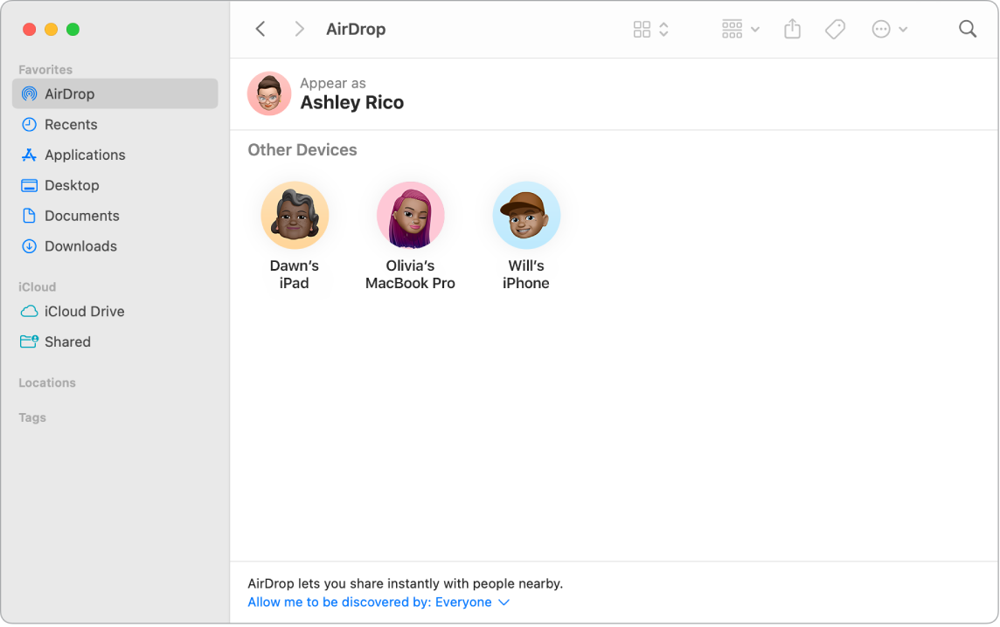
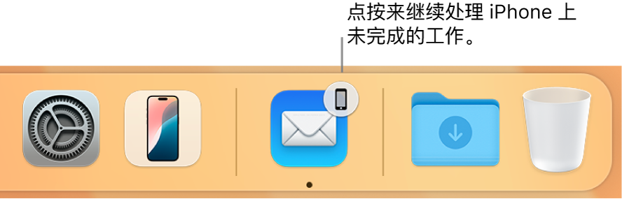
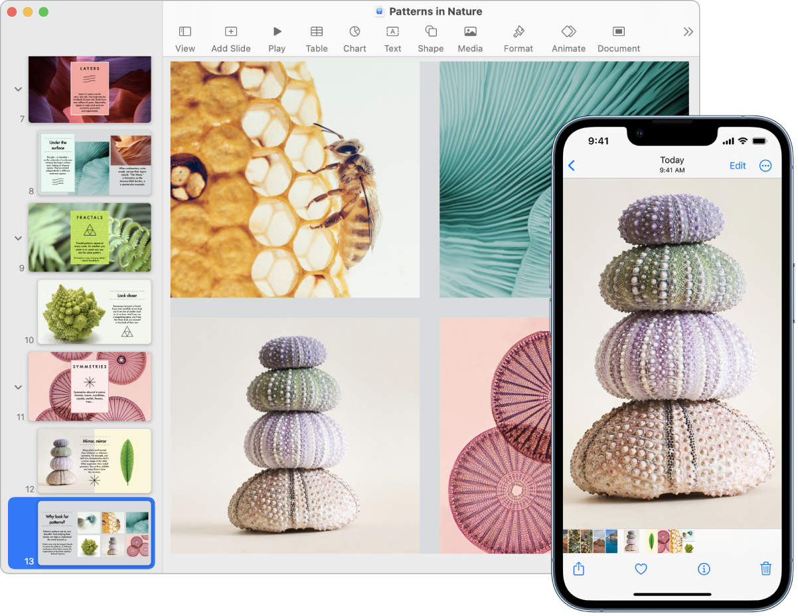

> 来源：https://support.apple.com/zh-cn/guide/imac/apdb6816a22d/2024/mac/15
> 章节：在设备间共享内容

# 在设备间共享内容

在 Apple 设备间共享内容的方式有多种。使用“隔空投送”共享文件、照片和密码等内容，或者使用“通用剪贴板”在设备间拷贝和粘贴。

通过“隔空投送”共享文件等内容

*图：“访达”窗口，其中边栏的“个人收藏”部分中“隔空投送”被选中。*

“隔空投送”可让你轻松与附近的 Mac、iPhone、iPad 和 iPod touch 设备共享文件。设备不需要共用同一个 [Apple 账户](https://support.apple.com/zh-cn/guide/imac/aside/apd74003fe84/2024/mac/15)。

**打开“隔空投送”。**点按菜单栏中的

*图：“控制中心”状态菜单*

，然后点按“隔空投送”

*图：“隔空投送”图标*

。选择“仅限联系人”或“所有人”来控制谁可以向你隔空投送内容。

**从“访达”中发送文件。**按住 Control 键点按要发送的项目，选取“共享”>“隔空投送”，然后选择要将项目发送到的设备。或者点按程序坞中的

*图：“访达”图标*

，然后点按左侧边栏中的“隔空投送”。当你想要发送文件的人出现在窗口中时，请将文件从桌面或另一个“访达”窗口拖给他们。当你将文件发送给某人时，收件人可以选择是否接受该文件。

**从 App 中发送文件。**使用 Pages 文稿或“预览”等 App 时，点按

*图：“共享”按钮*

 并选取“隔空投送”，然后选择要将项目发送到的设备。

**【提示】**若在“隔空投送”窗口中没有看到收件人，请确保两台设备均打开“隔空投送”和蓝牙并且彼此之间的距离不超过 9 米（30 英尺）。如果收件人使用的是较旧的 Mac，请尝试点按“看不到要找的人？”

**使用“隔空投送”接收项目。**如果联系人使用“隔空投送”向你的 Mac 发送项目，你可以选择是否接受并存储该项目。当你看到“隔空投送”通知且想要接受该项目时，请点按“接受”，然后选取是存储在“下载”文件夹还是如“照片”等 App 中。如果你在多台设备上使用同一个 iCloud 账户登录，你可以轻松将项目（例如，iPhone 上的照片）从一台设备发送到另一台设备，并且项目会自动存储。

**进一步了解。**请参阅[在 Mac 上使用“隔空投送”将文件发送给你附近的设备](https://support.apple.com/zh-cn/guide/mac-help/mh35868)和 Apple 支持文章：[在 Mac 上使用“隔空投送”](https://support.apple.com/102538)。

在 Mac 上使用“接力”

*图：程序坞中的“接力”图标。*

借助于“接力”，你可以使用一台设备来继续处理在其他设备上未完成的操作。在 iPhone 上开始 FaceTime 通话，然后当你回到桌边时将通话转移到 iMac。或者在 iMac 上处理演示文稿，然后在 iPad 上继续完成。“接力”能够与 FaceTime 通话、Safari 浏览器、“邮件”、“日历”、“通讯录”、“地图”、“信息”、“备忘录”、“提醒事项”、Keynote 讲演、Numbers 表格和 Pages 文稿配合使用。

**打开 iMac 上的“接力”。**打开[系统设置](https://support.apple.com/zh-cn/guide/imac/aside/apd796e4d5da/2024/mac/15)，点按边栏中的“通用”，点按“隔空投送与接力”，然后选择“允许在这台 Mac 和 iCloud 设备之间使用‘接力’”。

**打开 iOS 或 iPadOS 设备上的“接力”。**前往“设置”>“通用”>“接力”，然后轻点以打开“接力”。如果未看到该选项，则表示你的设备不支持“接力”。

**打开 Apple Watch 上的“接力”。**在 iPhone 上的 Apple Watch App 中，前往“设置”>“通用”，然后轻点来打开“启用接力”。

**在设备之间接力操作。**对于大多数操作，当你的 iMac 和其他设备彼此接近并且该操作可以使用接力时，程序坞中将出现一个图标。点按该图标以在设备间使用接力。

对于 FaceTime 通话，如果想要将通话从 iPhone 或 iPad 接力到 iMac，请在 Mac 上点按菜单栏中的

*图：视频图标*

，点按“切换”，然后点按 Mac 上 FaceTime 通话窗口中的“加入”。若要将 FaceTime 通话从 iMac 接力到 iPhone 或 iPad，请轻点 iPhone 或 iPad 左上方的

*图：视频图标*

，轻点“切换”，然后再次轻点“切换”。

**进一步了解。**请参阅[使用“接力”回到上次离开的地方](https://support.apple.com/zh-cn/guide/mac-help/mchl732d3c0a)。

在设备间拷贝和粘贴

*图：iPhone 显示一张照片，旁边的 Mac 显示被粘贴到 Pages 文稿中之后的照片。*

在一台设备上拷贝内容，然后在短时间内将它粘贴到附近的另一台设备。剪贴板中的内容通过 Wi-Fi 发送，并在所有登录相同 [Apple 账户](https://support.apple.com/zh-cn/guide/imac/aside/apd74003fe84/2024/mac/15)且已打开“接力”、Wi-Fi 和蓝牙的 Mac、iPhone、iPad 和 iPod touch 设备上可用。

**进一步了解。**请参阅[从 Mac 上拷贝并在设备间粘贴](https://support.apple.com/zh-cn/guide/mac-help/mchl70368996)。

在 Mac 上使用 iPhone 来拍照

*图：iPhone 显示一张照片，Mac 屏幕显示一个 Pages 文稿，其中的提示框为照片图像将显示的位置。*

Mac 上的“连续互通相机”可让你将 iPhone 用作 Mac 的额外摄像头。你可以使用 iPhone 相机拍照并将其插入到文稿中或存储到 Mac 上。

**插入图像或扫描件。**使用 iPhone、iPad 或 iPod touch 上的相机扫描文稿或给附近的事物拍照。图像会立即显示在 Mac 上。在“邮件”、“备忘录”或“信息”等 App 中，选择要插入图像的位置，选取“文件”（或“插入”）>“从 iPhone 或 iPad 导入”，选取“拍照”或“扫描文稿”，然后使用 iOS 或 iPadOS 设备拍照或扫描图像。轻点“使用照片”或“继续扫描”。如果你想要重试，也可以轻点“重拍”。

在 Pages 文稿等 App 中，选择要插入图像的位置，按住 Control 键点按，选取“导入图像”，然后拍照。你可能需要在拍照前先选择你的设备。

*【注】*若要使用 iOS 或 iPadOS 设备扫描，请拖移取景框直到你想要的内容显示在取景框内，轻点“继续扫描”，然后轻点“存储”。轻点“重拍”以重新扫描内容。

照片或扫描件会显示在文稿中你想要的位置。

**进一步了解。**请参阅[将 iPhone 用作网络摄像头](https://support.apple.com/zh-cn/guide/mac-help/mchl77879b8a)和[在 Mac 上使用“连续互通相机”插入照片和扫描件](https://support.apple.com/zh-cn/guide/mac-help/mchl9aebdc99)。
