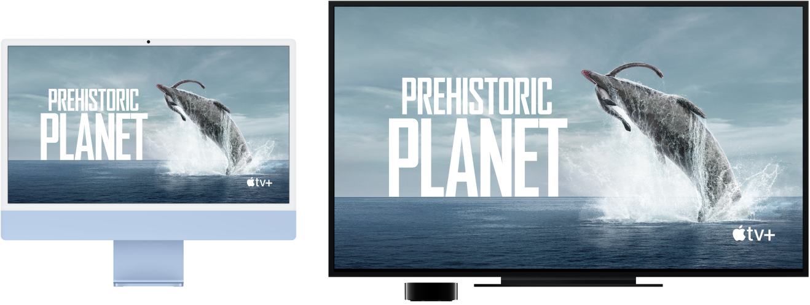

> 来源：https://support.apple.com/zh-cn/guide/imac/apdf1417128d/2024/mac/15
> 章节：在更大的屏幕上流播放内容

# 通过“隔空播放”在更大的屏幕上流播放内容

使用隔空播放将 iMac 上的任何内容流播放到大屏幕上，或者使用隔空播放将 iPhone、iPad 甚至是另一台 Mac 上的内容发送到 Mac。你可以将 iMac 屏幕镜像到高分辨率电视屏幕，或者将高分辨率电视用作第二台显示器。若要这么做，请将你的电视连接到 Apple TV，并确保 Apple TV 与 iMac 接入同一个 Wi-Fi 网络。你还可以直接在高分辨率电视上播放网络视频而不显示桌面内容，这在你想播放影片，同时又要保密工作内容时非常方便。

*图：iMac 内容通过 Apple TV 镜像到大的 HDTV 上。*

**将其他设备上的内容发送到 Mac。**当视频、音乐等正在其他设备上播放时，你可以在 Mac 上进行观看、聆听等。在 Mac 上镜像 iPhone 或 iPad，或者在支持的 App（如 Keynote 讲演和“照片”）中将 Mac 用作辅助显示器以扩展显示器。将 Mac 用作“隔空播放 2”扬声器以将音乐或播客流播放到 Mac，或者将其用作多房间音频的备选扬声器。你的 Mac 可与任何 Apple 设备搭配使用，如果设备共用同一个 Apple 账户，则连接更加方便。

**使用“屏幕镜像”来镜像你的桌面。**点按菜单栏中的

*图：“控制中心”状态菜单*

，点按

*图：“屏幕镜像”图标*

，然后选取你的 Apple TV。“隔空播放”处于活跃状态时，图标变为蓝色。

*【注】*如果 Mac 支持隔空播放屏幕镜像，则当 Apple TV 与 Mac 处于同一个网络时，菜单栏会出现“隔空播放”状态图标。请参阅[通过“隔空播放”从 Mac 流播放音频和视频](https://support.apple.com/zh-cn/guide/mac-help/mchld7e543a0)。

**播放网络视频而不显示桌面。**发现带有“隔空播放”图标

*图：GlobalArt/IL_AirPlay*

 的网络视频时，点按该图标，然后选择你的 Apple TV。

Apple TV 在 [apple.com](https://apple.com/cn) 上或当地的 Apple Store 商店中单独销售。

**【提示】**如果镜像屏幕时图像不适合高分辨率电视屏幕，请调整桌面大小以显示最佳画面。点按视频中的

*图：“隔空播放”图标*

，然后在“匹配桌面大小”下方选取一个选项。

**进一步了解。**若要进一步了解隔空播放，请参阅[使用“隔空播放”将 Mac 上的内容流播放到 HDTV](https://support.apple.com/zh-cn/guide/mac-help/mh40624)。若要进一步了解如何配合 iMac 使用第二台显示器，请参阅[将外接显示器连接到 iMac](https://support.apple.com/zh-cn/guide/imac/apd271f29cb9/2024/mac/15)。若要排除故障，请参阅 Apple 支持文章：[如果屏幕镜像或流播放在兼容“隔空播放”的设备上无法正常工作](https://support.apple.com/102587)。
