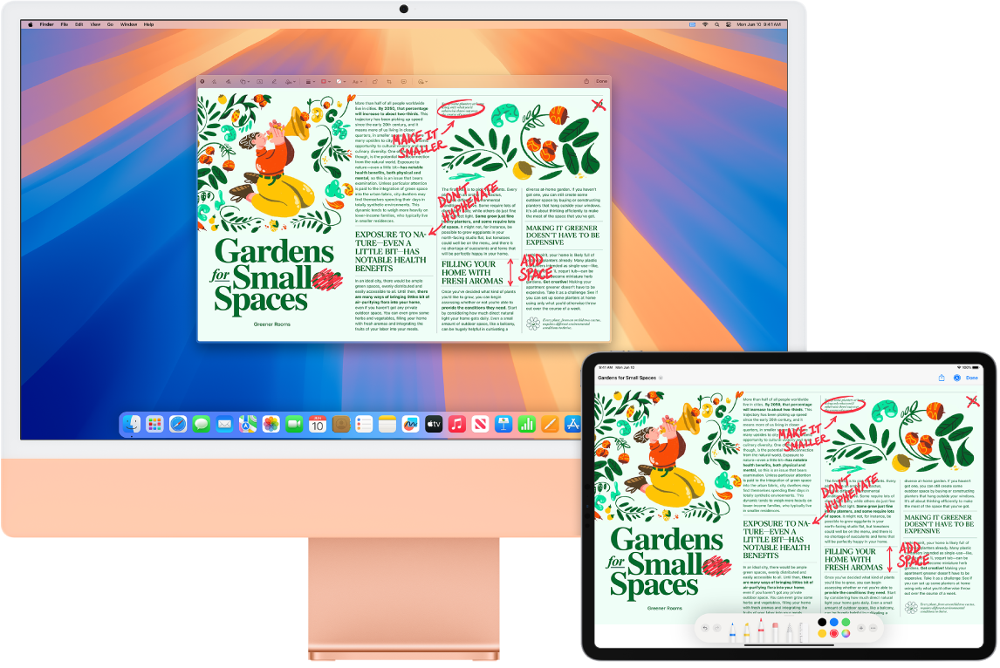
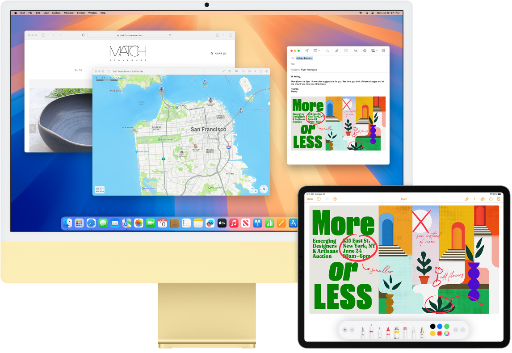

> 来源：https://support.apple.com/zh-cn/guide/imac/apd9f9bfbdad/2024/mac/15
> 章节：多设备协同工作

# 多设备协同工作

Mac 可与其他 Apple 设备协同工作。连续互通可让你在同时使用 Mac、iPad、iPhone 或 Apple Watch 时解锁强大功能。

**开始之前。**请确保 iMac 和 iOS 或 iPadOS 设备已打开 Wi-Fi 和蓝牙并登录相同 [Apple 账户](https://support.apple.com/zh-cn/guide/imac/aside/apd74003fe84/2024/mac/15)。

搭配 iPhone 使用 Mac

**将 iPhone 小组件添加到桌面。**将 iPhone 小组件直接放在 Mac 桌面上。使用小组件中心选择适用于 Mac 的 iPhone 小组件，或者将小组件从“通知中心”拖放到桌面。若要打开小组件中心，请按住 Control 键点按桌面，然后选择“编辑小组件”。

**将 iPhone 用作网络摄像头。**Mac 上的“连续互通相机”可让你将 iPhone 用作 Mac 的额外摄像头。你可以使用 iPhone 相机来进行视频通话。设置“连续互通相机”后，只要在通信范围内，Mac 便可自动切换为将 iPhone 用作摄像头。如果需要，你也可使用有线连接。请参阅[选取外置摄像头](https://support.apple.com/zh-cn/guide/mac-help/mchl034033f4)和[将 iPhone 用作网络摄像头](https://support.apple.com/zh-cn/guide/mac-help/mchl77879b8a)。

*【注】*将“连续互通相机”用作网络摄像头需要 iPhone XR 或后续机型。若要使用“连续互通相机”来共享照片，你需要安装 iOS 12（或更高版本）的 iPhone 或 iPod touch，或者安装 iPadOS 13.1（或更高版本）的 iPad。

**使用 iPhone 麦克风。**通过“连续互通相机”，你可以将 iPhone 用作 Mac 的麦克风。在通话期间，使用 FaceTime 通话中的“视频”菜单来选择 iPhone，或者在视频通话期间，使用 App 设置来切换至 iPhone 的麦克风。你也可以使用“系统设置”中的“音频”设置将 iPhone 选为系统麦克风。

**在 Mac 上使用 iPhone App。**许多你喜爱的 iPhone 和 iPad App 可在 Mac 上使用。请参阅[在搭载 Apple 芯片的 Mac 上使用 iPhone App 和 iPad App](https://support.apple.com/zh-cn/guide/app-store/fird2c7092da)。

**Mac 上的电话和文本信息。**你可以通过 Wi-Fi 连接直接在 iMac 上接打电话。你还可以收发文本信息。

在 iPhone 上，前往“设置”>“电话”，然后启用“Wi-Fi 通话”。然后在 Mac 上，打开 FaceTime 通话。前往“设置”，选取“通用”，然后点按“来自 iPhone 的通话”。请参阅[设置 iPhone 和 Mac 以进行通话](https://support.apple.com/zh-cn/guide/facetime/fctm264ce831)。

**将 iPhone 用作热点。**Wi-Fi 连接中断？通过“智能热点”，无需密码即可使用 iPhone 或 iPad 上的“个人热点”将 iMac 立即接入互联网。请参阅[使用 iPhone 或 iPad 接入互联网](https://support.apple.com/zh-cn/guide/mac-help/mchl7594e36f)。

点按菜单栏中的

*图：Wi-Fi 状态图标*

，然后点按列表中 iPhone 或 iPad 旁边的

*图：“链接”图标*

（如果没看到列表，请点按“其他网络”）。工具栏中的 Wi-Fi 图标变为

*图：“链接”图标*

。无需在设备上执行任何操作，iMac 会自动连接。未在使用热点时，你的 iMac 会断开连接以节省电池电量。

**【提示】**如果要求你输入密码，请确保设备已正确设置。请参阅 Apple 支持文章：[使用智能热点可接入个人热点而无需输入密码](https://support.apple.com/109321)。

搭配 iPad 使用 Mac

*图：并排摆放的一台 iMac 和一台 iPad。两个屏幕显示满是红色编辑标记的文章，如划掉的句子、箭头和添加的字词。iPad 屏幕底部也有标记控制。*

搭配 iPad 使用 iMac 来实现更多功能。“随航”可让你将 iPad 用作 Mac 的第二台显示器，以扩展你的工作空间以及使用 Apple Pencil 在喜爱的 Mac App 中绘制。通过“通用控制”，你还可以使用 Mac 键盘和鼠标或触控板控制 iPad，以在 iPadOS 和 macOS 之间轻松移动内容。此外，你可以快速标记截屏和 PDF 等内容。

**将 iPad 用作 Mac 的另一台显示器。**你可以通过“随航”在 Mac 十米（32 英尺）范围内通过无线方式使用 iPad，也可以使用线缆将 iPad 连接到 Mac 以保持充电状态。

**设置随航。**选取苹果菜单

*图：GlobalArt/IL_AppleLogo*

 >“系统设置”，点按“显示器”，然后从“添加显示器”弹出式菜单中选取你的 iPad。

**连接和断开连接 iPad。**若要连接 iPad，请依次点按

*图：控制中心*

、

*图：“屏幕镜像”图标*

、iPad 的名称。若要断开连接 iPad，请点按控制中心的

*图：“随航”按钮*

 或轻点 iPad 边栏中的

*图：“断开连接”图标*

。

**设定“随航”设置。**打开“系统设置”，点按“显示器”，然后点按 iPad 的名称。之后你可以为 iPad 指定“随航”设置，例如是将 iPad 用作主显示器还是镜像 Mac，是否在 iPad 上显示边栏并设定其位置，以及你能否使用 Apple Pencil 轻点两下来访问工具。

*【注】*如果还未设置 iPad，则在“显示器”设置中看不到这些选项。

**使用 Apple Pencil。**在你喜爱的专业 App 中精确绘制和创作。只需将窗口从 Mac 拖到 iPad，然后开始使用 Apple Pencil。或者使用 Apple Pencil 标记 PDF、截屏和图像。若要进一步了解，请参阅[使用连续互通速绘插入速绘](https://support.apple.com/zh-cn/guide/mac-help/mchl74e7c6df)和 Apple 支持文章：[在 iPhone、iPad 或 iPod touch 上使用“标记”](https://support.apple.com/119875)。

*【注】*Apple Pencil 的压力和倾斜角度感应仅在支持高级触控笔的 App 中有效。

**扩展或镜像桌面。**连接 iPad 时，它会自动变成 Mac 桌面的扩展，以便你可以在 Mac 和 iPad 之间拖移 App 和文稿。若要在两台设备上显示 Mac 屏幕（镜像显示器），请将鼠标移到“控制中心”中的“随航”按钮

*图：“随航”菜单按钮*

 上，点按出现在该按钮上方的右箭头，然后选择“镜像内建视网膜显示器”。若要再次扩展桌面，请打开该菜单并选取“用作单独的显示器”。

**充分利用边栏快捷键。**使用 iPad 上的边栏快速访问常用按钮和控制。轻点按钮以撤销操作，使用键盘快捷键，以及显示或隐藏菜单栏、程序坞和键盘。

**【提示】**若要快速访问“随航”选项，你可以设定“显示器”设置

*图：GlobalArt/IL_Display*

 以始终在菜单栏中显示。前往“系统设置”>“控制中心”，然后使用“显示器”旁边的弹出式菜单来选择“显示器”图标是始终还是仅活跃时显示在菜单栏中。“随航”已打开且 iPad 已连接时，菜单栏中的“显示器”图标会变为

*图：“随航”菜单按钮*

。

*图：并排显示的 iMac 和 iPad。iPad 屏幕显示带有注解的传单。iMac 屏幕显示“邮件”中的一封邮件，其中附件为来自 iPad 的带注解的传单。*

**使用单个键盘和鼠标或触控板控制多台设备。**通过“通用控制”，你可以使用单个键盘和鼠标或触控板控制多台设备。将指针移到 iMac 屏幕边缘时，指针会移到 iPad 或另一台 Mac，以便你可以在多达三台设备间工作。

**开始之前。**若要在 Mac 上使用“通用控制”，请确保每台设备都已打开蓝牙且接入 Wi-Fi。同时确保在 iMac 上的“通用”设置中以及在 iPad 上的“设置”>“通用”>“隔空播放与接力”中打开了“接力”。你还必须在这两台设备上登录相同 [Apple 账户](https://support.apple.com/zh-cn/guide/imac/aside/apd74003fe84/2024/mac/15)且打开双重认证。如果这些设置正确，你可以使用“控制中心”连接你的设备。在 Mac 上，点按菜单栏中的“控制中心”，点按“屏幕镜像”，然后选取“连接键盘和鼠标”下方的设备。

**在屏幕之间移动。**在 Mac 上，使用鼠标或触控板将指针移到最靠近 iPad 的屏幕的右侧或左侧边缘，停顿，然后将指针稍微移过屏幕边缘。当 iPad 屏幕一侧出现边线时，继续移动指针到 iPad 屏幕。

**拖放。**选择要移动的文本、图像或其他对象，然后将其拖移到其他设备上想要的位置。例如，你可以将在 iPad 上使用 Apple Pencil 绘制的速绘拖移到 iMac 上的 Keynote 讲演 App 中。你还可以在一台设备上拷贝内容，然后将它粘贴到另一台设备。

**共享键盘。**当指针位于文稿中或可输入文本的任意位置且插入点在闪烁时，开始键入。

**进一步了解。**请参阅[将 iPad 用作 Mac 的第二台显示器](https://support.apple.com/zh-cn/guide/mac-help/mchlf3c6f7ae)和[在 Mac 上通过“通用控制”跨设备使用键盘和鼠标或触控板](https://support.apple.com/zh-cn/guide/mac-help/mchl412faecf)。
