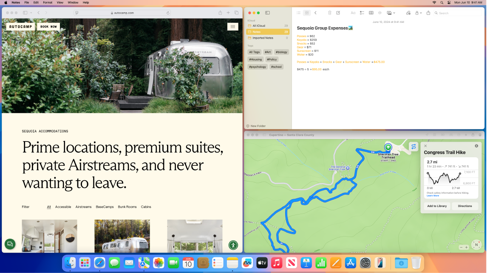
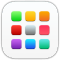
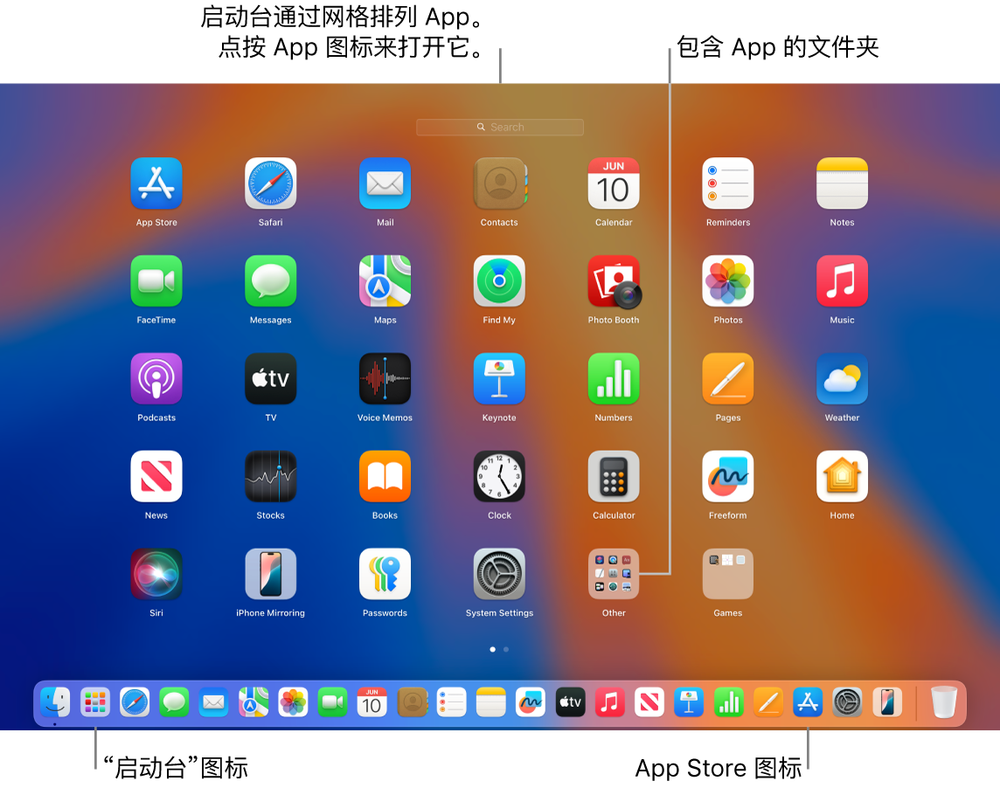

> 来源：https://support.apple.com/zh-cn/guide/imac/apd83cde9f0c/2024/mac/15
> 章节：使用 App

# 在 iMac 上使用 App

iMac 预装了各种 App，可让你与亲友保持联络、高效工作和发挥创意、享受娱乐时光和上网冲浪等。

*【注】*某些 macOS App 并非在所有地区或语言都可用。

*图：Mac 显示 Safari 浏览器、“备忘录”和“信息” App。*

**查看 App。**若要在 Mac 上快速查看所有 App，请点按程序坞中的

*图：“启动台”图标*

。

**【提示】**Mac 附带的每款 App 均包括内建帮助。若要了解如何使用 App，请前往要使用的 App，然后在菜单栏中选取“帮助”>“*[App]* 帮助”。请参阅[使用《Mac 使用手册》](https://support.apple.com/zh-cn/guide/imac/apdfdad69354/2024/mac/15)。

**打开 App。**你可以在 Mac 上同时打开多个 App，并保持打开状态。此功能对于像 Safari 浏览器或“邮件”等需要经常返回的 App 而言尤其有用。若要打开 App，请执行以下一项操作：

- *使用程序坞：*点按程序坞中的 App 图标。如果 App 不在程序坞中，请点按程序坞中的

  

  *图：“启动台”图标*

  ，然后点按该 App。有关程序坞的更多信息，例如如何添加常用 App，请参阅 [Mac 上的程序坞](https://support.apple.com/zh-cn/guide/imac/apd4b7fb731f/2024/mac/15)。
- *使用访达：*点按程序坞中的

  

  *图：“访达”图标*

  ，点按“访达”窗口边栏中的“应用程序”，然后连按要打开的 App。

**【提示】**若要快速打开 App，请使用“聚焦”搜索。按下 Command-空格键，在搜索栏中键入 App 名称，然后按下 Return 键。请参阅[使用“聚焦”搜索](https://support.apple.com/zh-cn/guide/mac-help/mchlp1008)。

*图：Mac 屏幕上程序坞中的启动台图标，以及显示各种 App 按网格排列的已打开启动台窗口。*

**关闭 App。**关闭 App 会将窗口关闭，但 App 仍保持打开，即使没有活跃窗口（程序坞中 App 图标下方的小圆点表示 App 处于打开状态）。若要关闭 App，请点按 App 窗口左上角的

*图：“关闭”按钮*

。

**退出 App。**如果只是偶尔使用某个 App，你不妨在使用完后退出该 App，尤其是使用大量能耗的 App。若要退出 App，请在菜单栏中选取 *[App 名称]* >“退出 *[App 名称]*”。例如，选取“预览”>“退出预览”。

*【注】*如果某个 App 没有正常退出或者无响应，你可以强制退出该 App，但可能会丢失未存储的更改。若要强制退出 App，请按下 Command + Option + Esc 或者选取苹果菜单

*图：GlobalArt/IL_AppleLogo*

 >“强制退出”。在出现的对话框中选择 App，然后点按“强制退出”。
