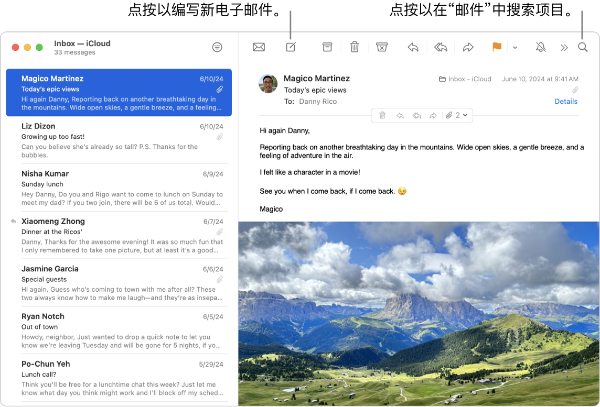
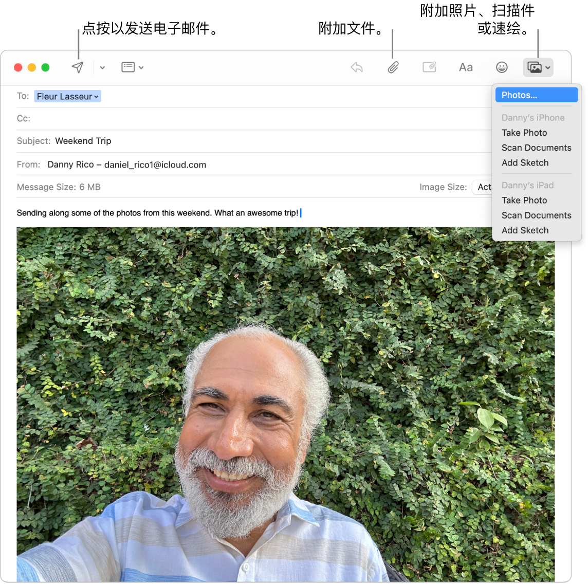
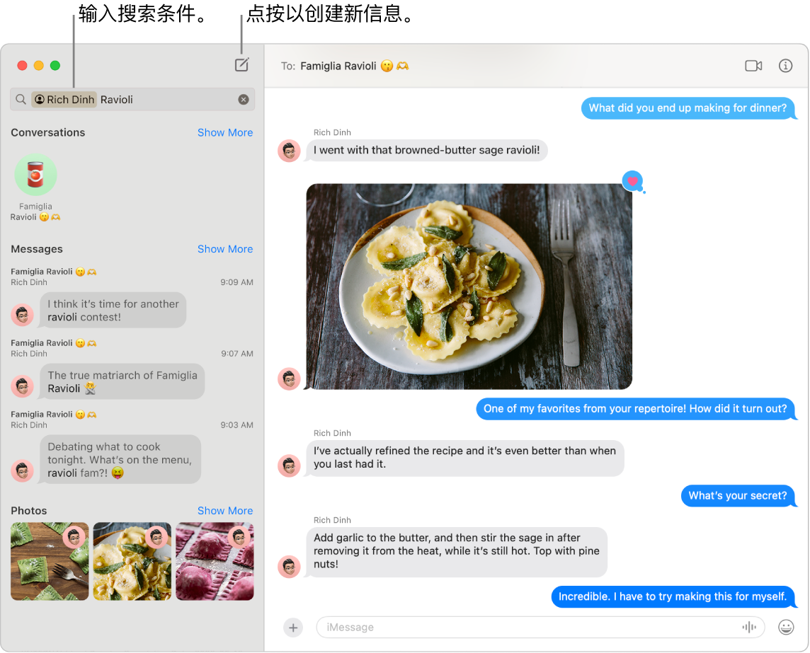
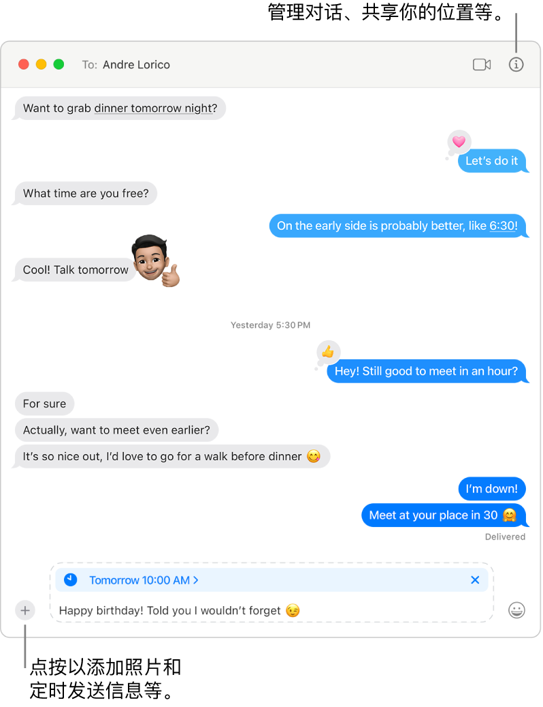

> 来源：https://support.apple.com/zh-cn/guide/imac/apd828c43bd3/2024/mac/15
> 章节：保持联络

# 使用 FaceTime 通话、“邮件”和“信息”保持联络

iMac 提供了各种内建 App，可让你与远亲近邻保持联络。点按表格中的链接以进一步了解 FaceTime 通话、“邮件”和“信息”。

|  *图：GlobalArt/ICt_FaceTimeIcon* FaceTime 通话 在 Mac 上的 FaceTime 通话 App 中接打视频和音频通话。 [开始使用 FaceTime 通话](https://support.apple.com/zh-cn/guide/imac/apd828c43bd3/2024/mac/15#apd5dc7b798b) |  *图：GlobalArt/ICt_MailIcon* 邮件 收发电子邮件和管理邮件账户。 [开始使用“邮件”](https://support.apple.com/zh-cn/guide/imac/apd828c43bd3/2024/mac/15#apd5130da56d) |  *图：GlobalArt/ICt_MessagesIcon* 信息 在 Mac 上通过“信息” App 收发 iMessages 信息和短信/彩信。 [开始使用“信息”](https://support.apple.com/zh-cn/guide/imac/apd828c43bd3/2024/mac/15#apd1a255252c) |
| --- | --- | --- |

FaceTime 通话

通过 FaceTime 通话，你可以拨打视频和音频通话给亲友，并在 FaceTime 群聊通话中与最多 32 人联系。没时间聊天？直接在 App 中发信息或设定提醒事项以回拨。

*图：FaceTime 通话窗口显示一组受邀请用户。*

**登录 FaceTime 通话。**你需要先登录 FaceTime 通话，才能接打视频和音频通话。在 FaceTime 通话窗口中输入 Apple 账户电子邮件或电话号码及密码，然后点按“登录”。忘记是否有 Apple 账户？如果有 iPhone，请前往“设置”，然后轻点你的姓名。用于 Apple 账户的电子邮件显示在顶部的姓名下方。

**Siri：**像这样说：“打 FaceTime 电话给小凤。”

**拨打 FaceTime 电话。**使用 Mac 上的内建 12MP Center Stage 摄像头进行 FaceTime 视频通话。点按“新建 FaceTime 通话”，输入呼叫对象的姓名、电话号码或电子邮件地址，然后点按

*图：“FaceTime通话”按钮*

。如果不方便打视频通话，你可以拨打纯音频通话：点按

*图：“FaceTime通话”按钮*

，然后选取“FaceTime 音频”。

**【提示】**最多可添加 32 人到群聊通话。若要创建唯一链接以与群组共享，请点按“FaceTime 通话”窗口左上角的“创建链接”。将链接拷贝到剪贴板，或直接在“信息”或“邮件”中与朋友共享，或者将链接添加到“日历”日程以安排稍后通话。你现可使用链接在非 Apple 设备上加入 FaceTime 通话。

**接听或拒绝通话。**收到 FaceTime 来电时，点按“接听”以加入视频。若要仅通过音频接听，请点按“接听”旁边的

*图：“接听选项”按钮*

，然后选取“以音频接听”。如果无法接听通话，请点按“拒绝”，或者点按“拒绝”旁边的

*图：“拒绝选项”按钮*

 以发送信息或创建提醒事项以稍后回拨。

*图：FaceTime 通话窗口显示视频效果，包括用于替换背景的按钮。*

**选取背景。**在 macOS Sequoia 或更高版本中，你可以选取虚拟背景以表达自我或只是隐藏身后的待洗衣物。若要更改背景，请前往 FaceTime 通话 App，点按菜单栏中的

*图：“FaceTime通话”按钮*

，然后选择“背景”。点按“背景”以选取其中一个精美内建背景，或者上传自己的背景或从“照片”中进行选取来进一步自定义背景。

**进一步了解。**请参阅[《FaceTime 通话使用手册》](https://support.apple.com/zh-cn/guide/facetime)。

邮件

集中一处阅读、编写和发送来自所有账户（iCloud、Gmail、Exchange、雅虎或 Outlook）的电子邮件。

*图：“邮件”窗口在边栏旁边显示邮件列表，右侧显示所选邮件的内容。标注框指向搜索栏。*

**设置电子邮件账户。**厌倦了登录多个网站来检查你的电子邮件账户吗？在“邮件”中设置你的所有账户，以便集中一处查看全部电子邮件。选取“邮件”>“添加账户”。

**发送或定时发送电子邮件。**若要开始新电子邮件，请点按“邮件”工具栏中的

*图：“新信息”按钮*

。键入收件人的电子邮件地址，输入主题，然后在下方空白处键入邮件。完成草稿后，点按

*图：“发送”按钮*

 以发送或

*图：“定时发送”按钮*

 以定时。

**发送照片或其他文件。**你可以在编写电子邮件时包括照片和文稿等。若要添加文件，请点按

*图：“附件”按钮*

，找到文件，然后选中。若要添加照片，请点按

*图：“添加媒体”按钮*

，然后选择要发送的照片。

**Siri：**像这样说：“给思琪发关于旅行的邮件。”

*图：“邮件”窗口显示正在起草的新邮件。弹出式菜单显示的选项用于从刘浩的 iPhone 或 iPad 附加照片、拍照、扫描文稿或添加涂鸦。*

**快速找到电子邮件。**你可以通过使用自己的字词搜索来快速找到电子邮件。在“邮件”中，点按右上角的

*图：“搜索”按钮*

 并键入字词，如“照片”。“邮件”会显示出现该字词的电子邮件，以及一个可让你按类别（如发件人或主题）细化搜索的菜单。

**【提示】**通过设置自定义规则过滤电子邮件来保持整齐有序。例如，你可以将指定发件人的电子邮件直接移到“废纸篓”来屏蔽该发件人的邮件。若要添加规则，请点按“邮件”>“设置”>“规则”，然后点按“添加规则”。

**进一步了解。**请参阅[《邮件使用手册》](https://support.apple.com/zh-cn/guide/mail)。

信息

直接从 Mac 收发信息和媒体来保持联络。搜索可让你轻松立即找到信息，并且你可以将喜爱对话固定在顶部，以与常聊联系人快速联系。

*图：“信息”窗口在左侧显示联系人和“意大利饺”的搜索结果。在右侧是带有意大利饺图片的对话。*

**在任意设备上随心发信息。**登录 Apple 账户后，你可以使用 iMessage 信息与 Apple 设备用户收发不限数量的信息。如果有 iPhone，你还可以将 iPhone 的短信/彩信中继到 Mac。点按

*图：“新信息”按钮*

 开始对话。

请参阅 Apple 支持文章：[iMessage 信息和短信/彩信有什么区别？](https://support.apple.com/104972)以了解不同类型信息的更多信息。

**Siri：**像这样说：“给妈妈发短信说我要晚点儿到”。

**添加照片和贴纸等。**在对话中，点按

*图：App 按钮*

，然后选取“照片”、“贴纸”、“#图像”或“信息效果”给信息添加趣味媒体和效果。或将文件、照片和视频拖入“信息”来轻松共享。

**【提示】**在 macOS Sequoia 中，现可将信息定时为指定时间发送。点按

*图：App 按钮*

，选取“稍后发送”，然后选取日期和时间以发送信息。

**查找所需信息。**在搜索栏中键入联系人的姓名或关键词以快速找到正在找的信息。叠加使用搜索过滤条件来进一步缩小搜索范围。搜索结果按类别整理，如对话、信息和照片。

*图：“信息”窗口显示一个对话。该信息被定时为明天上午 10 点发送。信息内容是：“生日快乐！说了我不会忘记。”*

**置顶常用对话。**通过将常用对话拖到对话顶部来使其在信息列表中置顶。新信息、点回和键入指示器显示在置顶对话上方。当群组对话中有未读信息时，最近参与者显示在置顶对话周围。

**进一步了解。**请参阅[《信息使用手册》](https://support.apple.com/zh-cn/guide/messages)。
