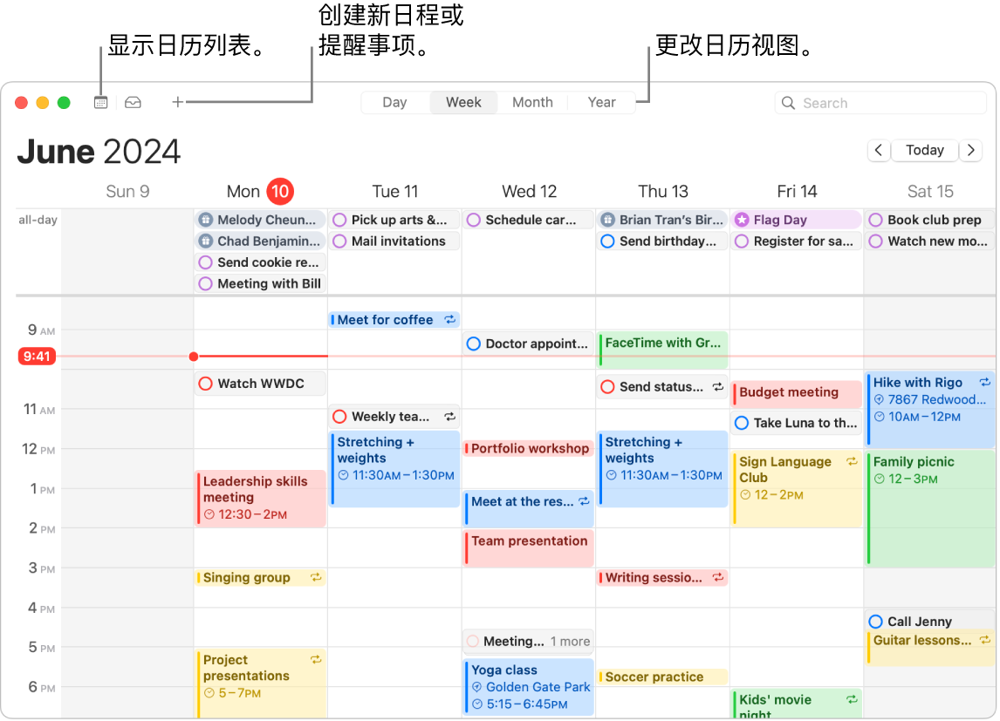
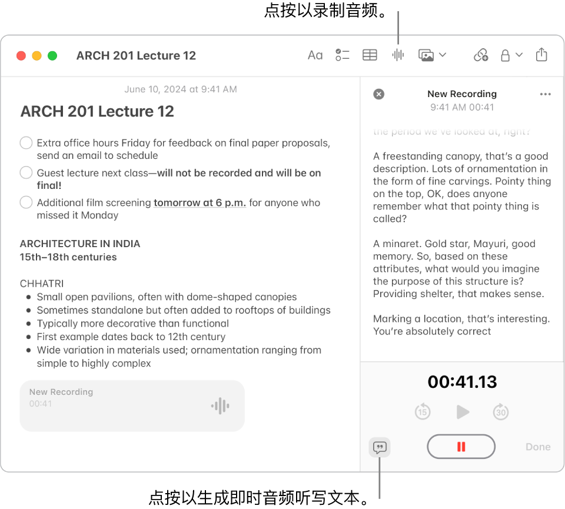
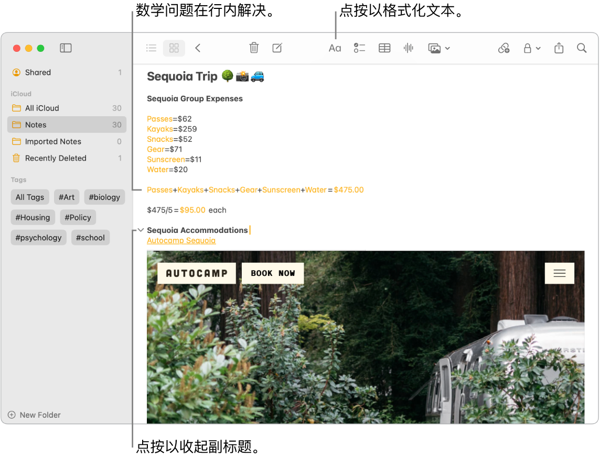
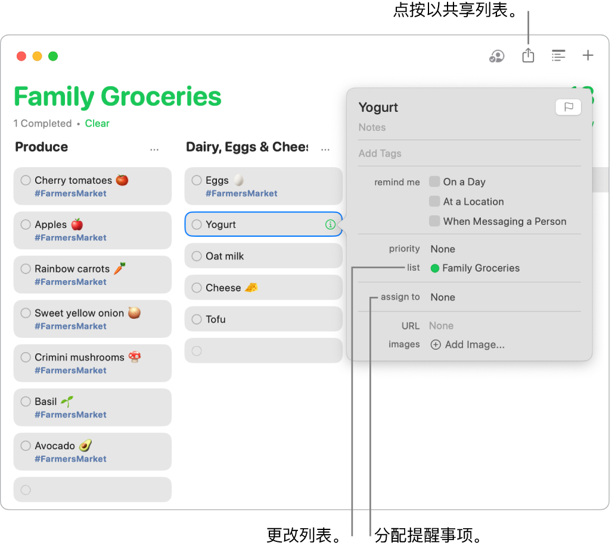
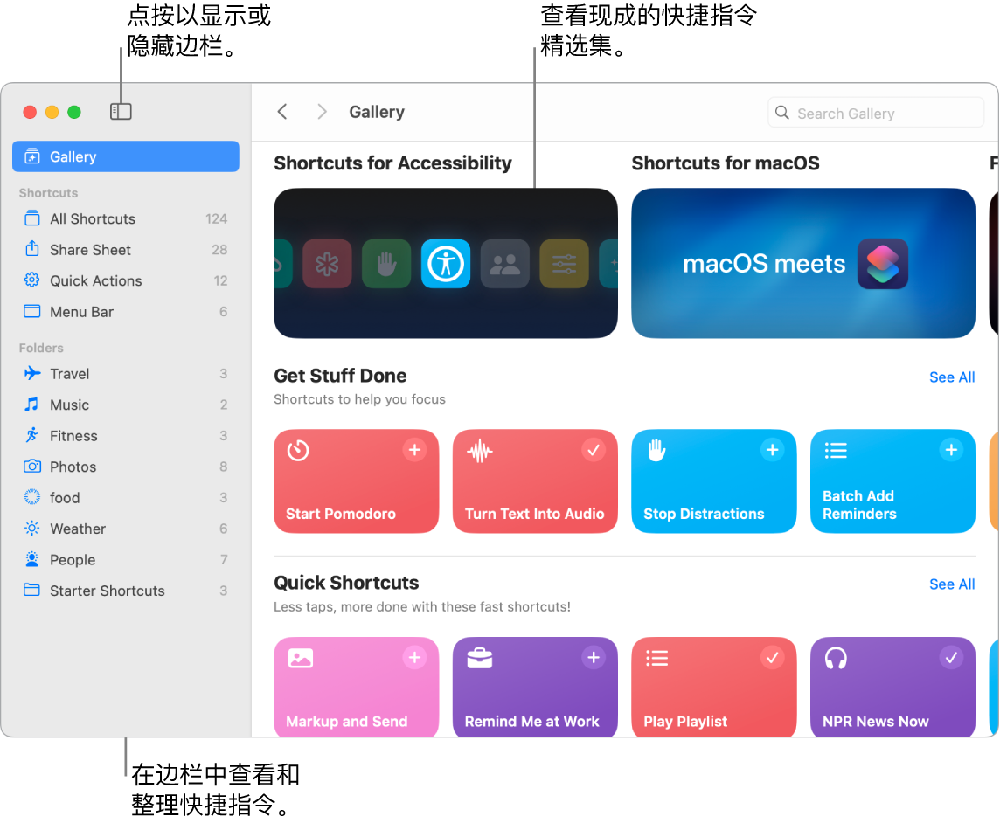
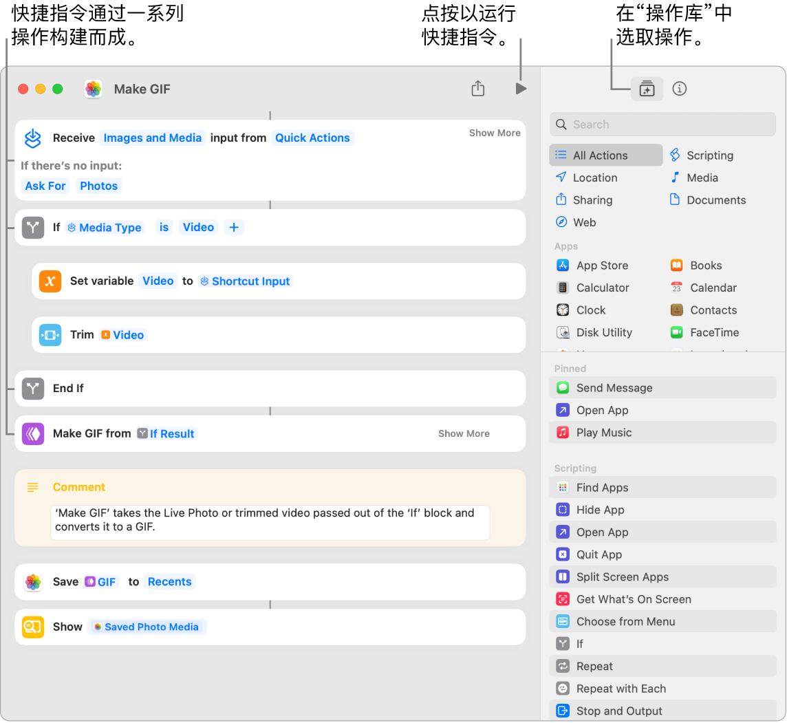

> 来源：https://support.apple.com/zh-cn/guide/imac/apd99814260c/2024/mac/15
> 章节：高效工作

# 使用“日历”、“备忘录”、“提醒事项”和“快捷指令”高效工作

iMac 提供了各种内建 App，可让你更高效工作、保持井井有条，并轻松管理一天事务。点按表格中的链接以了解如何利用“日历”、“备忘录”、“提醒事项”和“快捷指令”的生产力功能。

|  *图：ICt_CalendarIcon* 日历 添加多个日历来记录日程，并集中一处管理所有这些日历。 [开始使用“日历”](https://support.apple.com/zh-cn/guide/imac/apd99814260c/2024/mac/15#apd3a723845e) |  *图：GlobalArt/ICt_NotesIcon* 备忘录 “备忘录”是你随时随地记录各类备忘录的首选之地。可将核对清单、录音和图像等包括其中。 [开始使用“备忘录”](https://support.apple.com/zh-cn/guide/imac/apd99814260c/2024/mac/15#apde9fcb5424) |
| --- | --- |
|  *图：GlobalArt/ICt_RemindersIcon* 提醒事项 在 Mac 上的“提醒事项” App 中创建、共享和整理待办事项列表。 [开始使用“提醒事项”](https://support.apple.com/zh-cn/guide/imac/apd99814260c/2024/mac/15#apdc279f7c4e) |  *图：GlobalArt/ICt_ShortcutsIcon* 快捷指令 在你喜爱的 App 中创建自定义自动化操作，使用 Siri 或点按一下即可帮你完成日常任务。 [开始使用“快捷指令”](https://support.apple.com/zh-cn/guide/imac/apd99814260c/2024/mac/15#apd75ab7d6f2) |

日历

在 Mac 上的“日历” App 中添加日历、创建日程和新提醒事项、完成待办事项和共享日历以通知他人。

*图：“日历”窗口显示当周计划的所有日程和提醒事项。箭头指向的按钮用于显示日历列表、创建日程或提醒事项以及将视图更改为“日”、“周”、“月”或“年”视图。*

**添加多个账户。**你可以使用“日历”添加多个账户（iCloud、谷歌、Microsoft Exchange 等），并集中一处管理所有日程。打开“日历” App，选取“日历”>“添加账户”，然后按照屏幕指示操作。

**添加日历。**你可以创建单独的日历以跟踪不同日程。例如，在一个日历中保存所有工作会议，在另一个日历中保存子女的学校日程。选取“文件”>“新建日历”。如有多个账户，请选取要用于新日历的账户。新日历会显示在边栏中。若要更改日历的名称或颜色，请按住 Control 键点按日历，然后选取“显示简介”。

**【提示】**你可以选取显示所有日历或部分日历。点按

*图：“日历”按钮*

 以查看包括所有日历和计划提醒事项的列表，然后选择或取消选择日历的复选框以将其显示或隐藏。

**创建日程和提醒事项。**若要创建新日程或提醒事项，请在日历窗口中点按

*图：“添加日程”按钮*

 或连按某天和时间，然后选取“日程”或“提醒事项”。你还可以包括额外信息，如位置、URL 和备注。创建日程或提醒事项后，你可以连按以编辑。在“日历”中创建的提醒事项也会同步回“提醒事项” App。

**Siri：**像这样说：“邀请俊涵参加上午10点的会议。”

*图：“日历”窗口显示正在创建下午 1 点的新日程。“显示详细信息”窗口显示日程的位置，日程被设为每周重复，并且“日历”将在该出发时发送提醒。*

**与他人共享日历。**iCloud 让共享日历变得轻松。按住 Control 键点按边栏中 iCloud 账户下的日历，然后选取“共享日历”。输入共享对象的电子邮件。

**进一步了解。**请参阅[《日历使用手册》](https://support.apple.com/zh-cn/guide/calendar)。

备忘录

“备忘录” App 是你记录各类备忘录的首选之地，其中提供许多格式化选项助你保持井井有条，还有强大的搜索工具和协作功能。你可以添加核对清单、图像和录音等；与他人协作处理备忘录；甚至还可键入等号来求解表达式。

*图：“备忘录”窗口显示一个带有核对清单、项目符号列表和录音的备忘录。“音频详细信息”窗口已打开并显示录音的听写文本。*

**创建或编辑备忘录。**在“备忘录”工具栏中点按

*图：“创建备忘录”按钮*

 以创建新备忘录。若要更改现有备忘录，请点按备忘录的任意位置，然后开始更改。

**给备忘录添加格式和内容。**你可以给备忘录添加核对清单、表格、图像、链接和录音等。点按

*图：“字体”按钮*

 以将文本格式化，例如，添加列表、设为可收起的副标题或标题，或高亮标记文本。点按

*图：“录制音频”按钮*

 以录音、点按

*图：“添加媒体”按钮*

 以添加照片，或点按

*图：“添加链接”按钮*

 以添加另一个 App 的链接。

**协作处理备忘录。**你可以在“信息”或“邮件”中发送协作处理列表的邀请，或者共享链接。点按工具栏中的

*图：“共享”按钮*

，从弹出式菜单中选取“协作”或“发送副本”，然后选择“信息”、“邮件”或“拷贝链接”。邀请他人加入后，你可以点按

*图：“管理协作者”按钮*

 来跟踪活动和管理协作。

*图：“备忘录” App 窗口显示红杉国家公园露营费用的计算、网站的文本链接以及住宿图片。*

**解决数学问题。**直接从“备忘录”中计算数字、求表达式的值和给变量赋值。若要定义变量，请键入字词或字母，然后输入等号和变量的值。若要使用变量，变量必须用在任何表达式之前。若要求解表达式，请输入表达式，然后输入等号。

**【提示】**在需要时找到想要的备忘录。点按工具栏中的

*图：“搜索”按钮*

 以显示搜索栏，键入要查找的内容，然后按下 Return 键。你还可以按下 Command-F，然后键入字词或短语来搜索单个备忘录。匹配项会在备忘录中高亮标记。

**进一步了解。**请参阅[《备忘录使用手册》](https://support.apple.com/zh-cn/guide/notes)。

提醒事项

在“提醒事项” App 中将待办事项列表集中在一处。添加新任务、跟踪进度，并与他人分担工作。使用 iCloud 时，在其他 Apple 设备上跟踪提醒事项。

*图：“提醒事项”窗口，左侧是智能列表，下方是其他提醒事项和列表。指针位于提醒事项中。标注框指向智能列表和“添加新提醒事项”按钮。*

**创建提醒事项列表。**你可以为每个项目创建列表以帮助整理待办事项。通过 iCloud 提醒事项，你还可以创建自动分类的日常采购清单，或基于你指定规则和过滤条件的自定义智能列表。若要创建列表，请选取“文件”>“新建列表”，然后从“标准”、“日常采购”或“智能列表”中选取。

*【注】*日常采购清单并非在所有语言中都可用。

**添加或编辑提醒事项。**点按列表中最后一个项目下方的空白或点按右上方的

*图：“添加”按钮*

 以添加新提醒事项。你可以点按

*图：“编辑详细信息”按钮*

 以将备注、标签、日期或位置添加到提醒事项。

**Siri：**像这样说：“离开这里的时候提醒我去超市。”

**协作处理列表。**发送邀请协作处理列表以分担工作。点按

*图：“共享”按钮*

，然后选取“信息”、“邮件”或“通过链接邀请”。如果在“信息”中共享，对话中的每个人都会自动添加到该列表中。邀请他人加入后，你可以跟踪活动、管理协作，甚至分配提醒事项。

**【提示】**如果你是“家人共享”群组的组织者，可以创建与“家人共享”群组成员自动共享的“家庭日常采购清单”。请参阅[创建家庭日常采购清单](https://support.apple.com/zh-cn/guide/reminders/remn175e6897)。

*图：“提醒事项” App 窗口显示共享日常采购清单中提醒事项的详细信息。*

**查看临近提醒事项。**密切关注临近提醒事项，确保从不遗漏。计划的提醒事项显示在“日历” App 中，以及“提醒事项”的“今天”和“计划”智能列表中。若要给提醒事项添加日期，请将指针放在提醒事项上，点按

*图：“编辑详细信息”按钮*

，选取“日期提醒”，然后选择要收到提醒的日期。

**进一步了解。**请参阅[《提醒事项使用手册》](https://support.apple.com/zh-cn/guide/reminders)。

快捷指令

使用“快捷指令”通过 Siri 或简单点按执行日常任务。你可以创建自定义快捷指令，或从数以百计的内建操作中进行选取，例如，获取前往日历中下一个日程的路线、发送到达时间或播放喜爱的播放列表。

*图：“快捷指令”窗口中左侧是打开的边栏，右侧是“快捷指令中心”。“快捷指令中心”左上方是“边栏”按钮和导航箭头，右上方是搜索栏。*

**浏览快捷指令中心以查找快捷指令。**一系列常用任务的入门快捷指令按组分类在精选中。你创建的快捷指令和所选或所编辑的现成快捷指令会显示在边栏的“所有快捷指令”中。

**从快捷指令中心创建快捷指令。**从快捷指令中心选取快捷指令以将其添加到你的快捷指令中。例如，在“快捷指令”精选中，点按“播放播放列表”，然后点按

*图：“添加快捷指令”按钮*

。选取要快捷指令播放的播放列表，然后点按“添加快捷指令”。

**创建自定义快捷指令。**你还可以创建自己的快捷指令。查看“所有快捷指令”时，点按工具栏中的

*图：“添加快捷指令”按钮*

，然后将右侧列表中的操作拖移到左侧的快捷指令编辑器以生成你要的结果。操作是一个快捷指令的基本构成要素，就像任务中的步骤。“快捷指令”还提供“下一个操作”建议以帮助你完成快捷指令。有关灵感，请参阅[自定义快捷指令灵感](https://support.apple.com/zh-cn/guide/shortcuts-mac/apdb272b27ec)。

*图：左侧是“制作 GIF”快捷指令编辑器，右侧是操作库。*

**让快捷指令更快一步。**使用 Siri 或小组件运行快捷指令是完成事项的捷径。你还可以将快捷指令添加到“访达”和“服务”菜单，或将其固定到快捷指令菜单栏中。连按快捷指令，点按

*图：“快捷指令详细信息”按钮*

，然后选取“使用快速操作”下的选项。

**Siri：**像这样说：“发送上一张图像。”

**进一步了解。**请参阅[《快捷指令使用手册》](https://support.apple.com/zh-cn/guide/shortcuts-mac)。
