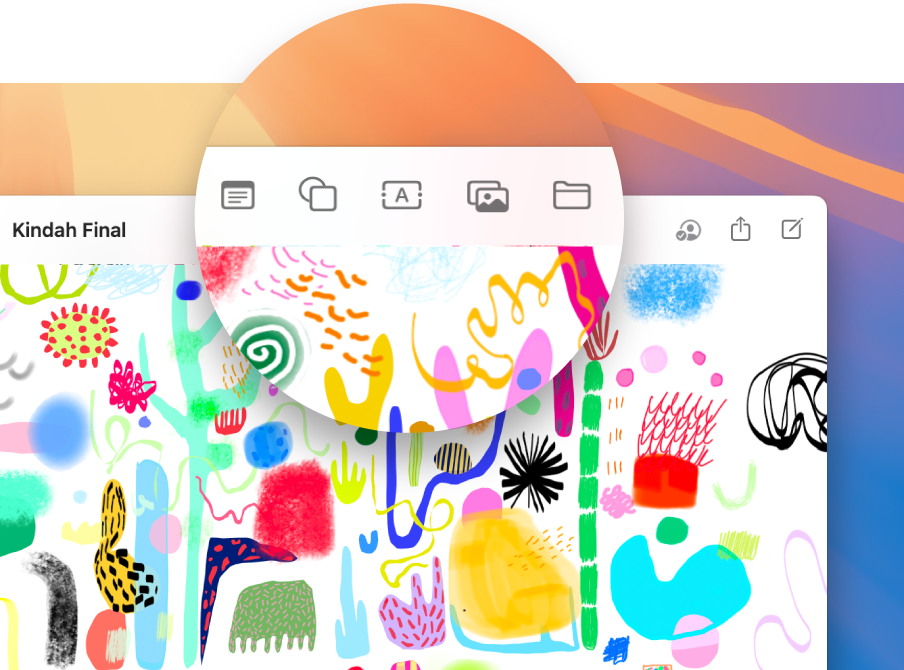
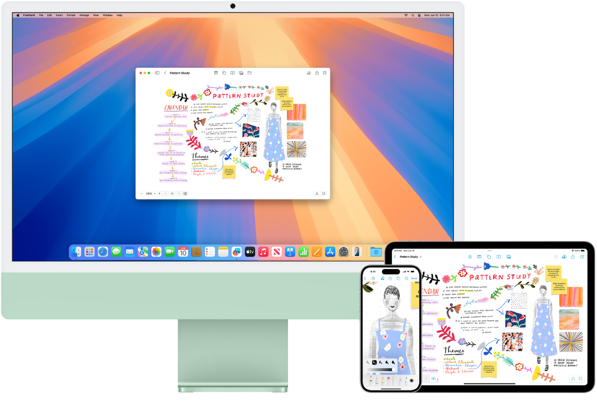
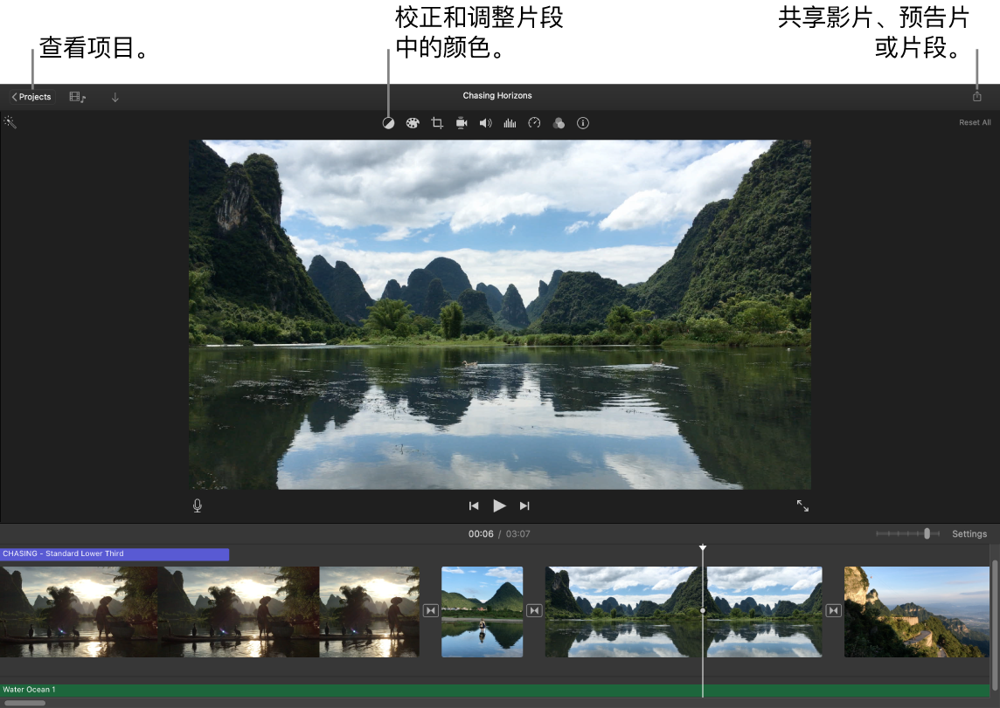

> 来源：https://support.apple.com/zh-cn/guide/imac/apdb8cbb896b/2024/mac/15
> 章节：发挥创意

# 在 Mac 上通过“照片”、“无边记”和 iMovie 剪辑发挥创意

iMac 提供了各种内建 App，可为你的创意赋能。点按表格中的链接以进一步了解如何开始使用“无边记”、“照片”和 iMovie 剪辑。

|  *图：GlobalArt/ICt_PhotosIcon* 照片 通过“照片”浏览、编辑和共享你所有设备上的照片及视频。 [开始使用“照片”](https://support.apple.com/zh-cn/guide/imac/apdb8cbb896b/2024/mac/15#apd98783e5ee) |  *图：GlobalArt/ICt_FreeformIcon* 无边记 “无边记”为你提供了灵活的画布，可让你单独或与他人一起拼凑出完美方案。 [开始使用“无边记”](https://support.apple.com/zh-cn/guide/imac/apdb8cbb896b/2024/mac/15#apd76de25e4c) |  *图：GlobalArt/ICt_iMovieIcon* iMovie 剪辑 通过 iMovie 剪辑中各种易用的工具创作出惊艳的自制视频和预告片。 [开始使用 iMovie 剪辑](https://support.apple.com/zh-cn/guide/imac/apdb8cbb896b/2024/mac/15#apd899f24077) |
| --- | --- | --- |

照片

在“照片” App 中，你可以查看、编辑和共享所有设备上的照片及视频。使用智能且个性化的功能帮助你查找、欣赏和共享你的最佳照片和回忆。

*图：“照片”窗口，显示左侧边栏中的“回忆”功能和“照片”窗口顶部的弹出式菜单，你可以在此处按日、月和年查看相簿中的照片。*

**所有照片位于所有设备上。**通过 iCloud 照片，你可以浏览、搜索和共享登录了相同 Apple 账户的所有设备上的一切照片和视频。使用 iPhone 拍摄照片时，照片会自动出现在你的所有设备上。如果编辑了照片，这些编辑内容也会显示在你的所有设备上。

若要开始使用，请参阅[使用 iCloud 照片](https://support.apple.com/zh-cn/guide/photos/phtf5e48489c)。

**导入照片。**你可以导入 iPhone、iPad、相机或文件中的照片。在 Mac 上打开“照片”后，连接设备或相机并将其开机。如果从相机导入，请将其设为下载照片。选取“文件”>“导入”，选择边栏中的设备，点按要导入的照片，然后点按“导入 [X] 个所选”。

**【提示】**若要选择多张照片，请按住 Command 键点按以选择列表中的一些照片，或者按住 Shift 键点按以选择列表中的一系列照片。

*图：“照片” App 窗口显示正在编辑照片。*

**化身专业照片编辑人士。**使用强大但易用的编辑工具创建出色的照片。连按一张照片，然后使用工具栏中的按钮进行快速增强，例如旋转或自动调整颜色和对比度。若要使用更为强大的编辑工具，请点按工具栏中的“编辑”，然后使用智能滑块以获得专业效果。

**浏览精选集并欣赏回忆。**精选集按照“日子”、“旅程”、“人物”和“回忆”等主题自动整理图库。若要查看照片图库中包含重要人物、地点或活动的照片和视频个性化精选集，请点按“照片”边栏中的“回忆”。照片和视频精选集配有音乐，方便你像影片一样观看。若要与朋友和家人共享，请连按回忆，点按

*图：“共享”按钮*

，然后选取想要的共享方式。

**进一步了解。**请参阅[《照片使用手册》](https://support.apple.com/zh-cn/guide/photos)。

无边记

使用“无边记” App 勾勒项目草图、创建行程安排、构建故事板、设计心情看板等。无论是独自工作还是为共同目标而协作，“无边记”都能为头脑风暴提供灵活的画布。

*图：“无边记”看板显示包含各种按钮的工具栏，这些按钮可让你添加内容。*

**创建看板。**点按工具栏中的

*图：“创建看板”按钮*

 以新建看板，然后开始添加内容。你可以在看板中添加几乎任何内容：例如，点按

*图：“添加便笺条”按钮*

 添加便笺条，点按

*图：“添加文本框”按钮*

 添加文本，或者点按

*图：“添加照片或链接”按钮*

 添加照片或链接。持续点按和添加来打造看板。格式化并四处移动项目直到看板符合你的创意：越大越好。

**在“无边记”中协作。**你可以在“信息”或“邮件”中发送协作邀请，或者拷贝并共享链接。点按工具栏中的

*图：“共享”按钮*

，选取“协作”，然后选择“信息”、“邮件”或“拷贝链接”。如果在“信息”中共享，对话中的每个人都会被邀请加入该看板。

**通过看板讲故事。**场景可让你依据所选顺序整理并按逐个部分展示看板。点按

*图：“显示场景控制”按钮*

，点按

*图：“显示场景”按钮*

，然后点按“添加场景”。

*图：Mac、iPhone 和 iPad 显示同一个“无边记”看板。*

**在 Mac 上开始，在 iPad 上完成。**在你的所有 Apple 设备上登录相同 Apple 账户以便随时随地访问看板。若要结合 iCloud 使用“无边记”，请选取

*图：GlobalArt/IL_AppleLogo*

 苹果菜单 >“系统设置”，点按边栏中 *[你的姓名]*，点按 iCloud，点按“显示全部”，然后打开“无边记”。

**进一步了解。**请参阅[《无边记使用手册》](https://support.apple.com/zh-cn/guide/freeform)。

iMovie 剪辑

iMovie 剪辑可让你将本地视频变成精美的影片和好莱坞风格预告片，只需简单点按几下即可共享。

*图：iMovie 剪辑窗口，显示用来查看项目、校正和调整颜色以及共享影片、预告片或短片的按钮。*

**创作影片或好莱坞风格预告片。**若要开始创建项目，请点按“项目”面板中的

*图：“新建”按钮*

，然后选取“影片”或“预告片”。选取“预告片”时，请选择一个模板，然后点按“创建”。

**添加照片图库中的媒体。**“照片”图库中的照片和视频片段可自动用于 iMovie 剪辑。在项目中，选择 iMovie 剪辑边栏中的照片图库，选取要使用的照片或片段以在检视器中预览，然后将其拖到时间线以添加到项目中。iMovie 剪辑为你创建新的资源库和事件。

你还可以导入 iPhone 或 iPad、相机或 Mac 上已存媒体文件中的视频。

**在 iMovie 剪辑中录制视频。**使用 Mac 上的 FaceTime 高清摄像头录制视频并将其添加到项目。在边栏中选择一个事件，点按工具栏中的“导入”，选择“FaceTime 高清摄像头”，然后点按“录制”按钮以开始或停止录制。

**【提示】**使用手持设备拍摄的视频可能会抖动，但是你可以对视频进行防抖动处理以使播放更加流畅。选择时间线中的片段，点按

*图：“防抖动”按钮*

，然后点按“对抖动视频进行防抖动处理”。

**进一步了解。**请参阅[《iMovie 剪辑使用手册》](https://support.apple.com/zh-cn/guide/imovie)和 [iMovie 剪辑支持](https://support.apple.com/zh-cn/imovie)。
