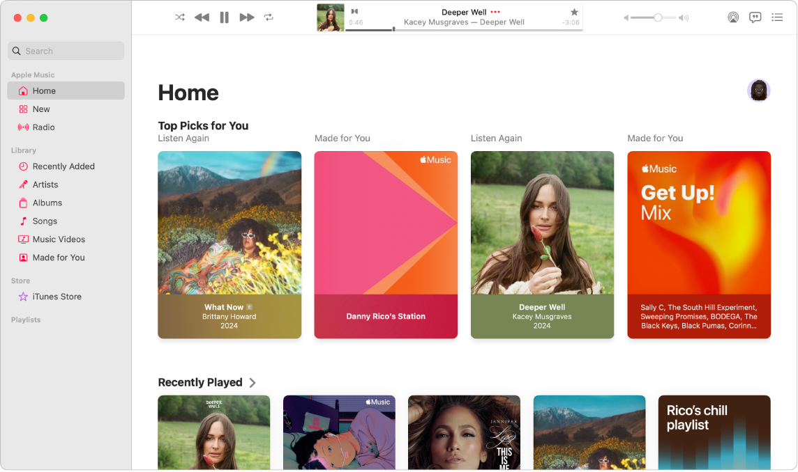
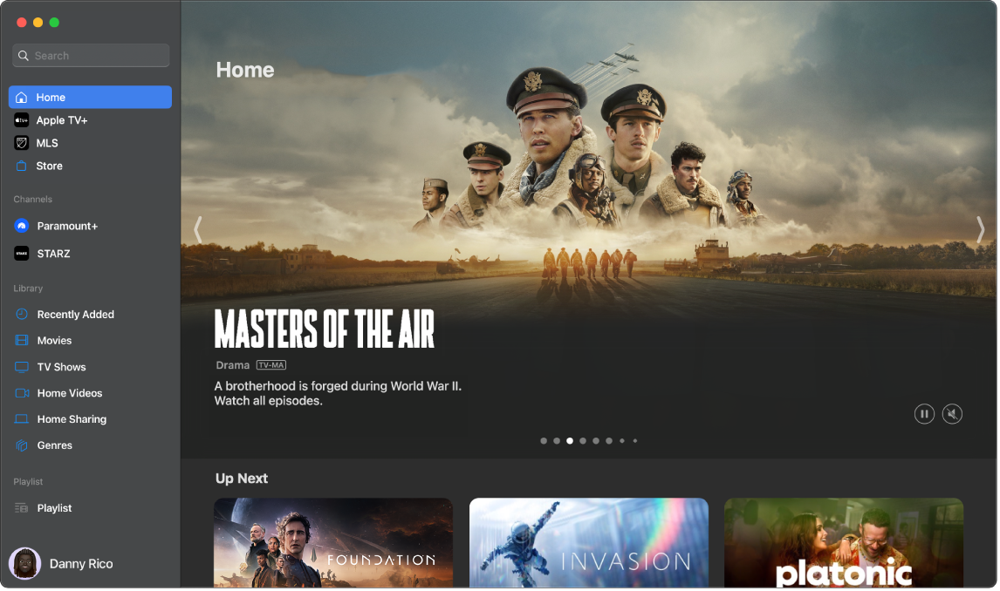
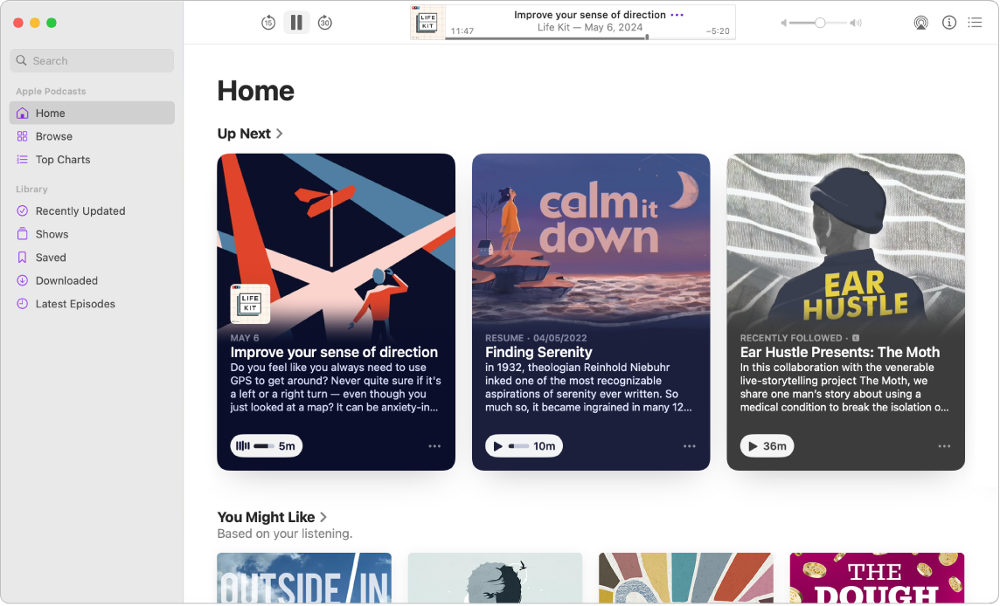
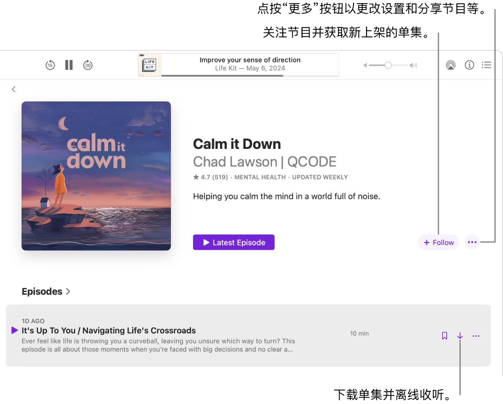

> 来源：https://support.apple.com/zh-cn/guide/imac/apdd481dd775/2024/mac/15
> 章节：观看和聆听

# 在“音乐”、“播客”和“视频”中观看和聆听

iMac 提供了各种内建 App，可让你尽享数小时的娱乐体验并与登录相同 Apple 账户的其他 Apple 设备进行同步。

|  *图：GlobalArt/ICt_MusicIcon* 音乐 聆听个人资料库中喜爱的曲目，或者订阅 Apple Music 以欣赏无广告的 1 亿多首歌曲和 30,000 多个播放列表。 [开始使用“音乐”](https://support.apple.com/zh-cn/guide/imac/apdd481dd775/2024/mac/15#apd3858ed38f) |  *图：GlobalArt/ICt_TVIcon* 视频 在 Apple 视频 App 中观看所有电影和电视节目。购买或租借电影和电视节目，或者订阅更多的频道或服务。 [开始使用“视频”](https://support.apple.com/zh-cn/guide/imac/apdd481dd775/2024/mac/15#apd2122f1625) |  *图：GlobalArt/ICt_PodcastsIcon* 播客 通过“播客”收听喜爱的节目，从知名主播到独立发布者，发现接下来可能喜欢的内容或者进行订阅。 [开始使用“播客”](https://support.apple.com/zh-cn/guide/imac/apdd481dd775/2024/mac/15#apd8ef705e6c) |
| --- | --- | --- |

音乐

“音乐” App 可让你轻松整理并欣赏 iTunes Store 购买项目、歌曲和专辑。除了个人资料库，你还可以订阅以访问 Apple Music 曲库，从而按需聆听数千万首歌曲并沉浸式体验无损音频和空间音频。

如果还未开始使用，请[登录你的 Apple 账户](https://support.apple.com/zh-cn/guide/imac/aside/apd74518e330/2024/mac/15)以开始。

*图：“音乐”窗口显示“主页”屏幕。左侧边栏显示“主页”、“新发现”和“广播”。右侧的“主页”屏幕显示“专属精选推荐”和“最近播放”。*

**订阅 Apple Music。**前往“音乐” App，选取“账户”>“加入 Apple Music”，然后按照屏幕指示操作。

*【注】*如果未看到“加入 Apple Music”，则说明你可能已经通过 Apple One 或“家人共享方案”订阅。

**搜索歌曲、专辑、播放列表等。**在搜索栏中，键入要查找的内容，例如艺人、歌曲或专辑。结果会按“艺人”、“专辑”、“歌曲”和“音乐视频”等类型分组。如果只想搜索资料库，请点按右上方“你的资料库”。

**购买歌曲或专辑。**如果想要拥有属于自己的音乐，请搜索想要购买的歌曲或专辑。点按右上方的 iTunes Store，然后点按在专辑下方或歌曲旁边列出的价格。或者点按歌曲或专辑上的

*图：“更多选项”按钮*

，然后选取“在 iTunes Store 中显示”。

**将项目添加到播放列表。**若要将歌曲添加到播放列表，请按住 Control 键点按一个项目，选取“添加到播放列表”，然后选取一个播放列表；或者选取“新建播放列表”以基于所选内容创建新的播放列表。

**Siri：**你可以这样说：“播放陈嘉桦最爱的电影歌曲播放列表”。

**进一步了解。**请参阅[《音乐使用手册》](https://support.apple.com/zh-cn/guide/music)。

视频

在“视频” App 中观看所有电影和电视节目。购买或租借电影和电视节目，订阅频道以及在任何设备上从你暂停的位置继续观看。

如果还未开始使用，请[登录你的 Apple 账户](https://support.apple.com/zh-cn/guide/imac/aside/apd74518e330/2024/mac/15)以开始。

*图：“视频” App 窗口显示包含不同类别的边栏以及“主页”屏幕。*

**订阅 Apple TV+。**Apple TV+ 是一项订阅式流播放服务，每个月都会新增各种内容，包括获奖电影和电视剧、引人入胜的戏剧、开创性纪录片、儿童娱乐、喜剧等在内的 Apple Originals。若要订阅，请点按 Apple 视频 App 中的 Apple TV+ 标签页，然后点按“订阅”。你可能符合免费试用条件，在这种情况下，请点按“访问免费试用”。

*【注】*Apple TV+ 的可用性可能因国家或地区而异。了解[你所在国家或地区功能的提供情况](https://support.apple.com/118205)。

**搜索节目或电影。**在“视频” App 左上角的搜索栏中，键入节目、电影的名称或演员的姓名，然后按下 Return 键。搜索结果会按“最佳结果”、“电影”和“电视节目”分组。不确定要查找的内容？浏览“主页”、Apple TV+ 或“商店”标签页来发现新节目和电影。

**购买或租借。**找到想要观看的电影或电视节目时，你可以选择在“商店”中进行购买或租借。若要观看购买或租借的内容，请前往“资料库”。你订阅的频道可在所有设备上观看，且可供多达六位家庭成员通过“家人共享”使用。

**接着观看。**如果在其他设备上观看 Apple TV，你可以从停下处接着继续观看。点按“主页”，然后从“待播清单”栏中选取想要继续观看的内容。

**进一步了解。**请参阅[《Apple 视频使用手册》](https://support.apple.com/zh-cn/guide/tvapp-mac)。

播客

在 Mac 上使用 Apple 播客浏览、关注和收听喜爱的播客。个性化推荐可帮助你发现按你感兴趣的主题分组的新播客。

如果还未开始使用，请[登录你的 Apple 账户](https://support.apple.com/zh-cn/guide/imac/aside/apd74518e330/2024/mac/15)以开始。

*图：“播客”窗口显示“主页”屏幕。左侧边栏显示“主页”、“浏览”和“排行榜”。右侧的“主页”屏幕显示“待播清单”和“你可能还喜欢”中的播客，后者包含基于你收听历史的精选建议内容列表。*

**搜索播客。**在搜索栏中键入播客名称，接着按下 Return 键以快速找到喜爱的内容。你还可以按主持人姓名、嘉宾或主题进行搜索，从而获取被提及或讨论的节目列表。

**播放播客。**若要开始播放播客，请将指针移到要播放的节目或单集上，然后点按

*图：“播放”按钮*

。

**Siri：**像这样说：“继续播放上一集播客”。

*图：“播客”窗口显示播客单集。标注框指向“下载”、“关注”和“更多”按钮。*

**关注喜爱的节目。**点按“关注”以将节目添加到个人收藏，以保证不会错过新单集。在“资料库”的“最近更新”标签页中查看新内容。

**将单集存储到资料库。**若要将单个单集存储到资料库，请点按

*图：“存储单集”按钮*

。若要下载播客供离线收听，请点按

*图：“下载”按钮*

。将播客下载到设备后，你可以在离线时访问该设备上的这些播客。

**进一步了解。**请参阅[《播客使用手册》](https://support.apple.com/zh-cn/guide/podcasts)。
