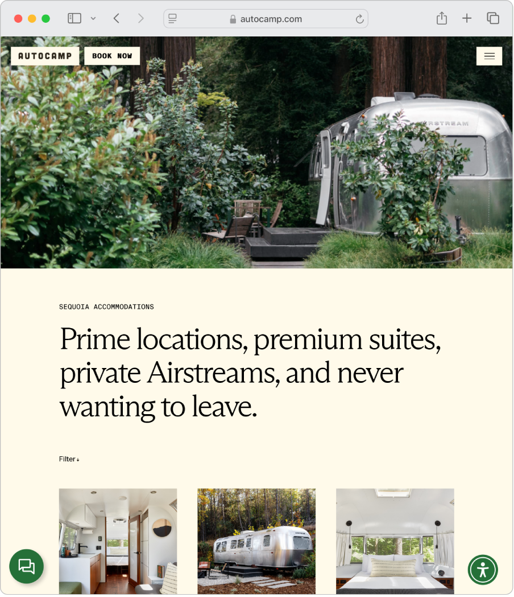
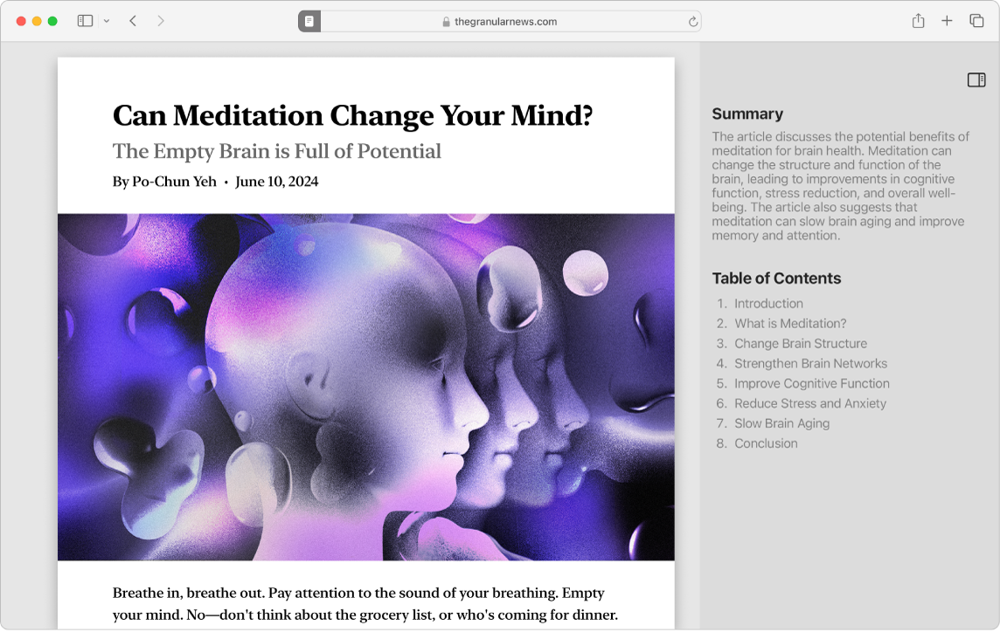

> 来源：https://support.apple.com/zh-cn/guide/imac/apd8c78b9596/2024/mac/15
> 章节：搜索网页

# 通过 Safari 浏览器搜索网页

以快如闪电的速度、优化的电池续航能力和内建的强大隐私保护功能畅游互联网。Safari 浏览器可在使用相同 Apple 账户的所有 Apple 设备间无缝工作以及同步你的密码、书签、历史记录、标签页等，因此无论在何处浏览，都能获得相同的 Safari 浏览器使用体验。

*图：Safari 浏览器窗口显示网站。*

**更改主页。**通过选取主页来自定义浏览器。选取“Safari 浏览器”>“设置”，然后点按“通用”。在“主页”栏中，输入网页地址。若就要使用当前查看的网页，请点按“设定为当前页面”。

**开始搜索。**开始键入字词或网址，Safari 浏览器会向你显示匹配的网站以及建议的网站。或者从 Safari 浏览器起始页中选择个人收藏或经常访问的项目。

**简化网页阅读体验。**使用重新设计且更为智能的阅读器来查看网页（例如食谱、新闻报道或博客帖子）；阅读器会调整网页格式以便你轻松阅读，免受广告、导览或其他干扰项影响。点按智能搜索栏中的

*图：“页面菜单”按钮*

，然后点按“显示阅读器”。在阅读器模式下，点按

*图：“阅读器”按钮*

 以更改字体和颜色。

*图：Safari 浏览器 App 窗口显示更新后的 Safari 阅读器。文章右侧是阅读器生成的文章目录和摘要。*

**添加和查看书签。**在书签中存储经常访问的网站（喜爱的商店、在线新闻站点、博客等）以便快速访问。若要为正在查看的页面添加书签，请点按工具栏中的

*图：“共享”按钮*

，然后选取“添加书签”。若要查看书签，请点按

*图：“边栏”图标*

，然后选择

*图：“书签”按钮*

。

**使用标签页整理。**避免使用多个窗口而导致桌面杂乱。你可以改为在单个 Safari 浏览器窗口中使用标签页查看多个网页。若要打开新标签页，请点按 Safari 浏览器工具栏中的

*图：“新建标签页”按钮*

，或者按下 Command-T。

**使用 Apple Pay 购物。**通过 Safari 浏览器在线购物时，你可以在 Mac 网站上使用 Apple Pay 便捷、安全、私密地购物。如果在网站上选取了 Apple Pay，请将手指轻轻放在妙控键盘（配备触控 ID）的触控 ID 感应器上。你也可以使用 iPhone 或 Apple Watch 确认付款。

使用 Apple Pay，你的 Apple Card 和其他信用卡或借记卡信息永不会被 Apple 储存或与商家共享。如需进一步了解，请参阅 Apple 支持文章：[设置 Apple Pay](https://support.apple.com/108398)、[使用 Apple Pay 购物](https://support.apple.com/102626)以及[更改或移除与 Apple Pay 搭配使用的付款卡](https://support.apple.com/118219)。

*【注】*Apple Pay 和 Apple Card 并非在所有国家或地区都可用。有关 Apple Pay 的信息，请访问 [Apple Pay](https://www.apple.com/cn/apple-pay/)。有关当前发卡机构的信息，请参阅 Apple 支持文章：[参加 Apple Pay 计划的银行](https://support.apple.com/HT204916)。有关 Apple Card 的信息，请参阅 [Apple Card 支持](https://support.apple.com/apple-card)。

**使用无痕浏览。**通过选取“文件”>“新建无痕浏览窗口”来创建无痕浏览窗口。使用无痕浏览时，Safari 浏览器不会记住你的历史记录，并且会帮助阻止网站跟踪你，完全阻止在页面上载入已知跟踪器，以及浏览时从 URL 中移除用于识别你身份的跟踪。

若要更好地了解站点如何处理你的隐私，请点按活跃标签页左侧的

*图：“隐私报告”按钮*

 以查看 Safari 浏览器在每个网站上阻止的跨站跟踪器。点按

*图：“完整报告”按钮*

 以查看隐私报告，了解有关网站的活跃跟踪器的更多详细信息。

**进一步了解。**请参阅[《Safari 浏览器使用手册》](https://support.apple.com/zh-cn/guide/safari)。

在美国，Apple Pay 是由 Apple Inc. 子公司 Apple Payments Services LLC 提供的服务。在其他国家和地区，Apple Pay 是由 [Apple Pay 隐私通知](https://www.apple.com/legal/privacy/data/zh-cn/apple-pay)指定的 Apple 特定附属机构提供的服务。Apple Inc.、Apple Payments Services LLC 以及任何 Apple 附属机构均非银行。Apple Pay 中使用的任何卡片均由发卡机构提供。
