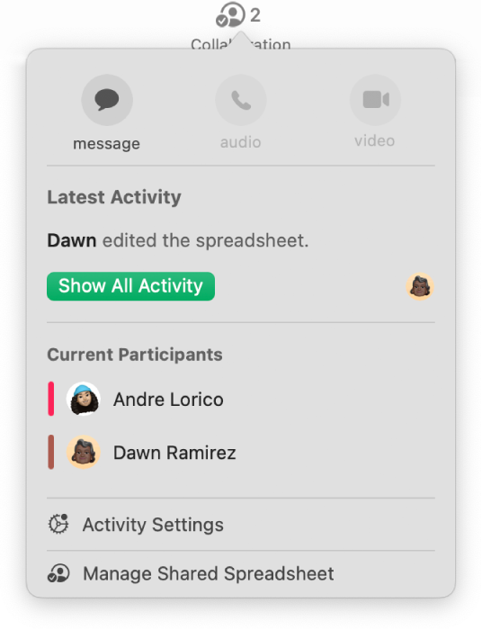

> 来源：https://support.apple.com/zh-cn/guide/imac/apd8b783ddd6/2024/mac/15
> 章节：通过 iWork 设计

# 在 Mac 上通过 iWork 设计

使用 iWork（Pages 文稿、Numbers 表格和 Keynote 讲演），你可以在 iMac 上创建出色的文稿、电子表格和演示文稿。模板和设计工具可让你轻松上手。而且通过实时协作，团队成员可协同工作，不论其使用的是 Mac、iPad、iPhone 还是 PC。

|  *图：GlobalArt/ICt_PagesIcon* Pages 文稿 使用 Pages 文稿创建想要的任何种类文稿，从以文本为主的简单文字处理文稿到包含图形和趣味字体处理方式等内容的页面布局文稿。 |  *图：GlobalArt/ICt_NumbersIcon* Numbers 表格 使用 250 多个强大的函数和功能创建电子表格，帮助你以视觉化方式呈现并分析数据。模板为你创建预算、发票、球队花名册等提供了良好开端。 |  *图：GlobalArt/ICt_KeynoteIcon* Keynote 讲演 使用 Keynote 讲演设计并创建精美且富有吸引力的演示文稿。从 30 多种预设计主题中选取一种主题，然后通过添加文本、3D 对象和更改颜色方案将其变为你自己的主题。 |
| --- | --- | --- |

**在 Pages 文稿、Numbers 表格和 Keynote 讲演中创建文稿。**若要开始创建，请打开 Pages 文稿、Numbers 表格或 Keynote 讲演，选择“新建文稿”，然后选取模板或主题，或者点按“空白”。点按“创建”以打开文稿并开始更改。

*图：Keynote 讲演窗口显示“模板”浏览器。*

**所有格式化工具位于一处。**点按 Pages 文稿、Numbers 表格或 Keynote 讲演工具栏中的

*图：“格式”按钮*

 以打开“格式”检查器。选择文稿中的部分内容，该部分内容的格式化选项会出现。

*图：Pages 文稿窗口显示基于模板创建的文稿。工具栏中有用于添加图表和影片等内容的标注框，以及用于打开或关闭“格式”边栏的标注框。*

**通过 iCloud 协作处理文稿。**通过 iWork 实时协同工作。通过“活动流”，边栏中的详细信息列表可让你查看协作者的编辑和批注。在 Pages 文稿、Numbers 表格或 Keynote 讲演文件中，点按

*图：“共享”按钮*

，选取“协作”，然后选取想要的文件共享方式。你还可以选择“发送副本”。

**【提示】**打开修改跟踪来查看你和其他人对文稿所做的更改。每个人的编辑和批注使用不同颜色标注，以便查看是谁进行的每项更改。选取“编辑”>“跟踪修改”以显示修改跟踪工具栏。

*图：裁剪的 Numbers 表格窗口，显示工具栏中“协作”按钮下方的“活动流”，其中两人处于活跃状态。*

**进一步了解。**请参阅[《Pages 文稿使用手册》](https://support.apple.com/zh-cn/guide/pages)、[《Numbers 表格使用手册》](https://support.apple.com/zh-cn/guide/numbers)和[《Keynote 讲演使用手册》](https://support.apple.com/zh-cn/guide/keynote)。
