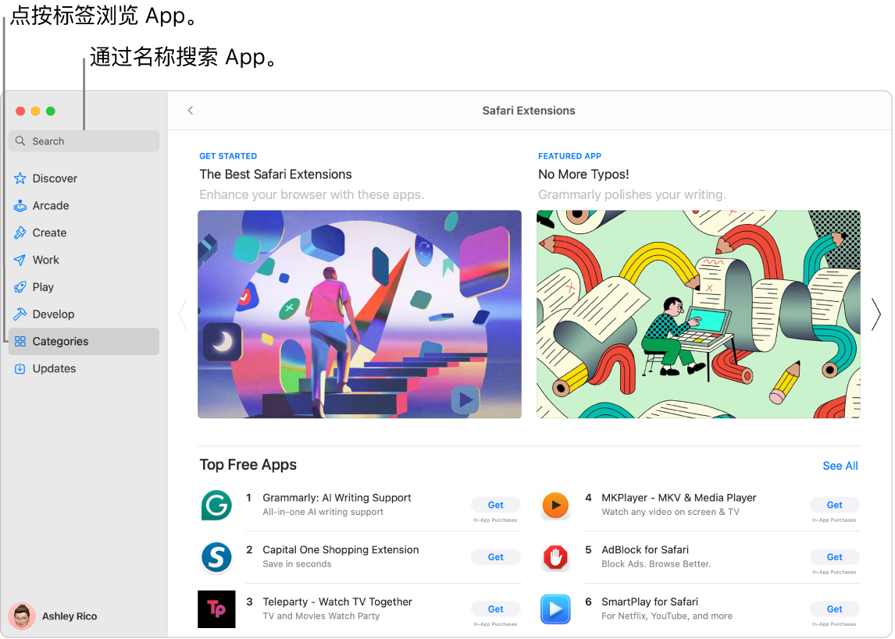
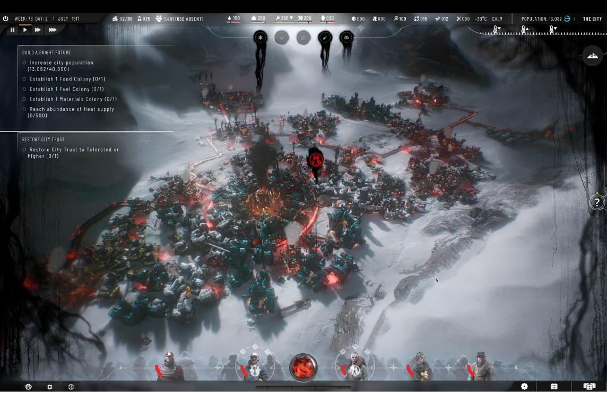

> 来源：https://support.apple.com/zh-cn/guide/imac/apd787343df7/2024/mac/15
> 章节：获取更多 App

# 获取更多 App

App Store 是 iMac 上的一站式商店，可查找、购买和下载新的 App 和游戏。你还可以获取最近更新，查看和管理订阅等。你所需要的只是一个 Apple 账户。

*图：显示搜索栏和一页 Safari 浏览器扩展的 App Store 窗口。*

**登录 Apple 账户。**若要下载免费 App，请登录 Apple 账户。在 Mac 上前往 App Store App

*图：GlobalArt/IL_AppStoreAppIcon*

，然后点按边栏底部的“登录”。

*【注】*若要购买 App，你还必须设置包含购买信息的账户。

如果没有 Apple 账户，请点按“登录”，然后点按“创建 Apple 账户”。如果有 Apple 账户但忘了密码，请点按“忘记 Apple 账户？”进行恢复。

**获取更多 App。**从 App Store 下载的 App 自动出现在[启动台](https://support.apple.com/zh-cn/guide/imac/aside/apd2d2a58738/2024/mac/15)中。在 Mac 上的 App Store App

*图：GlobalArt/IL_AppStoreAppIcon*

 中，执行以下任一项操作：

- *确切知道要查找的 App？*在窗口左上方的搜索栏中，键入 App 名称（例如 Microsoft Office、Excel 和 Powerpoint），然后按下 Return 键。
- *想要探索可用 App？*点按边栏中的一个标签页（例如“创作”、“工作”或“游戏”）并浏览结果。

  **Siri：**像这样说：“查找儿童App”
- *已经购买了 App？*点按左下方你的姓名以查看账户信息，其中包括之前已购买 App 的列表。App 和订阅可在“账户设置”的“购买历史记录”部分中进行管理。

**更新 App 和游戏。**如果在程序坞中的 App Store 图标上看到红色标记，则说明有可用的更新。在 App Store App

*图：GlobalArt/IL_AppStoreAppIcon*

 中，点按边栏中的“更新”标签页以查看可用更新，然后点按“更新”按钮。

*图：窗口显示正在 Mac 上玩游戏。*

**订阅 Apple Arcade。**点按 Arcade 以订阅 Apple Arcade。订阅 Apple Arcade 后，你可以访问 200+ 款趣味游戏，且更多游戏时刻增加。若要进一步了解 Apple Arcade 订阅服务，请参阅 Apple 支持文章：[使用 Apple Arcade 玩游戏](https://support.apple.com/102106)。

**获取游戏。**在 App Store 中，点按边栏中的“游戏”标签页以搜索和发现可供下载和畅玩的游戏。若要搜索游戏，请在搜索栏中键入名称，然后按下 Return 键。若要购买或下载游戏，请点按游戏旁边的“获取”或价格。

**进一步了解。**请参阅[《App Store 使用手册》](https://support.apple.com/zh-cn/guide/app-store)。
