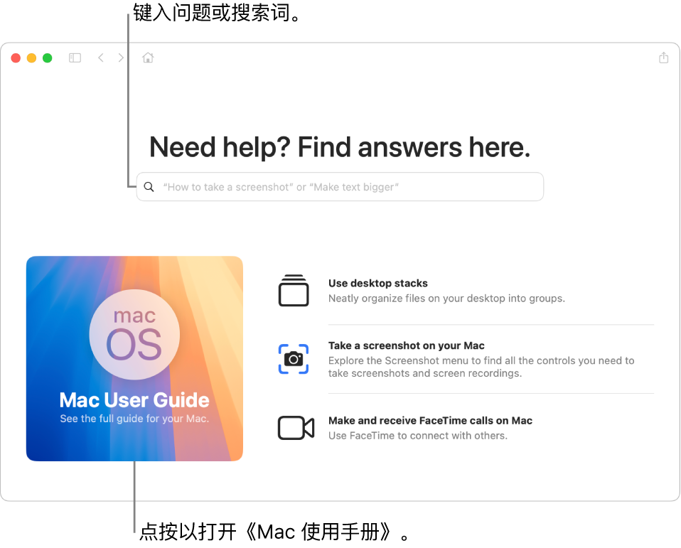
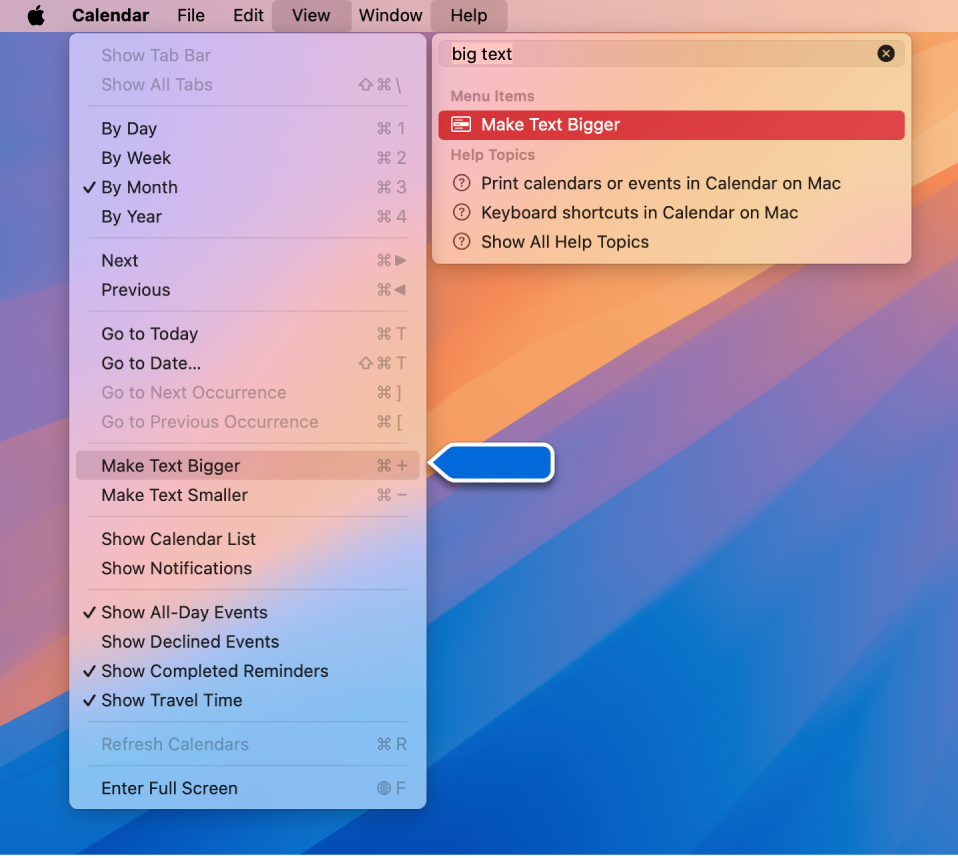

> 来源：https://support.apple.com/zh-cn/guide/imac/apdfdad69354/2024/mac/15
> 章节：Mac 使用手册

# 使用《Mac 使用手册》

《Mac 使用手册》涵盖了如何使用 iMac 的大量信息。

**获得帮助。**前往“提示” App 或点按程序坞中的

*图：“访达”图标*

，然后点按菜单栏中的“帮助”菜单并选取“Mac 使用手册”。在搜索栏中键入问题或搜索词，然后从结果列表中选取一个主题。

*图：“提示” App 启动页显示《Mac 使用手册》、搜索栏和建议的主题。*

**探索主题。**若要查找《Mac 使用手册》中的主题，你可以浏览或搜索。若要浏览，请点按“目录”以查看主题列表，然后点按一个主题来阅读。或者在搜索栏中键入你要查找的内容以直接前往你要的答案。

**【提示】**如果忘记了某个 App 中菜单项的位置，请在“帮助”中进行搜索。请将鼠标指针放在结果上方，然后箭头会显示命令。

*图：“帮助”菜单显示正在搜索“列表”，同时“项目符号列表”命令在结果列表和“格式”菜单中高亮标记。*

**进一步了解。**请参阅[《Mac 使用手册》](https://support.apple.com/zh-cn/guide/mac-help)。
