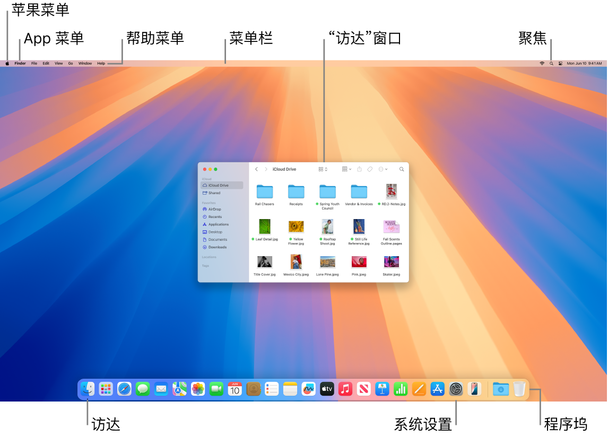

> 来源：https://support.apple.com/zh-cn/guide/imac/apd1f14ec646/2024/mac/15
> 章节：Mac 新手？

# Mac 新手？

如果这是你的第一台 Mac 电脑，尤其是如果你之前使用的是 Windows 环境，此处的一些实用信息可让你快速了解。

**熟悉桌面。**桌面是你执行各种操作的地方，你可以在此处快速打开 App、搜索和整理文件。

*图：显示苹果菜单、App 菜单、“帮助”菜单、菜单栏、“访达”窗口、“聚焦”图标、“访达”图标、“系统设置”图标以及程序坞的 Mac 屏幕。*

你可以在桌面上找到以下内容：

- *菜单栏：*桌面或处于活跃状态的已打开 App 的菜单栏始终位于屏幕顶部。使用菜单在 App 中查找选项和执行任务。有关菜单栏中项目（如苹果菜单和“帮助”菜单）的信息，请参阅 [Mac 上的桌面和菜单栏](https://support.apple.com/zh-cn/guide/imac/apd65991c417/2024/mac/15)。
- *程序坞：*程序坞类似于 Windows 中的任务栏和“开始”菜单，位于桌面底部（你可以在[系统设置](https://support.apple.com/zh-cn/guide/imac/aside/apd796e4d5da/2024/mac/15)中更改其位置）。程序坞可让你轻松查看所有已打开的 App 以及快速启动喜爱的 App。若要打开 App，请在程序坞中点按其图标。你还可以使用[启动台](https://support.apple.com/zh-cn/guide/imac/aside/apd2d2a58738/2024/mac/15)打开 App。请参阅 [Mac 上的程序坞](https://support.apple.com/zh-cn/guide/imac/apd4b7fb731f/2024/mac/15)。
- *访达：*点按程序坞中的

  

  *图：“访达”图标*

   以打开“访达”，你可以在此处整理和查找文件（类似于 Windows 中的“文件资源管理器”）。使用“访达”窗口顶部的按钮以更改查看文件的方式：图标

  

  *图：“图标视图”图标*

  、列表

  

  *图：“列表视图”图标*

  、分栏

  

  *图：“分栏视图”图标*

   或画廊

  

  *图：“画廊视图”图标*

  。在任何视图中，你都可以选择文件并按下空格键以通过“快速查看”来预览，无需打开文件。请参阅 [Mac 上的访达](https://support.apple.com/zh-cn/guide/imac/apddf030866a/2024/mac/15)。
- *“聚焦”菜单：*“聚焦”可让你搜索 Mac 上的任何内容，包括文稿、联系人、电子邮件信息等。你还可以启动 App 以及搜索网页。若要打开“聚焦”，请点按屏幕右上方的

  

  *图：“聚焦”图标*

   或按下 Command-空格键。请参阅 [Mac 上的“聚焦”](https://support.apple.com/zh-cn/guide/imac/apd10f8d1038/2024/mac/15)。
- *系统设置：*“系统设置”

  

  *图：“系统设置”图标*

   类似于 Windows 中的“控制面板”。使用桌面、程序坞、显示器、蓝牙、网络等的设置自定义 Mac。请参阅 [Mac 上的“系统设置”](https://support.apple.com/zh-cn/guide/imac/apda966cb8af/2024/mac/15)。

**了解键盘和触控板。**Mac 上的 Command 键

*图：Command 键图标*

 类似于 Windows 上的 Control 键。例如，使用 Command-C 和 Command-V 拷贝并粘贴内容。Mac 上的 Return 键相当于 Windows 上的 Enter 键，Delete 键相当于退格键。如果要向前删除，请按下 Fn-Delete。

有关 Mac 键盘快捷键列表以及 Mac 和 Windows 键盘之间的差异，请参阅 Apple 支持文章：[适用于从 Windows 转而使用 Mac 的用户的 Mac 提示](https://support.apple.com/102323)。另请参阅 [Mac 键盘上的 Windows 按键](https://support.apple.com/zh-cn/guide/mac-help/cpmh0152)。有关本手册中的更多快捷键，请参阅 [Mac 上的键盘快捷键](https://support.apple.com/zh-cn/guide/imac/apd194062a6d/2024/mac/15)。

**安装 App。**你可以从 App Store 或互联网下载 App。从互联网下载 App 时，你将获得一个磁盘映像文件（以 .dmg 结尾）或软件包文件 (.pkg)。若要安装 App，请在“下载”文件夹中找到 .dmg 或 .pkg 文件，连按该文件，然后按照屏幕指示操作。App 安装后，系统会提示你删除磁盘映像或软件包文件。

若要卸载 App，请在“访达”的“应用程序”文件夹中找到该 App，然后将 App 拖到“废纸篓”中。部分 App 有卸载器，可用于删除 App 以及与其关联的其他文件。请参阅[安装和卸载 App](https://support.apple.com/zh-cn/guide/mac-help/mh35835)。

**最大化、最小化和关闭窗口。**你可以为一个 App 同时打开多个窗口。使用窗口左上角的按钮来调整窗口大小和关闭窗口。

- 点按

  

  *图：“关闭窗口”按钮*

   或按下 Command-W 以关闭窗口而非 App。按下 Option-Command-W 以关闭 App 所有打开的窗口。按下 Command-Q 以退出 App。
- 点按

  

  *图：“最小化窗口”按钮*

   以最小化窗口（或按下 Command-M）。最小化窗口会使 App 保持打开状态，但将窗口缩小为显示在程序坞右侧的图标。点按图标可将窗口恢复到先前的大小。
- 点按

  

  *图：“全屏幕窗口”按钮*

   以全屏打开 App。若要最大化窗口，请按住 Option 键点按该按钮。或将指针放在按钮上以查看更多选项，如平铺窗口。按下 Esc 键以使窗口恢复到先前的大小。

**移动窗口。**通过拖移窗口的标题栏将其放置在想要的位置。某些窗口无法移动。请参阅[在 Mac 上管理窗口](https://support.apple.com/zh-cn/guide/mac-help/mchlp2469)。

**在 App 窗口之间切换。**按下 Command-Tab 以快速切换到上一个 App。打开了多个 App 窗口时，按住 Command 键，然后按下 Tab 键以查看所有已打开 App 的图标。按住 Command 键的同时按下 Tab 键（或箭头键）以在 App 之间移动并选择想要使其变为活跃状态的 App。松开 Command 键以在活跃 App 中工作。

**截屏。**按下 Command-Shift-5 以访问“截屏”实用工具。请参阅[在 Mac 上截屏](https://support.apple.com/zh-cn/guide/imac/apdbc4019fdf/2024/mac/15)。

**让 Siri 为你执行任务。**若要在 iMac 上激活 Siri，请点按菜单栏中的

*图：Siri 图标*

 或

*图：“Apple 智能 Siri”图标*

。如果选项已打开，你可以说“嘿 Siri”或“Siri”并继续说出你的请求。你也可以按住妙控键盘上的听写/Siri 键 (F5)，或者使用 Siri 设置中选择的键盘快捷键。让 Siri 打开文件夹、启动 App、调亮屏幕和执行其他任务。请参阅 [Mac 上的 Siri](https://support.apple.com/zh-cn/guide/imac/apdf7bb2fad4/2024/mac/15)。

**配合 iPhone、iPad 和 Apple Watch 使用 Mac。**如果使用相同 [Apple 账户](https://support.apple.com/zh-cn/guide/imac/aside/apd74003fe84/2024/mac/15)登录 Apple 设备，你可以轻松在设备间共享文件和照片、编辑文稿、回复电子邮件、接电话以及发送文本信息。请参阅[搭配 iMac 使用 iCloud](https://support.apple.com/zh-cn/guide/imac/apdc44eb8957/2024/mac/15)。

**进一步了解。**请参阅 [Mac 上常用的术语](https://support.apple.com/zh-cn/guide/mac-help/cpmh0038)和 Apple 支持文章：[Mac 键盘快捷键](https://support.apple.com/102650)。
