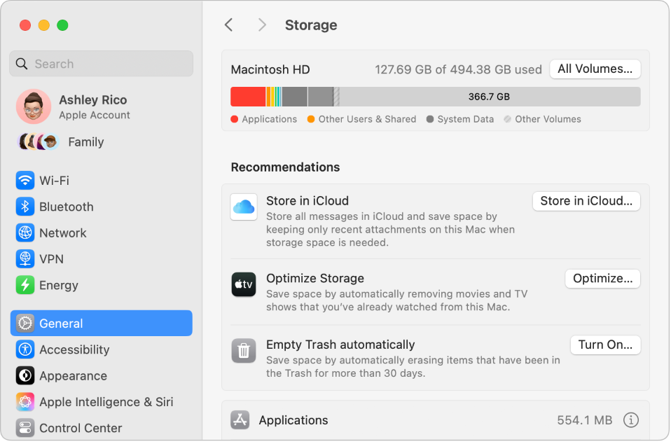

> 来源：https://support.apple.com/zh-cn/guide/imac/apdb468896e0/2024/mac/15
> 章节：节省空间

# 节省 iMac 的空间

通过“优化储存空间”，你可以按需使文件可用以自动释放 iMac 的空间。你最早的文件会储存在 iCloud 和电子邮件 IMAP 或 Exchange 服务器中，以便你随时可以进行下载。还有用于标识和删除大文件的工具。

**优化储存空间。**若要查看储存空间建议，请选取苹果菜单

*图：GlobalArt/IL_AppleLogo*

 >“系统设置”，然后点按边栏中的“通用”。点按“储存空间”以查看基于 Mac 配置方式的不同建议。

*图：储存空间的“推荐”设置，显示“储存在 iCloud 中”、“优化储存空间”和“自动清倒废纸篓”选项。*

将选项设定为：

- *储存在 iCloud 中：*将所有文件、照片和信息储存在 iCloud 中，以节省 Mac 的空间。

  - *桌面和文稿：*将“桌面”和“文稿”文件夹中的所有文件储存在 iCloud 云盘中。储存空间不足时，iCloud 云盘会在 Mac 上保留最近打开的文件，并按需使最早的文件可用。
  - *信息：*将所有信息和附件储存在 iCloud 中。储存空间不足时，iCloud 将最近的附件保留在 Mac 上并按需使最早的文件可用。

  即使文件储存在云端，你也可以正好从 iMac 上停留的位置继续访问文件。请参阅[在 Mac 上访问 iCloud 内容](https://support.apple.com/zh-cn/guide/imac/apd785390d2e/2024/mac/15)。
- *优化储存空间：*通过优化 Apple 视频 App 中的电影和电视节目的储存来节省 Mac 空间。你可以选取从 iMac 自动移除看过的影片或电视节目。你可以随时再次下载这些内容。
- *自动清倒废纸篓：*自动抹掉已在废纸篓中超过 30 天的项目。

为了节省工作时的空间，macOS 还提供以下功能：

- 防止从 Safari 浏览器下载同一个文件两次。
- 新 App 安装完成时提醒你移除软件安装器。
- 储存空间不足时清除可安全移除的日志和缓存。

**进一步了解。**请参阅[优化 Mac 储存空间](https://support.apple.com/zh-cn/guide/mac-help/sysp4ee93ca4)。
