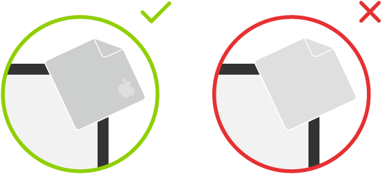

> 来源：https://support.apple.com/zh-cn/guide/imac/apd876e1a2ea/2024/mac/15
> 章节：重要操作信息

# Mac 的重要操作信息

**操作环境。**在以下范围之外操作 iMac 可能会影响其性能：

- *操作温度：*10°至 35°C（50°至 95°F）
- *存放温度：*-40° 至 47° C（-40° 至 116° F）

如果所在区域包含大量浮尘，或者香烟、雪茄、烟灰缸、火炉或壁炉散发烟尘，或者靠近使用未过滤自来水的超声波加湿器，切勿操作 iMac。吸烟、烹饪、燃烧或者使用未过滤水的超声波加湿器时所产生的尘埃微粒，在极少数情况下可能会进入 iMac 的通风口，而且在某些情况下可能会产生轻霾并附着在 iMac 显示器的玻璃内表面。

**搬运 iMac。**在抬起或重新放置 iMac 之前，请将其关机并拔掉连接的所有线缆和电线。抬起 iMac 时，请抓住它的两侧。

**【注意事项】**手和手指远离活动部件，以免夹伤。

**使用插头和端口。**切勿将插头强行插入端口中。将电源线插入电源端口前，请确保电源端口中没有任何碎屑。将设备连接到端口时，请确保端口中没有任何碎屑、插头与端口匹配，并且插头和端口的方向正确对应。

**【重要事项】**请仅使用电脑或配件随附的原装线缆，或者 Apple 零售店或 [apple.com/cn](https://www.apple.com) 在线销售的线缆。

**存放 iMac。**如果打算长期存放 iMac，请将其置于阴凉的环境中（理想温度为 22°C 或 71°F）。

**清洁 iMac。**清洁 iMac 外部及其部件时，请先将 iMac 关机，再拔下所有电线和线缆。然后使用干净、柔软、不起绒的擦拭布来擦拭 iMac 的外壳。避免任何一个开口处受潮。切勿将液体直接喷洒到电脑上。切勿使用可能会损伤机箱表面的酒精、喷雾剂、溶剂、研磨剂或含有过氧化氢的清洁剂。

**清洁显示器。**若要清洁 Nano-texture 纳米纹理玻璃显示器，请先将 iMac 关机，再拔下所有电线和线缆。只能使用 iMac 随附的抛光布来清洁显示器。

*图：两张图像，显示清洁 Nano-texture 纳米纹理玻璃显示器时使用的正确和不正确的布料。*

*【注】*若要偶尔清洁难去除的物质，你可以使用蘸有 70% 异丙醇 (IPA) 溶液的抛光布。请参阅 Apple 支持文章：[如何清洁 Apple 显示屏上的 Nano-texture 纳米纹理玻璃面板](https://support.apple.com/104948)。

如果 iMac 显示器使用标准玻璃，请使用随附的抛光布或干净的超细纤维布并蘸水进行清洁。切勿将液体直接喷洒到屏幕上。

*图：两张图像，显示用于清洁标准玻璃显示器的两种布料。*

**清洁妙控键盘或妙控鼠标。**关闭设备，然后拔下线缆（如有需要）。若要清洁鼠标或键盘的外表面，请使用稍微用水蘸湿且干净柔软不起绒的擦拭布。切勿弄湿任何开口处，切勿使用气雾喷剂、溶剂或研磨剂。
