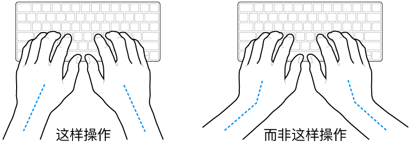
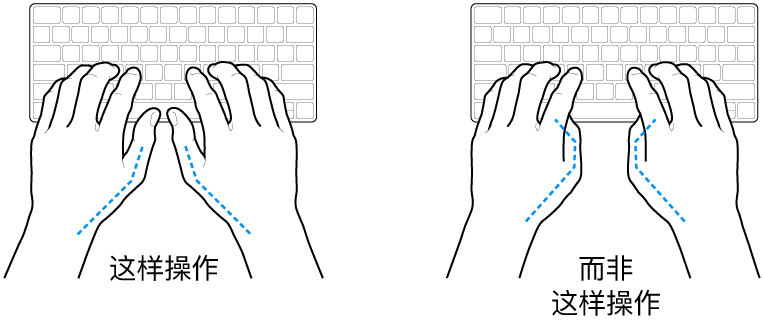

> 来源：https://support.apple.com/zh-cn/guide/imac/apd8a47fddd1/2024/mac/15
> 章节：人体工程学

# Mac 人体工程学

使用键盘和鼠标时，双肩要放松。上臂和前臂应形成一个稍大于直角的角度，手腕和手掌大致成一条直线。

*图：手掌放在键盘上方，显示手腕和手掌的正确对齐位置和错误对齐位置。*

*图：手掌放在键盘上方，显示拇指的正确放置和错误放置。*

在击键或使用触控板时手指要轻触，双手和手指应保持放松。不要把拇指卷曲在手掌下。

经常改变一下手的姿势以避免疲劳。在不间断的频繁操作之后，有些电脑用户会感到手、手腕或手臂不适。如果手、手腕或手臂出现慢性疼痛或不适，请向合格的健康专家咨询。

**鼠标或选购的触控板。**将鼠标或触控板与键盘放置在高度相同且操作舒适的位置。

**座椅。**最好使用可调节高度的座椅，且带有坚固而舒适的靠背。调整座椅的高度，使大腿放平，双脚平放在地板上。座椅靠背应支撑背的下部（腰部）。请参照制造商的说明，根据自身体形调节椅背。

**显示器。**调整显示器的位置，以便你坐在键盘前面时，屏幕的顶部稍低于你的水平视线。屏幕与眼睛之间的最佳距离由你决定，不过大多数人比较喜欢 45 至 70 厘米（18 至 28 英寸）的距离。

将显示器放置在较少眩光以及头顶灯光及户外光反射较少的位置。支架可让你调整显示器的最佳观看角度，帮助减少或消除不能移动光源发出的眩光。

有关人体工程学的更多信息，请参阅 Apple 支持文章：[人体工程学](https://support.apple.com/101928)。
