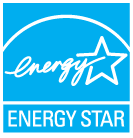

> 来源：https://support.apple.com/zh-cn/guide/imac/apd061664745/2024/mac/15
> 章节：ENERGY STAR® 合规声明

# ENERGY STAR® 合规声明

*图：ENERGY STAR 标志。*

作为 ENERGY STAR 合作伙伴，Apple 已确认此产品的标准配置符合 ENERGY STAR 指南的能源效率规范。ENERGY STAR 计划是与电子设备制造商的合作项目，用以推动节能产品发展。降低产品能耗不仅省钱，还有助于节省宝贵资源。

iMac 出厂时已启用电源管理功能，即在用户闲置 10 分钟后将进入睡眠状态。若要唤醒电脑，请点按鼠标或触控板，或者按下键盘上的任意键。若要更改此设置，请打开[系统设置](https://support.apple.com/zh-cn/guide/imac/aside/apd796e4d5da/2024/mac/15)，然后点按“锁定屏幕”。

连接显示器的 Mac 主机在关闭或进入睡眠状态即可令显示器进入关闭/睡眠模式。显示器关闭/睡眠模式是以空白屏幕为特征的低功耗状态。

iMac 符合 ENERGY STAR 的节能规定。有关 ENERGY STAR 的更多信息，请访问 [Energy Star 网站](https://www.energystar.gov)。
