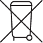

> 来源：https://support.apple.com/zh-cn/guide/imac/apd91eb694f4/2024/mac/15
> 章节：处理和回收信息

# 处理和回收信息

*图：请勿丢弃于垃圾箱图标。*

以上符号表明根据当地的法律和法规，你的产品和/或其电池必须和家庭垃圾分开处理。当此产品的使用寿命到了尽头时，请将它送至当地管理部门指定的收集点。处理你的产品和/或其电池时，分开收集和回收将有助于节约自然资源，并确保以保护人类健康和环境的方式进行回收。

有关 Apple 的回收计划、回收收集点、受限物质和其他环保措施的信息，请访问 [apple.com/cn/environment](https://www.apple.com/cn/environment)。

Información sobre eliminación de residuos y reciclaje

El símbolo de arriba indica que este producto y/o su batería no deben desecharse con los residuos domésticos.Cuando quieras desechar este producto y/o su batería, hazlo de conformidad con las leyes y directrices medioambientales locales.Para obtener más información sobre el programa de reciclaje de Apple, los puntos de recolección para reciclaje, las sustancias restringidas y otras iniciativas medioambientales, visita [apple.com/mx/environment](https://www.apple.com/mx/environment/) o [apple.com/la/environment](https://www.apple.com/la/environment).

Brasil – Informações sobre descarte e reciclagem

O símbolo acima indica que este produto e/ou sua bateria não devem ser descartados no lixo doméstico.Quando decidir descartar este produto e/ou sua bateria, faça-o de acordo com as leis e diretrizes ambientais locais.Para informações sobre substâncias de uso restrito, o programa de reciclagem da Apple, pontos de coleta e telefone de informações, visite [apple.com/br/environment](https://www.apple.com/br/environment).

Apple 回收计划

如需了解旧设备免费回收、预付费发运标签和相关说明，请参阅 [Apple Trade In 换购计划网站](https://www.apple.com/cn/shop/trade-in)。

*【注】*Apple 回收计划并非在所有国家和地区都可用。

土耳其环境信息

Türkiye Cumhuriyeti: AEEE Yönetmeliğine Uygundur.
